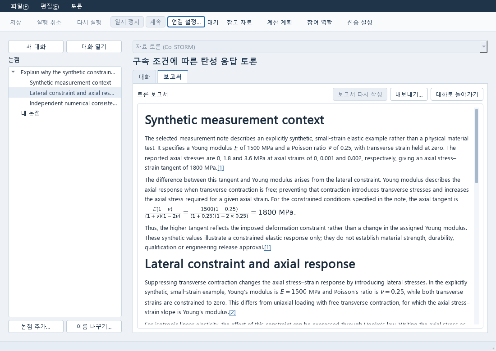

# Autonomous CAE Lab

Windows에서 CAD 모델을 편집하고 해석을 실행하고 결과를 분석하는 로컬 공학 연구 도구입니다.
FreeCAD 기반 전처리, ParaView 기반 후처리와 독립 Qt 연구 앱을 연결합니다.
작업에 필요한 도구를 따로 실행할 수 있습니다.

**현재는 개발 버전입니다.** 기본 데스크톱 실행과 일부 계산·자료 작업을 사용할 수 있습니다.
전체 모델링→해석→최적화→전문가 토론이 한 번에 끝나는 완성품은 아직 아닙니다.

[설치 안내](docs/INSTALL_KO.md) · [처음 해볼 작업](docs/USER_GUIDE_KO.md) ·
[개발 현황과 다음 인도본](CURRENT_STATE.md) · [English technical reference](docs/REFERENCE_EN.md)

## 설치하고 열기

1. [소스 ZIP](https://github.com/pikachu444/autonomous-cae-lab/archive/refs/heads/main.zip)을 내려받아 압축을 풉니다.
2. 폴더 안의 **Start-CAE-Lab.cmd**를 더블클릭합니다.
3. 처음에는 전용 실행 환경을 설치한 뒤 **Runner** 창을 엽니다. 아직 계산한 작업이 없으면 목록은 비어 있습니다.

Windows 10/11 x64를 사용합니다. 처음 설치할 때는 인터넷이 필요합니다.
기본 Research 앱에는 관리자 권한, 시스템 Python, Git, WSL이 필요하지 않습니다.
기본 설치는 전용 Python과 Research Qt 앱입니다.
FreeCAD·ParaView·Gmsh·외부 솔버와 AI 연결은 별도로 준비합니다.

Runner의 **도구** 메뉴에서 데이터·재료·수치 연구·전문가 토론 등 원하는 프로그램을
열 수 있습니다. 각 프로그램은 별도 창에서 사용합니다. 다음부터 원하는 도구로 바로
시작하려면 소스 폴더의 PowerShell에서 실행하세요.

```powershell
.\Start-CAE-Lab.cmd -Tool numerical
.\Start-CAE-Lab.cmd -Tool expert
.\Start-CAE-Lab.cmd -Tool data
```

설치 후에도 소스 폴더는 남겨 두세요. 저장 위치와 오류 해결은 [설치 안내](docs/INSTALL_KO.md)에 있습니다.

## 무엇부터 해볼 수 있나요?

| 해볼 작업 | 필요한 준비 | 얻는 결과 |
|---|---|---|
| CAD 예제의 치수 변경 | FreeCAD와 저장소의 `examples/contact/two-feet.FCStd` | 편집한 형상을 저장하고 다시 열기 |
| 연구 자료와 질문 정리 | 기본 설치 후 Expert 열기 | 파일을 첨부한 논의를 저장하고 이어 쓰기 |
| 합성 데이터 수치 계산 | 기본 설치 후 포함된 Python 예제 실행 | 피팅 곡선, DOE·최적화·불확실성 결과 파일 |
| 기존 해석 결과 보기 | ParaView와 사용자가 가진 결과 파일 | native 후처리에서 결과 확인 |
| 시험 CSV로 재료 계수 피팅 | 기본 설치와 공개 CSV 예제 | 관측·예측·잔차 비교 후 계수를 선택해 저장 |

**[처음 해볼 작업](docs/USER_GUIDE_KO.md)**에서 실행 명령과 화면에서 누를 항목, 결과 파일을 안내합니다.
CAD 예제는 형상만 포함합니다. 재료·하중·접촉·메시는 사용자가 설정해야 합니다.
수치 계산 예제의 데이터는 합성이며, 실제 재료나 설계의 안전성을 보증하지 않습니다.

[재료 피팅 예제](docs/DATA_MATERIAL_WORKFLOW.md)는 CSV 열과 단위 선택부터 계수 채택까지
안내합니다. 접촉 해석 결과가 있다면 [힘 이력 확인과 계산 계획 연결](docs/USER_GUIDE_KO.md#접촉-결과의-힘-이력을-비교하고-계산-계획에-쓰기)을
따라 ParaView의 결과를 Numerical에서 이어 사용할 수 있습니다.

[수치 연구 안내](docs/NUMERICAL_WORKFLOWS.md)는 DOE, 영향도, 불확실성,
대리모델과 다목적 계산의 입력·결과 연결을 설명합니다. 저장한 모델의 예측과
새로운 실제 계산을 구분해서 따라 할 수 있는 공개 FELUPE 예제도 포함합니다.
방법별 추가 개발 항목은 해당 안내의 지원 범위를 확인하세요.

Study에서는 저장한 계산이나 대화를 읽으면서 연구 판단을 작성합니다.
아래는 1100×780 크기의 실제 Qt 창입니다. 그래프는 보관된 합성 예제 계산이며,
아래 판단 문장은 화면 사용법을 보여 주기 위해 작성한 미저장 예시입니다.


Expert에서는 토론 내용을 인용 자료와 함께 보고서로 읽고 내보낼 수 있습니다.
아래 실제 Qt 화면은 합성 탄성 예제를 놓고 진행한 토론의 저장 보고서입니다.
보고서를 읽다가 대화로 돌아가도 작성 중인 질문은 그대로 남습니다.



## 개발 중인 부분

| 영역 | 현재 제공되는 부분 | 남은 일 |
|---|---|---|
| CAD/해석/후처리 | native 편집·접촉 설정, 지원 계산, 결과 읽기와 일부 설계 후보 연결 | 실제 화면의 전체 작업과 형상 변경 후 복구를 끝까지 확인 |
| Data·Material·PDE·Numerical | 기존 문서·수치 엔진과 Qt 편집 화면 | 도구별 편집·계산·저장·재개의 완결성 보완 |
| Expert·Study | 기존 로그인과 실제 AI·계산 결과 전달, Co-STORM 토론·참여·인용 보고서 저장, 수식 표시와 Study 자료·판단 읽기 | 전체 사용 흐름과 사용성 확인 |
| 설치와 MCP | 기본 Research 시작 파일, 선택적 MCP 서버 | 전체 native 환경 배포와 클라이언트별 사용 확인 |

개발 진행 상황과 인도 일정은 [CURRENT_STATE](CURRENT_STATE.md)에서 관리합니다.
프로그램 실행, 사용자의 업무 완료, 결과의 공학적 검증은 각각 확인합니다.

## 비용과 자료

기본 자료 처리와 수치 계산에는 AI 계정이 필요하지 않습니다. 프로젝트 개발은 추가 지출 없이
진행하며 AI 연결에 새 유료 API나 체험판을 요구하지 않습니다.
공개 예제만 저장소에 포함합니다. 회사 CAD·시험 자료와 인증정보는 올리지 마세요.
[선택 도구와 라이선스](docs/design/20261012-desktop-planning/TOOLS_AND_LICENSES.md)를 확인할 수 있습니다.

개발자는 [제품 계획](docs/PRODUCT_PLAN.md), [상세 기능 명세](docs/design/20261012-desktop-planning/pro-authored/FUNCTION_SPEC.md),
[구현 작업표](docs/design/20261012-desktop-planning/pro-ux/implementation_map.csv),
[개발 협업 규칙](docs/CODEX_WORKFLOW.md)에서 이어갈 작업을 찾을 수 있습니다.
