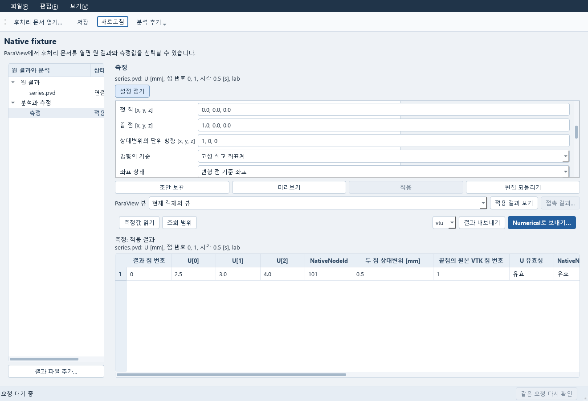
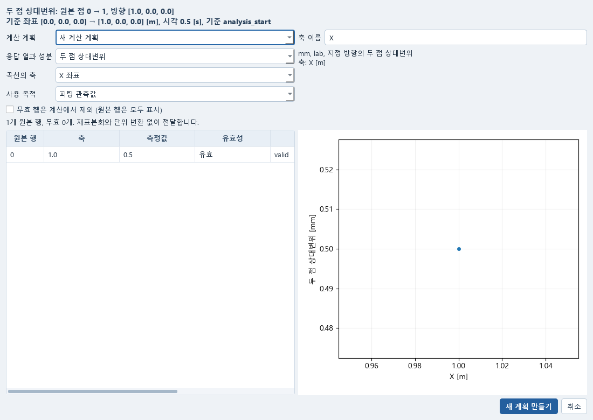
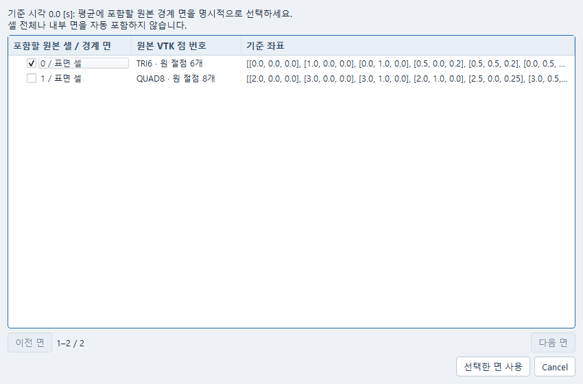
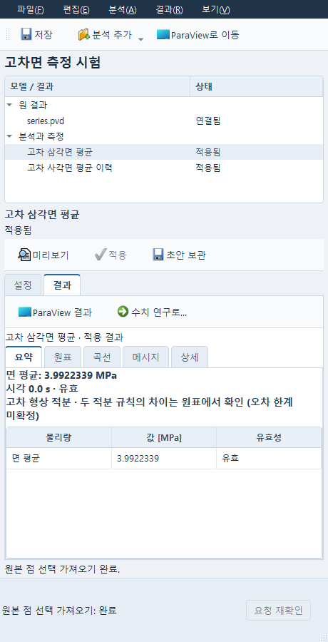
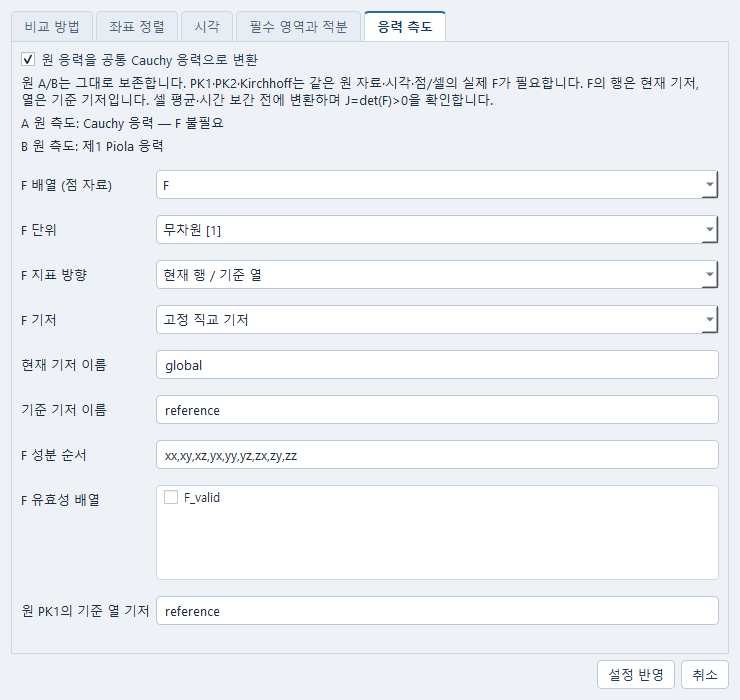
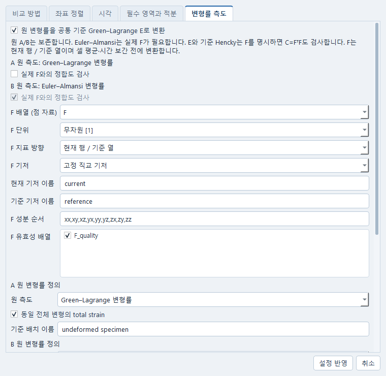

# Measured Post curve → Numerical Plan

This feature uses native ParaView measurements, the existing Data importer and the generic Numerical owner. It does not require Material, a provider or a new solver.

## 분석 설정창 다시 열기

같은 ParaView 문서에서 **CAE Analysis controls**를 다시 선택하면 이미 열린 분석
설정창으로 이동합니다. 미보관 편집, 선택한 측정과 진행 중인 요청은 그대로 유지됩니다.
창을 닫을 때 편집 폐기를 취소하면 다음에도 그 창으로 이동합니다.
**파일 → 열린 후처리로 전환…**에서 다른 문서를 고를 때도 이미 열린 설정창이 있으면
그 창으로 이동합니다. 현재 창의 미보관 편집은 먼저 보관하거나 되돌려야 합니다.

ParaView 문서의 세션이 달라졌거나 기존 설정창의 응답을 확인할 수 없으면 새 창을
만들지 않습니다. 기존 창과 연결 상태를 확인한 뒤 다시 선택하세요. 분석 설정창을
닫아도 ParaView 문서는 닫히지 않으며, 설정창을 다시 여는 동작은 측정 적용·저장·계산을
실행하지 않습니다.

## Use the desktop path

1. Open a saved Post project in native ParaView and open **CAE Analysis controls**. Select a point, path, time or two-point relative-displacement measurement. **Apply** its recipe and **Save analysis**.
2. Choose **Use in Numerical…**. The dialog shows the actual native table. Select its block, measured column/component/statistic and time/path/spatial axis. For example, ParaView may expose a scalar column literally named avg(U (2)); choosing that column retains that native statistic and component. It is not renamed to a guessed vector magnitude.
3. Review the measured curve and physical component/location. Known saved units, frame, measure and clock declarations are read-only. Only missing declarations need entry. Click a row or plotted point to inspect the matching sample.
4. If native-invalid rows exist, they remain visible. **Exclude invalid rows from calculation** is an explicit choice; their original values and native quality reasons remain retained separately from that calculation exclusion. Cancel creates no Data/Plan or job and does not edit the saved measurement.
5. Choose **New Numerical Plan** or a compatible **existing generic fit Plan** in the same dialog. **Create new Plan** imports through the existing Data owner and opens a saved fit Plan. **Review append in Plan** imports the observation without creating another Plan, then presents the measured table/curve in the selected Plan's existing editor. If that editor is closed, its exact saved document opens. **Cancel** leaves its current edits unchanged; **Append observation** adds one trial to the latest local draft while preserving variables, other trials and unapplied edits. **Check Plan review** reports Presented, Attached or Cancelled; delivery alone does not mean attachment. The **Observed curve** tab shows the exact retained table/curve. Fit/holdout role, weight and residual scale remain editable. Assign the new trial's model protocol and predicted response before Run.
6. **Use model…**, **Add variables…** and **Add response…** select the existing declared evaluator, model variables and actual retained model response. For fit, Use model binds the selected trial's protocol, leaving other protocols untouched. Edit additional protocol fields in **Model / advanced**. Apply/Save and Run remain separate actions. Missing or incompatible bindings block Run; no future solver response is inferred from a Post display array.
7. **Open in Post** shows the original saved measurement in its matching live native owner. If that owner is confirmed closed, the existing native launcher opens the pinned saved project and restores the measurement. A disconnected but still-running/uncertain process is reported for reconnection; it does not cause a duplicate launch or replace current native edits.

Only explicit **New Numerical Plan** creates a Numerical document. Existing-target review uses the same transient local Qt receiver as Numerical → Expert/Study return. It checks the exact target/session and retained Data reference before review and again before append. Busy/conflicted or malformed editors must be repaired first. A repeated delivery acknowledges its existing receipt; an already attached reference/role does not add a duplicate trial. Apply/Save remain the existing Numerical owner commands. Cancelling an existing-target review may leave the imported Data observation available, but does not edit the Plan.

The main sample table displays short row numbers and real native columns. Exact block/object identity is available in row tooltips. Selecting a value column is explicit; no first vector component or aggregate is silently chosen.

Save/reopen retains the ordinary Data input and result. Losing the original Post project does not erase the retained curve: the Observed curve tab reports that the native source is unavailable. Repair/reopen the original saved Post source explicitly; no later field/result silently replaces it.

## 두 점 상대변위를 같은 측정으로 재사용하기

1. 외부 VTU/PVD를 열고 왼쪽 **모델 / 결과** 트리에서 원 결과를 선택합니다. **분석 → 두 점 상대변위…** 또는 원 결과의 오른쪽 클릭 메뉴를 사용합니다. 선택한 분석의 **설정 → 대상**에서 원 자료와 세 성분의 변위 필드를 고릅니다. CAD·솔버·AI 연결은 필요 없습니다.
2. **ParaView로 이동** 또는 **F4**로 실제 ParaView 창에 원 결과를 표시합니다. 이 명령은 점 선택 도구를 켜지 않습니다. ParaView의 점 선택 도구나 SpreadSheet의 Point Data에서 원본 점 두 개를 선택하고 이 창으로 돌아와 **선택으로 새 측정 추가**를 누릅니다. Windows가 창 전환을 거절하면 작업 표시줄에서 ParaView를 엽니다. 원본 VTK 점 번호·실제 기준좌표·있으면 원 절점 ID가 함께 들어옵니다. 클릭 순서를 추정하지 않고 VTK 점 번호 오름차순으로 시작합니다. **A/B 순서 교환**은 번호·좌표·원 ID를 함께 바꾸며 방향은 유지합니다. 가져오기는 기존 측정을 덮어쓰지 않고 새 측정 초안을 만듭니다.
3. 설정의 A·B 점과 **B − A** 순서를 확인하고 **정의** 페이지에서 **단위 방향 n**을 직접 입력합니다. 예를 들어 X 방향은 `1, 0, 0`이며 자동 정규화하지 않습니다. **정의**에서 **고정 직교 좌표계**와 **변형 전 기준 좌표**를 확인하고 **단위**에서 **변위**, 알려진 응답·좌표 길이 단위를 지정합니다. 변위와 좌표는 같은 고정 좌표계여야 합니다. 아직 정하지 않은 항목은 **미결정** 목록과 해당 페이지의 **미정** 표시에 남습니다. 자동으로 방향이나 단위를 채우지 않습니다. Warp 배율이나 변형된 표시 좌표를 기준점으로 쓰지 않습니다.
4. PVD에서는 존재하는 한 시각과 시간 단위·기준을 지정합니다. 정적 VTU에 물리 시계를 만들지 않습니다. **미리보기(F6)**는 현재 초안을 보관하고 검증한 뒤 미리보기 값을 읽습니다. **결과 → 요약**의 값·단위·유효성을 확인하고 **적용(F7 또는 Ctrl+Enter)**합니다. 단일값은 작은 표로 보며, 이력은 **곡선** 탭에서 확인합니다. 적용 뒤에는 적용 결과를 다시 읽습니다. **저장(Ctrl+S)**은 별도입니다. 계산은 `δ = (u₂ − u₁) · n`이며 부호를 유지합니다. 강체 병진이면 0입니다. 큰 회전에서는 실제 점간 거리 변화와 다를 수 있으며, 신장·변형률로 바꾸거나 게이지 길이로 나누지 않습니다.
5. **결과 → 수치 연구로…**에서 scalar 응답 **두 점 상대변위**, 축, 피팅/검증 목적과 새/기존 계산 계획을 검토합니다. 상단의 두 원본 점·기준좌표·방향·시각·시간 기준이 맞는지 확인합니다. 축을 좌표로 선택하면 선택한 측정 결과 끝점의 좌표이며 시간 이력이 아닙니다. 전달 창은 저장된 상대변위의 단위·좌표계·측도·방향·위치를 바꿔 붙이지 않습니다. 취소는 계획을 바꾸지 않습니다.
6. 전달한 관측값과 원 측정 정의는 기존 Data/계산 계획에 저장됩니다. 같은 계획을 다시 열어 값과 정의를 확인하거나 원 Post 측정으로 돌아갈 수 있습니다. 새로운 설계에서 좌표·원 ID가 달라지면 참조를 명시적으로 다시 선택해 수리해야 합니다. 원본 번호만 같다고 같은 물리 위치로 해석하지 않습니다. 예측 응답·모델 연결이 없는 계획은 편집 가능한 초안으로 남으며, 가져오기만으로 새 계산이 실행되지 않습니다.

그림의 **두 점 상대변위 시험**은 공개 시험자료의 문서명입니다. 기존 사용자 문서의 제목은 바꾸지 않습니다. 분석 설정창은 [COMSOL Desktop의 작업 구조](https://www.comsol.com/support/learning-center/course/how-to-navigate-the-comsol-multiphysics-user-interface-12/introduction-to-the-comsol-desktop-34131)를 따라 **위쪽 분석 트리 / 아래쪽 선택 설정**으로 나뉩니다. 약 440px의 비모달 창이며 트리 높이는 구분선을 끌어 조절합니다. **대상·정의·단위·시각** 페이지에서 필요한 항목을 고르고, **결과**에서는 요약·원표·곡선·메시지를 전환합니다. 자주 쓰는 저장·분석 추가·ParaView 이동은 위 도구 모음에, 미리보기·적용은 선택한 분석 가까이에 있습니다. 3D 모델·필터·시간·점 선택은 별도 **실제 ParaView 창**에서 조작합니다. 제어창에 모형 이미지를 3D 편집기처럼 표시하지 않습니다. **파일 → 열린 후처리로 전환…(Ctrl+O)**는 이미 열린 ParaView 문서를 고르는 명령입니다. 디스크 파일을 새로 여는 동작은 ParaView에서 합니다. 점 선택 방법은 [ParaView 6.2 선택 문서](https://docs.paraview.org/en/v6.2.0/UsersGuide/selectingData.html)를 따릅니다.

트리는 선택한 원 결과나 분석의 오른쪽 클릭 메뉴를 제공합니다. 분석은 **설정 편집(Alt+Enter)**으로 열고, **결과** 메뉴에서 원표 읽기(F8), 내보내기(VTU/CSV/PNG), Numerical 전달을 실행합니다. 초안 보관·되돌리기·적용 취소는 **편집** 메뉴에 있습니다. 새 편집이나 실패한 조회가 있으면 마지막 성공 값은 이전 조회로 표시됩니다. 취소하거나 다른 대상을 눌러도 보관하지 않은 편집을 새 대상으로 덮지 않습니다.

**분석 → 측정 추가**에서 **면 평균**, **면 평균 시간 이력**, **두 점 상대변위 시간 이력**도 고를 수 있습니다. 면 평균은 원 자료·필드·성분과 실제 시각(정적이면 비움)을 지정하고 **원본 경계 면 선택…**에서 포함할 원본 셀/면과 좌표를 명시적으로 확인합니다. 목록은 200개씩 읽으며 페이지를 옮겨도 선택한 면을 유지합니다. 셀 전체나 내부 면은 자동 포함하지 않습니다. 면적 기준·단위·좌표계가 미결정이면 설정 요약에서 확인해 지정합니다. 기준 시각의 고정 면적만 사용합니다. **시각** 페이지에서 이력 두 종류의 실제 시각 범위와 기준 시각을 지정합니다. 원 자료에 존재하는 시각만 사용할 수 있습니다. 두 점 이력은 기준 시각 값을 자동 차감하지 않고 각 시각의 `(u₂−u₁)·n`을 보존합니다. 미리보기·적용·표/곡선 읽기·저장·관측 전달은 같은 명령 경로입니다. 정적 면 평균은 한 행과 무차원 결과 행 번호를 보존하며 가짜 시간 이력을 만들지 않습니다.

**두 점 상대변위**는 선택한 한 native frame의 측정이며, **두 점 상대변위 시간 이력**은 따로 명시하는 측정입니다. 거리 변화·변형률, 임의 이동/회전 기저나 새 메시의 자동 절점 대응은 지원하지 않습니다. 알려진 무효 mask·숨김 점·유한하지 않은 값·깨진 원 ID는 유효한 0으로 대체하지 않습니다. 기존 점·경로·원본점 시간 이력은 그대로 사용합니다. 새 면 평균·이력의 실제 실행 근거는 별도 측정 인도 기록으로 구분하며, 아래의 기존 단일 시각 시험 기록을 새 기능의 실행 근거로 재사용하지 않습니다.

2026-10-16 Sol 구현/Root 공통 통합: 기존 단일 시각 두 점 측정은 실제 설치 ParaView에서 정적 VTU와 PVD의 0.5초 원본 점 선택·상대변위 0.5 mm·저장·새 프로세스 재열기를 확인했습니다. 이 기존 기록의 Data/계획 전달은 native 명령 **운송만 명시적 시험 대역**이었습니다.

새 세 측정은 실제 Client·HTTP·native broker·ParaView GUI를 통해 미리보기→적용→저장→Data/계획 전달을 확인했습니다. 면적 1:3인 공개 제조 입력에서 면 평균 8 MPa, 면 평균 이력 [8, 10, 12] MPa, 두 점 이력 [0.5, 1.5, 3.5] mm와 실제 시각 [0, 0.07, 0.2] s를 대조했습니다. 같은 저장본을 새 ParaView/Qt 세션에서 열어 설정·표·곡선·원 값과 기존 Data/계획을 확인했고 계산을 다시 적용하거나 반입하지 않았습니다. 시험 프로그램은 모두 정리했습니다. 이 실행은 프로그램으로 Qt 명령을 호출한 소프트웨어 확인이며 OS 마우스 점 선택·새 모델 계산·공학 승인은 별도입니다. 새 솔버·provider는 호출하지 않았습니다.

## 고차 기준면의 면 평균과 적분

**면 평균** 또는 **면 평균 시간 이력**에서 원 자료·필드·자료 위치를 고른 뒤 **원본 경계 면 선택…**을 누릅니다. TRI6는 원 절점 6개, QUAD8은 원 절점 8개를 사용합니다. 좌표와 원 번호는 각 행의 상세에서 확인합니다. 체적 셀의 공유 내부면은 제외하며, 중간절점 연결이 다른 공유면은 오류로 표시합니다. 선택창의 취소는 기존 정의를 바꾸지 않고, **선택한 면 사용**은 현재 초안만 바꿉니다. 단위·좌표계·실제 시각을 지정한 뒤 **미리보기 → 적용 → 저장**을 실행합니다.

TRI6는 7점, QUAD8은 5×5 Gauss 규칙으로 실제 3D 형상함수의 면적을 적분합니다. 원 점 자료는 같은 형상함수로 보간하고, 셀 자료는 원 owner 셀의 값을 그 면의 상수로 사용합니다. 원 producer가 복구한 점 자료라면 해당 복구 선언을 보존합니다. 고차 중간절점을 버린 평면 다각형이나 native 적분점 면적으로 바꾸지 않습니다.

결과 요약은 면 평균이며, **원표**에는 면적 `SurfaceArea`, 적분 `SurfaceIntegral`과 두 규칙의 차이 `SurfaceAreaDifference`, `SurfaceIntegralDifference`, `SurfaceAverageDifference`도 보존됩니다. 면적 단위는 좌표 단위², 적분 단위는 응답 단위×좌표 단위²입니다. 대조 규칙은 TRI6 12점·QUAD8 7×7입니다. 이 차이는 관측된 수치 차이이며 엄밀한 오차 상한이 아닙니다. 정해진 정확도 허용치가 없으므로 **오차 한계·수렴·공학 적합성은 미확정**으로 남습니다.

현재 지원은 단일 dataset의 **고정 기준 형상**입니다. 면별 평면 투영의 전 영역 정규성을 보수적인 Bernstein 계수 조건으로 확인한 graph patch를 적분합니다. 퇴화·중간절점 오류 또는 이 조건을 입증할 수 없는 큰 overhang은 계산을 보류합니다. 보류를 실제 접힘으로 단정하지 않으며, 면적 0이나 선형화 결과로 통과시키지 않습니다. 일반 overhang·다중 블록·현재 변형 면적은 이 기능의 지원 범위 밖입니다. 원 mask가 무효인 시각은 값과 면적을 결측으로 유지하고 그 면의 일부만 버려 평균을 다시 만들지 않습니다.

저장 후 새 후처리 owner로 열면 같은 원 면·정의·규칙·원표를 읽으며 다시 적용하지 않습니다. **수치 연구로…**는 기존 고정 snapshot을 사용해 면 평균을 Data/계획에 전달합니다. 면적·적분·규칙 차이는 측정 출처의 보조 정보이며 다른 물리 응답으로 자동 선택하지 않습니다.

저장된 **면 평균 시간 이력**과 **두 점 상대변위 시간 이력**은 **곡선 비교**에서도 선택할 수 있습니다. 원표의 실제 `Time`과 유효성 mask를 사용하며 무효 행을 연결하거나 보조 면적·적분 열을 응답으로 바꾸지 않습니다. 방향 투영과 두 점 상대변위의 관측량 의미는 자동 추정하지 않으므로 비교 설정의 **물리량·가로축 확인…**에서 확인합니다. 단일 시각 면 평균은 시간 곡선 목록에 넣지 않습니다.

위 그림의 **고차면 측정 시험**은 공개 합성 PVD 자료를 연 실제 QWindows 설정창입니다. 실제 ParaView reader·계산·저장·새 owner 재열기는 별도 확인했으며, 이 설정창의 명령 운송과 snapshot→Data/계획의 native 상태 조회는 명시적 시험 대역으로 확인했습니다. OS 마우스 선택이나 전체 broker 경로의 새 수용시험은 수행하지 않았습니다. 원 수치·실패 기록은 인도 자료에 보존합니다.

형상함수와 원 절점 순서는 [고정 VTK TRI6](https://raw.githubusercontent.com/Kitware/VTK/a970ec452229b1a0953684c00ecd9fe612778b8a/Common/DataModel/vtkQuadraticTriangle.cxx), [QUAD8](https://raw.githubusercontent.com/Kitware/VTK/a970ec452229b1a0953684c00ecd9fe612778b8a/Common/DataModel/vtkQuadraticQuad.cxx)를 따릅니다. 전 영역 정규성의 충분조건과 지원 한계는 [고차 요소의 기하 유효성 원문](https://gmsh.info/doc/preprints/gmsh_curved2_preprint.pdf)의 Bernstein 경계 원리와 별도로 기록한 구현 조건을 사용합니다.

## 서로 다른 응력 측도를 Cauchy로 비교하기

공개 합성 텐서 자료를 연 실제 설정창입니다. 아래 순서대로 원 결과의 실제 F 배열과
기저를 지정합니다. 화면의 배열·기저 이름은 예제 자료의 이름이며 사용자 자료에서 추정해 채우지 않습니다.

A/B 비교의 **변환 설정… → 응력 측도**에서 **원 응력을 공통 Cauchy 응력으로 변환**을 켭니다. 꺼진 기존 비교는 같은 측도끼리 비교하던 동작을 유지합니다. 이 기능은 원 결과를 다시 푸는 작업이 아닙니다.

1. 실제 A/B 결과와 응력 배열을 선택합니다. **물리량 확인…**에서 원 단위·측도·성분 순서·기저를 확인합니다. PK1은 비대칭 전체 9성분과 **현재 행 / 기준 열** 선언이 필요합니다. Cauchy·PK2·Kirchhoff는 전체 9성분 또는 명시한 대칭 6성분(실제 전단/Kelvin)을 지원합니다. 응력에 공학 전단 변형률 규약을 사용하지 않습니다.
2. 비 Cauchy 쪽마다 같은 원 결과의 실제 F 배열을 선택합니다. 응력과 같은 점/셀 위치·같은 저장 시각의 무차원 9성분이어야 합니다. F의 실제 성분 순서, **현재 행 / 기준 열**, 고정 직교 기저, 현재·기준 기저 이름과 원 유효성 배열을 확인합니다. PK1의 기준 열 기저도 별도로 확인합니다. 배열 이름이나 성분 수만 보고 이 정의를 자동으로 채우지 않습니다. 원자료에 이미 선언된 단위·기저·성분·품질/공간 마스크는 덮어쓸 수 없습니다.
3. **비교 방법**에서 공통 응력 단위를, 기존 **좌표 정렬/시각**에서 실제 대응을 지정합니다. F와 원 응력은 각 원 시각·원 점/셀에서 단위와 측도를 먼저 변환합니다. 그 뒤 기존 셀→점 평균, 시간 보간, 기저 회전과 공간 대응을 적용합니다. 따라서 평균한 P와 평균한 F로 응력을 만드는 계산과 다릅니다.
4. **미리보기**에서 **변환 A / 변환 B / 차이**와 별도의 **원 A / A 위치의 원 B / 원 성분**을 읽습니다. 변환값과 차이는 공통 Cauchy 단위이며 원 성분은 각 원 측도·단위를 유지합니다. 셀 원값 열은 선택한 셀→점 투영을 거친 대응값이고, 원 reader의 셀 배열 자체는 보존됩니다. 전체 차이의 크기도 공통 Cauchy 텐서에서 계산합니다.
5. 확인 후 **적용**, **저장**합니다. 저장 프로젝트를 다시 열면 원 reader·F 선택·성분 순서·두 기저·시각·변환 정의와 적용 결과를 함께 복원합니다. 다시 적용하거나 솔버를 실행할 필요가 없습니다.

| 원 응력 | 공통 Cauchy 계산 | 원 응력 기저 |
|---|---|---|
| Cauchy σ | σ | 현재 × 현재 |
| 제1 Piola P | P Fᵀ / J | 현재 × 기준 |
| 제2 Piola S | F S Fᵀ / J | 기준 × 기준 |
| Kirchhoff τ | τ / J | 현재 × 현재 |

여기서 Fᵢⱼ=∂xᵢ/∂Xⱼ, J=det(F)입니다. J는 실제 유한한 양수여야 하며 작은 값을 임의로 올리거나 F=I/J=1로 대체하지 않습니다. 명시 마스크가 무효인 표본은 NaN으로 남깁니다. 유효 표본의 F가 없거나 비유한/비양수 J이면 해당 비교만 실패하고 원 A/B와 이전 적용 결과는 유지됩니다. 올바른 F 배열·원 유효성/기저·시각을 고친 뒤 새 미리보기를 만드세요. 취소는 기존 정의를 바꾸지 않습니다.

공통 출력은 이번 범위에서 Cauchy만 지원합니다. F 없는 J 단독 입력, 다른 source의 F 매핑, scalar 응력의 텐서 확장, PK1 대칭화, PK1/PK2/Kirchhoff 목표 출력은 지원하지 않습니다. 시각·메시 대응은 기존 비교의 same-mesh/선형 사면체 및 시간 보간 조건을 그대로 따릅니다. 수치 비교 성공은 공학적 적합성 승인이 아닙니다.

식과 두 지표의 배치는 [COMSOL의 응력 정의](https://doc.comsol.com/6.3/doc/com.comsol.help.sme/sme_ug_theory.06.017.html)와 [응력 및 운동방정식](https://www.comsol.com/multiphysics/stress-and-equations-of-motion)에 따릅니다.

## 전체 변형률을 기준 Green–Lagrange로 비교

기존 물리량 비교의 **변환 설정 → 변형률 측도**에서 켭니다. 원 A/B를 덮어쓰지 않고, 같은 전체 변형과 기준 배치의 텐서를 공통 기준 Green–Lagrange E로 비교합니다.

| 원 선언 측도 | 공통 E | F와 기저 |
|---|---|---|
| Green–Lagrange | 원 E | 기준 기저. F 없이 가능 |
| Euler–Almansi | Fᵀ e F | 원 e는 현재 기저, 출력은 F의 기준 기저. 실제 F 필수 |
| 기준 기저 Hencky | (exp(2H)−I)/2 | H=ln U인 기준 기저. F 없이 가능 |

1. 실제 원 결과 A/B와 전체 변형률 배열을 고릅니다. **물리량 확인**에서 단위 `[1]` 또는 `[%]`, 전체 6/9성분 순서, 실제 텐서/공학 전단/Kelvin 규약과 기저 이름을 확인합니다. 공학 전단 저장 규약은 shear를 2로 나누는 규칙이며 소변형을 유한변형으로 바꾸는 규칙이 아닙니다.
2. **변환 설정 → 변형률 측도**에서 공통 E 변환을 켜고, 각 원 측도와 **동일 전체 변형의 total strain**, 같은 기준 배치 이름을 명시합니다. 알려진 원 자료의 탄성·소성·미확인 선언은 total로 덮어쓸 수 없습니다. E/LE/H 같은 배열 이름으로 측도를 추측하지 않습니다.
3. Euler–Almansi에는 같은 reader·실제 시각·점/셀 표본의 F를 선택합니다. F는 전체 실제 9성분, 무차원 `[1]`, 현재 행/기준 열의 고정 직교 기저와 실제 순서여야 합니다. E/H에서는 **실제 F와의 정합도 검사**를 명시적으로 추가할 수 있습니다. 선택한 F는 생략하지 않고 검사하며 원 품질·공간 마스크를 유지합니다.
4. F를 사용하는 경우, 원 producer가 보증하거나 사용자가 근거를 명시한 **기준 C의 정합 오차**와 출력 프로그램·배열/출력 형식·근거 참조를 기록합니다. 검사는 `||C_s−FᵀF||_F ≤ abs_C + rel_C max(||C_s||_F,||FᵀF||_F)`입니다. 값은 무차원 C의 Frobenius norm 기준이며 원 strain/F의 출력 자릿수를 그대로 복사한 공차가 아닙니다. 자동 기본값은 없고, 사용자 선언은 native 정밀도 검증이나 공학 승인으로 바뀌지 않습니다. F가 없는 E/H는 이 오차 입력이 필요 없습니다.
5. **미리보기 → 적용 → 저장** 후 원 A/B 성분, 변환 A/B, 차이와 무효 행을 비교합니다. 새 owner로 열어도 같은 recipe·F 선택·오차 근거·원 행·마스크를 읽으며 재적용이 필요하지 않습니다. 원 F 누락·잘못된 기저·불일치 오류는 정의를 고쳐 다시 미리보기합니다. 취소하면 원 설정을 유지합니다.

변환은 각 원 시각/점/셀에서 수행한 뒤 인접 셀 평균·시간/공간 보간을 적용합니다. 별도로 평균한 변형률과 F가 맞지 않는 것을 허용값 확대나 F로 원 변형률을 교체해 숨기지 않습니다. 원 값은 별도 전체 성분과 원 단위로 보존합니다.

대칭과 양의 stretch를 독립 검사합니다. E에는 `I+2E`, e에는 `I−2e`의 양의 정부호가 필요하며, H는 대칭이고 지수의 양의 고유값이 유한해야 합니다. **H 자체가 양의 정부호일 필요는 없습니다.** 큰 압축에서 표현된 E가 −0.5로 반올림될 수 있어 H의 C는 별도 spectral 지수로 검사합니다. F가 있으면 유한한 양의 `det(F)`와 C 정합도 확인하며 값을 clip/epsilon으로 고치지 않습니다. C 정합 오차는 비대칭·음의 stretch·기저/종류 오류를 허용하지 않습니다. 명시 마스크의 무효 행은 NaN으로 남고, 마스크 배열 자체의 누락은 오류입니다.

이번 경로는 total Green–Lagrange / Euler–Almansi / material Hencky만 지원합니다. 소변형끼리의 직접 비교는 유지하지만 소변형 ε를 유한 E로 승격하지 않습니다. 공간 Hencky, elastic/plastic/integrated strain, scalar strain의 텐서 확장, 2D 누락 성분의 0 보충, 다른 source의 F 매핑은 지원하지 않습니다. F 없는 E/H의 수학적 변환은 `det(F)>0`나 실제 변형 이력의 독립 정합을 입증하지 않습니다.

식과 기준/현재 기저는 [COMSOL 6.3 Deformation Measures](https://doc.comsol.com/6.3/doc/com.comsol.help.sme/sme_ug_theory.06.009.html)를 따릅니다. Abaqus의 `LE=ln V`와 적분 `E`를 이번 material H/Green E로 자동 해석하지 않는 이유는 [Abaqus Conventions](https://docs.software.vt.edu/abaqusv2025/English/SIMACAEMODRefMap/simamod-c-conventions.htm)에 설명되어 있습니다. 사용 예의 화면과 수치는 명시한 합성 유한변형 시험자료이며 실제 솔버 결과나 공학 승인으로 제시하지 않습니다.

## Shared implementation

- Native owner commands: post.measurement_snapshot(object_ref) and post.measurement_open(origin).
- Shared service/client methods: post_measurement_preview(command_id), post_measurement_plan(command_id, selection, session_id, handoff_id, target_plan_id=None) and post_observation(canonical_result_reference).
- HTTP routes delegate to those same methods. The exact native project/object/measurement is retained in the existing registered-input receipt's origin; the Plan references the canonical retained Data T/J result.
- Snapshot extraction reads the applied **saved** measurement and checks its project JSON, PVSM and saved native dependencies. It writes a bounded JSON extraction in the project's existing exports directory. Cancel may leave this ordinary extraction artifact; no authored document/recipe is changed.
- A compact receipt crosses the unchanged 128 KiB native event boundary. Saved dependency pins are resolved from the pinned project, not repeated in that event. The extraction is bounded to 20,000 rows/16 MiB and must be complete; oversized measurements receive a diagnostic, never a truncated observation.
- The service consumes only the successful stored native command and verifies the same snapshot bytes it parses. Projection produces an ordinary registered CSV; Data's existing import_table job and retained reader produce the canonical response.
- One small DesktopLinks workflow receipt reuses its existing lock/receipt pattern. Retry resumes the same Data job and deterministic Data/Plan identities. An existing-target handoff returns OBSERVATION_READY and never commands that Numerical owner. No new owner, schema, result store, controller or job scheduler was introduced.
- Selection accepts only the saved measured array, its explicitly named component or recognized native statistic (min/q1/med/q3/max/avg/std/sum). Time, counts, IDs and masks remain auxiliary columns. An unrecognized naming convention stays unavailable instead of being guessed.
- Native path interpolation belongs to the already-authored measurement. This bridge performs no interpolation, unit conversion, frame projection or reduction. Actual time measurements must use their exact saved clock.

Native reopening also uses an exclusive transient launch lock through the startup gap. It rechecks for an existing owner before launching, records the actual registered native PID, and verifies the selected source before loading the saved workspace. An unconfirmed previous launch is reported for reconnection; it is not killed or silently replaced. A known pre-spawn failure releases the claim. Successfully reusing the exact late native owner records its actual PID, allowing another reopen once that process is confirmed closed. This small launch marker contains no document, sample data or queued delivery.

## Focused verification and limits

Pro source authorship. Remote Python/Qt/ParaView execution remains **NOT_RUN** because the executor is disconnected.

Codex reported these Windows checks, separately from Pro authorship:

- Backend checkpoint **f313bb1**: existing portable ParaView 6.2 opened a saved public synthetic PVD project and directly called the actual owner snapshot. Explicit Time / avg(U (2)) projection preserved [0, .5, 1] and [0, 1, 2]. This was a native owner call, not command-broker/UI acceptance.
- Corrected checkpoint **4563ec8**: tests/test_post_numerical.py and tests/test_post_numerical_ui.py passed (6 cases). Actual native snapshot data was rendered in MeasurementDialog at 1100×780 using existing Windows fonts, with row/curve point selection checked. Astra's independent source review closed the physical-declaration and native-quality findings.
- The earlier **1456e29** converter contained a source-generation syntax defect; **4563ec8** reconstructed it before those passes. It was not a runtime/environment fault.
- At **3d730ff**, Codex's new focused Windows run passed coordinate-unit switching and launch-claim checks. Direct Cancel/Append initially failed because the explicit PostClient test transport incorrectly accepted only Dpost reads. With an ignored routing-only adapter to the real Workbench, both direct Cancel/Append cases passed, including saved purpose/reference and no extra Plan. This is native-transport-double Qt evidence, not OS/native whole-path acceptance.
- **f015825/f966b52** publish that fixture correction, actual modal Review buttons under polling, the incoming-review call guard and native launch recovery. Astra identified the two product findings; Codex inspected their corrections and ran the changed paths at integrated `0759f86`: **4 passed in 6.24s** (`direct_existing or native_reopen`). Known-failure marker cleanup is limited to OSError, preserving ambiguous interrupts. Execution remains **NOT_RUN by Pro**.

Run only the new focused Qt cases while integrating this checkpoint:

    python -m pytest tests/test_post_numerical_ui.py -k "direct_existing or preview_cancel or unknown_coordinate or native_reopen" -q

The tests use an explicitly labelled native transport double and the real Data owner/import. Existing-target tests operate the actual Review dialog while ordinary polling runs, and check no new Plan/process, unchanged owner and local edits until confirmation, cancel, exact curve append, duplicate delivery, and explicit save. The converter test already covers a finite mask-zero sample through the actual file-table reader. Native OS input/DPI, a full native broker round trip, actual new model evaluation from this measured trial and broad product acceptance remain separate. No solver/provider ran and no numerical campaign is required by these tests.
