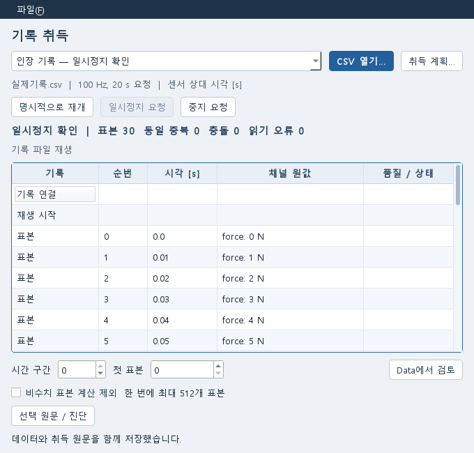

# 기록 데이터 취득

화면은 조작 확인용 CSV를 재생한 Qt 창입니다. 실장비 측정값이나 물리적 중지 시험 결과가 아닙니다.

## 사용자 작업

1. Data에서 자료를 열고 **파일 수집 설정**에 채널 이름·역할·단위·교정 원본, 요청 표본율·기간, 시각 기준을 입력한다. 초안을 적용한다. 채널 교정은 기존 교정 편집기에서 원본을 선택한다.
2. Data의 **기록 취득**을 열고 **CSV 열기**로 실제 기록을 선택한다. 지원 모드는 `RECORDED_REPLAY`다. UTF-8 CSV의 첫 행은 `sequence,timestamp,<계획 채널명...>`이며 표본 한 개가 물리적 한 행이다. timestamp는 선언한 clock 기준의 초 값이다. sequence는 음이 아닌 64-bit 정수다. 따옴표/여러 행 CSV는 지원하지 않고 원문 오류로 보존한다.
3. **재생 시작**으로 원파일을 읽는다. 원값 단위, sequence, 시각과 품질을 표에서 선택한다. 상단 계획의 Hz와 기간은 요청 조건이며 실제 장비 설정이나 실측 표본율로 승격하지 않는다. 기록을 재표본화하거나 결측을 보간하지 않는다. 한 번의 시작/명시 재개는 최대 `ceil(요청 Hz × 기간)`개 원기록을 읽고 재생 종료 receipt를 남긴다.
4. **일시정지 요청**과 **중지 요청**은 요청 상태를 먼저 남긴다. reader가 응답한 후에만 확인으로 표시한다. 요청 중 도착한 표본도 보존한다. 파일 끝, 요청 기간 도달, Job 취소는 장비 물리 중지 ACK가 아니다. 물리 중지는 계속 미확인이다.
5. **시간 구간**과 구간 안 **첫 표본**(0부터)을 정하고 **Data에서 검토**를 누른다. 최대 512개 표본을 도착 순서로 기존 Data에 적용한다. 재설정 경계 사이의 누락 순번처럼 구간을 판별할 수 없는 표본은 **미확인** 구간에서 따로 검토한다. 비수치 계산 제외는 사용자가 체크한 경우만 적용한다. 원값·원문은 계속 남는다. 시각 역전/중복이 있는 구간은 기존 Data의 원행 선택으로 계산 구간을 명시한다. 교정 전 원값과 같은 계획의 교정식·원본을 기존 reader가 사용한다. 기록 전체를 정렬하거나 시각을 합성하지 않는다.
6. Data에서 열·단위·물리 의미를 확인하고 **가져오기**한다. 기존 표·결과·교정 전후 검토를 쓴다. 기존 채널의 component/location/measure/frame을 보존하고, 신규 채널은 기록 채널/미선언 frame임을 확인한다. 다른 원본에 적용했던 배율을 자동 복사하지 않는다.
7. 취득 창에서 **Ctrl+S** 또는 파일 메뉴의 **Data 문서 저장**을 선택한다. 같은 Data revision에 일관된 취득 ledger, 원 기록파일, 교정 원본과 가져오기 결과가 보존된다. 새 프로세스에서는 같은 Data 문서의 취득 목록을 열고 **명시적으로 재개**한다. 저장된 byte cursor 이후부터 읽으며 새 owner를 기록한다. 등록 입력이 없어도 같은 저장 revision의 원파일을 사용한다.

창을 닫아도 진행 중인 재생이 취소되지는 않는다. 중지를 원하면 **중지 요청**을 누르고 응답을 확인한다.
취득 창은 열었던 Data 문서와 세션에 묶인다. Data 창에서 다른 문서를 열거나 세션이 바뀌면 취득 창은 닫히며, 이전 요청의 늦은 응답이 새 문서를 덮지 않는다. 현재 문서의 취득은 그 문서에서 다시 연다.
GUI의 원문/진단은 접힌 선택 상세에서 확인한다. 화면은 최근 500개 이벤트이며 원 기록은 SQLite 아티팩트에 전부 남는다.
행이나 취득을 바꾸면 이전 원문 상세를 지우며, 늦게 도착한 응답은 현재 선택과 일치할 때만 표시한다.

## 저장·오류 경계

- Data owner의 `acquisition/<run_id>.sqlite3` 하나에 raw BLOB, event, 디스크 sequence index와 재생 prefix를 저장한다. 별도 문서 owner/registry/queue/service를 만들지 않는다. stdlib SQLite의 cache는 2 MiB, 입력 batch는 64개 이하, 한 원표본은 64 KiB 이하다. pull adapter는 batch의 durable receipt를 받은 뒤 다음 batch를 읽는다.
- 동일 sequence/동일 bytes는 계산 표본에서 중복 제거하고 중복 횟수를 남긴다. 다른 bytes는 첫 원표본을 덮지 않고 충돌 원문으로 보존한다. 늦은 순번 자체를 clock reset으로 잘못 판정하지 않는다. 높은 sequence의 시각 역전은 새 시간 구간이다. 이후 늦게 온 표본은 저장한 재설정 순번 경계로 분류하며 경계가 불확실하면 미확인 구간에 둔다. gap 이벤트를 나중 표본의 도착으로 지우지 않는다. 이전 기록의 경계 정보가 없는 reset 뒤 늦은 표본도 미확인으로 둔다.
- push adapter의 비재시도 overflow는 원bytes와 이유를 기록하는 별도 공통 경계가 있다. 실제 장비 binding은 없다. 거부된 과대 batch/과대 표본은 ACK하지 않으며 생산자가 원문을 유지해야 한다.
- SQLite write/busy 실패는 transaction 전체를 rollback한다. ACK가 나간 byte prefix만 재개 기준이다. 디스크가 가득 차 오류 자체를 쓸 수 없으면 Job 오류와 UI 메시지로 알리며 이전 prefix를 유지한다. worker FileLock은 같은 취득의 동시 writer를 막는다. 변경된 원파일, 끊김, 읽을 수 없는 행, 중지 무응답과 이전 Job 종료를 성공으로 바꾸지 않는다.
- 저장 복사본은 SQLite backup으로 한 순간의 prefix를 동결한다. 취득 생성·상태·원문 변경은 작은 ledger head로 Data 문서의 저장 필요 상태에 반영한다. 매번 커지는 SQLite 파일 전체를 해시하지 않는다. 저장본에는 실제 backup의 head를 기록하며 실행 중 그 뒤 도착한 표본은 문서를 다시 저장해야 하는 변경으로 남는다. 옛 revision은 바뀌지 않는다.
- 취득 당시 동결한 계획의 교정 원본은 현재 계획·Undo/Redo에서 사라져도 저장한다. 원 기록파일과 동결한 교정 증거의 bytes/hash를 확인하지 못하면 저장을 거부하고 이전 저장본을 유지한다. 등록 입력이 없는 복사본에서도 저장된 원본으로 명시 재개와 교정 가져오기를 수행한다.
- 장비 전용 protocol, 물리 stop receipt, 장비 안전성은 B7.6.L02 외부 인수다.

## 통합 확인 범위

2026-10-17, 리팩토링 기준 `faa296f` 위에 최초 취득 구현과 기존 supplement 교정을 재사용해 통합했다.
최초 구현과 supplement는 acquisition 담당 Sol의 작성물이며 이번 통합·회귀 보완은 Codex Sol이 수행했다.
새 문서 owner·scheduler·registry·종속성은 추가하지 않았다.

- `test_acquisition.py`, `test_acquisition_integration.py`: 실제 CSV 원문·오류·중복·충돌·시간 구간, pause/stop receipt, 쓰기/busy rollback, 저장 head와 새 도착의 dirty 분리, 응답 손실 복구를 확인했다. Undo 후 새 편집으로 교정 계획이 편집 이력에서 사라진 경우에도 동결 원본이 남는다.
- 별도 Python 프로세스에서 workspace 복사본의 registry·working ledger·working 문서를 옆으로 보존하고, 저장본만 열어 byte cursor 뒤를 재개했다. 중복·충돌 0, 원 교정 증거 유지, 부분 Data의 기존 reader 결과 `[2, 4, 6, 8] N`을 확인했다. 이 값은 검사 CSV의 선형 교정 결과이며 실험 정확도 검증이 아니다.
- `test_acquisition_panel.py`: 행·취득 변경 뒤의 늦은 원문 응답 거부와 변경 없는 과거 기록의 여러 페이지 읽기를 확인했다. 취득 계획 편집은 열 때의 최신 Data 초안과 generation을 함께 고정한다. 대화상자 중 다른 Data 편집이 적용되면 기존 CAS가 제출을 거부해 새 편집을 보존한다. 호스트 문서·세션 변경 후 명령/늦은 응답을 차단하고 같은 문서의 정상 세대 갱신을 유지하는 것도 확인했다. 관련 Data 재가져오기·복구 검사도 통과했다.
- Qt 6.9.1 offscreen에서 실제 loopback HTTP·Data owner·JobManager를 연결해 실행 중 저장→새 도착의 저장 필요 표시→일시정지→Ctrl+S를 확인했다. 정상 1040×740와 좁은 680×650의 한글·선택·비활성 상태를 렌더로 검사했다. WIN-COMMAND에 따라 원문 진단은 접힌 보조 상세로 유지하고 QT-ACCESS에 따라 현재 선택과 상세를 일치시켰다. Windows offscreen에는 font 목록이 없어 검사에서 설치된 `malgun.ttf`를 프로세스에 등록했다.

검사 자료는 `_workspace/acquisition-integration-20261017/`에 있다. 잠긴 데스크톱에서 native 창을 열지 않았으며 offscreen 확인은 OS 직접 조작 인수를 대신하지 않는다. 실장비·물리 중지·장비 시각 정확도는 확인하지 않았다.
