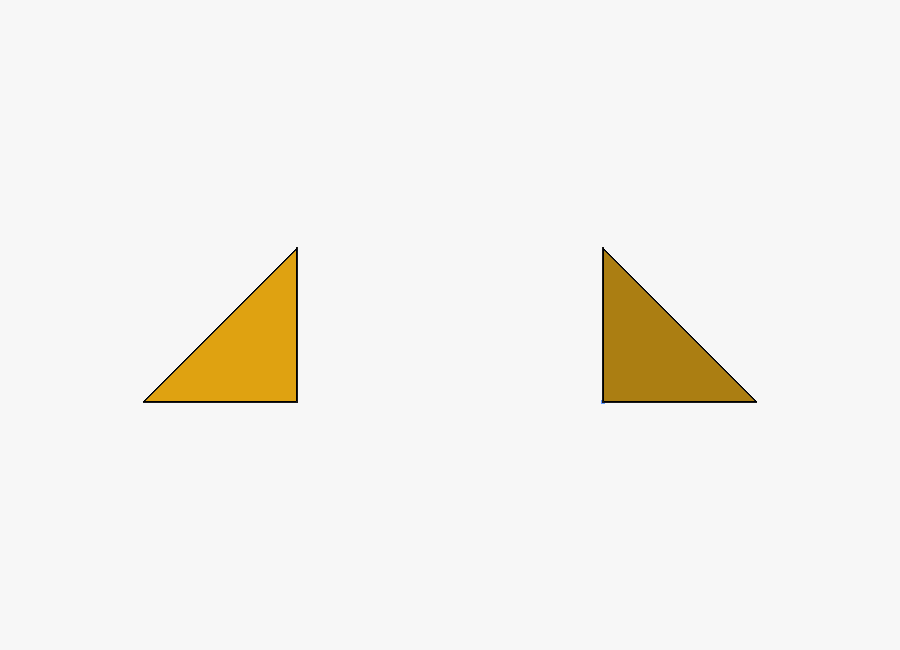
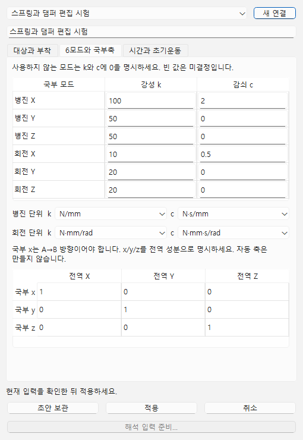

# 스프링과 댐퍼 연결

FreeCAD 모델의 두 실제 기준점·영역을 연결하고 병진·회전 여섯 모드의 선형 강성·감쇠를 지정합니다. 현재 Windows OpenCourant 경로는 유한 길이 TYPE13 연결을 사용합니다. 0길이, 임의 6×6 행렬, 비선형·파손 연결은 실행 범위 밖입니다.

## 모델 준비와 입력

1. FreeCAD에서 자기 모델을 열고 **연결요소 → 스프링과 댐퍼…**를 선택합니다. 면·영역과 그 기준 꼭짓점을 선택할 때는 꼭짓점을 마지막에 선택하고 A/B 각각 **현재 선택 가져오기**를 누릅니다.
2. 기존 탄성 C3D4 FE 모델이라면 **FE 원본 가져오기**에서 해당 해석과 메시 참조 솔버를 선택합니다. 두 영역은 서로 겹치지 않는 비공선 절점 세 개 이상이어야 합니다. 기존 구속과 겹치거나 한 사면체 전체를 포함한 영역은 다시 선택합니다. 원 재료·밀도·메시·나머지 구속은 유지하며 선택 영역만 명시적으로 강체 부착합니다. FE 질량·관성을 몸체 값으로 다시 입력해 더하지 않습니다.
3. 국부 x축은 A에서 B를 향하게 하고 y/z까지 직교 오른손 축을 입력합니다. 여섯 k/c 값은 각각 명시합니다. **0**은 해당 계수가 0이라는 뜻이며 빈칸은 미확인입니다. 병진 단위는 N/mm·N·s/mm, 회전은 N·mm/rad·N·mm·s/rad입니다. 단위 선택을 바꾸면 그 명시 단위로 해석합니다.
4. 연결요소 자체의 실제 질량·관성, 종료 시각과 출력 간격을 입력합니다. FE 초기운동은 **원 FE 유지**가 기본입니다. **선택 영역 초기운동 지정**을 선택하면 A/B의 명시 속도·각속도를 사용하며 원 FE의 비0 운동과 충돌하면 수정해야 합니다. 원 구속을 자동 해제하거나 운동을 추정하지 않습니다.

FE 원본 없이 **독립 강체 표현**을 사용하면 각 끝이 실제 질량중심임을 확인하고 실제 몸체 질량과 질량중심 관성텐서를 입력합니다. CAD만 보고 밀도를 추정하거나 숨은 질량을 추가하지 않습니다. 이 경로는 변형체 전체 해석을 대신하지 않습니다.

## 저장과 실행

**초안 보관**은 `1e` 같은 미완성 값도 보관합니다. **적용**은 현재 대상과 입력을 확인해 모델에 기록하며 계산하지 않습니다. 문서 저장은 열린 연결 편집의 현재 초안도 먼저 보관합니다. 저장 응답을 기다리는 동안 고친 최신 값은 이전 응답으로 지우지 않습니다. 미완성 초안은 계속 편집할 수 있고 입력 준비·실행은 차단됩니다.

**해석 입력 준비…**를 누르면 편집 원본과 정확한 계산 입력을 보존합니다. 연결된 경우 같은 입력의 Simulation 창이 열립니다. **실행**은 그 창에서 명시적으로 시작합니다. 입력 준비나 계산 창 열기 자체는 계산이 아니며 같은 요청을 다시 확인해도 중복 계산을 시작하지 않습니다.

## 결과와 재편집

기존 결과 선택에서 연결요소의 힘·일반화 모멘트·변형·상대회전 곡선을 선택합니다. FX/FY/FZ는 힘(N), MX/MY/MZ는 일반화 모멘트(N·mm)입니다. MY/MZ를 전단 지레팔까지 포함한 끝점 반력으로 해석하지 않습니다. LX는 축 신장, LY/LZ는 native beam 전단 모드이며 LENGTH는 총길이입니다. RX/RY/RZ는 native 현재 국부기저에서 누적한 상대회전(rad), IE는 점성 일까지 포함한 내부 일입니다. 곡선은 실제 TH 표본 시각과 무효 mask를 보존합니다. 실패·취소 뒤의 부분 이력도 원 상태와 구분해 명시적으로 읽습니다.

Simulation을 저장하고 다시 열면 같은 보존 결과를 선택합니다. 입력 모델을 다시 열어 계수를 고친 뒤 새 입력을 준비하면 기존 계산은 원 입력에 그대로 남습니다. FreeCAD 저장·복원에서 형상 직렬화만 달라진 경우에는 기존 FEM의 원 형상 증명으로 면·점 대응을 확인합니다. 실제 형상·메시가 달라지거나 원 증명이 없으면 대상을 다시 선택해야 합니다.

공개 탄성 C3D4의 두 면 부착 사례에서 실제 입력 동결·native 계산·힘/모멘트 이력·저장·새 프로세스 읽기를 확인했습니다. 여섯 모드 전체의 독립 구성식 시험·자유감쇠 정확도·공학 자격을 승인한 것은 아닙니다. 공학 판정은 **미확인**이며 원 결과와 실패는 보존됩니다.
