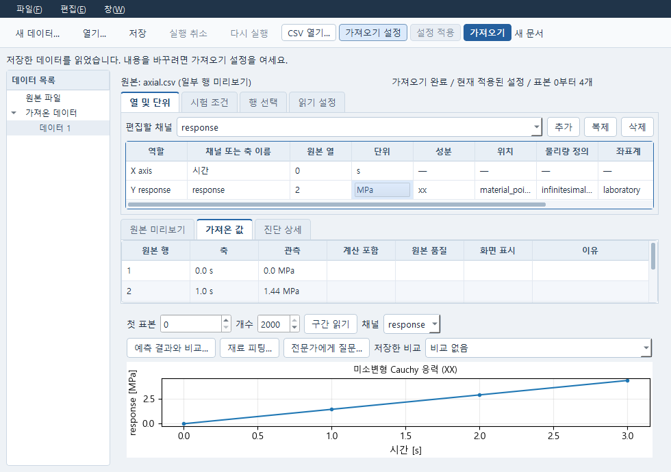

# 시험 데이터에서 재료 피팅까지

이 작업은 독립 **Data → 재료 피팅(Numerical Plan) → Material** 창을 연결합니다.
Data의 원본과 가져온 곡선, Plan의 시작값·탐색 범위, Material의 현재 계수는 별도로 남습니다.
피팅을 실행하거나 후보를 선택해도 Material 계수는 바뀌지 않습니다.

## 작은 공개 예제로 시작하기

설치된 Research 환경에서 `Start-CAE-Lab.cmd -Tool data`를 실행합니다.
다음 파일은 실제 계측자료가 아니라 **E=1200 MPa, nu=0.25인 선형 탄성의 합성 예제**입니다.
축방향 시험은 횡방향 신장비를 1로 지정한 변형 이력이고, 전단 시험은 F12=γ인 단순 전단입니다.
자유 인장시험이나 재료의 공학적 자격 검증을 뜻하지 않습니다.

- [axial.csv](../examples/material-tests/axial.csv): 지정 축방향 변형률 / σxx.
- [shear.csv](../examples/material-tests/shear.csv): 지정 단순 전단량 / σxy.
- [holdout.csv](../examples/material-tests/holdout.csv): 피팅에 쓰지 않을 축방향 이력.

### 1. CSV와 열 설정

1. Data의 **CSV 열기…**에서 파일을 고릅니다. 파일 선택 취소는 현재 편집을 바꾸지 않습니다.
2. **시험 열 설정…**을 엽니다. 시간은 time_s, 단위 s; 관측은 stress_MPa, 응력/MPa;
   사용할 단위는 MPa, 응력 정의는 미소변형 Cauchy를 선택합니다.
3. axial/holdout은 성분 xx, 변형 이력 strain, 공학 변형률/1을 선택합니다.
   shear는 성분 xy, 변형 이력 gamma, 단순 전단량 γ12/1을 선택합니다.
4. 확인 → 설정 적용 → 가져오기를 실행합니다. **저장**으로 Data 문서를 저장합니다.
   다른 두 파일도 별도 Data 문서로 가져옵니다.

열 번호를 직접 입력하는 기존 편집기와 서비스 원본 선택도 유지됩니다.
시험 열 설정은 사용자가 확인한 배율을 기존 Data mapping에 기록합니다.
원본 파일·원래 값은 유지하고, 단위 이름만 바꿔서 수치를 변환하지 않습니다.

직접 열을 편집할 때 **열 및 단위**에서 채널과 X/Y 행을 선택합니다. 구분자·소수점·
건너뛸 머리글 행은 **읽기 설정**에 있습니다. 열이 창보다 넓으면 표 아래 가로 스크롤로
이동합니다. 가져오기 전 설정 변경은 이전 결과의 숫자나 단위를 바꾸지 않습니다.



위 화면은 공개 합성 예제와 읽기 응답 대역을 사용한 실제 Windows Qt 창입니다.
화면 배치와 선택을 확인한 것이며 실제 솔버 실행 결과를 뜻하지 않습니다.

힘은 **초기 단면적 A0**를 사용해 공칭 응력 P로만 변환합니다. Cauchy 응력으로 바꾸지 않습니다.
변위는 명시한 초기 표점 거리 L0로 나누어 공학 변형률로 바꿉니다.
면적 단위, 길이 단위, 힘 단위와 시간 단위를 직접 선택해야 합니다.
시간 열이 없는 시험에 임의 시간축을 붙이지 않습니다.

### 2. 구간과 제외 행

그래프의 점을 클릭하면 **가져온 값** 표에서 해당 원본 행을 선택하고 그 위치로 이동합니다.
같은 표 구간에서 Ctrl을 누르고 점을 클릭하면 선택을 추가합니다. 찾는 행이 다른 표
구간에 있으면 그 구간을 읽어 보여 주며, 그래프에 표시한 곡선은 그대로 유지합니다.
Ctrl을 누른 채 다른 표 구간으로 이동하면 이전 선택을 바꿨다는 안내가 나타납니다.

표에서는 Shift/Ctrl로 여러 행을 선택하고, 곡선에서는 가로 방향으로 구간을 드래그합니다.
점을 선택하거나 표 구간을 옮기는 것만으로 계산에 사용할 행이 바뀌지는 않습니다.
표의 우클릭 메뉴에서 **선택 구간만 사용 / 계산에서 제외 / 선택 행 제외 해제**를 사용합니다.
선택은 화면 인덱스가 아닌 원본 행 번호에 연결됩니다.

**피팅 구간으로 복제 / 검증 구간으로 복제**는 선택 구간을 가진 별도 채널을 만듭니다.
설정 적용 후 새 가져오기를 실행해야 새로운 구간이 계산에 사용됩니다.
이전 가져오기의 곡선과 결과는 유지됩니다. Plan에서 각 채널의 용도를 다시 명시합니다.
같은 원본 파일의 같은 관측 열·성분·원행을 fit과 holdout에 중복 사용하면 Run을 차단합니다.
같은 파일을 다시 가져와 새 가져오기 ID를 받아도 별도의 검증 표본이 되지 않습니다.
품질 불량 표시, 계산 제외, 화면 숨김은 서로 다른 설정입니다.

### 3. 재료와 시험 조건

axial Data의 **재료 피팅…**에서 **stress / xx [MPa]** 관측 채널을 고른 뒤
새 선형 탄성 재료 또는 기존 Material을 선택합니다. Data 화면에서 deformation을 보고 있어도
피팅 관측은 이 대화상자에서 따로 선택합니다. 취소하면 새 재료나 Plan을 만들지 않습니다.
기존 Material 창에서도 **재료 피팅…**을 직접 열 수 있습니다.
처음 생성한 재료의 계수는 시작값이며 관측자료로 추정한 결과가 아닙니다.

피팅 창 왼쪽의 시험은 **axial.csv / xx**, **shear.csv / xy**처럼 파일/시험명과
성분으로 구별합니다. 시험을 선택하고 **조건…**을 엽니다.

- 관측 stress, 모델 응답 stress_xx.
- 용도 **피팅**.
- 변형 조건 **측정 변형 이력 사용**, 채널 deformation.
- 지정 F22=1, F33=1을 입력합니다. 이 예제는 횡수축을 구하는 시험이 아닙니다.

**시험 추가…**로 shear와 holdout Data의 정확한 가져오기를 선택합니다.
shear는 모델 응답 stress_xy, 변형 채널 deformation, F22/F33=1, 용도 피팅입니다.
holdout은 stress_xx, 같은 지정 횡방향 조건, 용도 **검증(holdout)** 입니다.
가중치와 오차 기준값은 시험별로 편집할 수 있습니다.

전체 변형구배 이력을 직접 편집하는 기존 경로도 남습니다.
측정 이력에서 전체 변형구배 편집으로 전환해 확인하면 자동 유도 연결은 명시적으로 해제됩니다.
측정 이력을 사용한 경우 Plan에는 정확한 같은 Data 가져오기와 변형 채널, 지정 횡방향 값,
전개된 시간/F 이력이 저장됩니다. 실행 시 그 원본으로 다시 확인합니다.
관측 표본의 원본 행과 시간이 변형 채널에 없으면 보간·누락 제거로 맞추지 않고 차단합니다.

### 4. 피팅과 결과 읽기

왼쪽 계수 표에서 E 시작값 900 / 하한 500 / 상한 2000,
nu 시작값 0.2 / 하한 0.1 / 상한 0.4 / 조정 true로 설정합니다.
이는 **Plan 탐색 범위**이며 현재 Material 값 자체를 수정하지 않습니다.

**방법 설정**에서 알고리즘과 모델 호출 한도를 확인한 뒤 계획 적용 → 피팅 실행을 누릅니다.
이 예제는 축방향과 전단 관측을 함께 사용하므로 E만 맞추는 단일 계수 예제가 아닙니다.
기존 SciPy/FELUPE 엔진을 사용합니다. 실행 취소는 기존 JobManager에 요청하고
이미 계산한 후보·실패·이전 실행을 유지합니다.

오른쪽에서 시험을 선택하면 관측과 **최종 피팅 계수의 예측**, 아래에 같은 표본의
**예측−관측** 잔차와 실제 응력 단위가 표시됩니다.
최적화의 가중·정규화 잔차를 MPa라고 표시하지 않습니다.

곡선 위의 **시간 / 측정 변형** 선택에서 변형률·신장비·단순 전단량을 가로축으로 볼 수 있습니다.
이 축은 **선택한 실행 당시**의 측정 변형 채널에서 관측과 같은 원본 행·시간의 값만 읽습니다.
관측·예측·잔차 모두 같은 x 값을 사용하며, 하중을 되돌리는 구간의 순서도 유지합니다.
현재 편집 중인 시험 조건으로 과거 결과의 축을 바꾸지 않습니다.
원본을 읽을 수 없거나 대응이 다르면 사유를 표시하고 시간축을 계속 사용할 수 있습니다.
전체 변형구배만 지정한 옛 시험에는 측정축을 만들어 붙이지 않습니다.
검증 곡선은 fitting objective에 들어가지 않으며, 호출 한도/취소로 계산되지 않았으면
실패와 이유를 보여 줍니다. 0이나 성공 곡선으로 채우지 않습니다.

다른 실행·실패·읽기 대기를 선택하면 곡선과 최종 계수/RMSE 요약을 함께 바꿉니다.
늦게 도착한 이전 실행 응답이 사용자가 선택한 실행을 다시 선택하지 않습니다.

**평가한 후보** 탭은 실제 평가 이력과 실패를 보존합니다.
후보 선택은 최종 피팅 곡선을 그 후보의 곡선으로 바꾸지 않습니다.
임의 후보마다 관측 비교 곡선이 저장됐다고 주장하지 않습니다.

### 5. 계수 적용, 저장과 재열기

성공한 후보를 선택하고 **계수를 재료에 적용…**을 누릅니다.
확인창의 현재→새 계수와 단위를 비교한 뒤 명시적으로 적용합니다.
기존 Material 소유자의 세대/원입력 확인과 같은 command ID 재시도 처리를 사용합니다.
재료가 다른 창에서 변경됐다면 새 값으로 몰래 덮어쓰지 않습니다.

**파일 → 재료 열기 / 저장…**에서 적용된 Material을 확인하고 저장합니다.
Plan도 저장합니다. Material의 실행 취소/다시 실행과 Plan의 저장/재열기는 기존 명령을 사용합니다.
응답을 받지 못했으면 **적용 결과 다시 확인**을 누릅니다. 앞선 적용 요청을 그대로 확인하므로 중복 적용하지 않습니다.
새 창에서 Data/Material/Plan의 저장 문서를 열면 원래 관측·조건·범위·보존 결과를 계속 사용할 수 있습니다.
저장한 Data는 기존 Numerical 추가, Expert, 비교 경로에 다시 사용할 수 있고,
계산은 기존 Runner 작업이며 결과의 Study 연결도 기존 도구 경로를 사용합니다.

## 지원 경계

이 간단한 CSV 조건 편집은 지정 축방향 F11(명시 F22/F33)과 단순 전단 F12를 지원합니다.
공학 변형률, 신장비, 변위/L0와 명시 단위 변환만 사용합니다.
로그 변형률, 자동 횡수축/자유 인장 혼합 제어, 임의 좌표 회전, 현재 면적 추정,
시간 없는 자료의 시간 이력 추정은 만들지 않습니다. 그 요구는 후속 기능으로 남습니다.

현재 이 Material 피팅 창의 법칙은 기존 FELUPE 선형 탄성(E/nu)과
압축성 Neo-Hooke(mu/lmbda)입니다. Neo-Hooke는 first_Piola 관측이 필요합니다.
MFront의 별도 재료/상태 이력, 기타 점탄성·소성·손상·실패·연성 요구와
generic Numerical Plan은 그대로 유지되며 이 CSV 편집기로 지원됐다고 표시하지 않습니다.
시험과 프로토콜이 계수를 충분히 식별하는지는 별도 판단입니다. 실행 성공은 공학 승인 아닙니다.

## 구현과 확인 범위

기준 d048a31. 기존 Data/Numerical/Material owners, 파일 reader, SciPy/FELUPE,
JobManager, 채택 receipt와 공유 service/store를 재사용합니다.
공통 계약의 추가는 legacy experiment의 선택적 `kinematics` 한 필드입니다.
옛 전체-F 시험은 수정 없이 읽습니다. 새 필드도 GUI/CLI/Python/MCP가 같은 소유자에서 검사합니다.
잘못된 초안은 저장 가능하며 실행 단계의 원본/물리량 검사는 유지합니다.

추가로 generic CAD DOE worksheet는 현재 편집 buffer의 recipe에서 변수 label과 응답 선언을
표시 fallback으로 읽습니다. 이후 사용자가 직접 선택한 표시를 우선하며 입력을 바꾸지 않습니다.

### 실행 주체와 이번 교정

작성 환경의 Python/Qt/엔진 실행 및 화면 렌더는 **NOT_RUN**입니다.

Root가 Windows에서 첫 소스 **08c7e18**의 새 검사 두 파일을 실행했습니다.
실제 기존 FELUPE 엔진의 E=1200 MPa / nu=0.25 피팅, 별도 holdout, 명시 채택 재시도,
저장/새 owner 재열기는 통과했습니다. 전체 결과는 **7 passed / 1 failed**였고,
실패는 1100×780 창의 곡선 폭이 350 px라 요구한 400 px를 넘지 못한 것이었습니다.
같은 실행에서 Matplotlib 기본 글꼴의 한글 누락도 관찰됐습니다.
Root의 별도 Qt/HTTP 슬롯·모달 경로는 stress 선택 → 기존 재료 → 측정 변형/F22/F33 →
저장 → 새 Qt 창 재열기에서 같은 초안을 확인했습니다. 이때 새 계산은 없었고
Data/Material은 바뀌지 않았습니다. OS 입력 수용 결과는 아닙니다.

이 후속 소스는 fit 입력 패널의 폭을 제한하고 곡선 최소 공간을 확보합니다.
검사의 창 크기·곡선 폭 요구는 낮추지 않았습니다.
공통 `apps/research/appearance.py`에는 기존 설치 파일의 실제 한글 glyph를 확인하여
새 Matplotlib figure의 글꼴을 설정하는 함수만 추가했습니다.
Windows의 맑은 고딕, 그 밖의 설치된 지원 글꼴을 사용하며 다운로드·폰트 복사·설치는 없습니다.
기존 Qt 스타일은 그대로입니다. 이 소스의 Windows 재실행/렌더 결과는 아직 기록하지 않습니다.

원본 미리보기는 document/source token에 묶고 새 업로드 때 이전 표를 비웁니다.
미완성 숫자·행 마스크를 사용자 몰래 정규화하지 않습니다.
시험 이름과 측정축을 읽는 비동기 요청도 최신 편집 칸을 다시 채우지 않습니다.

다음은 이번 변경 경로의 실행 명령입니다. 이전 성공한 계산을 반복해야 하는 선행 조건은 아닙니다.

```powershell
python -m pytest tests/test_material_test_ui.py tests/test_material_test_workflow.py tests/test_data_multichannel_ui.py::test_channel_add_clone_remove_and_explicit_followups -q
```

첫 파일은 명시 변환/조건·두 계수 실제 기존 엔진 피팅·별도 holdout·적용 재시도·저장 재열기,
두 번째는 실제 창 크기/설치 글꼴·시험 구분·같은 변형축/잔차·늦은 결과 선택·부분 초안과
원본 교체·명시 응력 채널 선택·CAD 표시 fallback 경계를 다룹니다.
기존 연결 검사 대역은 새로운 관측 선택에 필요한 실제 metadata API와 재료 backend를 반환하도록 맞췄습니다.
GUI 사용자 수용과 공학 검증은 코드 작성/단위 확인과 구별합니다.


### 637f089 수용과 종료 경로 후속

Root는 Windows에서 `test_material_test_workflow.py`,
`test_material_test_ui.py`, `test_data_multichannel_ui.py`의 **17개 검사를
12.42초에 통과**시켰습니다. 이후 서비스 종료 뒤 Data HTTP 읽기의 연결 거절과
삭제된 Qt signal sender의 traceback이 관찰됐습니다.
이는 기능 assertion 실패와 별개의 종료 수명 문제이며, 그 기록을 지우지 않습니다.

후속 소스는 닫힌 Data/Numerical 창의 예약 조회와 새 요청을 차단합니다.
진행 중 읽기는 서비스 호출의 반환을 기다리되 닫힌 화면으로 전달하지 않습니다.
이미 제출한 계산/가져오기/채택 명령이나 JobManager 작업은 창 종료 때문에 취소하지 않습니다.
열린 창의 연결 실패는 기존 오류 경로로 표시하고,
Qt sender가 실제로 삭제된 경우에만 종료 중 재발하는 signal 예외를 처리합니다.

시험 자료의 다음 읽기 대기열과 GUI 후속 호출도 닫을 때 정리합니다.
제품 GUI에서 전체 QThreadPool을 기다리거나 종료하지 않습니다.
테스트는 창 닫기 → 예약 콜백 처리 → 작업 pool 종료 확인 → HTTP 서비스 종료 순서입니다.
새 lifecycle 검사는 예약 조회, 늦은 실패/전달, sender 삭제를 다루며 새 solver 실행은 없습니다.

작성 환경의 이 후속 Python/Qt 실행은 **NOT_RUN**입니다.
변경 종료 경로만 먼저 확인하려면 다음을 실행합니다.

```powershell
python -m pytest tests/test_data_read_lifetime.py tests/test_data_multichannel_ui.py::test_actual_http_mask_metadata_channel_edit_save_import_undo -q
```
