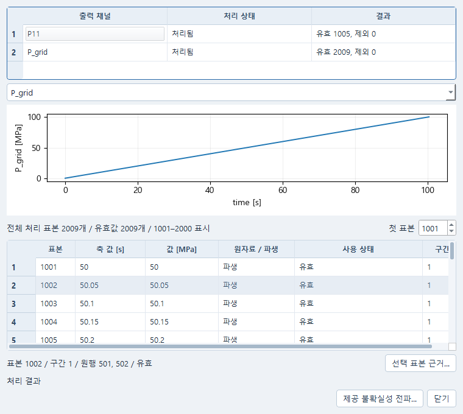
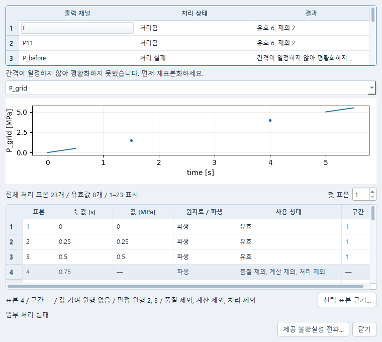
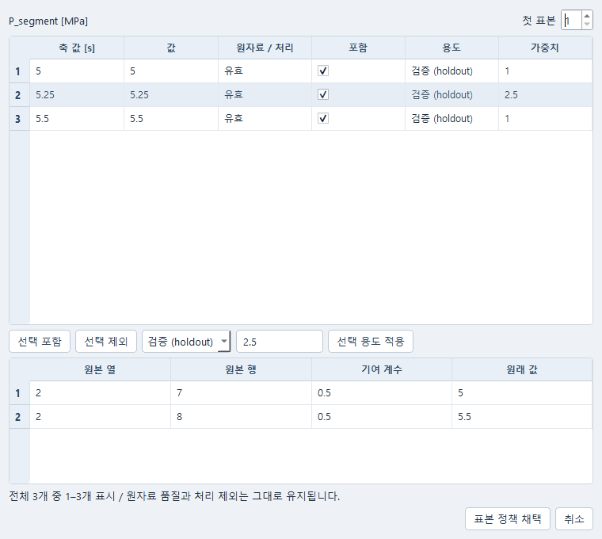

# Data 처리 표본과 원자료 근거

Data의 **자료 → 자료 처리…**는 같은 자료 문서를 Python 처리 창에서 연다.
원파일과 열 설정, 보존한 가져오기 결과를 공유한다. 창을 여는 것만으로 새 처리나
피팅을 실행하지 않는다. [원자료 작업면 사용법](DATA_WORKSPACE_KO.md)을 함께 참고한다.

## 처리와 확인

1. 원자료를 열고 응답 열과 시간축, 단위·교정·계산 제외를 정한 뒤 **자료 준비**를 한다.
   단위 이름을 바꾸는 것과 수치 교정은 별개다. 교정 계수와 근거 파일은 기존 교정 창에서 지정한다.
2. **처리 단계…**에서 변환·필터·재표본화 순서를 정한다. 위아래 이동으로 순서를 바꾸고
   설정을 적용한 뒤 **처리 미리보기…**를 연다. 미리보기를 닫으면 처리 결과는 보존되지 않는다.
3. 출력 채널을 고르고 표본을 선택한다. **전체 처리 표본 / 유효값 / 표시 범위**는 서로
   다른 수다. 표는 최대 1,000개씩 표시하며 **첫 표본**을 바꾸면 뒷부분을 확인할 수 있다.
   이 표시 개수는 처리 상한이 아니다. 채널을 바꾸었다 돌아와도 페이지와 선택이 유지된다.
4. **선택 표본 근거…**에서 같은 표본의 원열·원행·부호 있는 값 기여 계수·원래 값을 확인한다.
   **값 기여 원행**과 제외·간격을 검사한 **판정 원행**은 별도다. 처리에서 제외된 표본은
   값 기여항이 없어도 판정 원행을 확인할 수 있다. 이전 결과에 판정 행 필드가 없을 때만
   값 기여행을 대신 표시한다. 재표본은 **파생**으로 표시한다. 원행 번호를 빌려 표시하지 않는다. 이전 가져오기에
   원래 값이 보존되지 않았다면 `—`로 표시한다.
5. 확인한 결과를 **처리 결과 보존**으로 보관하고 자료를 저장한다. **보존한 처리 결과…**에서
   같은 결과를 다시 열 수 있다. 페이지 이동과 표본 선택은 원자료를 다시 가져오거나 처리하지 않는다.

불규칙 시각에 균일 시각을 요구하는 필터를 적용하거나, NaN·품질 제외·설정한 최대 시간
간격을 가로질러 보간하려 하면 기존 처리 검사가 해당 단계를 막는다. 표는 제외된 표본도
보여 주며, 곡선은 기존 유효 구간만 그린다. 일부 실패를 숨기거나 끊긴 곡선을 이어 그리지 않는다.
계산 제외·품질 제외·처리 제외·보기 숨김은 각각 표시한다.
균일 시각이 필요한 평활화 오류는 단계표 아래에 먼저 재표본화하라는 안내를 표시한다.
해당 오류의 원문은 도구 설명과 원래 진단에 유지한다.

## 피팅 계획에 쓰기

보존한 응력 채널에서 **피팅 계획으로…**를 선택한다. 기존 Plan 편집기에서 재료 법칙과
응력 정의·성분·단위, 변형 이력과 시험 용도를 확인한다. 측정 이력에 제외 구간이 있으면
연속 구간을 기존 재표본화 범위로 명시 선택하거나 실제 시험 조건을 다시 지정해야 한다.
자동으로 변형 이력을 만들거나 실패 구간을 채우지 않는다.

Plan의 **표본 용도** 창에서 같은 표본의 포함·제외, 학습 또는 별도 검증, 가중치를 정한다.
표본 가중치는 원값의 기여 계수와 다르다. 재표본끼리 시간이 달라도 원자료 값이 공유되면
학습과 검증이 독립적이지 않을 수 있다. 기존 실행 전 검사는 이 중복을 차단한다.
편집·저장과 피팅 실행은 별도 동작이다. 저장한 Data 결과와 Plan은 다시 열어도 선택한
처리 단계·표본·원행 근거를 유지한다.

## 확인한 범위

Windows Qt에서 합성 CSV·ASCII 두 시험의 교정, 처리 순서, 필터 실패 보존, 재표본 구간,
선택 표본의 계보, Plan 학습·검증 용도, 저장 후 새 프로세스 읽기를 확인했다.
별도 1,005행 파일은 2,009개 재표본을 만들었고, 1,000개씩 표시하면서 같은 선택을 유지했다.
기존 수치 처리·reader·문서·표본 정책을 사용하며 새 처리 엔진은 추가하지 않았다.
이 확인에는 피팅·solver·provider 실행, 계측기 교정 승인 또는 재료의 공학 적합성 판정이 포함되지 않는다.
