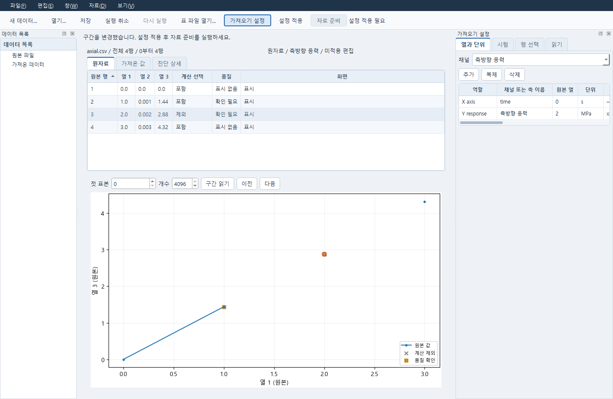
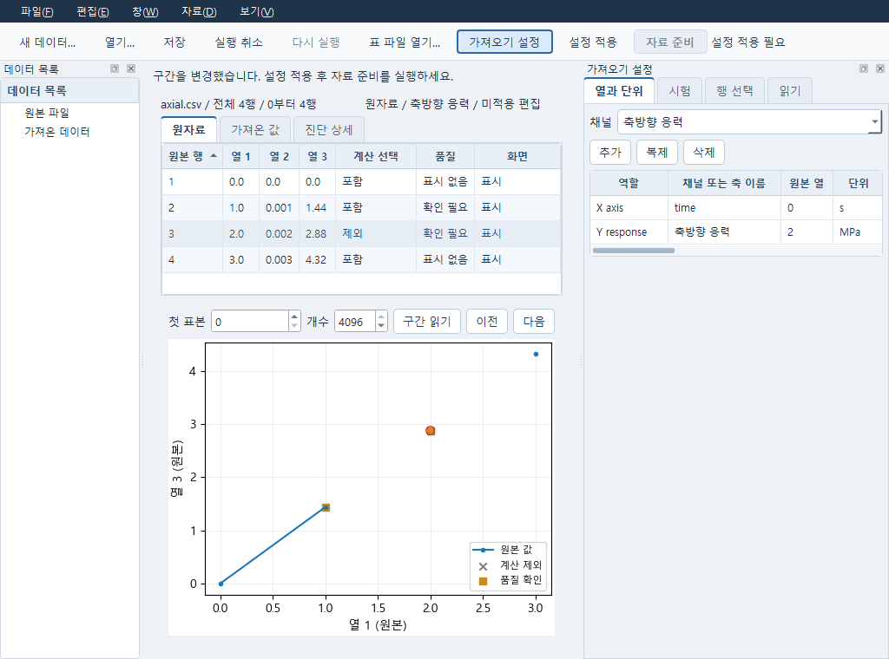
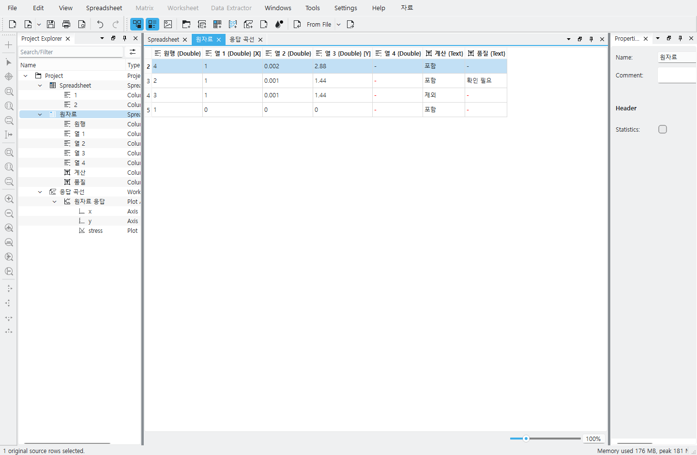
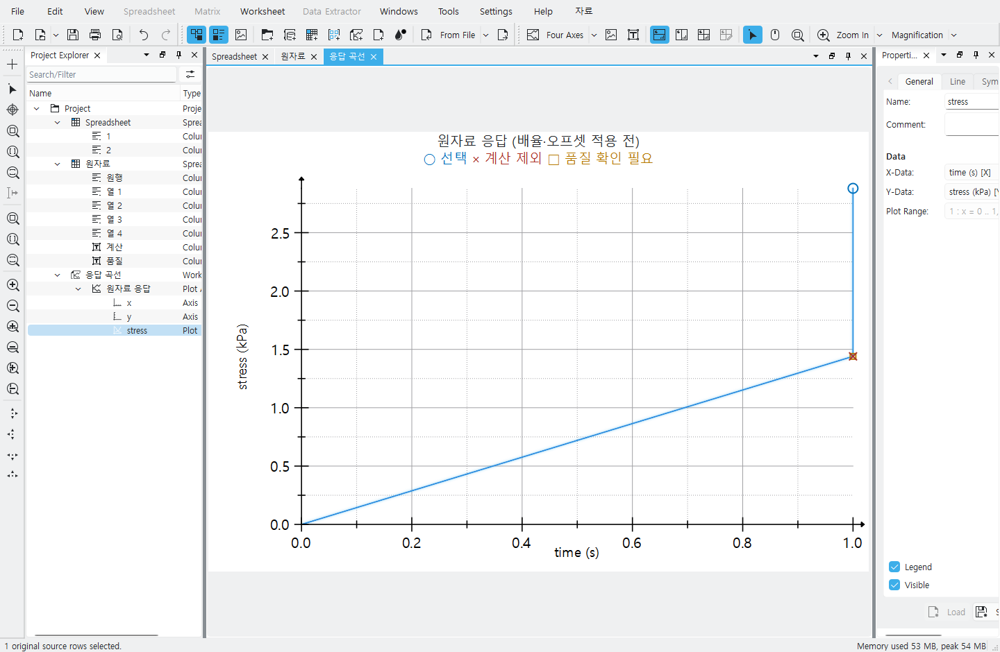
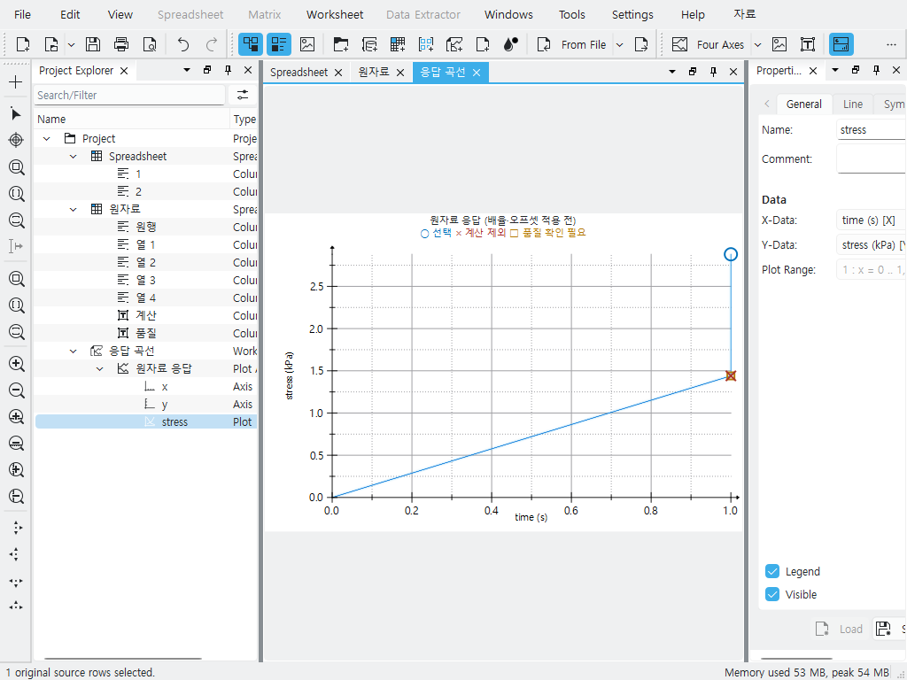
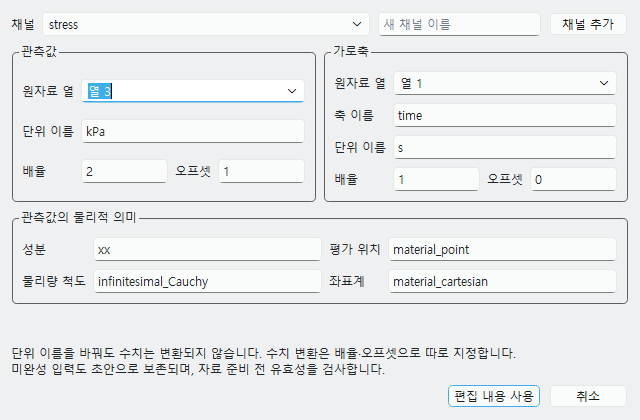

# Data 원자료 작업면

Data는 기존 문서 서비스와 표 reader를 사용한다. 다음은 기본 PySide6 작업면의 사용법이며,
별도로 빌드한 native Data의 진입과 조작은 아래에 설명한다. 원자료 표와 곡선이 중앙에 있고,
왼쪽 데이터 목록에서 원본과 보존한 가져오기를 선택한다. **보기 → 가져오기 설정**으로
오른쪽 속성 창을 열거나 닫을 수 있다. 창을 줄여도 편집 중인 항목을 자동 이동하지 않는다.

## 원자료에서 자료 준비까지

1. **표 파일 열기**로 CSV/TSV/NPZ 등 지원 표를 등록한다. 원본의 열 구성을 사용하거나
   시험 열 설정에서 축·응답·단위·물리량을 명시한다. 단위 이름은 수치를 변환하지 않는다.
2. 원자료는 4096행씩 읽는다. **이전/다음** 또는 첫 표본·개수·**구간 읽기**로 전체 자료에
   접근한다. 표의 머리글을 눌러 정렬해도 입력 순서와 원자료는 바뀌지 않는다.
3. 표 행 또는 곡선 점·드래그 구간을 선택한다. 표의 우클릭 메뉴에서 계산 제외·복원,
   품질 표시·해제, 화면 숨김·전체 표시를 따로 지정한다. CSV/TSV의 원행은 0부터 세는
   실제 텍스트 줄이며 NPZ는 배열 인덱스다. 중복 좌표도 원행으로 구별한다.
4. **설정 적용**은 전체 편집본을 한 번 적용한다. **자료 준비**를 명시적으로 실행해야
   실제 가져오기 결과가 생긴다. 비단조 축과 미완성 단위는 원자료 조회를 막지 않지만
   기존 import 검증을 통과한 것으로 표시하지 않는다.

Ctrl+Z/Redo와 편집 메뉴는 현재 창의 로컬 편집만 바꾼다. 적용·저장 후의 Undo도 새 미적용
변경이며 서비스 입력과 보존 결과를 바꾸지 않는다. 새 프로세스에서 이전 Undo 이력을
복원하지 않는다. 열기·선택·Undo·저장만으로 import, solver 또는 AI를 실행하지 않는다.

## 저장과 복구

**저장**은 필요한 설정 적용 → Core 저장 → 정확한 저장 참조를 담은 로컬 보기 파일의
임시 기록·원자 교체 순서다. 보기 파일은 사용자 AppLocalDataLocation의
`caelab/data-views/<service-hash>/<document-id>.json`에 놓인다. 공학 문서를 대체하지 않는다.

- 적용 응답을 잃으면 **요청 확인 및 재시도**로 같은 명령 ID·본문·generation을 재사용한다.
  결과가 확인되기 전 편집을 직렬화한다. 다른 문서에 도착한 응답은 적용하지 않는다.
- 확인한 명령 응답과 현재 서비스 입력·저장 상태를 다시 대조한다. 응답 유실 뒤 다른 창이
  입력을 바꿨다면 과거 응답으로 현재 문서나 보기 파일을 덮지 않는다. 원 편집·명령 ID·확인
  응답을 보존하고 서비스 입력 재읽기 또는 새 문서 보존으로 복구한다.
- Core 저장 실패는 기존 보기 파일을 교체하지 않는다. Core 저장 성공 후 보기 저장만
  실패하면 그 사실을 표시하며 **저장**은 같은 Core revision의 보기만 재시도한다.
  이 단계에서 닫기·문서 전환은 보기 저장 재시도 또는 취소를 먼저 묻는다.
- 다른 창이나 CLI가 입력을 바꾸면 로컬 편집본·이력을 보존하고 적용을 막는다.
  서비스 입력을 다시 읽거나 편집본을 새 문서로 보존할 수 있다. 결과나 저장 상태의
  갱신만으로 로컬 편집본을 덮지 않는다.
- 저장한 문서를 같은 서비스에서 다시 열면 일치하는 보기 설정을 읽는다. 연결이 끊겼고
  저장한 캐시가 있으면 **캐시 보기 / 서비스 연결 안됨**으로 표시하며 적용·저장·전달을
  막는다. 재연결 버튼은 서비스 문서를 다시 읽으며 캐시를 자동 적용하지 않는다.

## 재료에서 사용

현재 적용 입력과 일치하는 실제 가져오기를 선택하고 **자료 → 재료에서 사용**을 누른다.
필요하면 해당 결과를 저장한 다음 기존 재료 또는 새 재료 창 열기를 요청한다. 전달하는
것은 선택한 문서·실행·응답·입력 revision/hash의 참조다. Material은 보존 결과를 다시
검증하고, 사용자가 선택한 Numerical 계획에서 시험 조건을 정해 관측을 명시 등록한다.
창 열기 요청만으로 시험·계획 생성, 피팅 실행 또는 후보 채택이 완료되지 않는다.
현재 이 시험 등록 경로는 FELUPE 재료와 연결한 계획을 지원한다.

설정을 바꿨다면 다시 적용하고 자료 준비를 실행해야 새 결과를 전달할 수 있다. 이전
가져오기와 실패한 결과는 보존되며 현재 설정의 결과로 바꿔 표시하지 않는다.

## 확인 범위

실제 loopback HTTP와 Qt 검사에서 전체 표 읽기, 정렬·중복 원행 선택, 한 번의 적용,
로컬 Undo, 명시 import, 응답 유실, 보기 저장 실패, 외부 입력 충돌, 오프라인 캐시와
Material 전달 요청을 확인한다. 공개 `examples/material-tests/axial.csv`의 Windows 창을
1440×940, 1024×760으로 열어 한글·선택·품질·제외와 속성 창을 렌더하고 닫았다.
물리 OS 입력 전체 인수와 공학적 적합성 승인을 뜻하지 않는다.
실제 별도 Material 프로세스에서도 같은 관측 참조와 저장 결과 hash를 확인해 시험 조건
창에 표시했다. 이 경계 검사는 최종 등록을 취소해 시험과 계산을 추가하지 않았다.

## Native Data에서 이어 작업하기

LabPlot 기반 작업면은 같은 서비스의 Data 문서와 원자료를 사용한다. 고정 소스의
별도 Windows 빌드가 필요하며 기본 `data` 진입은 위 PySide6 창을 연다.
원파일은 보존하며 표는 기존 수치 reader의 값을 표시한다. 비수치 CSV 셀은 현재 reader
정책대로 NaN으로 읽으므로 일반 텍스트 표 편집기로 사용하지 않는다.
[빌드·고지·실행 확인](../native/data_labplot/README.md)과
[명시 실행 명령](../apps/research/README.md#data-source-table-and-material-observations)을 따른다.
`data-native`에 `--document-id`를 주면 해당 자료를 읽고, `--project`를 주면 저장한 `.lml`을
연다. 창을 여는 것만으로 자료 준비나 해석을 실행하지 않는다.

1. **자료 → 원자료 열기** 또는 **자료 문서 열기**에서 작업을 시작한다. 원표는 편집하지
   않고 유지하며, **열과 단위**에서 응답 채널과 가로축의 원열·단위·배율·오프셋을 지정한다.
   단위 이름과 수치 변환은 별개다. 미완성 입력은 초안으로 남길 수 있다.
2. 표 행이나 곡선 점을 선택한다. **곡선 범위 선택**을 켜고 드래그하면 해당 원행들을
   선택한다. 같은 위치에 겹친 점은 대응하는 원행들을 함께 선택한다. **표 정렬**은 보기
   순서만 바꾼다. 계산 제외·품질 표시·숨김은 자료 메뉴에서 각각 지정한다.
3. **변경 적용**은 현재 편집을 한 번 적용한다. native Undo/Redo는 로컬 편집을 되돌리며
   적용·저장 후에도 Core 입력을 자동으로 되돌리지 않는다. **자료 준비**를 명시해야
   현재 설정의 보존 결과가 생긴다. 연결된 응답 곡선의 원열은 **열과 단위**에서 바꾼다.
4. **자료 저장**은 Core 저장을 확인한 뒤 정확한 참조를 포함한 `.lml`을 원자 교체한다.
   **재료에서 사용**은 현재 입력과 맞는 보존 관측을 별도 Material 창으로 전달한다.
   시험 등록과 계산은 Material에서 별도로 진행한다.

보기 저장만 실패하면 **적용·저장 다시 시도**로 같은 저장 참조를 마무리한다. 종료 뒤에는
**중단된 작업 복구**로 복구 기록을 연다. 응답 유실과 외부 입력 충돌에서는 원 편집·요청·
확인 영수증을 보존한다. 연결 확인에 실패한 작업 파일은 일반 Save로 덮지 않는다.
재읽기에서 미적용 편집을 버리려면 명시적으로 선택해야 하며 취소하면 기존 편집을 유지한다.
이전 프로세스의 Undo 이력 전체를 새 프로세스에 복원하는 기능은 아니다.

다음은 중복 좌표가 있는 합성 자료의 실제 native 창이다. 선택·원행·단위·범례와 일반/좁은
창을 확인한 화면이며 수치 정확도나 공학적 적합성 승인 자료가 아니다.

