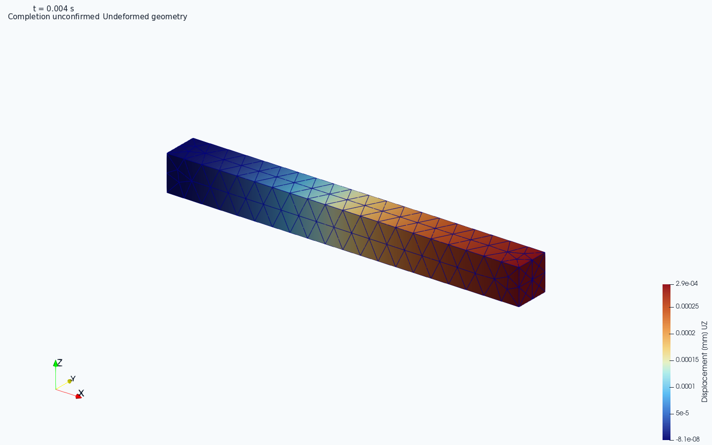

# 동해석 R2: 원 결과의 프레임 단위 처리, 정확 선택, 명시 재처리

요청: `PRO-NS2-N3-RETAINED-RESULT-C2-20261015-01-R2`.
이 문서는 R2 Core의 API와 동작 설명이다. Windows 파일 식별·선택 관문 교정은
[DYNAMIC_READER_SELECTION_C1_KO](DYNAMIC_READER_SELECTION_C1_KO.md), 실제 Runner 조작은
[동해석 사용법](DYNAMIC_WORKFLOW_KO.md#runner에서-보존된-출력-다시-읽기)을 따른다.

## 사용자가 하는 작업

기존 FreeCAD 모델과 `Workbench.register_local_input` → `submit('run')`를 그대로 사용한다. 동해석인 경우 기존 contact adapter가 native 종료 기록을 먼저 보존하고, 동일 strict FRD 규칙으로 한 프레임씩 임시 파일에 보관한다. 새 솔버, 스케줄러, DB, 프로젝트 형식이나 실행기가 없다. 원래 요청한 모든 프레임을 보관한다.

결과 목록과 단계표는 metadata API를 사용한다. 한 프레임을 선택하면 그 프레임의 해시와 원 job/input/result/native 위치를 검증한다. 원 출력과 모든 프레임의 전체 무결성 검사는 별도의 명시 감사이다. `DEFERRED`를 성공으로 표시하면 안 된다. 현재 Sol 창의 `frame_metadata()` 연결은 유지한다.

원 결과 읽기나 Post 등록이 실패했을 때, 종료한 원 job의 실행기록을 선택해 `dynamic.reprocess`를 한 번 제출한다. 이 새 job은 원 FRD/DAT/STA/rout/입력과 기록을 확인하고 **새 폴더에 파생 결과**를 만든다. 원 job을 재실행하거나 상태를 고치지 않는다. 재처리 job 자체가 SUCCEEDED여도 원 native/전체 작업의 FAILED/CANCELLED/UNKNOWN은 그대로다. 물리 승인도 UNKNOWN이다.

## 원 프레임을 전부 메모리에 보관하지 않는 처리

`dynamic_native_stream.read_dynamic_frd()`는 기존 `frozen_fem._read_frd_lines()`의 문법/채널/절점·요소 coverage/종결자 검사를 호출한다. 새로운 숫자 parser로 대체하지 않는다. 원 ASCII를 한 차례 줄 단위로 조사하고, 다시 동일 strict 문법으로 소비한다. 두 전체 Python 문자열이나 모든 프레임 dictionary를 만들지 않는다. 각 pass의 원 파일 hash/stat이 일치해야 한다.

일시적인 `NativeFrames`는 기존 프레임 값을 개별 pinned JSON으로 쓰고 payload cache를 최대 3개로 제한한다. 원 모델·토폴로지와 작은 프레임 catalog는 유지한다. 이 cache는 새로운 공유 저장 프레임워크가 아니라 이 reader의 일회성 작업폴더이며, 정상·오류·취소 시 해제한다. 프레임 수/시간/출력주기/값을 줄이거나 평균하지 않는다.

`write_result()`는 한 프레임 및 필요한 인접 속도 표본만 소비한다. DAT도 기존 parsing 규칙을 줄 단위로 소비한다. 기존 v2 index/프레임 artifact를 사용하며 모든 결과 payload를 index에 다시 넣지 않는다. 원 source/frame 크기 admission 상한은 올리지 않았다. 한 프레임 또는 metadata 자체가 기존 admission을 넘으면 명시 실패한다.

여기서 bounded는 **메모리의 전체 payload 적재와 조회의 payload I/O**에 대한 것이다. catalog의 행 수, 모든 파일의 path/size 확인, 생성·최초 pinning·명시 full audit 비용은 프레임 수에 비례한다. 전처리 mesh/토폴로지는 메모리에 있고, 프로그램 전체가 어떤 모델에서도 일정 RSS라는 주장은 아니다. 비교·전체 history·legacy v1 materialization을 요청하면 해당 범위를 실제로 읽는다.

## 정확한 조회 API

```python
from pathlib import Path
from caelab.dynamic_result_store import (
    describe_attempt, read_attempt, select_frame, verify_attempt, frame_metadata,
)

attempt = Path(r"C:\CAE\workspace\native\J_ORIGINAL")
catalogue = describe_attempt(attempt)  # 직렬화 가능한 metadata + 실제 verification 범위
result_pin = catalogue['verification']['result']
job_id = catalogue['job_id']
snapshot_id = catalogue['snapshot_id']
rows = catalogue['frames']

selected = select_frame(
    attempt, 0,
    expected_result=result_pin,
    expected_job_id=job_id,
    expected_snapshot_id=snapshot_id,
    expected_native=rows[0]['native'],
)
# 선택한 payload와 topology만 읽는다. 다른 프레임/raw 출력 byte 검사는 DEFERRED.

# 사용자가 명시하는 전체 감사. 실행이나 결과값 변경은 하지 않는다.
audit = verify_attempt(attempt, expected_result=result_pin,
                       expected_job_id=job_id, expected_snapshot_id=snapshot_id)
```

정확 원 owner가 실행기록 pin을 가지고 있으면 `expected_record`도 전달한다. `read_attempt`는 index와 실행기록의 artifact membership, job identity/request, snapshot, input origin, 원 상태를 대조한다. 선택 payload는 index의 hash뿐 아니라 내부 result identity·frame index·native increment/time·field 목록도 맞아야 한다. 다른 job에서 같은 시간/번호의 frame을 가져와 대체할 수 없다. 파일명·크기만 검사한 내용은 `VERIFIED`가 아니다.

v2 조회는 `INDEX_ONLY` 또는 `INDEX_AND_TOPOLOGY`; 선택 후 `selected_frame_bytes=VERIFIED`이다. `ALL_REFERENCED_BYTES`는 실제 명시 full audit에만 사용한다. 같은 크기의 미선택 payload 손상은 metadata 조회에서 발견하지 않을 수 있으며, 그 상태를 정직하게 DEFERRED로 돌려준다. 그 payload 선택 또는 full audit 시 해시 불일치를 거절한다. 잘못된 경로, symlink, 누락, 크기 변경, 중복·교차 dependency는 metadata admission에서 거절한다. persistent trust-cache로 미선택 검사를 생략하지 않는다.

기존 작은 v1 JSON은 기존 bounded 호환 reader로 계속 읽는다. v1은 monolithic이므로 metadata 조회도 그 파일을 materialize하며, `BOUNDED_LEGACY_V1_MATERIALIZED`로 구분한다. v1을 v2의 bounded payload 조회 성능으로 설명하지 않는다.

## 단일 위치 이력과 값의 의미

```python
from caelab.dynamic_results import history
result = read_attempt(attempt, expected_result=result_pin)
node = result['nodes'][0]
curve = history(result, 'VELO', body_id=node['body_id'],
                native_node_id=node['native_node_id'], component=2,
                step_id=result['stages'][-1]['id'])
```

`history`는 metadata의 실제 step/physical-time 여부를 먼저 필터링한다. 선택한 단계의 실제 body/native node/성분만 추적하고 공간 평균·nearest·보간은 하지 않는다. 전체 단계 이력을 명시하면 전체 해당 프레임을 순차 읽는다. 모든 nodal arrays를 다시 응답으로 보내지 않고 선택한 성분의 행만 반환한다.

U(mm), V(mm/s), RF(N), 응력(N/mm²), 변형률/PE(1)는 기존 model 단위와 원 채널을 유지한다. RF는 해당 단계의 **실제 구속 DOF에서만** 반력이다. 구속하지 않은 절점력은 반력으로 이름을 바꾸지 않는다.

A(mm/s²)는 native A가 아니라 **서로 다른 세 실제 V 시각**을 쓰는 기존 비균일 3점 미분이다. 단계 양끝, 충분하지 않은 표본, gap·누락은 기존 missing reason과 `None`을 유지하고 0으로 채우지 않는다. 단계 경계를 가로질러 미분하지 않는다.

ELKE/ELSE(N·mm)는 native DAT의 요소별 값과 원 합계이다. ENER(N/mm²)의 DAT 적분점, FRD 절점 복원값은 서로 다른 association이고 절점 밀도를 합산해 에너지로 만들지 않는다. 해당하지 않는/unassociated energy block, native token, 적분점 identity도 보존한다. 0-byte DAT는 입력 artifact로 보존할 수 있지만 missing energy가 0이라는 뜻은 아니다.

## Post와 접촉 결과를 같이 읽기

동적/정적 clock PVD와 기존 contact PVD는 **같은 프레임별 VTU 집합**을 가리킨다. 전체 legacy VTU 집합을 다시 생성하지 않는다. 원 contact sidecar의 node/body/surface/pair map, native signed values, raw token, validity/active/missing, gap, CPRESS·CSHEAR·CF/CFN/CFS 및 UNKNOWN 상태를 유지한다. NS1/셸/빔 writer의 독립 경로는 대체하지 않는다.

`dynamic_locations.load`, `verify_registration`, `verify_saved_source`의 기본은 pinned metadata admission이며 원 source/job/result identity와 기존 저장 dependency pin을 대조한다. `select(..., time=..., result_frame_index=..., registration_origin=...)`는 선택 VTU·dynamic frame·topology·선택 inspection JSON의 bytes를 확인한다. 다른 source의 같은 초를 검색하거나 restart 부모/READ clock을 합치지 않는다. 정적 preload는 무차원 모델 좌표, dynamic은 물리 초로 구별한다. 중복 시각이 모호하면 정확 result frame index 없이는 거절한다.

`dynamic_locations.audit`와 저장 시 명시 `full=True`가 전체 byte 감사이다. 기존 Post project의 저장 dependency와 source_revision을 그대로 사용한다. cold reopen은 미선택 raw 전체를 다시 해시하지 않으며, 선택 payload를 native reader에 넘기기 전에 확인한다.

`inspect_contact(..., time=..., pair_id=..., include_history=False)`는 같은 원 contact frame의 선택 inspection만 읽는다. 기본적으로 전체 force history를 자동 계산하지 않는다. 필요한 경우 `contact_history(..., pair_id=..., quantity='CFN', component=2, step_id=...)`를 명시한다. 기존 native model coordinate 축은 보존하고 물리 위치는 별도 `locations`로 제공한다. 원 접촉 inspection의 검증 코드를 선택 로딩에 재사용하며, 일반 legacy eager API와 기존 admission은 그대로 유지한다.

## 기존 JobManager에서 명시 재처리

```python
from caelab.workbench import Workbench
from caelab.dynamic_recovery_job import request, open_result, OPERATION

wb = Workbench(r"C:\CAE\workspace")
try:
    args = request(wb, 'J_ORIGINAL')  # 원 terminal receipt 선택; 제출/실행 없음
    job = wb.submit(OPERATION, args, request_id='readback-user-action-001')
    # 기존 Runner/JobManager로 상태·취소를 처리한다.
    # 동일 request_id+args는 기존 idempotency를 사용한다. 새 시도는 새 ID이다.
    # 상태가 terminal이고 retained result가 있으면 아래 reader로 연다.
    # result = open_result(wb, job['id'], metadata_only=True)
finally:
    wb.manager.shutdown()
```

GUI는 이 API를 소비하되 이번 ZIP에는 GUI 수정본이 없다. 일반 service의 기존 submit/status/cancel/result 경로를 사용한다. 새 HTTP provider나 coordinator를 만들지 않는다.

다른 derived attempt를 native 부모로 지정, active job/cleanup 미확인, 바뀐 receipt, 다른 data_id/request/input origin은 거절한다. 기존 Workbench source root와 실제 JobManager 기록을 사용한다. 새 산출물의 `job_id`는 **원 native job**, `derivation.readback_job`은 **새 읽기 job**이다. registrar를 통과시키기 위해 두 ID를 바꿔치기하지 않는다. 두 identity와 copied source_execution receipt를 모두 확인하는 최소 root hunk를 제공한다.

실제 ccx 종료가 확인되면 early native terminal이 저장되고, 이후 reader/Post 성공·실패·취소는 별도 기록이다. 이미 근거 없는 옛 timeout의 native 성공을 역추정하지 않는다. 취소 중 원 입력/rout/runtime/STA/원 결과는 유지하고 미완성 새 artifact를 성공 index로 게시하지 않는다. 원 기록과 raw pin 검사는 명시 재처리에서 실제 전수 수행한다. 그 비용은 목록 조회에 숨겨 실행하지 않는다. 물리적으로 다른 실행을 이 readback의 native 실행으로 대신할 수 없다.

## WRITE/READ와 사전 수치 policy의 경계

이번 R2는 전달된 R1 `dynamic_restart.py`를 변경하지 않는다. 실제 2,010,796-byte Windows rout를 읽는 read-only 회귀와 기존 unknown ABI·rin byte identity·동일 runtime/완료 checkpoint·새 READ step 관문을 재검사한다. 이것은 Windows READ 실행 성공이 아니다.

기존 `compare_continuation`과 `compare_saved_states`의 공통 `atol + rtol*max(abs(a),abs(b))` 비교식과 명시 tolerance 요구를 유지한다. 출력 채널별 mm/mm·s⁻¹/N/N·mm/N·mm⁻²/무차원과 실제 출력 precision에 맞춘 **사전 채택된** policy가 필요하다. 이번 크기 검사는 그러한 policy를 정하는 근거가 아니고, 기본 공통 1e-N을 추가하지 않는다. 결측/허용치 미지정은 INCOMPLETE, qualification은 UNKNOWN이다.

rout saved arrays는 native `vold/veold`의 mt×nk, `sti/eme`의 6×mi(1)×ne, `ener/xstate/contact`의 실제 layout/count와 각 record hash를 사용한다. 없는 A hidden state를 있다고 만들지 않는다. topology/order와 크기가 다른 saved arrays는 숫자만 맞춰 비교하지 않는다. 각 array의 구성/단위가 혼합된 경우 caller가 그 실제 의미를 확인해야 하며 동일 숫자 허용치를 임의 적용하지 않는다. exact-zero의 합성 reader 동등성 검사는 protocol 동일성 진단일 뿐, 진동 주기·위상·감쇠나 공학 수용과 같지 않다.

## 검사 재현과 미실행

`tests/test_dynamic_r2_*.py`는 원 strict grammar와 payload 동등, 소형 실제 retained subset/rout, 손상/경로/교차 identity, scope별 byte read, step-filtered history, cancellation/부분 게시, actual JobManager+owned-process double의 solver0 재처리, owner 재열기·경로 이동, contact raw/masks/공유 VTU를 검사한다. actual native 실행이 아니다.

`tools/profile_dynamic_r2.py --output NEW_FOLDER --frames-per-step 3` 또는 `200`은 공개 첫 3프레임의 **명시 synthetic size double**이다. 원 값 블록을 순환시키고 시간·증분 header를 합성한다. 실제 원400프레임이나 그 물리값이 아니다. 1085 nodes/502 C3D10의 입력 모델을 유지한다. 메모리는 새 process의 adapter 전체 RSS를 10ms 간격으로 측정한다. query의 실제 read/readinto byte 수도 따로 기록하고 source 해시 전후 일치를 검사한다. GB 크기 생성본은 인도 ZIP에 넣지 않고 측정값/생성 코드/원 seed/hash만 넣는다.

실제 ccx/READ, FreeCAD/PySide6의 OS 사용자 조작, 물리 수용과 더 넓은 E3–E6/C1–C6/explicit FN16–17 law/contact는 NOT_RUN 또는 별도 잔여다. 원 full400 읽기와 stock ParaView 확인은 아래 후속 결과를 따른다. 기존 사용자가 보고한 Windows45PASS, R1 35PASS1FAIL, 과거 C2 기록은 이번 test count에 합산하지 않는다.

## 실제 400프레임과 ParaView 확인

2026-10-15에는 보존된 실제 FRD 163,291,184 bytes와 DAT·STA·rout·원 입력을
기존 재처리 API로 한 번 읽었다. 합성 프레임이나 새 솔버 계산을 사용하지 않았다.
400프레임 전체를 개별 결과와 VTU로 저장했고, index는 372,421 bytes다.
원 823MB 문서의 제한 초과 실패와 원 파일은 보존한다.

ParaView 6.2의 실제 reader에서 0.00001·0.00201·0.004 s를 열고 1,085절점·502요소와
변위·Z속도·XX응력·요소 운동에너지 배열을 저장 결과와 대조했다. 상태를 저장한 뒤
별도 프로세스에서 다시 열어 선택 시각·변위 Z성분·값이 유지됨을 확인했다.
시험에 사용한 프로세스는 모두 종료했다.



위 화면은 실제 0.004 s의 Z방향 변위를 색으로 표시한 결과이며 형상은 변형하지 않았다.
원 실행은 부모 종료 기록이 없어 전체 계산 완료를 확인할 수 없다. 결과를 읽는 데
성공했어도 원 취소 요청 상태와 공학적 미승인을 유지한다. 실제 WRITE/READ 이어 계산,
Workbench 등록, plugin 종료 메뉴와 OS 마우스·키보드 조작 수용은 별도 잔여다.

이 PC에서 ParaView의 **File → Open**으로 다음 파일을 열고 **Apply**하면 시간별 결과를
볼 수 있다. 저장한 보기까지 불러오려면 **File → Load State**에서 PVSM을 연다.

```text
C:\SourceCodes\autonomous-cae-lab\_workspace\delivery-structure-impact\r2-actual400-readback\derived\dynamic-post\dynamic.pvd
C:\SourceCodes\autonomous-cae-lab\_workspace\delivery-structure-impact\r2-actual400-readback\native-post-01\actual400-native-post.pvsm
```

이 큰 결과 파일은 로컬 작업 폴더에만 있으며 저장소 복제본에 포함하지 않는다.
실행·읽기와 원 파일 전후 확인은 같은 폴더의 `finish-summary.json`, ParaView 확인은
`native-post-01/finish-summary.json`에 남겼다.
