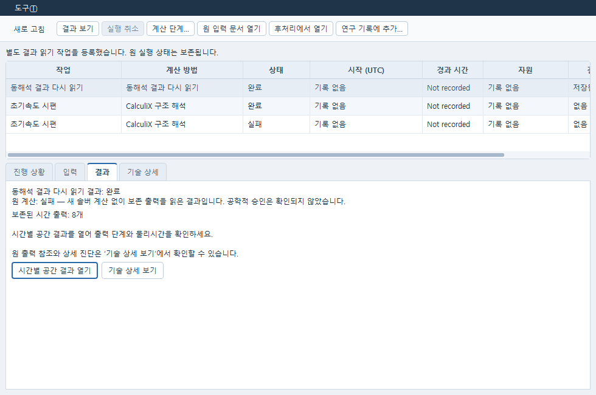

> 2026-10-15 C1 교정: `PRO-NS2-N3-CORRECTION-20261015-01`을 적용한 사용법이다.
> 원 요구 1–7과 기존 1–11장은 유지한다. 단계 복제, 실제 제출, READ 파일 등록,
> 정확한 Post 의존 파일/원천 복원은 아래 12장에서 보강했다.
> 이 소스 교정의 portable 통과를 Windows native 실행이나 공학 승인으로 읽지 않는다.

# 사용자 고체 동해석과 실제 저장점 이어가기

## Runner에서 보존된 출력 다시 읽기

계산이 끝났지만 결과 읽기나 등록이 실패했으면 Runner에서 **원 실행**을 선택한다.
**진행 상황**의 원 상태와 오류, **입력**의 고정 입력을 확인한다. 필요한 경우
**입력 문서 열기**로 원 모델을 연다. 프로세스 종료가 확인된 구조 실행에서만
**결과 다시 읽기**를 사용할 수 있다. 원 파일의 존재·정확한 실행 기록·동해석 지원
여부는 기존 서비스가 다시 검사하며, 거절 이유는 창의 안내에 표시한다.

버튼을 누르면 같은 JobManager에 **동해석 결과 다시 읽기**라는 새 작업이 생긴다.
새 솔버 계산은 시작하지 않는다. 원 실패·취소 상태, 원 입력과 원 출력은 보존한다.
새 작업은 목록에서 따로 선택하며 기존 **실행 취소**는 선택한 읽기 작업에만 적용된다.
**원 실행 선택**으로 원 기록에 돌아가고, **원 입력 문서 열기**는 원 실행의 입력을 연다.
등록 응답이 유실되면 **같은 읽기 요청 확인**을 눌러 동일한 요청을 확인한다.
선택을 바꾸거나 창을 닫아도 늦은 등록 응답이 다른 작업 화면을 바꾸지 않는다.
창을 다시 열면 서비스의 기존 목록에서 등록된 읽기 작업을 찾는다.

새 작업에 결과가 저장되면 **결과 보기**에서 읽기 상태와 원 계산 상태를 구분해 확인한다.
이 화면은 기록된 시간 출력 수와 읽기·등록 오류를 표시한다. **시간별 공간 결과 열기**로
등록된 Post를 열고 **기술 상세 보기**로 원 출력 참조와 진단 원문을 확인한다.
**후처리에서 열기**는 선택한 새 작업에 등록된 정확한 Post 입력을 연다. 원 실행의
다른 Post 입력으로 대신 열지 않는다. 결과 읽기 완료는 원 계산 성공이나 공학적 승인으로
판정하지 않는다. 원 출력이 부족하면 읽기 작업도 실패할 수 있다.



위 화면은 조작 확인용 예시 자료다. 실제 계산 결과의 물리 수용을 나타내지 않는다.

2026-10-15 GUI 확인은 제어된 서비스 응답으로 admission·취소·응답 유실·늦은 응답·
원 입력/파생 Post 구분을 검사하고, Windows Qt 창을 980×650과 1420×900에서 확인한 것이다.
HTTP preparation도 보존된 작은 대역 원 실행으로 새 작업을 제출하지 않음을 확인했다.
실제 400프레임 원 출력 읽기, 실제 WRITE/READ 및 물리 비교의 완료 근거를 대신하지 않는다.

Runner의 경과 시간은 **시작 전**, **기록 없음**, **종료 시각 미기록**, **시간대 미기록**을
구분한다. **마지막 갱신까지**는 추적이 중단된 작업의 관측 구간이며 종료 확인을 뜻하지 않는다.
시간대 없는 과거 날짜에도 **시간대 미기록**을 붙여 UTC로 추정하지 않으며 원 날짜는 기술 상세에 남긴다.
결과의 **사용 / 제외**는 원 유효성 마스크를 표시하고, 제외 구간은 곡선에서 잇지 않는다.
후보 표의 **예측값**과 실패·벌점 목적함수는 유효 목적함수와 구분한다. 기본 표의 후보 번호는
보기 순서이며 원 후보 ID, 실행 ID, 요청 식별값과 원 상태·응답은 **기술 상세**에 보존된다.

요청: **PRO-NS2-N3-DELIVERY-20261015-01**
기준: **90d0869ba17e19671538f11e0630e1f35799ae51**. 첨부 `current-wip`는 읽기 전용 참조다. 이전 대화에서 회수한 NS2 구현은 없다.

## 1. 이번 인도 상태와 적용

이번 코드는 기존 CalculiX C3D10 implicit dynamic 경로를 확장한다. 별도 solver, scheduler, 웹 화면, project format을 만들지 않는다. 전용 코드와 기존 코드의 통합 패치를 모두 적용해야 메뉴부터 실행까지 연결된다. 기존 `.caepre`, Owner 문서·generation, frozen snapshot, JobManager와 retained attempt를 그대로 사용한다. `dynamic_result.json`은 기존 실행 폴더 안의 파생 결과 artifact이며 별도 프로젝트 파일이 아니다.

**제품 코드 작성/portable 검사와 Windows native 수용 완료는 다르다.** Pro 작성 호스트에는 FreeCAD, CalculiX, ParaView, Qt 바인딩이 없었다. Windows 통합에서는 초기 속도 예제의 실제 생성·managed 저장·새 Owner 재열기/재동결과 두 크기의 FreeCAD Qt 입력 오류 복구를 확인했다. 계산부터 결과 열기까지의 완결 동선·READ 수치 동등성·다른 법칙/접촉 모델은 아직 확인하지 않았다. 계산이 정상 종료해도 `qualification=UNKNOWN`, `decision=NOT_RELEASED`, `engineering_valid=False`다. 실제 지원 판정은 아래 native 수용 순서로 닫아야 한다.

후속 Windows 초기 속도 예제의 원 출력은 400프레임이다. 처음 저장한 823MB 결과 문서는
256MiB 읽기 제한으로 실패했으며 그 실패와 원 입력·FRD/DAT/STA/rout를 보존한다.
R2 적용 후에는 같은 원 400프레임 전체를 새 결과로 읽고 실제 ParaView 6.2에서
표시·상태 저장·별도 프로세스 재열기를 확인했다. [실제 결과와 여는 방법](DYNAMIC_RETAINED_R2_KO.md#실제-400프레임과-paraview-확인)을 따른다.
원 부모 종료 기록이 없어 전체 계산 완료를 추정하지 않으며, 실제 READ 이어 계산과
수치 비교는 여전히 남아 있다. 출력 간격이나 수치 기준을 바꾸어 통과시키지 않는다.

ZIP의 `source/`에는 Pro 소유의 새 파일만 있다. 공통 파일은 `integration.patch`에 작은 hunk로만 들어 있다. Sol 소유의 Runner/Impact, fem_panel, assembly_pose 및 다른 팀 소스는 직접 교체하지 않는다. 다음은 **Codex 통합 담당자용**이며 사용자에게 git 작업을 요구하는 절차가 아니다.

```text
git apply --check product.patch
git apply product.patch
git apply --check integration.patch
git apply integration.patch
```

`source/`를 복사한 경우 product.patch까지 중복 적용하지 않는다. 공통 WIP에 hunk 충돌이 있으면 현재 변경과 비교해 병합하며 공유 파일을 통째로 덮어쓰지 않는다. 별첨 검증 기록은 원본 snapshot에 두 패치를 실제 적용한 결과를 포함한다. 배포 설치본에는 두 패치의 모듈을 모두 포함해야 한다.

## 2. 자기 모델에서 시작하기

기존 FreeCAD 제품을 열고 하나의 editable solid, 그 solid를 대상으로 생성한 양의 Jacobian의 C3D10 메시, 재료, 경계조건을 준비한다. 접촉 모델은 기존 분리 body/메시/접촉 정의를 그대로 쓴다. 기존 메시 품질, 원 형상·면·배치·토폴로지, 재료 할당, Analysis 소속 검사를 우회하지 않는다.

첫 경로는 무접촉 **단일 solid** 또는 기존 penalty linear/Coulomb 접촉 모델이다. 다른 무접촉 다중 body, shell/beam, tie/adjusted MPC, 새로운 접촉 법칙, 완전 자유비행은 이번 지원 경로가 아니다. 기존 compiler는 단계마다 적어도 하나의 지정변위/고정 구속을 요구한다. 구속을 임의로 추가해 통과시키지 않는다.

FEM에서 해당 Analysis와 CalculiX solver를 명시적으로 선택한다. 기존 native solver의 `AnalysisType=static`, `ModelSpace=3D`, `SplitInputWriter=False` 조건은 유지한다. 이 경로의 실제 STATIC/DYNAMIC 입력은 **전용 단계 compiler**가 생성한다. 일반 FreeCAD writer나 기존 정적 입력 생성으로 돌아가지 않는다. 동해석 record가 있는 Analysis의 일반 freeze는 차단하고 동해석 명령을 사용하게 한다.

상단 **동해석 → 동해석 설정…**을 연다. 해석/솔버를 선택하고 **설정 만들기**를 누른다. 기존 FEM 재료·기하·수렴 편집에 미적용 입력이 있으면 먼저 저장·적용하거나 취소한다. 동해석 실행은 해당 공유 편집의 미저장 보호도 확인한다.

## 3. 초기 상태와 오류 복구

오류 목록에서 항목을 더블클릭하거나 Enter를 누르면 해당 입력으로 이동한다. 초기값·밀도 오류는 원 행의 입력칸을 선택하고, 좁은 창에서도 그 칸이 보이도록 스크롤한다. 이동이나 입력 수정만으로 적용·계산을 실행하지 않으며, 수정한 초안을 확인한 뒤 **적용**을 선택한다.

밀도는 각 원 body/재료의 **kg/m³** 값이다. solver에 쓰는 단위는 tonne/mm³이며 변환은 `rho_solver = rho_kg_m3 × 1e-12`다. 단위를 변환할 뿐 재료 원곡선·law·응력/변형률 measure는 바꾸지 않는다. 하나의 재료 객체를 여러 body가 공유하면 서로 다른 밀도를 줄 수 없다.

Rayleigh 감쇠는 모델 전체의 한 쌍 `α [1/s]`, `β [s]`다. 별도 칸의 `수치감쇠 α [무차원]`는 `*DYNAMIC,ALPHA`이며 Rayleigh α와 다르다. Rayleigh 계수는 0 이상, 수치 α는 -1/3 이상 0 이하를 요구한다. 기본 수치 α는 -0.05로 초안에 명시된다. 저장 주기의 단위는 **완료 단계 수**이며 시간증분 수가 아니다.

3D 화면에서 같은 body의 면을 선택하고 **대상 선택…**을 누른다. 또는 `3D 화면에서 선택한 면 사용`을 끄고 원 메시의 실제 절점 번호를 입력한다. 내보내기에서 재번호화된 solver 절점 번호를 원 절점 번호로 입력하지 않는다. 원 body, 메시, 형상·면·배치·전체 binding과 선택 절점을 함께 보관한다. 원 대상이 삭제되거나 다른 메시/형상으로 바뀌면 재선택이 필요하다. 가까운 점이나 비슷한 중심/부피로 자동 대응하지 않는다.

조건 표에서 U 또는 V, 전역 X/Y/Z DOF, 값을 편집한다. U 단위는 mm, V 단위는 mm/s다. `*INITIAL CONDITIONS,TYPE=DISPLACEMENT/VELOCITY`로 보내며 CAD 이동이나 지정변위로 대체하지 않는다. 같은 종류/절점/DOF의 중복을 막는다. 같은 DOF의 U와 V는 서로 다른 초기 상태이므로 별도로 지정할 수 있다. 비영 초기 U/V와 첫 단계의 지정변위 DOF 중첩, 비영 초기 U/V와 정적 선행 단계의 조합은 이번 경로에서 차단한다.

`1e`처럼 미완성 숫자를 입력한 상태에서도 **초안 저장**과 프로젝트 저장은 가능하다. **적용**은 유한성·범위·대상·law/step 조합을 먼저 검사하고 통과한 설정만 native 밀도 및 적용 상태에 기록한다. 오류가 있으면 원 초안을 보존하고 입력 생성/계산을 막는다. 오류 항목을 활성화하면 관련 탭/행/입력으로 이동한다. 일부 단계 compiler 오류는 단계 탭 수준으로 안내되며 정확한 셀 자동 이동까지는 미완료다.

**수정 취소/저장본 읽기**는 미저장 변경을 버릴지 확인한다. 해석을 바꾸는 동안의 미저장 편집, 늦은 응답, 문서 닫기/재연결 때의 변경은 기존 Connection과 전용 buffer의 선택 세대 검사로 보호한다. 실제 FreeCAD Qt에서 미완성 숫자 저장→오류 Enter 이동→키보드 수정→명시 적용과 창 정리를 확인했다. OS 입력기·다중 문서 재연결 전체의 수용은 남아 있다.

## 4. 정적 선행하중과 동적 단계

**시간 단계** 탭에서 단계 추가/삭제/순서 변경과 정적·동적 절차, 길이, 초기/최소/최대 증분, 최대 횟수, 출력 간격을 편집한다. 내부 단계 ID는 순서를 바꿔도 유지한다. 이번 허용 순서는 `dynamic+` 또는 `static+ → dynamic+`다. dynamic 뒤 static으로 되돌아가는 순서는 초안 저장은 가능하지만 적용/입력 생성은 차단한다.

단계를 선택한 뒤 **하중 곡선…**에서 각 기존 조건의 곡선/유지/해제를 선택한다. 곡선의 좌표는 해당 단계의 좌표다. 유지는 직전 단계 끝 조건값을 유지한다. 힘 해제는 하중을 제거하고, 지정변위 해제는 해당 자유도의 구속을 제거한다. 기존 고정 지지조건을 몰래 해제하지 않는다. 기존 compiler의 OP=NEW 규칙을 사용하므로 외력이 없는 초기속도 모델에도 빈 CLOAD 초기화 카드가 있을 수 있지만 힘 숫자를 만들어 넣지 않는다.

정적 단계의 가상시간 1 뒤에 동적 단계 0.002 s가 오면 native 전역 좌표는 약 1.002지만 **동적 물리시간은 0.002 s**다. 단계 ID/순서/procedure, native 전역 좌표, native 단계 좌표(전역 좌표에서 시작점을 뺀 파생 값), 동적 물리시간, wall time은 각각 구분한다. 정적 좌표를 단일 하중계수라고 표시하지 않는다. 독립 곡선이 있으므로 일반적인 공통 하중계수는 정의되지 않는다. wall time은 프레임의 solver 물리시간이 아니다.

동일 입력의 연속 native 단계가 앞 단계의 변위·재료·접촉 상태를 전달한다. 초기조건을 매 단계 다시 적용하거나 FRD 변위로 재시작 상태를 만드는 코드는 없다. J2/기하비선형/접촉의 구체적인 상태 전달 수치 동등성은 아래 실제 native 비교가 남아 있다.

## 5. 입력 생성, 계산, 시간 결과

**적용 → 입력 생성**은 기존 owner에서 editable 프로젝트와 frozen snapshot을 보존하고 실제 `contact.inp`를 보여준다. **계산**은 기존 Connection의 명시적 명령→입력 등록→JobManager→ContactFemCalculixAdapter 경로를 쓴다. 새 작업 큐나 자동 재시도는 추가하지 않는다. 기존 configured PATH의 `ccx`를 사용한다. 실행파일 교체/다운로드/유료 fallback은 하지 않는다.

계산 중 취소는 기존 계산 목록/JobManager에서 수행한다. late cancel로 이미 끝난 다른 실행 상태를 바꾸는 새 경로는 만들지 않는다. 이번 전용 설정의 수정 취소는 편집 취소이며 solver 취소와 다르다.

**저장 결과…**에서 보존된 실행 폴더를 고르면 solver를 호출하지 않고 읽는다. 원 body/절점/DOF, 단계 또는 요소/적분점을 선택하면 실제 표와 시계열 그래프가 바뀐다. 그래프는 누락점을 0으로 잇거나 다른 단계 사이를 이어 그리지 않는다. 정적 단계와 동적 단계의 시각을 섞지 않는다.

**단계 / 원 시각**에서 출력 행을 선택하면 그 단계의 좌표 정의를 볼 수 있다.
단계 좌표는 정적이면 가상좌표 `[1]`, 동적이면 해당 단계의 시간 `[s]`로 표시한다.
정적 단계의 물리시간은 **해당 없음(정적)**이며, 동적 시간의 **결측**과 구별한다.
**전체 좌표**는 솔버가 기록한 누적 좌표다. 정적 가상좌표가 포함될 수 있으므로 물리시간으로
바꾸어 읽지 않는다. 각 좌표의 원값과 상세 정의는 해당 셀의 도움말에 남는다.

| 채널 | 원천과 위치 | 단위 / 의미 |
|---|---|---|
| U | native FRD 절점 | mm |
| V | native FRD 절점 | mm/s |
| 절점력 RF | native FRD 절점 | N. 그 단계에서 구속된 DOF에 한해 반력으로 해석 |
| A (속도 미분) | 같은 동적 단계의 실제 V와 비균일 출력시각 | mm/s². native A가 아닌 파생량 |
| ELKE | native DAT 원 구조요소별 | N·mm, 운동에너지 |
| ELSE | native DAT 원 구조요소별 | N·mm, 내부에너지 |
| ENER (적분점) | native DAT 원 요소/적분점별 | N/mm², 에너지밀도 |
| ENER (절점 복원) | native FRD 절점 외삽·평균값 | N/mm². 적분점 값이나 ELSE가 아님 |

A는 세 출력점의 2차 보간식을 가운데 시각에서 미분한다. `hL=t_i-t_(i-1)`, `hR=t_(i+1)-t_i`에 대해 계수는 `[-hR/(hL(hL+hR)), (hR-hL)/(hL*hR), hL/(hR(hL+hR))]`다. 값과 실제 세 시각·프레임·계산방법을 보존한다. 각 단계 처음/마지막 출력은 결측이다. 출력이 두 개 이하면 그 단계의 A는 전부 결측이다. 누락된 V, 비유한 값, 표현 불가능한 시각 간격도 사유와 함께 결측이며 외삽하지 않는다.

ELKE/ELSE 합계는 원 구조요소를 한 번씩만 합산한다. 접촉에서 solver가 만든 보조요소를 구조요소 에너지 합계에 몰래 더하지 않는다. ENER는 절점/적분점 값을 단순 합산하지 않는다. 이 세 채널로 전체 외력일·접촉일·감쇠소산·전체 에너지 평형이 검증됐다고 주장하지 않는다. 비선형 누적 내부에너지 요청은 정적 선행 단계부터 포함한다.

ParaView용 VTU/PVD는 동적 물리시간과 정적 선행 좌표를 별도 시리즈로 보존한다. 원 body/요소/절점 대응, 단위, 파생 A의 유효 마스크, 에너지 위치를 함께 쓴다. **계산 목록에서 Post 열기**는 기존 Runner를 해당 job ID로 열고, 그 창의 기존 Post 열기 명령을 사용한다. 이번 인도는 Post 창을 직접 다시 구현하지 않는다. 이 추가 클릭과 Runner/ParaView 실제 창 연결은 Windows 수용 확인 대상이다.

## 6. 실패, 수정 후 새 계산, cold reopen

실패/취소 실행에서는 원 `.inp/.frd/.dat/.sta/.rout`, stdout과 기존 NS1 수렴 판정을 보존한다. strict reader가 STA의 수렴 증분에 대응하는 끝부분만 부분 결과로 인정한다. 요청 채널이 없거나 저장 출력이 손상되면 성공으로 올리지 않는다. 부분 결과는 마지막 인정 프레임까지만 읽으며, 실패 상태와 결측은 그대로 남는다. 인정할 결과 프레임이 없으면 원 입력/로그/진단 창을 보여준다. 기존에 pin으로 보존된 결과 파일이 변조됐을 때는 이 fallback으로 숨기지 않고 차단한다.

원 입력을 수정하고 다시 계산하려면 부모 실행의 `frozen_input/editable.caepre`를 기존 프로젝트 열기로 연다. 형상·재료·조건을 필요한 만큼 편집하고 초기조건 대상을 재검토한다. **초안 저장 → 적용 → 입력 생성/계산**으로 새 snapshot/새 job/새 attempt를 만든다. 이전 결과의 수치/시각/상태는 덮어쓰지 않는다. 이것은 restart가 아니라 새 계산이다.

문서를 저장하고 FreeCAD를 종료한 뒤 `.caepre`를 다시 열면 저장된 초안과 원 native 문서를 불러온다. 이전 실행의 결과 창은 retained artifact를 읽을 뿐 계산하지 않는다. 결과 파일, 입력, 실행기 identity, index가 맞지 않으면 읽기를 막는다. 초기 속도 예제는 실제 FreeCAD1.1.4에서 managed 저장 뒤 원 문서를 닫고 새 Owner로 재열어 초안·적용 상태·재동결을 확인했다. 다른 모델과 실제 계산 결과의 cold reopen은 남아 있다. 메시 번호/형상 참조가 변한 경우 추정 대응하지 않고 막는다.

## 7. 실제 rout → rin → READ

재시작 선택은 실제 `solver/contact.rout`와 원 입력/실행/STA가 모두 보존된 부모 실행에서만 가능하다. `.rout`의 저장 단계와 STA의 완료 단계 끝을 함께 확인한다. FRD 마지막 시각은 checkpoint가 아니다. 파일이 없거나 부분 기록/알 수 없는 layout/실행기 불일치면 이유를 표시하고 새 초기조건 실행으로 대체하지 않는다.

결과 창에서 **저장점 이어가기**를 누른다. 현재 열려 있는 원 모델, 재료, 밀도, 초기조건, Rayleigh/수치감쇠, 기존 조건, 저장 주기는 부모와 같아야 한다. 이미 끝난 단계도 같아야 한다. 현재 적용된 전체 단계표에서 선택 checkpoint 이후의 단계만 READ 실행에 사용한다. 후속 단계 곡선/길이는 편집 가능하지만 원 대상 집합/재료/기하를 바꾸는 일반 모델 변경은 허용하지 않는다.

기본은 **입력만 생성**이다. 원 rout 전체를 새 snapshot의 `contact.rin`으로 byte-for-byte 복사한다. native 실행 직전에 새 attempt의 solver 폴더로 다시 정확히 복사한다. 원 `.rout`은 보존한다. 입력 첫 카드는 `*RESTART,READ,STEP=n`이며 원 mesh/material/IC 카드를 반복하지 않는다. 기존 이름과 충돌하지 않는 후속 amplitude namespace를 사용한다. 부모 job/data/snapshot/input/실행기 SHA, 실제 저장점·rout·rin 관계를 기록한다. 직접 Python 실행은 실제 JobManager job이 없으므로 job ID를 만들어 내지 않는다.

지원 reader는 전달 공식 commit `cff1bb12…`의 순차 Fortran unformatted 구조 중 4-byte record marker, int32, float64 layout이다. little/big endian은 기록 구조를 모두 확인한다. **이 source layout을 설치된 CalculiX 2.22 Windows 바이너리의 실측 layout이라고 부르지 않는다.** 다른 marker/int 크기나 알 수 없는 기록은 차단한다. 동일 실행파일 SHA와 platform이 필수다. 지원 layout으로 읽혔다는 사실만으로 J2/contact 내부 상태의 동등성을 승인하지 않는다.

연속/분할 비교는 actual READ 실행 관측, 원 메시/요소 연결, 단계 ID·순서·길이·native 경계, 양쪽 실제 출력시각의 빠짐 여부, 모든 native U/V/RF/S/E/PE/ENER 값, 요소 ELKE/ELSE 및 적분점 ENER를 대조한다. 별도로 `.rout`의 실제 저장 구조 상태 배열과 native 전역 좌표를 비교한다. 시각 보간/값 재조정은 없다. 출력 또는 필요한 tolerance가 없으면 INCOMPLETE다. PASS도 물리 승인이나 저장되지 않은 모든 hidden state의 증명은 아니다.

## 8. 공개 editable 예제 생성

`examples/dynamic/generate_freecad.py`는 설치된 FreeCAD/ObjectsFem/GmshTools와 기존 Owner를 사용한다. 시스템 Python이 아니라 **제품 Connection을 아직 시작하지 않은 FreeCAD Python 콘솔**에서 실행한다. 기존 창의 문서 owner와 두 번째 owner를 동시에 만들지 않는다. 아래 경로는 설치한 저장소/새 폴더에 맞춘다.

```python
import sys
sys.path.insert(0, r"C:\work\autonomous-cae-lab")
from examples.dynamic.generate_freecad import generate
receipt = generate(r"C:\cae-runs\ns2-initial-v", case="initial-velocity")
print(receipt)
```

기존 FreeCAD에서 Gmsh 경로가 설정되지 않았을 때만 설치된 실행파일을 `gmsh=r"C:\...\gmsh.exe"`로 명시한다. 새 다운로드/설치/fallback은 하지 않는다. Gmsh 실행 실패, 0개 메시, 기존 품질 검사 실패는 숨기지 않는다.

예제는 편집 가능한 100×10×10 mm Part::Box와 C3D10 메시이며 beam 요소 모델이 아니다. 예시 재료 E=210000 MPa, ν=0.3, ρ=7850 kg/m³는 설명용 입력이지 실측 재료 승인이 아니다. `initial-velocity`는 고정된 한쪽 면과 반대쪽 원 면 절점의 Z 초기속도 100 mm/s, 외력 없음, 0.002 s의 동적 두 단계다. `preload-release`와 `preload-hold`는 5 N 횡하중의 정적 선행 단계 뒤 동일 길이의 동적 두 단계를 각각 해제/유지한다.

출력은 `example.caepre`, native editable 문서, 동결 입력, 생성 결과 기록이다. 생성기 자체는 solver를 실행하지 않는다. 제품을 시작해 `example.caepre`를 열고 위 동선을 진행한다. 생성 성공/실행성공/수치 수용/공학 승인은 각각 별개다.

## 9. native 연속/분할 최소 수용 실행

`examples/dynamic/verify_restart.py`는 기존 adapter를 세 번 명시적으로 사용하는 검사 도구다. 새 scheduler가 아니다. 전체 계산 → prefix 계산 → 실제 READ 후속 계산을 수행한다. 각 attempt는 새 폴더이고 실패를 자동 재시도하지 않는다. 뒤이어 결과를 cold read하고 `.rout` 상태를 비교한다. 기존 configured PATH의 ccx를 그대로 사용한다.

```text
python -m examples.dynamic.verify_restart C:\...\snapshot.json C:\cae-runs\ns2-native-check --policy C:\...\policy.json --checkpoint-step 1
```

초기속도 예제는 checkpoint 1, 정적 선행 예제는 checkpoint 2를 사용한다. 이 **검사 helper**는 split 이전에 적어도 한 dynamic 단계를 요구한다. 제품 READ inventory 자체는 실제로 저장된 정적 완료 단계도 검토할 수 있다. 정적 checkpoint 단독 prefix 비교 helper는 추가 확인 사항이다.

수치 허용치는 비교 결과를 보기 **전에** 정해야 한다. 제품은 기존 형상·STA·FRD 허용치를 바꾸지 않는다. 검사에는 다음 JSON 필드가 필요하다. `examples/dynamic/comparison-policy.template.json`의 null을 문제·출력 정밀도·단위에 맞게 모두 숫자로 정한 뒤 사용한다. 예제의 0 또는 임의 tolerance를 공학 허용치로 자동 제공하지 않는다.

- `absolute`: DISP, VELO, FORC, STRESS, TOSTRAIN, ENER, ENER_IP, ELKE, ELSE 및 J2일 때 PE. 각 원 채널 단위의 절대 허용치.
- `relative`, `time`: 무차원 상대 허용치, native 좌표/출력 매칭 절대 허용치.
- `saved_arrays`: vold, veold, sti, eme, ener, xstate, pslavsurf, clearini, xmodal, ctrl, qaold, prestr, xmodal_modes. 저장 배열의 실제 의미/단위를 보고 정한다. 일반 단일 물리 허용치가 아니다.
- `saved_relative`, `saved_time`: 저장 상태의 상대/전역 좌표 허용치.

실행 전 모든 값의 유한성/비음수/필수 항목을 검사한다. 결과 `native-comparison.json`은 실제 실행 때에만 만들어진다. 이번 ZIP에는 그런 실제 native PASS 기록을 넣지 않았다. 수치가 일치하더라도 `UNKNOWN/NOT_RELEASED`를 유지한다.

## 10. 조합별 완료/미완료

| 조합 | 입력·상태·reader 코드 | 이번 호스트의 검증 | 남은 native 확인 |
|---|---|---|---|
| 탄성 C3D10, 무접촉 단일 solid, dynamic | 구현 | portable 검사; Windows 초기V 생성·저장·재열기/재동결 | 실제 계산·자기 모델 수용 |
| 탄성 C3D10, 기존 linear/Coulomb 접촉 | 구현 | 기존 접촉 경계 + 조합별 deck 검사 | 접촉 U/V/힘/에너지·수치 안정성 |
| 위 조합의 static→dynamic hold/release | 구현 | 단계 카드/좌표/결측 검사 | 실제 평형 상태와 hold/release 응답 |
| 기존 J2 등방경화, 선형/기하비선형, 위 접촉/무접촉 | 기존 law 재사용·카드/검사 구현 | 입력 조합 검사; 실제 재료 응답 미실행 | PE/E/S measure, 누적 내부에너지, 상태 전달 |
| 같은 build의 actual rout/rin READ | parser/원파일 보존/실행 hook/비교 구현 | 합성 binary·process 대역만 검사 | 실제 2.22 Windows layout 및 연속/분할 수치·상태 일치 |
| 실패/취소 원결과/수정 후 새 실행 | 기존 경로 확장 | portable 실패·결측·pin 보존 검사 | native 실패/취소, 이전 성공 재열기 |
| `.caepre`와 retained 결과 cold reopen | 기존 serializer 및 reader 연결 | editor 대역·파일 변조/재실행 없음 검사 | 새 FreeCAD owner와 실제 저장 번호 안정성 |
| native Qt 두 크기/한글/키보드/선택/취소 | 구현 + Qt 검사 코드 | Windows Qt 단위 및 실제 FreeCAD 두 크기/한글/숫자 오류 복구 캡처 | 다른 DPI·입력기·다중 문서 재연결 |
| tie/adjusted MPC dynamic, dynamic→static, 비영 IC+정적 선행 | 미지원 조합으로 차단 | 차단 검사 | 개별 native 의미 설계·구현 |
| E3 2D/축대칭, E4 복합재, E5 강체/connector, E6 예압 | 별도 잔여 유지 | 이번 완료 대상 아님 | 각 원행 담당 구현 |
| C1–C6 새 접촉/해제/주기경계, explicit FN16/17 | 별도 잔여 유지 | implicit NS2로 대체하지 않음 | Impact/접촉 팀 원 요구 유지 |

원 요청 1–7은 각각 기존 엔진 확장, 초기 상태·단위, 혼합 단계, 결과/파생 A, 실제 restart, 실패/재열기, native Qt로 위 장에 대응한다. SPEC-PREFE-001 NS2(N2+S3)/N3, AC12/13, FN15/FN25가 범위다. NS2 구현으로 제품 전체나 다른 원행을 완료 처리하지 않는다.

7개 인도 단위의 병렬 GUI 작업은 계속 유지한다. Pro 구조·동해석은 전용 파일과 의미/입력/결과/restart 계약, Codex는 공유 hunk 통합과 Windows 실행 경계, Astra는 독립 검토를 맡는 **요청의 분업**을 따른다. CAD/Pre, Runner/Impact, Post, DataMaterial, NumericalPDE, ExpertStudyReport, Windows 설치의 동시 GUI 파일을 Pro가 소유하거나 실제 다른 agent를 실행했다고 주장하지 않는다. DataMaterial의 law/revision/measure는 재해석하지 않고 구조 capability 검사에서 명시적으로 받는다.

## 11. 검토한 근거와 UI 선택

전달된 FreeCAD 1.1.4 `ObjectsFem`, FEM 예제, `femmesh.gmshtools`, native `verify_native.py`와 기존 owner/contact pipeline을 기준으로 작성했다. 실제 설치본의 실행 성공은 이 자료 열람으로 대체하지 않는다.

CalculiX 공식 고정 commit: `cff1bb12ec7d24ad9048a1f54ae243a18d1a0b54`. 검토 대상은 `src/initialconditionss.f`, `src/dampings.f`, `src/frd.c`, `src/printout.f`, `src/restartwrite.f`, `src/restartread.f`, `doc/CalculiX.tex`다. 초기 U/V, 전역 Rayleigh와 수치 ALPHA의 구분, 에너지 위치, native 저장 record와 READ 관계에 사용했다. 최신 branch나 별도 릴리스 바이너리와 같다고 추정하지 않았다.

```text
https://github.com/Dhondtguido/CalculiX/tree/cff1bb12ec7d24ad9048a1f54ae243a18d1a0b54
```

로컬 UI skill의 VIS-TYPE/QT-ACCESS에 따라 한글 fallback 글꼴, 실제 palette의 focus/강조, 충분한 입력 높이를 적용했다. QT-PANELS에 따라 좁은 dock의 스크롤과 표/대화상자를 사용한다. FC-TASK에 따라 원 CAD 선택을 재사용하고, PV-PIPELINE에 따라 저장 시리즈와 실제 Post의 선택/실행 수명을 분리한다. hash/raw JSON/긴 실행 이력을 주 편집 영역에 배치하지 않는다. **이 선택들이 실제 화면에서 만족스러운지는 미검증**이며 선택적 Qt 테스트를 native 시각 검수로 대신하지 않는다.


## 12. C1 — 해제 후속 단계 → 계산/READ 제출 → 정확한 Post 재열기

### 사용 순서와 달라진 동작

`preload-release` 생성기는 정적 Preload, 하중을 해제하는 Dynamic1, 해제 상태를 계속하는
Dynamic2를 만든다. Dynamic2를 `hold`로 바꾸지 않는다. `preload-hold`는 두 동적 단계 모두
직전 하중 끝값을 유지하며 `initial-velocity`는 외력을 만들지 않는다. 세 생성기는 실제
제품 compiler로 검사하는 동일 `configure_draft` 함수를 사용한다.

직접 편집할 때는 해제한 동적 단계를 선택하고 **단계 추가**를 누른다. 새 단계가 선택된다.
기존 곡선/유지는 hold가 되고, 기존 release는 release로 남는다. 힘 해제는 힘 0이며,
지정변위 해제는 자유 DOF다. 둘을 0 지정변위로 통일하지 않는다. 원 단계와 원 곡선점은
바뀌지 않는다. 잘못된 mode를 정상 mode로 치환하지도 않는다. 사용자가 해제 다음을
명시적으로 hold로 바꾸면 기존의 “해제된 변위/하중을 유지할 수 없습니다” 오류가 그대로
나온다. 새 단계는 미적용 초안이므로 **적용** 전에는 계산/입력 생성 버튼이 비활성이다.

**적용 → 계산**은 `pre.dynamic.freeze`의 완료 응답을 기존 Connection의 단일 대기열에서
받고, 기존 `frozen_contact` 입력 등록과 `structure.calculix.contact` 실행으로 이어진다.
**입력 생성**은 파일만 만든다. READ 대화상자의 기본 **입력만 생성하고 계산하지 않음**은
그대로다. 실제 READ 계산을 원할 때만 이 선택을 해제하고 확인한다. `pre.dynamic.restart`
역시 같은 Connection, 입력 등록기, JobManager로 제출한다. 정상 입력을 READ라고 이름만
붙이거나 정적 입력을 동해석으로 제출할 수 없다.

제출 응답이 늦으면 **다시 확인**으로 같은 명령을 조회한다. 같은 명령 ID는 같은 입력 ID와
같은 작업 ID를 반환한다. 서비스 재열기 후에도 재시도는 새 계산이 아니다. 새로 편집해
새 계산을 명시했을 때만 새 입력/작업을 만든다. 완료/실패/취소가 아닌 export, 원 문서가
다른 snapshot, 보존 입력 변조는 계산을 시작하지 않는다.

READ 등록기는 기존 `dynamic_restart.MEMBERS`의 정확한 구성과 원 `.rout`/새 `.rin`,
부모 입력·저장점·실행 기록을 기존 `contact_fem.validate_snapshot/validate_members`로
검사한 뒤 복사한다. 등록 사본도 다시 검증한다. 임의 파일 확장자를 허용하거나 READ 검사를
건너뛰는 수정은 아니다. 실제 Windows 바이너리가 `.rin`을 읽고 수치적으로 이어가는지는
9장의 실제 native 비교로 확인해야 한다.

### 두 결과 시리즈와 저장 사본

기존 계산 목록의 Post 결과 선택에는 **동적 시간 결과**와, 존재할 때 **정적 선행하중 결과**가
각각 등록된다. 기본 Post 열기는 동적 결과다. 동적 시간은 `s / PHYSICAL_TIME`, 정적 선행
좌표는 `1 / DIMENSIONLESS_MODEL_TIME`이다. 두 번째 값은 기존 Post 계약의 차원 없는 모델
좌표 분류명이다. 공통 enum/schema를 새로 추가하지 않았다. 정적 좌표를 초로 표시하지 않는다.

동적 `dynamic.pvd`와 `dynamic-locations.json`, 정적 `static-preload.pvd`와 그 sidecar를
각각 하나의 결과 의존 집합으로 등록한다. 각 PVD의 VTU뿐 아니라 그 결과의 정확한
`dynamic_result.json`, 원 snapshot, frozen mesh/input/editable 파일, 원 FRD/DAT/STA와
존재하는 rout/rin도 보존 사본에 포함한다. 두 시리즈의 파일 집합은 독립적으로 검증한다.
등록 제한 용량을 넘기거나 파일이 바뀌면 조용히 의존 파일을 생략하지 않고 등록 실패로 남긴다.

Post에서 원 reader와 실제 목록의 시각을 선택한 뒤 저장한다. 새 프로세스에서는 이 보존
사본의 snapshot/job/input/명령 원천과 정확한 단계 ID·순서·procedure·native 증분·native
좌표·물리시간을 다시 결합한다. 같은 초가 부모 실행과 READ 실행에 있어도 각 입력/작업의
원천은 다르다. 가까운 시각, 다른 source 또는 보간값을 대신 선택하지 않는다. 소수 출력으로
반올림한 표시값을 새 시각이라고 재해석하지 않고 실제 선택값을 사용한다.

Post 검사 결과의 `dynamic` 정보에는 `EXACT_NATIVE_LOCATION`, 원천, native 위치와 함께
원 `execution_status`, `complete_analysis`, `qualification`이 반환된다. 부분 결과가 성공으로
바뀌지 않으며 파생 A의 단계 경계 결측도 원 결과에 남는다. 일반 필터의 결과를 원 reader와
동일한 exact 단계 결과라고 자동 인증하지 않는다.

sidecar의 hash만 다시 쓰면서 단계/시간/원 snapshot을 바꿔도 원 결과 및 frozen 프로그램과
대조하여 차단한다. sidecar·원 결과·보존 입력이 빠지면 다른 프레임으로 대체하지 않는다.
교정 전의 sidecar만 있는 결과에 exact 원천을 자동으로 꾸며 넣지 않는다. 이전 원 출력과
저장 결과는 삭제하지 않으며 기존 저장 결과 표는 계속 원 자료를 읽는다. 기존 Post 사본에
필수 원천이 없다면 해당 사본의 exact 재열기는 미충족으로 남는다.

Post 등록 실패는 이미 끝난 solver의 재실행 사유가 아니다. 실제 native 상태, 계산 결과,
원 입력/로그/원 출력은 보존하고, Post 등록 실패를 별도 상태로 남긴다. 두 시리즈 중 하나만
등록되었어도 전체 동해석 Post 등록을 성공이라고 게시하지 않는다.

### 이번 소스에서 확인한 범위와 남은 수용

실제 Python compiler, 기존 Connection 완료 처리, NativeCommands, 입력 등록기, JobManager,
동해석 adapter 및 Post 계약을 실행했다. 계산 프로세스·FCStd·FRD/DAT/STA/rout 데이터는
명시적인 synthetic fixture다. VTK는 실제 설치 라이브러리로 읽었고 ParaView proxy/상태 저장은
기존 시험 대역으로 확인했다. 원 실행 폴더 삭제 후 새 Python 프로세스의 재열기와 새 Workbench의
중복 제출 방지도 검사했다. 합성 rout의 READ 대조를 실제 CalculiX READ 수용으로 세지 않는다.

`tests/test_dynamic_correction_qt.py`는 실제 PySide6의 버튼 클릭으로 세 case의 단계 추가와
기존 compiler/적용을 연결한다. 470×740과 1100×840 두 크기이며 Qt가 없으면 모듈을 SKIP한다.
이 작성 호스트에는 Qt와 FreeCAD/CalculiX/Gmsh/ParaView가 없으므로 native 실행 기록은 없다.
기존 Windows 환경에서 위 단계 추가, 입력 생성과 실제 계산의 차이, 명시 READ, 두 시리즈의
native 저장/닫기/다시 열기를 확인해야 한다. 제품 구현 승인 재요청이나 새 설치 요구가 아니다.

탄성 C3D10의 무접촉/기존 linear·Coulomb 접촉, J2/기하비선형과 N3 상태 전달의 구분은
10장의 조합별 표 그대로다. 새 수치 허용치/physics gate를 추가·완화하지 않았다. E3–E6,
C1–C6 및 explicit FN16/17은 이 C1 교정으로 완료 처리하지 않는다.
