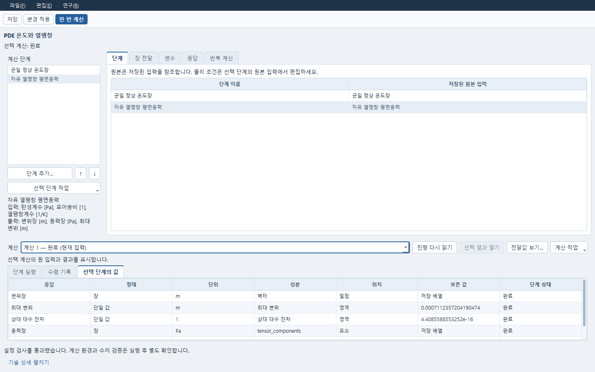

# 저장한 PDE를 계산 절차로 연결하기

Evaluation은 저장한 모델의 정확한 개정을 단계로 연결하는 독립 계산 절차입니다.
PDE·해석 모델의 식, 물성, 경계 조건은 원 프로그램이 편집하고 Evaluation은 단계
순서, 입출력 연결, 노출할 변수와 읽을 응답을 편집합니다. CAD·AI·Numerical Plan은
이 한 번 계산의 필수 조건이 아닙니다.

## 원본을 선택하고 한 번 계산하기

같은 로컬 서비스 주소를 PDE와 계산 절차 창에서 사용합니다. 현재 Windows의
SciPy ODE와 scikit-fem P1 준비 방법은 [PDE 작업 흐름](PDE_WORKFLOW_KO.md)을
따릅니다. 기존 서비스를 쓰거나 아래처럼 시작합니다.

```powershell
python -m apps.lab --store runs/my-evaluation --port 18767
python -m apps.research.pde_window --service http://127.0.0.1:18767
python -m apps.research.evaluation_window --service http://127.0.0.1:18767
```

1. PDE에서 입력을 작성하고 **저장**합니다. Evaluation에서 **단계 추가…**를 눌러
   저장한 PDE를 선택합니다. 저장되지 않은 변경이 있는 원본은 목록에서 제외합니다.
2. 왼쪽 단계를 선택하고 **선택 단계 작업 → 원본 입력 열기**로 그 단계가 참조한
   저장본을 확인합니다. 열기는 계산하지 않습니다. 원 프로그램에서 현재 모델을
   수정해도 이미 선택한 저장본은 자동 갱신되지 않습니다.
3. **연구 → 입출력 확인**으로 등록된 입력과 출력을 확인합니다. 편집 중이면 정의를
   먼저 적용합니다. 이 검사는 계산을 제출하지 않습니다.
4. 필요하면 **변수**에서 등록된 단일 입력을 추가하고, **응답**에서 단계 출력과
   단위를 선택합니다. 목록에 없는 실제 응답은 이름과 단위를 명시해 지정할 수
   있습니다. 임의 식이나 새 solver를 이 표에서 정의하지 않습니다.
5. **변경 적용** 후 **한 번 계산**을 누릅니다. 입력·참조·필수 연결이 잘못되면
   실행이 차단됩니다. 잘못된 정의도 고쳐 계속 작업할 수 있도록 저장할 수 있습니다.
6. 아래 계산 목록과 **단계 실행**에서 같은 계산의 단계를 선택합니다.
   **선택 단계의 값**에는 실제 응답의 단위와 보존 값 또는 저장 배열의 존재를
   표시합니다. 큰 배열을 숫자 하나로 바꾸지 않습니다. **선택 결과 열기**는 설치된
   Post 경로로 해당 단계의 보존 결과를 엽니다.
7. **저장**하고 같은 저장소에서 다시 엽니다. 새 서비스/별도 Python에서도 저장한
   정의와 보존 실행을 읽으며 열기 자체로 solver를 실행하지 않습니다.

원본 선택 도중 원본 개정·문서·서비스가 바뀌면 다시 읽고 선택하라는 안내가
나옵니다. 선택한 것과 다른 원본을 조용히 채택하지 않습니다. 실패·응답 유실·늦은
응답으로 현재 다른 문서나 선택한 다른 단계의 결과를 덮어쓰지 않습니다.

## 원본 수정과 과거 결과를 구별하기

예를 들어 PDE 냉각식의 `rate`를 `0.5 1/s`에서 `0.75 1/s`로 바꾸고 저장해도,
기존 Evaluation은 먼저 선택한 `0.5 1/s` 저장본을 계속 참조합니다.
**선택 단계 작업 → 원본 교체…**로 새 저장본을 선택하고 적용·저장해야 정의가
바뀝니다. 교체 자체는 실행하지 않으며 새 계산은 **한 번 계산**으로 제출합니다.

교체 후에도 이전 계산은 원래 입력과 결과를 보존합니다. 아래에서 과거 계산과
단계 실행을 선택한 다음 **계산 작업 → 선택 결과의 원본 입력 열기**를 사용하면
그 실행이 실제로 사용한 저장 원본을 엽니다. 이는 위쪽 편집 단계의 현재 원본
열기와 구별됩니다. 보존 원본을 확인할 수 없으면 현재 원본으로 대체하지 않습니다.
기술 상세에는 문서·저장 개정·입력 개정·입력 내용 확인값의 정확한 연결을 남깁니다.

## Windows P1 온도 → 2D 평면응력 열팽창

다음은 기존 T25-C1의 균일 온도와 자유 팽창 기준을 실제 PDE 단계로 계산하는
작은 예입니다. 현재 구현된 2D 스칼라 P1·등방 선형 평면응력·명시한 정상 snapshot
범위입니다. 3D, 과도 열해석 또는 양방향 연성 수렴을 뜻하지 않습니다.

먼저 PDE에서 **Windows 공간 약형식**을 새로 만들고 다음 입력을 저장합니다.

| 항목 | 값 |
|---|---|
| 영역 | 너비 1 m, 높이 0.25 m |
| 장 | temperature, K, 절대 열역학 온도, 전역 직교 좌표계 |
| 계수 | k=200 W/(m*K), q=0 W/m**3, left_value=right_value=323.15 K, length=1 m |
| 약형식 | `k*inner(grad(u),grad(v))`, `q*v` |
| 경계 | left/right Dirichlet, 식 left_value/right_value; 다른 변은 자연 경계 |
| 메시 | 한 축 셀 수 `[2]`, Lagrange P1 |
| 실제 시각 | 0 s, 정상 상태 기준(`steady_reference`) |
| 상대 대수 잔차 한계 | 기존 `1e-9` |

해석 프로그램에서 **평면응력 열탄성 (scikit-fem)** 원본을 만들어 저장합니다.
기존 기본 모델에서 메시 셀 수만 `[3,2]`로 지정합니다. 영역은 1×0.25 m,
탄성계수 70 GPa, 포아송비 0.3, 열팽창계수 `23e-6 1/K`, 무응력 기준온도
293.15 K입니다. `temperature_mode=absolute`, 실제 시각 0 s와 같은 정상 상태
기준을 유지합니다. 기존 강체 이동 제거 구속과 자유 팽창 검사는 엔진이 소유합니다.

Evaluation에 저장한 PDE와 해석 원본을 순서대로 추가합니다.

1. **장 전달 추가…**에서 공급 PDE의 `temperature`를 구조 단계의 `temperature`에
   연결합니다. 전달 시점은 **현재 반복**, 방법은 **다른 P1 메시로 온도 보간**입니다.
2. 전달 설정은 **기록된 동일 시각 선택**, 수신 0 s/같은 원점, **절대 온도 [K]**,
   **모든 수신 P1 절점**을 유지합니다. 공급 snapshot을 확인하고 **정의에 적용**합니다.
3. 응답에 구조 단계의 변위장 `[m]`와 응력장 `[Pa]`를 추가합니다.
   **입출력 확인** 후 **한 번 계산**을 명시적으로 누릅니다.
4. **전달값 보기…**에서 공급 snapshot과 수신 메시를 각각 선택합니다.
   좌표 `[m]`, 공급/보간/실제 수신 온도 `[K]`, 유효 절점, 원 시각을 확인합니다.

이 전달은 원 삼각형과 P1 형상함수로 수신 절점을 보간합니다. 보존적 전달이나
외삽은 아닙니다. 필요한 수신 절점이나 시각이 없으면 차단하며 0으로 채우지
않습니다. 절대 온도를 전달할 때 mapping은 Tref를 빼지 않고 구조가 한 번 뺍니다.
기존 진단의 `reference_subtractions_in_mapping=0`과
`reference_subtractions_in_structural_solver=1`로 구별할 수 있습니다.

이 입력의 실제 Windows 실행에서는 서로 다른 9/12 절점 메시를 사용했고 보간값과
실제 수신 입력이 일치했습니다. 균일 323.15 K의 독립 자유 팽창식은
`u=alpha*(T-Tref)*[x,y]`입니다. 관측 오차는 약 `1.80325e-18 m`, 원 기준은
`1e-10 m`였으며 구조 상대 대수 잔차는 약 `4.40856e-16`이었습니다.
이 한정 기준의 성공과 실제 물리·설계 적합성 `UNKNOWN`/`NOT_RELEASED`는 별개입니다.
solver 성공을 공학 출하 승인으로 표시하지 않습니다.

## 실제 작업 경로의 재현 검사

설치된 프로젝트 Python에서 아래를 순서대로 실행합니다. 각 supervisor 디렉터리는
새 경로여야 합니다. 첫 단계는 새 저장소에서 ODE 원본 선택·단일 Evaluation 계산,
원본 새 개정과 명시 교체를 확인합니다. 둘째는 같은 저장소에 PDE→구조의 새
Evaluation 계산을 추가합니다. 마지막은 별도 Python/HTTP·Qt에서 보존 결과를 읽고
같은 입력/결과 해시·과거 원본과 현재 정의·새 실행 0을 확인합니다.

```powershell
python scripts/native_check.py --timeout 150 --output-dir runs/my-evaluation-check/first -- python tests/test_evaluation_pde_workflow.py runs/my-evaluation-check/workflow first
python scripts/native_check.py --timeout 150 --output-dir runs/my-evaluation-check/pair -- python tests/test_evaluation_pde_workflow.py runs/my-evaluation-check/workflow pair
python scripts/native_check.py --timeout 120 --output-dir runs/my-evaluation-check/cold -- python tests/test_evaluation_pde_workflow.py runs/my-evaluation-check/workflow cold
```

`workflow.json`은 정확한 원본 참조와 Evaluation/작업/단계 시도·원 결과 해시·전달
진단을 기록합니다. PNG는 실제 일반/좁은 창과 원본 선택·온도 전달 화면입니다.
`QT_QPA_PLATFORM=offscreen`으로 실행한 배치 검사와 일반 Windows 창 캡처를
구별합니다. 검사가 연 원본 창과 solver 자식 프로세스는 정확한 소유 핸들과
Windows Job에서 종료하며 다른 사용자 프로그램을 종료하지 않습니다.



[좁은 창](images/desktop-recovery/evaluation-pde-narrow.png),
[과거 계산의 정확한 PDE 원본](images/desktop-recovery/evaluation-saved-pde.png),
[보간값과 실제 수신 온도](images/desktop-recovery/evaluation-temperature-transfer.png)를 확인했습니다.
실행 단계를 바꾸면 이전 단계의 응답과 단위를 즉시 비웁니다. 선택 단계가 실행 중이거나
읽기에 실패하면 다른 단계의 성공값을 남기지 않으며 [결과 없음 상태](images/desktop-recovery/evaluation-pending-stage.png)를 표시합니다.
