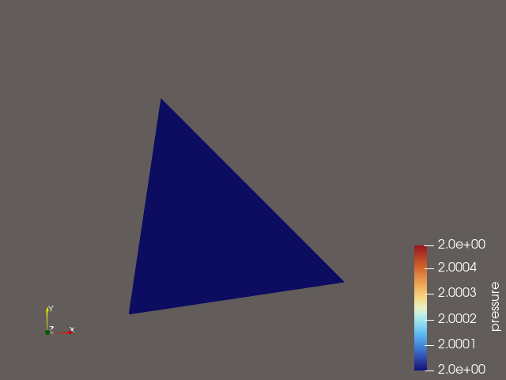
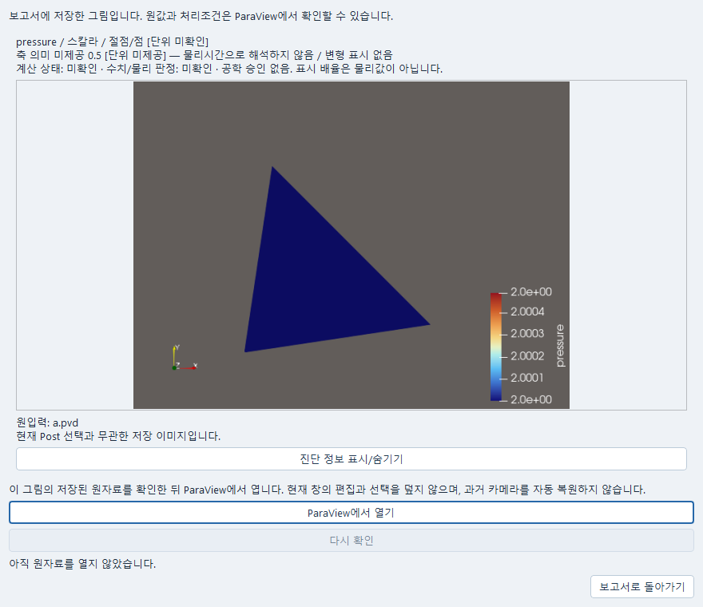

# 시험 자료와 보고서

시험 파일의 채널을 교정하고 계산 결과와 비교한 뒤, 표와 곡선을 독립 **보고서** 창에
모아 저장한다. Windows 기본 설치로 사용할 수 있으며 장비, WSL, AI 연결은 필요 없다.
처음 실행할 명령과 화면은 [따라 하기](USER_GUIDE_KO.md#시험-채널을-교정하고-보고서로-저장하기)에 있다.
실장비 연결·수집·물리적 중지는 아직 구현하지 않았다.

2026-10-14 Windows 통합에서는 공개 파일 가져오기→FELUPE 재료점 계산→관측 비교→
Study→보고서 저장을 실행했다. Qt 수치 보고서의 PDF·Markdown 출력과 새 프로세스에서의
저장 내용 재열기도 확인했다. 아래의 작성 환경 NOT_RUN은 Pro 작성 당시 기록이며,
후속 Windows 실행과 구분한다. OS 마우스 입력은 창 활성화·캡처 실패로 미확인이다.

## 1. 파일의 채널 교정

1. Data에서 CSV를 열고 원본 열, 축 이름·단위, 응답 성분·위치·측도·기준계를 지정한다.
   시간처럼 보이는 첫 열도 자동으로 시간이라고 해석하지 않는다.
2. **편집 → 채널 교정…**에서 원값 단위, 계수에 사용한 입력 단위, 출력 단위를 지정한다.
   식은 **y = a × (x − x₀) + b**이다. a의 단위는 출력/계수입력, x₀는 영점 단위,
   b는 출력 단위다. 2 mV와 0.002 V를 같은 물리 입력으로 변환하지만 count를 V로
   암묵 변환하지 않는다.
3. **교정 원본 열기…**로 제공된 교정서/텍스트를 등록한다. 계수와 같은 버전의 원본을
   Data 개정에 함께 보존한다. 원본의 경로나 해시를 직접 입력할 필요가 없다.
4. 교정 범위와 센서 한계를 따로 입력한다. 센서 한계에 도달한 표본은 포화로 표시한다.
   기간을 지정했다면 시간대가 있는 실제 관측 시각도 지정한다. 미제공 불확실성은 비워
   둔다. 확장 불확실성의 k와 상관을 모르면 미확인으로 보존한다.
5. **교정 전후 보기**로 현재 파일의 원본 미리보기를 확인한다. 원값과 교정값은 각 단위의
   별도 축에 표시된다. 범위 밖 ○, 포화 ×와 원값을 지우지 않는다. 미리보기는 원본
   미리보기의 제한된 행이다. 전체 보존 결과는 가져오기 뒤 **교정 전후 결과…**에서 읽는다
   (한 번에 최대 4096행).
   저장 결과 창은 **닫기**로 돌아오는 읽기 화면이다. 표의 **교정 확인**은 범위/포화/
   기간을, **품질**, **계산**, **화면**은 각각 보존된 품질 판정, 계산 선택, 표시 숨김을
   보여 준다. 좁은 창에서는 표의 가로 스크롤이나 가운데 구분선으로 열을 확인한다.
   화면에서 숨긴 행도 계산에 쓰였을 수 있으며, 표시 숨김을 계산 제외로 해석하지 않는다.
6. **초안에 적용**하고 Data의 적용/가져오기를 명시적으로 실행한다. 교정과 기존 배율/
   오프셋은 중복 실행하지 않는다. 기존 배율 교체는 확인을 받는다. 1e 같은 미완성 값도
   초안으로 저장되지만 계산은 차단된다. 수정 취소는 현재 Data 초안을 바꾸지 않는다.
   명시적으로 끝난 교정 파일 등록은 입력 목록에 남을 수 있다.
   입력칸에서 Enter를 눌러도 초안에 적용하지 않는다. 잘못된 수치를 고쳐 **교정 전후 보기**를
   다시 누르면 마지막 정상 곡선과 원행 선택을 유지한 채 확인할 수 있다.
7. Data를 저장한다. 원파일, 교정 원본, 매핑, 원행, 품질/계산제외/표시숨김 상태, 이전
   가져오기가 함께 보존된다. 새 교정으로 실행해도 옛 가져오기/비교를 다시 쓰지 않는다.

교정 범위 밖·센서 포화·기간 밖 표본은 원값과 교정값을 남기고 새 계산 대상으로는
제외한다. 기존 사용자의 계산 제외와 별도 필드로 기록한다. 제공 불확실성은 기록할 뿐
자동 전파·신뢰구간·독립성 추정에 쓰지 않는다. 액추에이터 변위로 시편 변형률이나
면적을 추정하지 않는다. 변형률/응력 계산이 필요하면 기존 시험 조건 편집에서 물리
정의·치수·단위를 명시해야 한다.

## 2. 같은 물리량의 계산과 비교

Data의 기존 **예측 선택/비교** 경로에서 정확한 저장 실행, 응답, 성분·위치를 선택한다.
단위·측도·기준계가 맞지 않으면 비교를 거절하며 이름을 바꾸어 통과시키지 않는다.
기존 연속 곡선 비교는 명시된 축에서 선형 정렬한다. 계산에서 제외된 구간이 있으면
정확히 일치하는 표본만 허용하고 그 사이를 임의로 보간하지 않는다. 축의 명시적
scale/offset은 입력과 결과에 보존된다.

**이 자료를 사용하는 계획…**은 현재 문서 목록에서 이 Data를 참조하는
Numerical/Study/보고서를 보여 준다. 각 계획은 선택 당시의 가져오기를 유지한다.
새 교정을 쓰려면 해당 계획에서 새 가져오기를 명시적으로 선택해야 한다. 이 조회는
의존 계획을 자동 수정하거나 재계산하지 않는다. 다른 보관소·미등록 외부 파일까지
검색하는 전역 의존성 관리자는 아니다.

## 3. 미식별 계수와 다음 시험

기존 재료 피팅 또는 일반 Numerical fit를 실행한 뒤, 계산을 선택하고
**보기 → 계수 식별과 다음 시험…**을 연다.

- 실제 least_squares의 최종 잔차 Jacobian을 명시한 계수 탐색범위(로그 변수는 로그 범위)로
  정규화하여 SVD를 기록한다. 잔차의 weight/scale, 사용 응답·마스크·단위·기준계를 보존한다.
- 국소 독립 방향 수, 미식별 조합과 경계 도달을 구분한다. 고정 계수는 진단 대상이 아니다.
  작은 RMSE를 식별 성공으로 표시하지 않는다. 국소 1차 구분은 전역 유일성이나
  시험의 물리적 타당성/공학 승인이 아니다.
- robust loss, 실패 벌점이 섞인 검색, 다른 최종 후보로 대체된 결과, 저장하지 않은 옛
  Jacobian은 진단 미확인으로 남긴다. 진단을 읽으면서 평가기를 다시 호출하지 않는다.
- 동일 원본 열/행을 다시 가져오거나 재교정한 자료를 fit와 holdout 양쪽에 넣을 수 없다.
  새로 읽은 열은 숫자 열 위치도 보존한다. 과거 결과에 이 열 정체성이 없으면 제공된
  원래 선택자를 사용하며 이름/번호 별칭까지 소급 추정하지 않는다.
- 다음 시험의 질문과 목적을 사람이 작성하고 **연구 기록에 저장**한다. 정확한 결과와
  기존 Study의 next_observations에 연결한다. 전송 재시도는 같은 작성 요청을 사용하며
  저장 후 다른 문구는 새 명시적 기록이다. 연구 판단/승인은 자동 변경하지 않는다.
- **최종 후보 상세…**는 이 피팅 결과에 보존된 최종 후보의 상세 창을 연다. 원값,
  예측값과 잔차의 보존 여부를 확인하고, 상세 창에서 필요한 시험을 명시적으로 선택한다.
  열기는 계산을 추가하지 않는다. 상세 창의 **미보존분 계산**은 별도의 명시적 실행이다.
  최종 후보 연결이 없는 옛 결과나 후보가 모호한 결과는 이 버튼을 사용할 수 없다.
  계수가 비슷한 다른 후보로 대신 연결하지 않는다. 이 상세 창을 열었다고 전체 피팅의
  식별 진단이 새로 생기거나 불확실성이 전파되지는 않는다.
- 원래 진단의 사유와 결과 참조는 **진단 세부…**에서 읽는다. 이 창도 재계산하지 않는다.

미분진단이 없는 방법을 지원한다고 표시하지 않는다. DE/비매끄러운 법칙에 일반적인
전역 식별 알고리즘을 새로 만든 기능은 아니다.

## 4. 독립 보고서

Python 진입:

    python -m apps.research.desktop --service http://127.0.0.1:18766 report

같은 서비스의 저장 보고서를 열려면 끝에 --document-id B...를 추가한다. 실제 GUI의
제목에는 식별자를 붙이지 않는다. Windows 시작 메뉴의 **보고서** 또는
`Start-CAE-Lab.cmd -Tool report`로도 열 수 있다. Runner의 **도구** 메뉴에도 연결돼 있다.

- 독립 보고서의 **자료 → 계산 결과 추가…**에서 저장 실행과 물리 응답을 고른다.
  native 응답은 기존 위치 카탈로그에서 실제 선택자를 고른다. 표본 구간 또는 정확한
  저장 시각을 **선택한 값 읽기**로 미리 본 후 추가한다. 없는 .03 시각을 .02/.04로
  대체하지 않는다. 정적 load_parameter를 시간[s]로 바꾸지 않는다.
- Data에서 원행을 직접 선택한 뒤 **선택 결과로 보고서…**를 누르면 같은 원행을 고정한다.
  저장된 비교가 선택되어 있으면 해당 비교의 현재 표본 페이지를 고정한다.
- Study를 저장하고 **보고서 만들기…**를 선택하거나, 보고서에서 **저장된 연구 적용…**을
  사용한다. 이미 작성한 섹션을 교체할 때는 확인하고 취소할 수 있으며 Undo로 복구한다.
- **문헌 추가…**는 기존 파일 가져오기/자료실 선택을 쓴다. 문헌만 있는 Study로도 시작할
  수 있다. 정확한 문헌 개정과 원문을 고정하며 AI 생성은 필요 없다.
- 섹션의 포함 여부·순서를 바꾸고 **선택 섹션 편집…**에서 제목, 설명, 표/곡선 포함을
  편집한다. **설명 적용**은 페이지에 적용, **닫기**는 미적용 설명을 창 안에 유지,
  **수정 취소**는 마지막 적용 설명으로 복귀한다. 저장/내보내기 전에 미적용 설명을
  적용 또는 취소해야 한다. 창 크기를 바꿔도 편집 패널을 자동 이동하지 않는다.
- 섹션을 선택하면 해당 페이지의 제목으로 이동한다. 실제 A4 페이지 구성은 미리보기와
  PDF에서 같다. PDF는 Qt PrintSupport, 곡선은 기존 Matplotlib, Markdown은 같은
  고정 데이터와 포함된 그림을 사용한다. 브라우저/HTML 편집기를 주 화면으로 쓰지 않는다.
- **원자료 열기**는 해당 정확한 참조를 열람한다. 원 창의 이후 선택은 보고서에 영향을
  주지 않는다. 원자료가 없어져도 고정 내용은 남고 원자료 확인 불가를 표시한다.
  다른 최신 결과로 대체하지 않는다. 보고서 소유 자료 자체가 손상되면 읽기 실패를
  명확히 표시하며 개정 무결성 검사는 유지한다.
- 저장 충돌/응답 유실에는 **전송 다시 시도**로 같은 요청을 재시도한다. 필요하면
  **서버 저장 상태 확인…**에서 확인한 버전과 현재 편집을 비교하고 계속한다.
  확인만으로 편집을 덮거나 저장하지 않는다.
- 출력 취소와 쓰기 실패는 이전 파일과 초안을 유지한다. 원자료 미확인 섹션은 표시를
  남긴 초안으로 출력할지 명시적으로 결정한다. PDF/Markdown은 새 계산을 제출하지 않는다.

현재 표·곡선 편집은 정확한 자료/행/시각 선택, 섹션 포함·순서, 제목·설명, 표/곡선
포함이다. 원값을 보고서 표에서 수정하거나 물리 단위를 임의로 다시 붙이지 않는다.
워드프로세서 수준의 자유 표 셀/그림 꾸미기는 별도 잔여다.
현재 native 위치/시각의 실제 곡선은 읽을 수 있으며 전체 3D field 편집기는 native Post다.

### 3D 결과 이미지를 넣고 원자료 확인하기

1. Post에서 적용된 3D 결과를 표시하고 검토할 필드·성분·시각·카메라를 정한 뒤 저장한다.
   보고서에 넣을 결과만 해당 뷰에 표시한다. 미적용 속성이 있으면 먼저 적용하거나 취소한다.
2. 보고서의 **자료 → 3D 결과 이미지 추가…**를 연다. 목록에서 원하는 Post 결과를 고르고
   **선택한 결과 캡처**를 누른다. 새 해석 계산은 실행하지 않는다. 응답이 늦으면
   **같은 요청 상태 확인**으로 확인하며, 같은 캡처를 반복 제출하지 않는다.
3. 그림과 필드·성분·단위·축 설명을 확인하고 **이 이미지 적용**을 누른다.
   **적용하지 않고 닫기**는 기존 본문·그림·판단을 유지한다. 이미지를 선택하고
   **편집 → 이미지 표시와 크기…**에서 표시 여부와 크기를 바꿀 수 있다.
4. 섹션의 제목·설명에 연구 질문, 관찰, 판단과 다음 연구를 적고 **설명 적용**을 누른다.
   **파일 → 저장**, **PDF 내보내기…** 또는 **Markdown 내보내기…**로 보존한다.
   저장한 보고서를 다시 열면 보존 그림을 읽으며 계산이나 새 캡처를 실행하지 않는다.
   Post의 이후 선택·카메라 변경이 이 그림을 바꾸지 않는다.
5. 해당 이미지 섹션에서 **자료 → 원자료 열기**를 누른다. 보존 그림을 먼저 확인한 뒤
   **ParaView에서 열기**를 누르면 정확한 저장 프로젝트와 결과를 검사한다.
   원창이 다른 상태이면 덮지 않는다. 현재 원창을 저장하거나 편집을 취소하고 정상 종료한 뒤
   저장본 열기를 다시 요청한다. 실행 여부가 미확인이면 **다시 확인**을 쓴다.
   과거 카메라를 자동 복원하는 기능은 아니며 원 Post의 Properties와 Spreadsheet View에서
   원값·처리조건을 검토한다.

물리시간, 정적 단계·증분, 정적 하중 매개변수와 무차원 모델시간은 각 의미를 유지한다.
선언이 없는 단위와 축 의미는 **미확인**으로 남으며, 그림의 표시 배율은 물리값이 아니다.
서로 다른 블록 필드·성분·색상표가 섞인 그림을 하나의 필드로 채택하지 않는다.
원파일이 없거나 바뀌어도 검증된 보존 그림과 본문은 읽을 수 있지만 원자료 확인 불가를 표시한다.
검증된 그림 자체가 손상되면 복구가 필요하며 다른 최신 결과로 바꾸지 않는다.

위 그림은 2026-10-15 설치된 ParaView 6.2에서 공개 합성 PVD를 절단·저장한 실제 PNG다.
직접 연 파일에 물리 선언이 없어 단위와 축 의미는 미확인이다. 같은 소유자의 원값 검증과 별도
프로세스의 저장본 재열기를 확인했다. 원자료 대화상자는 실제 Windows Qt의 정상·좁은 창에서
선택·포커스·오류 복구를 확인했다. 이 검사는 전체 GUI 창 활성화·닫힌 창 실행 왕복이나 모든
블록·축 조합의 native 수용 완료를 뜻하지 않는다. 세부 검사 범위는
[Windows 검사 기록](delivery/PRO-EXPERT-REPORT-20261015-01-C1/WINDOWS_CHECKS_20261015.md)에 있다.
복합 블록의 추가 native 검사에서는 ParaView 프로세스가 종료되어 해당 범위를 확인하지 못했다.
이 결과를 단일 절단 그림의 저장·재열기 성공과 구분하며, 복합 블록 전체 사용 완료로 표시하지 않는다.

이 화면은 같은 실제 PNG를 Windows Qt 보고서의 원자료 창에 표시한 사용법 예시다.
그림 아래 **ParaView에서 열기**와 **다시 확인**의 위치를 볼 수 있다.
화면 배치는 로컬 모의 전달을 사용했으며 이 캡처 자체가 ParaView 창 활성화나 새 계산의 증거는 아니다.

## 5. 파일 수집 설정

Data의 **파일 수집 설정…**에서 이름, 채널 역할·단위, 요청 표본율·기간, 시간 오프셋,
시각 기준과 장비 설명을 작성한다. 저장된 교정도 설정에 포함할 수 있다. 초안 적용과
Data 저장, 또는 설정 내보내기/불러오기로 재사용한다. **같은 이름의 현재 채널에 이 교정
적용**은 사용자가 명시적으로 선택한 경우에만 기존 채널에 교정을 반영한다. 기존 비항등
배율은 채널 교정 화면에서 먼저 명시적으로 교체해야 한다.

요청 표본율은 취득된 시간축을 만들거나 기존 파일을 재표본화하지 않는다. 설정 파일은
실장비가 없을 때도 편집·저장할 수 있다. 실장비 연결/수집/중지는 모델·프로토콜·권한·
안전한 물리 종료 조건이 없으므로 **미구현/NOT_RUN**이다. 계산 Job 취소와 장비 정지를
같다고 표시하지 않는다.

## 공개 예제와 좁은 실행

    python -m examples.experiment_report --store runs/d9-example --run

명시 실행 시 공개 CSV를 가져오고 기존 FELUPE 재료점 한 번을 계산하여 같은 물리량의
관측/계산 비교, Study, 보고서를 저장한다. 출력되는 report/Data/Study ID를 **같은 store**
서비스에서 열어야 한다. 기본 다른 store를 열면 예제 문서를 찾을 수 없다. 추가로 생성한
가상의 계산 결과가 아니며 합성 센서 선언과 실제 기존 FELUPE 계산을 구분한다.

    Start-CAE-Lab.cmd -Tool report -Store runs/d9-example -Port 18766

Windows 실행 파일의 보고서 인수와 기존 서비스 재사용을 확인했다. 기존 서비스가 다른
작업 폴더로 열려 있으면 종료하지 않고 다른 포트를 선택한다.

관련 검사:

    python -m pytest tests/test_experiment_calibration.py tests/test_experiment_identification.py tests/test_experiment_report.py tests/test_experiment_report_ui.py -q

이 브랜치 작성 환경은 executor가 연결되지 않아 **Python/Qt/예제 실행 NOT_RUN**이다.
코드 문자열의 괄호/인용 균형 검사만 수행했으며 컴파일이나 테스트 통과를 대신하지 않는다.
Windows Qt의 실제 페이지, PDF 글꼴/긴 표, 두 창 충돌 및 실제 OS 입력 수용은 root 실행과
구분하여 후속 기록한다. 변경 없는 solver campaign은 요구하지 않는다.

## 설계·공통 인터페이스·작업 상태

기준 bdc79d7c759cb7ce1a2beceed6548af491cc7dbe와 GUI 인계
db533783f40470d174490116ff62d00818656e74를 읽었다. 교정은 기존 Data mapping의 선택 필드,
수집 설정은 같은 draft의 선택 필드이다. 기본 mapping과 기존 문서는 그대로 읽는다.
보고서 B 문서는 기존 MaterialDocuments의 Undo/개정/충돌/보존 소유자를 재사용하며
별도 scheduler나 결과 store를 만들지 않는다. 큰 원문/곡선은 보고서 개정의 해시 검증
asset에 두어 96KiB draft 한계를 유지한다.

공통 검토 대상은 새 report owner 및 report-capture/report-content 읽기 API, knowledge와
comparison exact-reference 종류, Data 교정 원본 retention, source_rows 명시 선택,
최종 Jacobian 진단과 원행 중복 차단이다. source_rows는 기존 위치 범위 rows와 다르다.
요청 원행이 없으면 거절하고 입력 순서를 정렬/재번호 매기지 않는다. native B 문서 등록은
새 Report namespace와 충돌하지 않게 예약한다. 원본/교정 결과/보고서 projection의 SHA는
서로 다른 역할로 보존한다.

| 작업 | 이 브랜치의 제품 소스 | 잔여/실행 상태 |
|---|---|---|
| FN-05-01 | 명시 단위·영점 교정, 원행/범위/포화, 원본 retention, 기존 비교, 영향받는 현재 계획 조회 | 실제 장비 교정 타당성·불확실성 전파·임의 공간 투영 미지원. 작성 환경 실행 NOT_RUN |
| FN-05-02 | 실제 최종 LSQ 국소 SVD, 범위/잔차스케일, 고정/미식별 구분, 다음 시험 Study 저장 | 전역 식별·robust/DE Jacobian 미지원. 새 평가를 숨겨 수행하지 않음 |
| FN-32-01 | 독립 report, 정확 자료 미리보기/고정, Study/문헌/비교, 섹션 편집·페이지·PDF/MD·재열기 | 임의 문서 워드프로세싱/3D이미지 편집은 잔여. 실제 Qt/PDF NOT_RUN |
| FN-35-01 | 파일 수집 설정 저장·불러오기·교정 재사용·미완성 입력 | 실장비 연결·수집·물리적 중지는 미구현/NOT_RUN |

계획 대비 실제: 별도 Data calibration owner나 전용 Report result engine을 만들지 않고
기존 Data/문서·참조 소유자를 확장했다. 화면은 Sol/Astra의 실제 전달 시안의 두 열 교정,
원값/교정값 별도 축, 큰 페이지/접이식 설명 편집 원칙을 적용했다. 시안 자체의 합성 렌더를
제품 동작 성공으로 인용하지 않는다. 일반 안내·SPEC·CURRENT_STATE 및 root Windows
launcher 파일은 수정하지 않았다.

## 첫 통합 피드백 후 교정

첫 체크포인트 07b715e에 대해 Codex가 전달한 Windows 결과는 9 통과 / 3 실패다.
실패는 시험 평가기 인자 수 두 건과 보고서 캡처의 NumPy 정수 직렬화 한 건이며 이 후속
소스에서 교정했다. 이 작성 환경에서 그 교정의 Python/Qt 재실행은 **NOT_RUN**이다.
전달받은 설명 보고서 저장/재열기/PDF 및 채널 교정 동작은 전체 D9 수용과 구분한다.

- 보고서의 수치 스냅샷은 NumPy scalar/array를 같은 값의 JSON scalar/list로 보존한다.
  비유한 값은 기존 원자료와 같은 nan/inf/-inf 토큰을 써서 0/null과 구분한다.
- 기존 response 한 개 참조와 selection 명시 참조를 같은 규칙으로 읽는다. 후보/예측은
  실제 candidate_ids 선택을 참조에 별도로 보존한다. UI에서 선택한 후보 입력과 응답을
  함께 추가하며, 예측은 실제 계산으로 표시하지 않는다. 고급 후보 stage/native 위치는
  기존 원 도구의 평가 읽기 경로이며 여기서 임의 첫 stage로 치환하지 않는다.
- 페이지·PDF·Markdown은 수렴 여부, 종료 이유, 체크의 값·한계·단위·실패 근거를 보존한다.
  응답이 무효이면 정상 곡선으로 그리지 않는다. 행별 판정이 없으면 미확인 표식을 쓴다.
- 여러 섹션의 미적용 설명이 있으면 Study 교체/Undo 전에 적용 또는 수정 취소하도록
  한다. 닫기만으로 버퍼를 버리지 않는다. Study를 읽는 동안 새 설명이 입력되어도
  그 편집을 새 섹션으로 덮지 않는다.
- Data 소유자뿐 아니라 공개 import_table도 실제 mapping에서 교정 증빙 전체를 도출하고
  등록 원본·내용·receipt를 제출 및 실행 전후 확인한다. 누락/무관한 supplied 증빙은
  거절한다. 직접 API의 정상 등록 원본은 제출 시 같은 증빙 계약으로 고정된다.
- 불확실성 종류가 미제공/UNKNOWN이어도 제공 값·단위·k·상관을 그대로 남기며 교정은
  가능하다. 표준 불확실성을 추정해 넣거나 불확실성을 자동 전파하지 않는다.
- fit/holdout 원행 겹침은 실제 _mask/mask에 포함된 원행으로 판단한다. 동일 파일의
  서로 다른 구간은 허용하며 화면 숨김은 이 판정과 무관하다. 기존 observation_job도
  원본 SHA/열/행 근거를 잃지 않는다.
- 다음 시험 저장의 응답 유실 재시도는 최초 제출 메모를 기준으로 완료 처리한다.
  그 사이 작성한 새 메모는 남긴다. event/scalar 관측의 국소 진단도 배열 길이를
  임의로 가정하지 않는다.
- 저장된 교정 결과 보기는 이미 보존한 transformed_value와 flags를 읽는다. 현재
  교정 함수를 다시 실행해서 옛 값이나 판정을 바꾸지 않는다.

여러 채널이 교정서 하나를 공유할 때도 증빙 목록은 문서 command receipt를 쓰기 전에
정렬·중복 제거한다. 실제 Job 인자와 저장한 제출 인자가 같으므로 admission 뒤 응답이
유실되어도 같은 Job을 복구하며 새 가져오기를 만들지 않는다. 이 경계의 공유/서로 다른
교정서 두 경우와 cold reopen 검사도 포함했다.

최적화가 summary 보존을 선택했다면 response_reductions의 실제 축약값을 후보별로 읽는다.
같은 응답의 최댓값과 최종값은 원 reduction_index로 구분해 고정하고 단위·성분·위치·
좌표계를 표에 남긴다. 이 선택에는 표본/시각 입력을 비활성화하고 원 곡선 미포함을
표시한다. 목적값과 정규화 제약 잔차도 응답 값과 구분해 보존한다.

계수 식별과 다음 시험 창에서 저장된 결과를 읽지 못하면 **결과 다시 읽기**로 같은
문서·계산 결과를 다시 읽을 수 있다. 작성한 다음 시험 질문과 근거는 유지한다.
처음 읽기에 실패한 동안 연구 기록 저장과 보고서 만들기는 비활성화한다.
재읽기는 추가 피팅이나 식별 진단 평가를 실행하지 않으며, 보존된 진단이 없으면
미확인 표시를 유지한다. 연구 기록 저장의 응답 유실은 같은 저장을 다시 시도해 복구한다.
질문 입력 중 Enter를 눌러도 창이 닫히지 않으며, 저장과 닫기는 해당 버튼으로 실행한다.
