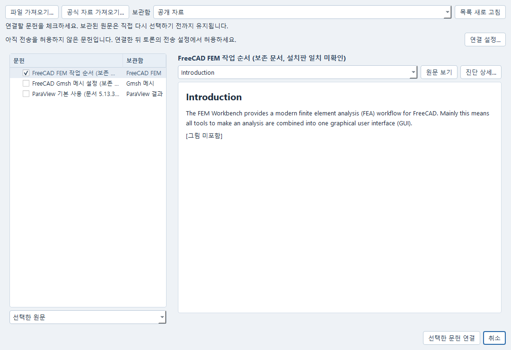

# 공식 자료를 반입하고 원문으로 확인하기

이 묶음은 FEM 작업, Gmsh 메시 설정, ParaView 결과 선택에 참고할 공식 문서와
CalculiX·Radioss 참고 링크입니다. 자료를 넣었다고 모델이 전문 지식을 학습하거나
현재 해석을 검증한 것은 아닙니다. 검색 순위, 읽은 원문, 사용 버전의 적합성,
공학 판단을 따로 확인합니다. 모델·유료 검색·솔버 실행 없이 사용할 수 있습니다.

## 들어 있는 자료

| 자료 | 반입 범위 | 버전과 한계 |
|---|---|---|
| FreeCAD FEM Workbench | 공식 Markdown 원문 | 고정된 문서 snapshot입니다. 설치 FreeCAD 1.1.4의 모든 기능과 일치한다고 확인한 문서는 아닙니다. |
| FreeCAD의 Gmsh 메시 명령 | 공식 Markdown 원문 | 요소 차수·크기·물리 그룹·비양의 Jacobian 안내입니다. Gmsh 알고리즘 전체 매뉴얼이 아닙니다. |
| ParaView Basic Usage | 공식 튜토리얼 원문 | 문서 5.13.3, 확인한 설치본 6.2.0입니다. 메뉴·동작 차이를 확인해야 합니다. |
| CalculiX 2.22 매뉴얼 | 공식 URL만 | 설치본의 버전 표시는 2.22입니다. 전문 재배포 허가는 확인하지 않아 포함하지 않았습니다. |
| Radioss INIEVO 설명 | 공식 URL만 | 웹 설명과 고정 OpenCourant의 카드·법칙 구현이 같다고 가정하지 않습니다. 전문은 포함하지 않았습니다. |

원문·출처·문서 라이선스·사용범위는
[편집 가능한 목록](../examples/research-knowledge/manifest.json)과
[저작자 및 배포 조건](../examples/research-knowledge/ATTRIBUTION.md)에 있습니다.
FreeCAD 문서는 CC BY 3.0, 선택한 ParaView 튜토리얼은 CC BY 4.0이라는
문서 자체의 허가를 사용했습니다. 소프트웨어 라이선스를 문서에 대신 적용하지 않았습니다.

## Expert에서 선택하고 가져오기

1. Expert의 **연결 설정… → 역할**에서 **기본 연구팀 (3담당) → 역할 불러오기**를 선택합니다. 기존 사용자 역할은 유지됩니다. **재료와 시험 (2담당)**도 계속 사용할 수 있으며, **현재 저장된 역할**로 편집을 되돌릴 수 있습니다.
2. 담당자를 선택하고 **검토할 자료…**에서 FreeCAD FEM, Gmsh 메시, ParaView 결과 중 필요한 범위를 고릅니다. **편집에 반영**은 이 설정창의 편집값만 바꿉니다. **설정 적용** 전에는 현재 역할과 연결이 바뀌지 않으며 취소할 수 있습니다.
3. **참고 자료 → 저장 자료… → 공식 자료 가져오기…**를 엽니다. 문서 범위, 배포 조건, 설치판과의 차이를 확인하고 **선택 자료 가져오기**를 누릅니다. 현재 Expert가 연결된 서비스의 보관함을 사용합니다. 별도 작업 폴더나 JSON 파일을 만들 필요는 없습니다.
4. 보관이 끝나면 **가져온 문헌 선택**을 누릅니다. 돌아온 문헌 목록에서 원문 구간을 골라 내용을 읽고 **선택한 문헌 연결**을 누릅니다. 링크만 제공하는 항목은 본문으로 선택할 수 없습니다.
5. 대화 방식을 **연구팀**으로 선택하고 **팀 검토…**에서 담당자별 **자료 선택…**을 엽니다. 같은 보관함의 문헌과 원문 개정을 선택한 뒤 **편집에 반영 → 저장**으로 팀의 질문과 자료를 보존합니다. 팀 검토에서 공식 자료를 가져오고 바로 선택하는 경로도 같습니다.

함께 제공된 FreeCAD Markdown 두 문서는 제목·문단·링크 글자를 읽기 편한 서식으로 표시합니다. 그림과 링크의 대상을 불러오지는 않습니다. **원문 보기**를 켜면 현재 구간의 정확한 보관 텍스트를 확인할 수 있습니다. ParaView 튜토리얼의 일반 텍스트와 임의 TXT·CSV·PDF를 Markdown으로 바꾸어 해석하지 않습니다. 표시 서식은 원문·위치나 모델에 제공하는 내용을 바꾸지 않습니다.



담당자의 자료 범위와 외부 전송 허가는 별개입니다. 실제 연구를 요청하려면 **연결 설정… → 자료 전송**에서 질문과 필요한 자료 분류를 명시적으로 허용하고, 현재 대화에서도 해당 질문과 문헌의 전송을 허용해야 합니다. 자료를 고르거나 가져오는 동작이 이 허가를 대신하지 않습니다. 부족한 범위는 문헌 선택창에서 안내하며 **연결 설정…**으로 바로 이동할 수 있습니다.

기본 3담당은 연구팀에서 선택 원문을 읽는 도구만 사용합니다. 공개 검색이나 계산 결과 권한을 추가할 필요는 없습니다. 기존 **자료 토론** 방식의 검색 권한 요건과는 다릅니다. 설정창에서 로컬 파일이 확인되어도 로그인과 모델 사용 권한이 확인된 것은 아닙니다. 가져오기와 원문 열람에는 모델 호출이 필요하지 않습니다.

응답이 늦거나 가져오기 결과를 확인하지 못했다면 **기존 작업 확인**으로 먼저 조회하세요. 이미 접수된 요청은 같은 작업을 확인하며 다시 반입하지 않습니다. 일부 자료가 실패해도 완료한 자료와 실패 기록은 남습니다. 창을 닫아도 접수된 가져오기 작업은 계속될 수 있습니다.

## Python으로 반입·검색·원문 읽기

저장소 루트에서 기존 [Research Windows 설치](WINDOWS_QUICKSTART.md)의 Python 환경을 사용합니다. 목록과 저장 원문을 읽는
데 AI 설정은 필요하지 않습니다. BM25 검색은 기존 `haystack-ai` 설치를 사용하며
이 예제는 패키지를 설치하거나 자료를 내려받지 않습니다.

```powershell
$researchPython = Join-Path $env:LOCALAPPDATA 'AutonomousCAELab\windows-runtime\venv\Scripts\python.exe'
& $researchPython -m examples.research_knowledge_public list
& $researchPython -m examples.research_knowledge_public import --workspace "C:\CAE\공식 자료 연구"
& $researchPython -m examples.research_knowledge_public search --workspace "C:\CAE\공식 자료 연구" --source freecad-gmsh-mesh --query "Nonpositive Jacobians Element Order"
```

`import`가 명시적인 반입입니다. 포함된 원문 3개와 라이선스 기록을 검사한 뒤 기존
업로드·자료 반입 작업으로 보관합니다. URL 항목은 자동 다운로드하지 않습니다.
예시는 별도 새 작업 폴더를 사용합니다. 기존 폴더에 반입하려면 같은 폴더를 사용하는
서비스를 종료한 뒤 실행해 동시에 자료를 쓰지 않도록 합니다.
같은 반입 기록이 있으면 다시 반입하지 않고 검색·읽기를 안내합니다. 실패한 반입은
이미 보관된 자료와 기존 작업 기록을 남기므로, 먼저 기록을 확인합니다.

검색 결과에는 제목, 문서 버전·적용 한계, 정확한 개정과 위치가 나옵니다.
읽을 결과의 `segment_id`를 다음 명령에 넣습니다. `0`을 모든 결과의 위치로
가정하지 마세요. 결과가 없으면 원문을 읽었다고 표시하지 않습니다.

```powershell
& $researchPython -m examples.research_knowledge_public read --workspace "C:\CAE\공식 자료 연구" --source freecad-gmsh-mesh --segment-id <검색결과의_segment_id>
```

이 명령은 검색을 다시 하지 않고 그 개정·위치만 읽습니다. 원문 위치를 잘못 넣으면
다른 구간으로 대체하지 않습니다. 새 Python 프로세스에서도 같은 명령으로 보관된
자료를 읽을 수 있습니다. 다시 다운로드하거나 모델·솔버를 실행하지 않습니다.
ParaView 원문은 기존 텍스트 reader가 장 전체를 한 구간으로 읽으므로, 이를 특정
그림·수식만 정확히 추출한 결과로 사용하지 마세요. RST 지시문·치환명은 원문 그대로이며
그림, 데이터셋, 외부 링크의 내용은 반입하지 않았습니다.

## Expert 창에서 사용하기

같은 작업 폴더로 Expert를 열고 **참고 자료 → 저장 자료…**에서 반입한 문서와 개정을
선택합니다. **원문 읽기**로 실제 내용과 적용 한계를 확인합니다. 파일을 직접 반입하려면
**참고 자료 → 파일 추가…**를 사용합니다. 질문·자료 전송 허용은 별도의 기존 절차이며,
이 자료 반입 명령이 전문가 호출이나 팀의 공유 권한을 승인하지 않습니다.
담당자가 실제로 조사할 때는 기존 전문가 설정에서 해당 자료 모음과 필요한 도구가
허용되어야 합니다. 연구팀은 선택 원문 읽기만으로 사용할 수 있으며, 기존 자료 토론은
검색과 원문 읽기 권한이 필요합니다. 자료 반입이 이 권한을 자동으로 늘리지는 않습니다. 허용된 담당자가 없어도 위 로컬
검색·원문 읽기는 AI 없이 사용할 수 있습니다.

```powershell
.\Start-CAE-Lab.cmd -Tool expert -Port 8770 -Store "C:\CAE\공식 자료 연구"
```

저장 자료의 제목에도 설치판 일치 미확인 또는 ParaView 버전 차이를 표시합니다.
원 제목·상세 버전·출처·라이선스는 반입 metadata에 보존하며 이 예제의 검색·읽기
결과에서 확인합니다. 현재 일반 검색/원문 API는 그 metadata 전체를 반환하지 않으므로,
모델이 숨은 metadata를 읽었다고 가정하지 말고 필요한 적용조건을 질문에도 명시하세요.

URL만 있는 자료는 공식 링크에서 해당 버전을 직접 읽습니다. 현지 사용·보관 권한을
확인한 뒤 PDF 또는 허용된 UTF-8 선택 본문을 **파일 추가…**로 반입할 수 있습니다.
제목·기관·원 URL·발행일·버전·선택 범위와 사용 조건을 함께 기록하세요. PDF 추출에
빠진 표·수식·그림이 있으면 원 PDF에서 확인하며, 서지만 있는 항목을 본문으로 취급하지 않습니다.

## 갱신과 판단

확인한 설치 표시는 FreeCAD 1.1.4, Gmsh 4.15.0, CalculiX 2.22, ParaView 6.2.0입니다.
버전 확인만 했으며 새 모델·메시·해석을 실행하지 않았습니다. Gmsh 웹 매뉴얼의 현재
4.15.2와 설치본 4.15.0도 구별합니다. FreeCAD 문서 저장소는 보존된 변환본이므로
최신판이나 설치판 전용 매뉴얼이라고 부르지 않습니다.

자료를 바꾸려면 목록의 버전·출처·라이선스와 새 파일 hash를 검토한 뒤 명시적으로
새 자료 또는 기존 문서의 새 개정으로 반입하세요. 이 예제는 자동 갱신하거나 옛 원문을
덮어쓰지 않습니다. 철회할 자료는 기존 자료 관리의 revoke 기능을 사용합니다.
연구팀의 실제 요청과 공유 범위는 [연구팀 사용법](research-team/USAGE_KO.md)을 따릅니다.
