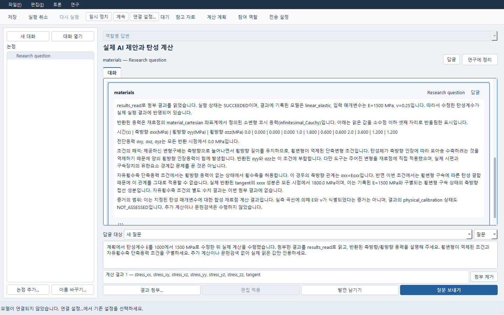
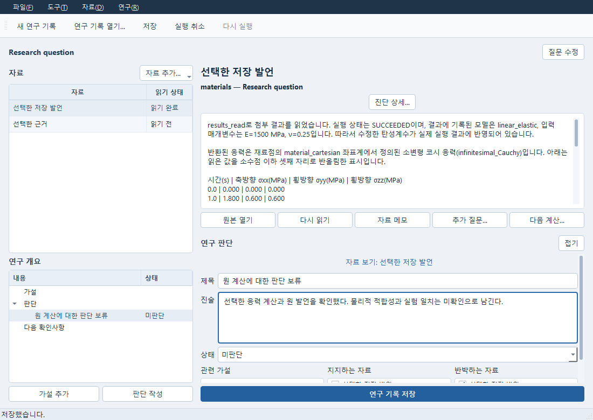
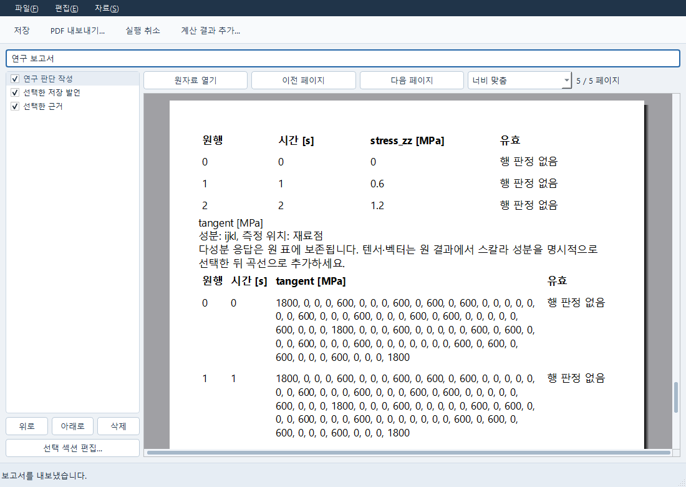

# 저장한 Expert 발언에서 연구와 보고서 만들기

이 흐름은 이미 저장한 대화와 문헌·계산 결과를 사용한다. 연구를 열거나 보고서를 만드는
동작은 AI에 질문하거나 계산을 실행하지 않는다. 새 상담이나 계산은 해당 앱의 별도 실행
명령과 조건을 따른다.

## 발언과 근거 선택

1. Expert에서 저장한 대화를 열고 정리할 발언을 선택한다.
2. **발언 근거**를 열어 함께 넣을 문헌 구간, 계산 결과 또는 후보 근거 한 개를 선택한다.
   근거를 선택하지 않으면 발언만 전달한다. 발언 생성 기록과 공학 계산 결과를 구별한다.
3. 선택 발언 옆의 **연구에 정리**를 누른다. 저장하지 않은 대화는 먼저 저장하고, 선택이
   달라졌다는 안내가 나오면 원하는 발언과 근거를 다시 선택한다.
4. 열린 Study에서 원 발언과 선택 근거를 확인한다. 현재 읽은 최신 결과로 바꾸거나 다른
   후보를 대신 넣지 않는다. 연구팀 답변은 기존 주장·의존 관계 선택 절차를 사용한다.

연결 응답을 받지 못하면 **연구 연결 결과 확인…**으로 원 요청을 확인한다. 다른 발언을
선택해도 미확정 요청은 유지되며, 이를 확인하기 전에는 다른 연결 요청을 만들지 않는다.
응답을 기다리는 동안 선택이 바뀌면 연구를 자동으로 열지 않는다. 결과 확인을 명시적으로
눌러 원 연구를 열 수 있다. 재확인은 같은 연구를 열며 그 연구에 이미 쓴 내용을 덮지 않는다.

서버가 연결 전에 원 대화 변경을 확정적으로 거절하면 현재 편집을 보존하고 재선택을
안내한다. 대화를 다시 읽고 필요한 편집을 저장한 뒤 발언과 근거를 선택한다. 결과가
불명확한 통신 오류는 이 거절과 구별하여 원 요청을 계속 보존한다.

## 연구 판단 작성

Study에서 **판단 작성**으로 진술과 상태를 직접 정한다. 지지·반박 근거를 각각 연결하고,
물리적 적합성이나 독립 실험 일치가 확인되지 않았다면 **미판단**으로 남긴다. 발언이나
계산 성공 자체로 공학 승인을 부여하지 않는다. 편집 후 적용하고 저장한다. 실행 취소와
다시 실행으로 판단 변경을 되돌리거나 복원할 수 있으며 원 근거는 유지된다.

Study의 **파일 → 보고서 만들기…**에서 저장한 연구와 연결된 발언·근거를 보고서에 넣는다.
Report의 **자료** 메뉴에서 계산 결과나 문헌을 추가하고 원하는 원 실행과 응답을 명시한다.
포함 목록에서 섹션을 선택해 순서·포함 여부·설명을 편집한다. **원자료 열기**는 원 앱으로
돌아가며, 보고서에 고정한 자료를 원 문서의 새 편집으로 바꾸지 않는다.

## 본문·표·그림 확인과 저장

보고서 미리보기의 이전/다음 페이지와 너비 맞춤으로 본문, 표, 곡선을 확인한다. 수치의
단위, 실패·미판단 상태와 원자료 참조를 보존한다. 텐서·벡터는 원 값을 표에 보존하며
다성분 값을 임의의 스칼라 곡선으로 그리지 않는다. 곡선이 필요하면 원 결과에서 지원하는
스칼라 응답·성분을 명시적으로 선택한다. 임의 텐서 인덱스 투영 기능을 추가한 것은 아니다.

일반 **저장**은 섹션 설명을 **설명 적용** 또는 **수정 취소**로 마친 뒤 누른다. 창 닫기,
새 보고서, 다른 보고서 열기에서 변경이 남으면 다음 중 하나를 선택한다.

| 선택 | 결과 |
|---|---|
| 저장 | 편집 중인 섹션 설명까지 포함해 저장한 뒤 이동한다. |
| 버리기 | 저장하지 않은 변경을 버리고 이동한다. 다시 열면 마지막 저장본을 읽는다. |
| 취소 | 현재 창과 편집을 그대로 유지한다. |

저장 응답을 받지 못하면 기존 재시도로 같은 요청을 확인한다. 오류 때문에 현재 편집을
지우거나 새 보고서를 만들지 않는다. 저장 중 새 편집을 시작하면 완료 후에도 창을 유지해
남은 편집을 확인할 수 있다.

**PDF 내보내기…**와 **Markdown 내보내기…**로 출력한다. 출력한 뒤 앱과 서비스를 닫고
다시 시작하여 같은 연구와 보고서를 열면 고정한 원 입력·결과와 저장한 판단을 다시 읽는다.
원 문서의 편집 가능성과 보고서 보존본은 각각 유지된다.

## 확인한 범위

2026-10-18에는 보관된 실제 Expert 답변과 탄성 재료점 결과(E=1500 MPa, ν=0.25)를 복사한
저장소에서 이 흐름을 실행했다. 별도 Python 프로세스에서 같은 연구·사용자 메모·판단과
보고서 자료를 다시 읽고, 응력 6개 곡선과 접선 텐서의 3시점×81성분 표를 PDF/Markdown으로
출력했다. 연결 응답 유실, 선택 변경, 연결 전 원 대화 변경 거절, 저장 응답 유실과
저장/버리기/취소를 확인했다. 이 과정의 새 계산 작업과 provider 호출은 0개다.

이는 저장 자료를 사용하는 이 작업 흐름의 구현·실행 근거다. 새 AI 상담, 새 솔버 실행,
모든 앱의 완료, 전체 Windows 입력 자동화의 수용 또는 공학 적합성 승인을 뜻하지 않는다.

## 실제 화면

