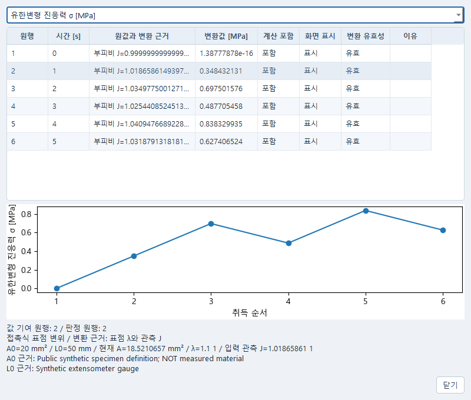
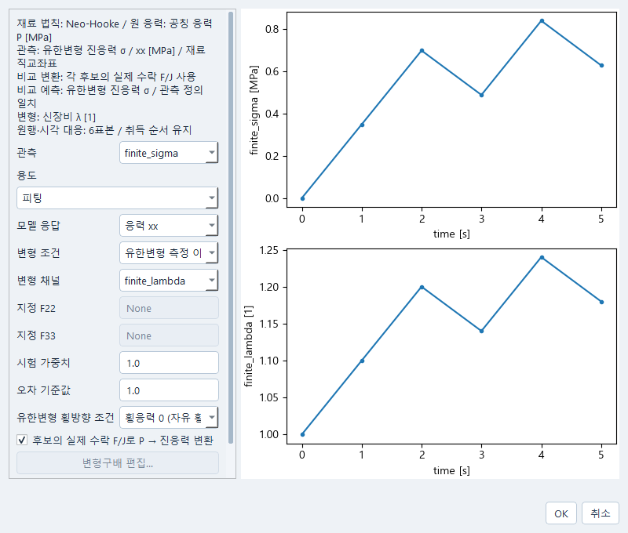

# 유한변형 관측과 같은 측도 예측

이 경로는 회전·전단 없는 단축·동축 관측을 대상으로 한다. 원자료의 힘과 표점 변형,
치수·면적·부피비를 명시하고, 선택한 재료 법칙의 예측을 같은 응력 정의로 비교한다.
관측값의 J와 각 후보가 실제로 수락한 F/J는 서로 다른 근거다.

## 원자료에서 변환값 확인하기

1. Data의 **자료 처리…**로 같은 문서를 열고, Python 처리 창의 편집 메뉴에서
   **유한변형 시험 설정…**을 선택한다. 시간·하중·변형 열과 각 단위를 지정한다.
   표점 변위에는 초기 표점 거리 L0와 측정 근거, 힘에는 초기 단면적 A0와 근거가 필요하다.
2. 변형 측정 방식을 고른다. 크로스헤드 변위를 표점 변위와 자동으로 같게 취급하지 않는다.
   이 가정을 쓰려면 별도 체크와 입력 근거가 필요하며, 체크 자체가 장비의 적합성 판정은 아니다.
3. 필요한 출력과 변환 근거를 고르고 **변환 미리보기**를 누른다. 공칭 응력은 축방향
   힘/A0이며, 동축 진응력은 `(λ1/J) P11`이다. 현재 면적 경로는 힘/A(t)를 사용한다.
   J·현재 면적·F가 빠졌다고 자동 J=1이나 미측정 횡변형을 채우지 않는다.
4. 초안에 반영하고 설정 적용·자료 준비를 한다. **응력과 변형률 변환 추가…**로 기존
   처리 단계에 연결한 뒤 처리 미리보기에서 값을 확인하고 결과를 보존·저장한다.
   미완성 숫자는 초안으로 보존할 수 있지만 선택한 변환에 필요한 입력이 잘못되면 실행이 차단된다.
5. **변환값과 원행 확인…**에서 출력 채널과 행을 선택한다. 원값·계산 포함·보기 숨김·
   변환 유효성을 따로 확인한다. 아래에는 선택 행의 A0·L0·신장비·J와 원래 입력 근거가 나온다.
   J는 입력 관측, 관측 F에서 계산한 값, 명시 가정을 구별한다. 채널을 바꿔도 선택 행은 유지된다.

로그 변형률은 양의 신장비에서만 정의된다. λ≤0, 필요한 J·면적 누락, 시간·단위 불일치,
서로 맞지 않는 원행은 기존 검사에서 확인한다. 취득 순서의 언로딩·재로딩을 신장비순으로
다시 정렬하거나 누락 구간을 임의로 보간하지 않는다.

## 재료와 비교하고 계획에 쓰기

보존한 응력 관측을 기존 피팅 계획에 연결한다. **시험 조건** 창에서 재료 법칙과 원 응력
정의, 관측의 정의·성분·단위, 변형 채널과 원행·시간 대응을 함께 확인한다.
이 문맥 표시는 전체 실행 검증이나 재료 승인을 대신하지 않는다.

Neo-Hooke의 원 공칭 응력을 진응력 관측과 비교할 때는 **후보의 실제 수락 F/J로 P → 진응력 변환**을
명시한다. 변환에는 각 후보의 실제 수락 증분을 사용한다. 관측 J나 지정 F를 후보의 실제
상태로 대체하지 않는다. 실패 전 수락 결과를 확인하는 것과 성공 점수에 사용하는 것도 다르다.

계획의 학습·별도 검증 용도, 표본 mask, 시험·표본 가중치와 정규화 척도를 확인한다.
후보 상세에서 원 단위 잔차와 정규화 잔차, 수락 F/J를 보존 근거와 함께 읽는다.
**계수를 재료에 적용**은 선택한 원 재료에 대한 별도 확인 동작이다. 원 재료 입력이 계획을
묶은 뒤 바뀌면 기존 보호 관문이 적용을 차단한다. 현재 재료를 보존하고 원 연결을 확인한다.
저장한 뒤 다시 열어도 같은 관측·후보·원행·채택 근거를 사용한다.

## 이번 확인 범위

기존 Windows 실제 유한변형 사례의 학습·독립 검증 각 6표본, μ 자유·λ=5 MPa 고정인
Neo-Hooke 결과와 후보 C000010을 재사용했다. 이는 공개 합성 자료이며 새 재료 기본값이 아니다.
기존 실제 피팅·채택·저장 기록과 원 hash를 읽었고, 이번 창 변경에서는 새 피팅·법칙·solver·
provider 계산을 하지 않았다. 현재 확인은 보존 결과 읽기, 선택·취소, 이미 변경된 원 재료에
대한 적용 차단, 별도 프로세스 재열기다. 현재 차단을 새로운 채택 성공으로 세지 않는다.
실장비의 크로스헤드 등가성이나 재료의 공학 적합성은 확인한 범위에 포함되지 않는다.
