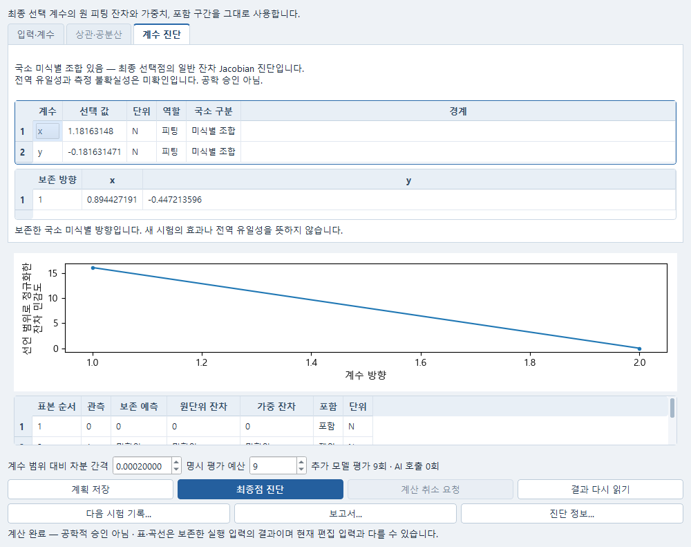
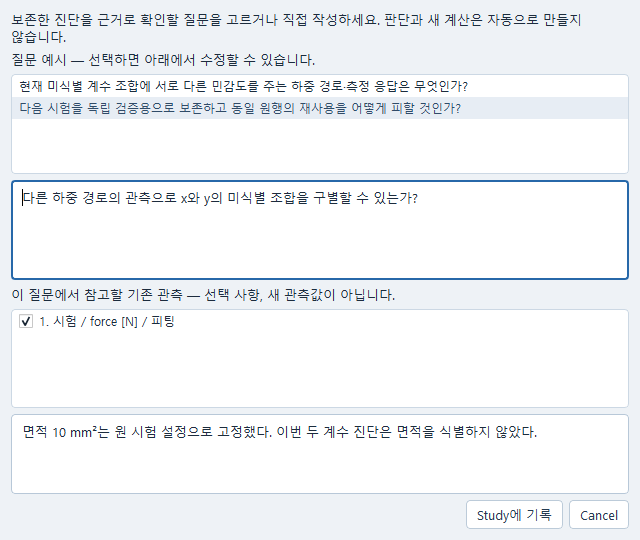
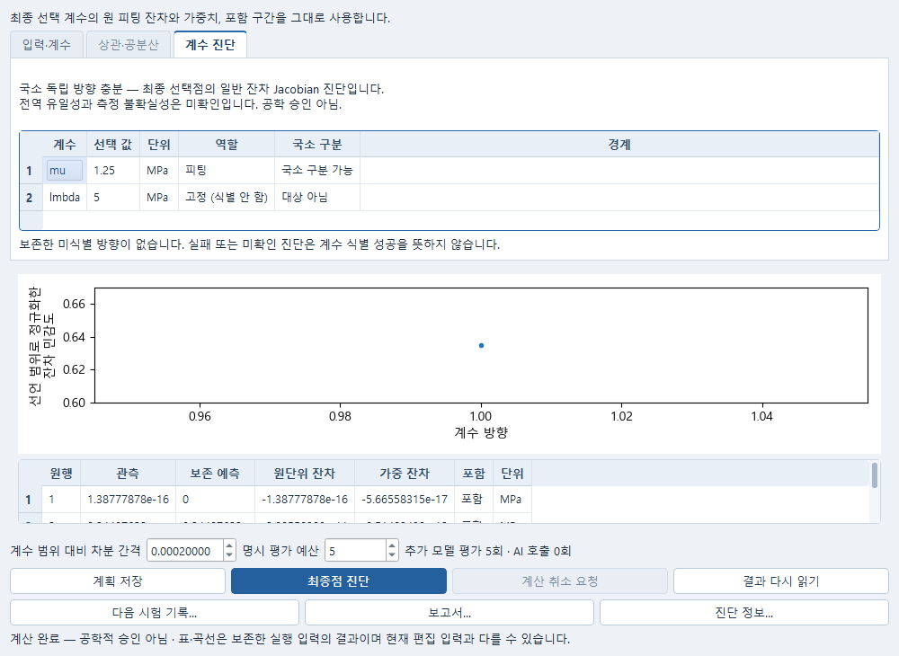
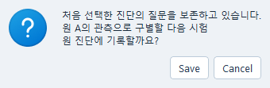
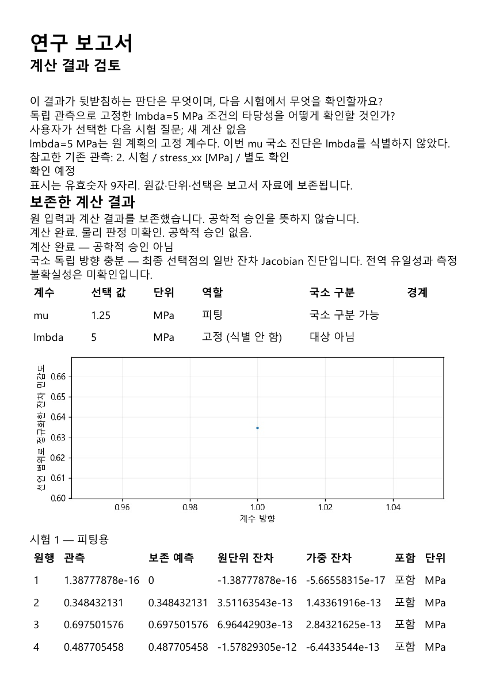

# 보존한 계수 진단에서 다음 시험 기록하기

이 안내는 이미 저장한 최종점 계수 진단을 읽고 다음 관측 질문을 Study와 보고서에 남기는
흐름이다. **최종점 진단**은 별도 명시 실행이며 추가 평가 예산을 사용한다. 창 열기,
**결과 다시 읽기**, **다음 시험 기록…**, 보고서 만들기는 새 평가를 실행하지 않는다.

## 진단 읽기

Numerical의 보존 후보에서 최종점 진단을 열거나 저장한 시험 분석 계획을 다시 연다.
**계수 진단** 탭에서 선택 값·단위·국소 구분·경계를 확인한다. 원 계획이 고정 계수를
명시한 경우에는 **고정 (식별 안 함)**으로 구별한다. 단순한 시험 설정의 상수를 식별된
계수나 정식 고정 변수로 대신 표시하지 않는다.

미식별 방향이 보존돼 있으면 원 진단의 범위 정규화 방향 계수를 표에서 읽는다. 아래의
원 관측·보존 예측·잔차표와 민감도 곡선을 함께 확인한다. 작은 잔차나 국소 진단의 계산
완료는 전역 유일성, 측정 불확실성 또는 공학 승인을 뜻하지 않는다. 실패·차분점 오류·
예산 소진으로 진단이 미확인이면 원 사유와 결과를 유지한다.

같은 결과를 다시 읽어도 선택한 계수와 아직 적용하지 않은 입력은 유지한다. 현재 편집한
차분 간격과 예산이 보존 결과의 실행 조건과 다를 수 있으므로, 원 조건은 **진단 정보…**에서
확인한다. 보존 결과를 새 편집 입력으로 재해석하지 않는다.
다른 실행이 대기 중이어도 Study와 보고서에 연결하는 근거는 현재 표에 표시한 완료
결과다. 연결 응답을 기다리는 동안 표시 결과가 바뀌면 자동으로 창을 열지 않으며,
안내에 따라 원하는 결과를 다시 선택하거나 원 저장 요청을 확인한다.
질문 작성 창을 연 사이 다른 진단이 표시되면 기록하지 않고 원 질문을 보존한다.
**원 진단 질문 기록…**에서 처음 선택한 결과에 기록할지 다시 확인한다. 취소하면 원
질문을 유지하며, 다른 결과에 대신 기록하지 않는다.

## 다음 관측 질문 선택

1. **다음 시험 기록…**을 누른다. 처음에는 질문이 선택되거나 입력되어 있지 않다.
2. 예시 질문을 직접 선택한 뒤 수정하거나, 확인할 질문을 직접 작성한다. 질문이 비어
   있으면 **Study에 기록**을 누를 수 없다.
3. 참고할 기존 관측을 필요할 때 선택한다. 피팅용과 별도 확인용 표시는 원 역할을
   따른다. 원 보존 시험의 순서도 함께 기록하여 같은 이름의 시험을 구별한다. 이 선택은
   새 시험값을 만드는 동작이 아니다.
4. 시험 조건이나 고정 계수를 어떻게 확인하려는지 목적 메모를 적고 **Study에 기록**을
   누른다. 원 진단 결과에 연결된 다음 확인사항을 저장한다. 가설·판단은 자동 생성하지 않는다.

Study의 다음 확인사항에서 질문·목적 메모·연결 근거를 확인한다. 근거는 선택한 실행의
원 입력과 결과를 가리킨다. 다른 최신 실행이나 후보로 바꾸지 않는다. 지지·반박이나
고정 계수의 타당성 판단이 필요하면 Study에서 판단을 명시적으로 작성한다. 미확인인
내용은 미판단으로 남긴다.

## 저장·복구와 보고서

연결 또는 저장 응답이 유실되면 분석 창의 **다음 시험 저장 재시도**로 원 요청을 확인한다.
같은 생성·갱신·저장 요청을 사용하고 이미 기록한 다음 확인사항을 중복 추가하지 않는다.
분석 창의 미적용 입력도 보존한다. 미확정 요청이 남은 창을 닫을 때는 기존 입력 보호
확인을 따른다.

Study를 저장한 뒤 **파일 → 보고서 만들기…**로 연구와 원 진단을 함께 넣는다. 분석 창의
**보고서…**는 보존 진단을 직접 보고서에 넣는다. 계수표·보존 방향·관측과 잔차의 단위,
실패·미확인 상태를 확인하고 PDF 또는 Markdown으로 내보낸다. 보고서 저장과 닫기의
저장/버리기/취소는 [보고서 안내](EXPERT_STUDY_REPORT_KO.md#본문표그림-확인과-저장)를 따른다.

앱과 서비스를 종료한 뒤 같은 저장소에서 연구와 보고서를 다시 열어 같은 질문·근거·
보고서 자료가 남아 있는지 확인할 수 있다. 이 재열기는 원 후보를 다시 계산하지 않는다.

## 실행해 확인한 범위

2026-10-18에는 기존 합성식 **P=(x+y)t**의 4시점 중 한 시점을 제외한 두 계수 사례를
사용했다. 실제 SciPy soft_l1 least-squares는 16회, DE(seed 8, 4세대, population size 5)는
24회 평가했다. 각각의 정확한 최종 후보에 기존 ordinary-residual FD를 9회 적용하여
국소 미식별 방향을 보존했다. 면적 10 mm²는 시험 설정의 상수이며, 이 두 진단의 정식
고정 변수로 표시하지 않았다.

그 뒤의 Windows HTTP/Qt 흐름과 별도 Python 프로세스 재열기에서는 새 계산 없이 같은
원 fit·진단·Jacobian·질문·Study·보고서 자료를 확인했다. provider와 native solver 호출은
없었다. 이 공개 합성 사례는 실제 물성 식별, 통계적 신뢰구간, 전역 유일성 또는 공학
승인을 검증한 것이 아니다. 전체 Windows 입력 수용과 제품 전체 완료도 별도다.

기존 공개 합성 유한측도 시험의 FELUPE neo-Hooke 결과도 재피팅 없이 재사용했다. 원
계획의 자유 μ≈1.25 MPa와 고정 λ=5 MPa를 유지하고, 승인된 최종점 진단 5회에서 고정
계수를 식별 대상으로 세지 않았다. 원 피팅·별도 확인 결과는 변경하지 않았고 이번
진단에서 별도 확인 시험을 평가하지 않았다. 이 실행 역시 실제 시험에 대한 물성
적합성 승인과 구별한다.

## 실제 화면

