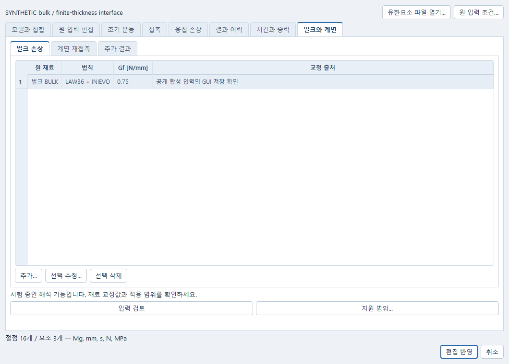
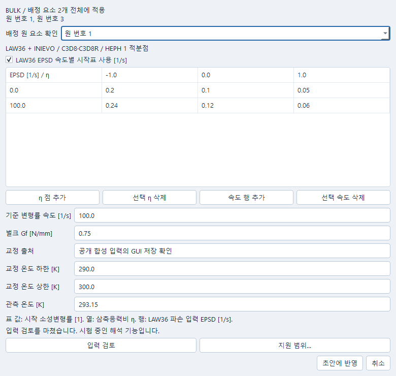

# 충격 모델의 벌크 손상과 계면 설정

기존 해석 모델에서 재료의 손상 조건, 계면 재접촉과 추가 결과를 편집합니다. 시험 중인 해석 기능이므로 화면의 **지원 범위…**에서 지원 요소와 교정 조건을 확인하세요.

## 화면에서 편집하고 저장하기

해석 창에서 자기 INP 모델을 열고 **충격 조건… → 벌크와 계면**으로 이동한다. 기존 **모델과 집합**, **초기 운동**, **접촉** 편집은 그대로 사용한다. 원 RAD 직접 입력의 벌크·계면 확장은 지원하지 않으며, 해당 화면은 기존 초안을 보존한 채 편집을 막는다.



1. **벌크 손상 → 추가…**에서 원 입력에 배정된 재료를 고른다. 선택 재료의 배정 요소 전체에 적용되며, 대화상자의 **배정 원 요소 확인**에서 원 instance와 요소 번호를 확인한다. 일부 요소에만 적용하려면 원 INP에서 재료를 먼저 분리한다.
2. 손상 시작 소성변형률 표의 삼축응력비 η 열과 EPSD 속도 행, **기준 변형률 속도 [1/s]**, **벌크 Gf [N/mm]**, **교정 출처**와 온도 적용범위를 입력한다. 속도 축을 쓰지 않으면 한 행의 삼축응력비 표다. **입력 검토**에서 오류를 확인하고 **초안에 반영**한다. 취소하면 변경 전 상태를 유지한다. 수치가 비어 있거나 `1e`처럼 미완성이어도 초안을 저장할 수 있지만 계산은 기존 입력 검사에서 차단된다. 예제의 합성 교정값은 사용자 재료의 기본값이 아니다.
3. **계면 재접촉 → 추가…**에서 기존 COH3D8 LAW117 재료를 고른다. 응집 압축만 유지하거나, 기존 **접촉** 탭에서 만든 TYPE24의 원 대향면과 활성 시각을 선택한다. 선택 면은 모델 미리보기에서 강조된다. **입력 검토**는 실제 벌크 이웃과 중복 접촉도 검사한다. 지연 활성은 시간 조건이며 자동 삭제 감지가 아니다.
4. **추가 결과 → 추가…**에서 벌크 요소·원 응집 요소·원 접촉쌍을 구분하고 물리량, 원 대상과 성분을 고른다. 표시된 단위를 유지하며 DAMA를 고유 손상 시작/진전 상태로, PLSR을 EPSD로 바꾸지 않는다. 접촉쌍의 힘·충격량 의미는 미확인으로 남긴다.
5. **지원 범위…**에서 요소 형식·교정법·솔버 검증의 제한을 읽고, **입력 검토 → 편집 반영** 후 해석 창에서 **변경 적용**하고 문서를 저장한다. 같은 Simulation을 재열면 같은 표·재료·대상·결과 선택을 계속 수정할 수 있다. 바깥 편집 창에서 **취소**하면 그 창의 수정은 반영되지 않는다.



원문이나 재료 배정을 바꿔 기존 대상이 달라졌다면 **원 입력 편집 → 원 대상 대응 확인…**에서 기존/현재 instance·원 번호·재료 배정 전체 구성원과 접촉 양면을 비교하고 명시 수락한다. 같은 정수 번호가 남아 있어도 자동 승인하지 않는다. 거절하면 원 선택과 실행 차단을 유지한다.

실제 Windows QWindows 화면에서 보통·좁은 창의 선택·편집·취소, 같은 Simulation 저장과 별도 Python 프로세스 재열기를 확인했다. 공개 합성 입력으로 프로그램 방식의 Qt 조작을 검사한 범위이며, 잠긴 Windows 세션의 키보드·마우스 조작과 실제 손상 솔버 계산은 실행하지 않았다.

## 구현 기준과 확인 범위

요청 `PRO-IMPACT-BULK-INTERFACE-20261015-01`. 기준 제품 `ce9ec3aefc6b7bc759b7b6bda23177595dbd3cd1`, fixture `3e48bf6138f495299f45b1af254bfb4aaff307b8`. 고정 OpenCourant source `cb760c206e346eff12161a2268b134ef9d48a4ef`, release `latest-20261011`.

이 인도는 실제 Python 제품 코드와 회귀 검사다. **전체 B의 native/물리 수용 완료가 아니다.** 기존 Python INP 변환기, 원 물리 postflight, B 카드 작성/재검증, native 형식 reader, 원본 작성 시점에는 기존 Simulation/JobManager에 연결한 별도 실패 재후처리와 저장·새 프로세스 재열기를 실행했다. 현재 main 통합은 아래 4절처럼 최근 공통 읽기 경로를 보존하며 별도 실행기를 중복 등록하지 않는다. Reader 시험 입력은 명시한 합성 raw TH/VTK/CSV이며 Starter/Engine이 생성한 관측으로 표시하지 않는다. Pro 원본의 Windows 확인은 NOT_RUN이었고, 현행 Windows reader·저장·cold 확인은 아래와 구분한다. Starter/Engine, ANIM/TH converter binary, Qt 화면 조작은 이 백엔드 통합에서 NOT_RUN이다.

## 1. 사용자가 편집하는 내용

기존 충격 Simulation의 메시·재료·단위·운동·접촉을 유지한다. `bulk_damage`에 원 재료 이름을 선택하고 손상 시작표, SR_REF, Gf, 교정 출처와 온도 적용조건을 입력한다. `impact_bulk.default_law(material)`는 수치가 비어 있는 UNKNOWN 초안이다. 새 초안은 저장할 수 있지만 필수 교정이 없으면 실행하지 않는다. 공개 예제 수치는 합성 검사값이며 사용자 재료의 기본값으로 복사하지 않는다.

첫 조합은 원 INP C3D8/C3D8R의 양의 affine Hex8, 실제 변환 PROP/SOLID Isolid24 HEPH 1 material IP, 원 LAW36 단일 소성 곡선, INIEVO 한 criterion이다. INP의 C3D8/C3D8R 표기만으로 Abaqus 적분과 같은 것으로 인증하지 않는다. 두 형식 모두 변환 후 실제 property를 검사한다. Warped brick, 다른 적분점 수, tetra/shell/beam, 비국부 길이, 추가 FAIL, LAW36 자체 cutoff, 다른 rate-hardening 옵션은 이 첫 조합에 자동 포함하지 않는다.

| 편집 내용 | 구현된 의미 |
|---|---|
| 시작표 | INITYPE1. 열은 eta, 행은 LAW36에서 failure에 전달하는 EPSD 속도. rate 축을 비우면 명시한 1차원 eta 표다. |
| eta | native solid 함수의 [-1,1] 절단과 원 raw eta의 교정 범위 판정을 분리한다. 절단됐다고 교정이 유효해지지 않는다. |
| rate | 원 LAW36 NRATE1, VP0, Fsmooth0을 유지한다. hardening의 속도 보간은 없다. failure 입력은 dispatcher의 EPSD이며 DPLA/dt로 치환하지 않는다. 2차원 표의 두 번째 좌표는 EPSD/SR_REF이다. |
| 진전 | EVOTYPE2, EVOSHAP1, COMPTYP1, ILEN0, FAILIP1. source의 onset YLD0 계수 `ΔD = Δplastic_strain × L0 × YLD0 / (2 × Gf)`를 바꾸지 않는다. |
| 길이 | 초기 effective affine geometry에서 V와 V^(1/3)를 예측해 보존한다. native VOL의 실제 관측과는 별도 상태다. 실제 온도·삼축도·길이 및 mesh-objectivity 검증은 별도 수용이다. |
| 온도 | 교정 적용범위와 관측 metadata다. 이 경로의 native 온도 의존 failure 축이 아니다. 누락 관측은 UNKNOWN으로 남긴다. |

지원검사는 원 변환 결과의 mesh/part/material/property와 기존 LAW36 값을 먼저 확인하고, B가 추가한 exact table/failure/output 카드와 LAW117 보존을 다시 검사한다. 기존 Starter의 warning/error/units 검사, Engine 종료 검사, runtime 해시 검사를 우회하지 않는다. 일반 native RAD와 계층 INP 편집/dispatch는 A의 소유이며 본 patch가 대신 구현하지 않는다.

## 2. 결과 선택과 단위

기존 `responses`는 그대로 둔다. 새 `b_responses`는 `name`, `scope`, `identity`, `quantity`, `component`로 정확한 원 위치를 선택한다. 화면 표시문구는 `impact_b.editor_rows()`와 응답 metadata의 한국어 `label`을 사용한다. 내부 JSON/hash를 사용자의 기본 작업면으로 요구하지 않는다. 아래 GUI는 같은 Simulation의 기존 편집·저장 경로를 사용한다. 계산 결과를 생성하거나 물리 수용을 대신하지 않는다.

벌크 선택은 `scope='bulk'`, 원 element ID, `damage_sum`, `active`, `plastic_strain`, `internal_energy_density`, `volume`, `strain_rate` 또는 `stress_xx`/`stress_yy`/`stress_zz`/`stress_xy`/`stress_yz`/`stress_xz`다. 벌크 각 선택의 `component`는 `scalar`이며 응력 성분은 quantity 이름으로 구분한다. 정확한 지원 component 목록은 `impact_bulk_results.BULK`와 `validate()`가 검사한다. DAMA는 **native sum of damages**이며 고유 INIEVO initiation/evolution 상태로 재명명하지 않는다. PLSR도 별도 native 출력이며 failure에 전달된 EPSD와 자동 동등시하지 않는다.

| 양 | 단위와 구별 |
|---|---|
| 벌크 Gf / 계면 GIC·GIIC | 각각 N/mm. 같은 차원이어도 다른 법칙/교정이다. J/m² 값은 N/mm 값의 1000배다. |
| 요소 IE | native internal energy density, N/mm². 총에너지나 Gf가 아니다. 현재 부피로 임의 곱해 총 damage energy를 생성하지 않는다. |
| global 에너지 | native N·mm를 J로 표시할 때 ×0.001. IE/KE/contact/hourglass/external work/plastic work를 개별 보존한다. |
| 질량 | native Mg에서 kg로 ×1000. MASS를 original mass로 재명명하지 않고 ADDED MASS와 구분한다. |
| 손상·활성 | DAMA와 OFF/EROSION_STATUS를 분리한다. 누락 요소는 삭제된 것으로 추정하지 않는다. 삭제 뒤 물리량은 적용불가 mask로 남긴다. |
| 충격량 | 실제 시각 표본의 사다리꼴 적분은 DERIVED다. 첫 0은 적분 기준값이지 native impulse 관측값이 아니다. gap 뒤 적분을 이어 붙이지 않는다. |

Native TFILE/4 reader는 원 group ID·member ID·출력 token·실제 binary32 시각과 원 row/byte 범위를 사용한다. 입력 token 순서와 native 저장 순서가 달라도 실제 token으로 대응한다. DAMA/OFF/IE 등의 열이 없거나 identity가 다르면 값을 생성하지 않는다. 전체 internal energy 차를 damage dissipation으로 만들지 않는다. 벌크와 계면 손상을 합산하지 않는다.

접촉쌍은 정확한 TYPE24 카드·양면·TH/INTER group/member·FNX/FNY/FNZ/FTX/FTY/FTZ를 선택한다. 고정 Windows producer의 첫 여섯 raw TH 열은 **누적 충격량**이다. 솔버가 매 증분 힘×DT12를 FSAV에 더하고 TH가 그대로 기록하며, 현재 고정 `th_to_csv`는 이 누적값을 차분해 힘으로 내보낸다. 현재 reader는 CSV의 FN/FT를 다시 충격량으로 읽지 않고 원 TH를 사용한다. 고정 producer·원 변수 번호·단위 대응이 없는 과거/다른 runtime은 UNKNOWN을 유지한다.

| 접촉쌍 선택 | 표시·계산 의미 |
|---|---|
| `native_impulse` | native 누적 충격량 [N·s], NATIVE. 첫 기록값을 임의로 0으로 바꾸지 않는다. |
| `force` | 누적 충격량의 시각 차분으로 얻는 **구간 평균 힘** [N], DERIVED. 양 끝은 한 구간, 내부 표본은 앞·뒤 표본을 잇는 구간을 사용한다. 순간 solver 힘이 아니다. |
| `sampled_impulse` | 위 평균 힘 표본을 실제 TH 시각으로 사다리꼴 적분한 값 [N·s], DERIVED. 첫 표본을 0 기준으로 삼으며 exact solver 충격량과 다르다. |

여섯 성분은 모델 전역 축의 native 부호를 유지한다. 법선 FN은 접촉 법선 기여의 전역 X/Y/Z 성분이며 축방향 절댓값이 아니다. surface-to-surface TYPE24에서 원 surface1의 main 기여는 +FNI·N, surface2의 main 기여는 -FNI·N으로 누적한다. 기존 compiler는 surface1=`b`, surface2=`a`를 쓴다. FT는 native FXT/FYT/FZT main-contact 기여를 그대로 합친 값으로, 사용자가 고른 한 body 쪽으로 재부호화하지 않는다. 다른 쌍이나 ANIM의 all-contact nodal resultant를 섞지 않는다. TH group에는 정확한 interface member 하나만 두고 성분별 native 변수 번호 1–6까지 검사한다.

실제 binary32 TH 시각을 사용하며 요청한 출력 간격이나 안정 시간증분을 대신 넣지 않는다. 힘의 각 값에는 실제 차분 구간과 원 row를 보존한다. 표본 부족·비유한 값·원 row gap은 계산하지 않고 mask로 남기며, 표본 적분도 그 뒤를 이어 붙이지 않는다. TYPE24에 없는 SFW/CE_DAMP는 만들지 않는다.

## 3. 계면: 지원 코드와 남은 물리 수용

기존 positive-thickness COH3D8 LAW117 envelope, 체적밀도, POWER/BK, 기하와 mean-damage reader를 재사용한다. 기존 2025 입력의 LAW117 카드 길이를 보존한다. 새 fork의 2612 Isym/criterion/evolution 필드를 임의 기본값으로 추가하지 않는다. 이 법칙은 반복 수명/fatigue law가 아니다.

`interface_controls`에서 `COHESIVE_ONLY` 또는 `DELAYED_TYPE24_REQUIRE_DELETION`을 선택한다. 후자는 원 두 벌크면과 정확한 TYPE24를 대조하고, 사용자가 선언한 활성 시각만 수정한다. 중복/alias 면으로 같은 접촉을 다시 넣거나 COHESIVE_ONLY에 같은 대향 접촉을 겹치는 경우는 거절한다.

**지연 활성은 clock gate이지 자동 element-deletion gate가 아니다.** 출력 표본에서 활성 시각 이후 cohesive가 살아 있으면 VIOLATED다. 이전 삭제가 관측돼도 전체 solver 증분에 걸친 압축 이중계상 방지 인증은 UNKNOWN이다. 삭제 전 부분 손상 0<d<1의 unload/compression/reopen·mixed mode와 완전 삭제 뒤 bulk recontact/reopen은 서로 다른 native 시험으로 남긴다.

원 paired-face separation/opening/slip은 고정 초기 basis의 기하학적 계산이다. cohesive 삭제 후에도 양쪽 bulk가 실제 활성으로 관측되고 대응 절점이 있으면 읽는다. 벌크가 삭제/누락되면 적용불가다. 이것을 native closest-contact gap, penetration, normal traction/reaction으로 표시하지 않는다. 이전 cohesive traction이 부활했다고 해석하지 않는다.

## 4. 원 실패 결과 다시 읽기

같은 해석 창의 계산 목록에서 원 작업을 선택하고 **연구 → 보존 결과 다시 읽기…**를 연다. 이미 보존된 결과를 읽을지, 원 ANIM/TH를 명시적으로 다시 변환할지 선택한다. 이 작업은 새 읽기 작업이며 Starter/Engine 계산을 다시 시작하지 않는다. 원 해석의 실패·취소 상태와 새 읽기의 성공 여부는 별도로 남는다.

기존 읽기 경로는 검증할 수 있는 CSV의 완결 행과 독립적으로 읽을 수 있는 VTK 프레임을 보존한다. 빠진 중간 프레임이나 잘린 끝부분은 사유와 원 위치를 남기며, 그 구간을 보간해 연속 곡선으로 만들지 않는다. 원 작업·입력·결과를 저장한 뒤 같은 문서를 열어 선택한 결과를 다시 읽는다.

이번 B 원본에 있던 별도 `b_readback` 초안·재후처리 실행기는 최근 개선된 이 경로에 덮어쓰지 않았다. 이전 참조를 새 계산 초안에 넣으면 실행을 거절한다. B의 추가 TFILE/4 벌크·계면 응답도 같은 원출력 읽기에 연결했다. 원 작업에 보존한 B 정의와 실제 native 카드를 대조하며, B 정의가 없는 과거 작업에서 B 수치를 생성하지 않는다. 잘못된 입력 pin은 거절하고, 채널 불일치는 B 읽기의 오류로 남긴다. 그 오류 때문에 정상인 기존 전역 이력·독립 프레임을 버리지 않는다.

벌크 TH의 완결 표본, 계면의 독립 프레임, 물리 의미가 미확인인 접촉쌍은 각각 확인한다. 빠진 원 프레임 번호는 유지하며, 예를 들어 0번 다음 2번을 읽으면 두 구간을 이어 붙이지 않는다. 활성/삭제 상태를 정상적으로 읽었지만 삭제 뒤 물리량이 적용되지 않는 경우는 mask로 남기며, 이를 새 solver 실패로 바꾸지 않는다. 원 native 물리량과 원 대응면에서 계산한 기하량은 각각 NATIVE와 DERIVED 출처를 유지한다. 새 읽기 작업이라는 이유로 원 물리량의 출처가 바뀌지 않는다.

원문 편집으로 같은 번호가 다른 원 요소나 접촉쌍을 가리키거나, 손상·계면 재료에 배정한 요소 집합이 달라지면 **원 대상 대응 확인…**에서 변경 전/후를 확인하고 명시적으로 적용해야 한다. 새 번호가 존재한다는 이유만으로 이전 선택을 승인하지 않는다. 기존 A의 운동·접촉·결과 보호와 같은 검토/적용 경로다.

현재 Windows 확인은 합성 TH/VTK 입력을 기존 Simulation에서 선택·보존·다시 읽고 새 Python 프로세스로 재열기한 범위다. 실제 Windows 손상 계산에서 얻은 B 결과의 수용은 별도다. 입력 화면의 Qt 확인 범위는 앞의 화면 사용법에 명시했다. A의 native animation 단일 프레임·지연 선택 API를 B의 추가 물리량으로 확장했다고 주장하지 않는다. 추가 B 선택은 기존 응답 이름 선택을 사용한다.

## 5. 실행 예제와 검사

제품 저장소 루트에서 다음은 기존 Python 변환기와 B 카드·합성 TH/VTK reader를 검사한다. 별도 binary나 provider를 내려받지 않는다.

```text
python -m pytest -q tests/test_impact_bulk.py tests/test_impact_bulk_examples.py tests/test_impact_bulk_history.py tests/test_impact_interface_bulk.py
python -m pytest -q tests/test_impact_b_retained.py tests/test_impact_b_reference_bindings.py
```

검사 파일의 공용 fixture import가 필요한 실행기에서는 저장소 루트와 `tests`를 Python import 경로에 포함한다. 원 Pro 배포 `RUN_STATUS.md`의 이전 재후처리 실행과 현재 main의 검사를 구분한다. 새 의존성은 없다.

실제 Windows의 **기존 exact-pinned runtime**을 운영자가 이미 선택한 경우에만 아래 opt-in 예제를 실행한다. 이 인도 환경에서 아래 명령은 실행하지 않았다.

```text
python -m examples.impact.bulk_interface.run_local --workspace "C:\CAE\Impact B check\one" --execute-synthetic --nx 1 --output-factor 1
```

`--nx 2` 및 `--output-factor 0.5`는 별도 workspace에서 작은 사전 비교를 위한 입력이다. output-factor는 **출력 표본 간격**이며 native 안정 시간증분을 반으로 만드는 옵션이 아니다. `--cfl-scale 0.45`는 기존 engine /DT의 scale을 0.9에서 0.45로 바꾸는 별도 native 시간증분 비교다. 실제 기록된 TIME STEP을 확인해야 하며 sample-quadrature 민감도와 혼동하지 않는다. 상세 선언은 공개 예제의 `NATIVE_ACCEPTANCE_PLAN.json`을 따른다. native 명령 실패/취소 시 원 로그를 보존하고, script는 `finally`에서 해당 Workbench의 소유 작업만 정리한다.

## 6. 통합

전용 파일은 product.patch, A 소유 접점은 A.integration.patch, root 접점은 root.integration.patch로 분리한다. integration.patch는 두 접점 patch를 합친 동일본이다. **분할본과 합본을 중복 적용하지 않는다.** 최신 A/root 수정 위에는 해당 최소 hunk를 정합하며 baseline 전체 파일을 덮지 않는다. source/에는 신규 B 전용 파일만 제공한다.

원 B 전체 잔여는 `IMPACT_B_ORIGINAL_LEDGER.md`에 남긴다. A의 일반 native RAD/계층 입력, C의 εN/다축 피로, 추가 결과의 Qt 표시·물리 수용, Codex의 native Windows 실행·게시, Astra 독립 검토는 이 GUI 연결로 대신 완료 처리하지 않는다.


## 7. 접촉쌍 응답 후속 확인

같은 Simulation의 **결과 선택**에서 접촉쌍과 성분, 누적 충격량·구간 평균 힘·평균 힘 표본 적분 중 필요한 응답을 선택한다. 기존 응답 이름 선택으로 곡선·표를 비교하고 문서를 저장한다. 다른 프로세스에서 열어도 원 pair/member와 원 시각, 부호·단위, NATIVE/DERIVED 구별이 유지된다. 두 양을 비교할 때 원 충격량의 초기 offset과 표본 적분의 0 기준을 먼저 확인한다.

2026-10-16 후속은 고정 producer source `cb760c206e346eff12161a2268b134ef9d48a4ef`의 TYPE24 누적·TH 저장·초기화/clear 경로와 실제 고정 converter binary의 3표본/2쌍/12 signed 채널을 대조했다. raw [0,2,1] N·s와 비등간 시각 [0,0.1,0.4] s에 대해 변환 힘은 [20,2.5,-3.333333] N이다. 이 입력은 합성 TH 형식 검사이며 실제 contact 관측이 아니다. 별도 Tools source의 중심/끝 차분 구현도 확인했으나 release binary의 정확한 Tools build commit을 단정하지 않는다. 제품은 고정 binary 해시와 원 producer 소스를 구별해 보존한다.

정상 및 원 FAILED/잘린 TH의 기존 Simulation 읽기·선택·저장·mutable 결과 제거·새 Python cold에서 같은 선택과 원 실패를 보존했고 solver/converter 재호출은 없었다. 고정 producer 증거가 빠지면 pair 값은 UNKNOWN이며 원 저장 열은 진단에 남는다.

허용한 공개 두 탄성 C3D4·TYPE24 한 쌍의 실제 Windows 확인은 Starter 뒤 관문에서 `Itetra4=3/Ismstr=12` 불일치로 차단됐다. Starter는 1 thread로 실행됐고 Engine은 시작하지 않았다. 원 변환 INP/native deck·Starter 결과·문서·cold를 보존했으며 입력이나 공차를 바꿔 재실행하지 않았다. 따라서 새 실제 접촉 조합의 충격량/운동량·부호 수용은 아직 미완료다. 기존 native RAD의 명시 Itetra4=1000 지원을 INP effective compiler에 잇는 정식화 교정은 별도 후속이다. 이 reader 인도로 벌크/계면 손상, 비영 FT 물리 검증이나 전체 B 완료를 주장하지 않는다.

원 생산 소스와 공식 보조 문서: [고정 TYPE24 producer](https://github.com/OpenCourant/OpenCourant/blob/cb760c206e346eff12161a2268b134ef9d48a4ef/engine/source/interfaces/int24/i24for3.F), [TH 직접 저장](https://github.com/OpenCourant/OpenCourant/blob/cb760c206e346eff12161a2268b134ef9d48a4ef/engine/source/output/th/thkin.F), [출력 뒤 clear 범위](https://github.com/OpenCourant/OpenCourant/blob/cb760c206e346eff12161a2268b134ef9d48a4ef/engine/source/output/sortie_main.F), [공식 TH/INTER 성분](https://2023.help.altair.com/2023/hwsolvers/rad/topics/solvers/rad/th_inter_starter_r.htm). 공식 성분 설명은 producer/실제 binary 대조를 대신하지 않는다.


## 8. 실제 보존 결과의 3040 재읽기

2026-10-16의 후속 한 건은 원 설정을 보존한 채 기존 선형 탄성 tetra 정식화를 명시하여 Starter를 통과하고 Engine이 3683 cycle로 정상 종료했다. 이후 CSV 추가 제목의 비UTF8 바이트 때문에 원 실행의 후처리가 FAILED로 남았다. 이 원 실패를 바꾸지 않고 같은 Simulation에서 **보존 결과 다시 읽기**를 명시 실행하여 TH/ANIM만 변환하고 접촉쌍 응답을 저장했다. 새 해석은 실행하지 않았다.

추가 제목이 해독되지 않는 CSV는 동일 고정 converter identity일 때만 원 헤더 bytes를 보존하고 가역적인 byte escape로 표시한다. 첫 24개 global 제목은 여전히 정확해야 하며 수치 행의 손상을 문자 무시로 숨기지 않는다. 이 실제 CSV의 FN/FT 900개 값은 충격량 원값과 일치했고 차분되지 않았다. 앞선 합성 3표본 converter의 차분 성공은 그 입력에 한정된다. **CSV FN/FT 열을 힘으로 가정하지 않는다.** 접촉쌍은 기존 raw TH reader로 읽고, 힘은 그 실제 시각의 충격량 차분인 구간 평균값으로만 제공한다.

단위 헤더가 없는 3040/3041은 원 실행을 보존한 후 명시 재읽기에서 단위를 확인한다. 같은 원 execution·input·TH·TITLES·Starter 출력의 pins, 원 고정 runtime, 원 입력 Mg/mm/s와 실제 Starter unit check를 함께 검증한다. 외부 dict의 단위 표기나 PASS 문자열만으로는 물리값으로 승격하지 않는다. 4021의 내장 단위 검증은 그대로다.

이번 실제 원 TH는 150표본이며 마지막 시각은 0.0029800354968756437 s다. 선언 종료 0.003 s로 보간하지 않는다. 원 운동 에너지는 0.006500000134110451 N mm에서 3488010496 N mm로, 내부 에너지는 마지막 5289563648 N mm로 커졌다. 이 급증을 원 곡선과 관측 기록에 그대로 남기며 **수치 안정성·물리 타당성·공학 승인은 UNKNOWN**이다. 새 읽기의 성공은 원 Engine 정상 종료나 해석 품질 통과를 대신하지 않는다. 원 FAILED 결과와 새 읽기 결과를 각각 보존하고 저장 후 새 프로세스에서 같은 18개 접촉쌍 응답을 재열었다.
