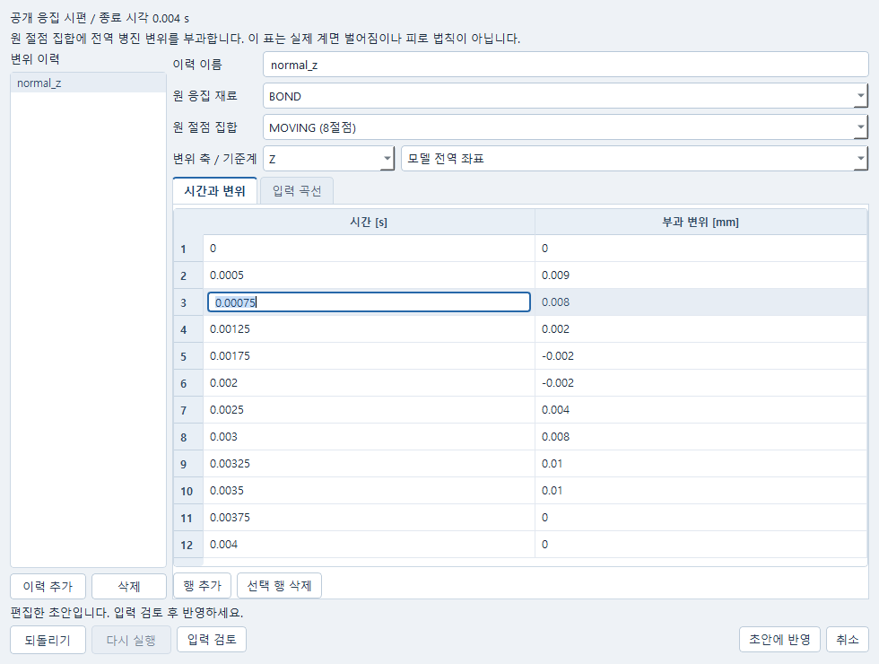
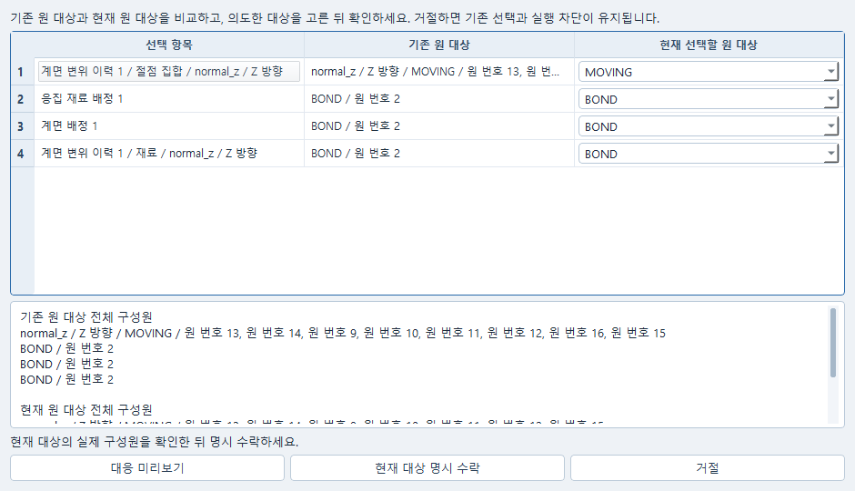
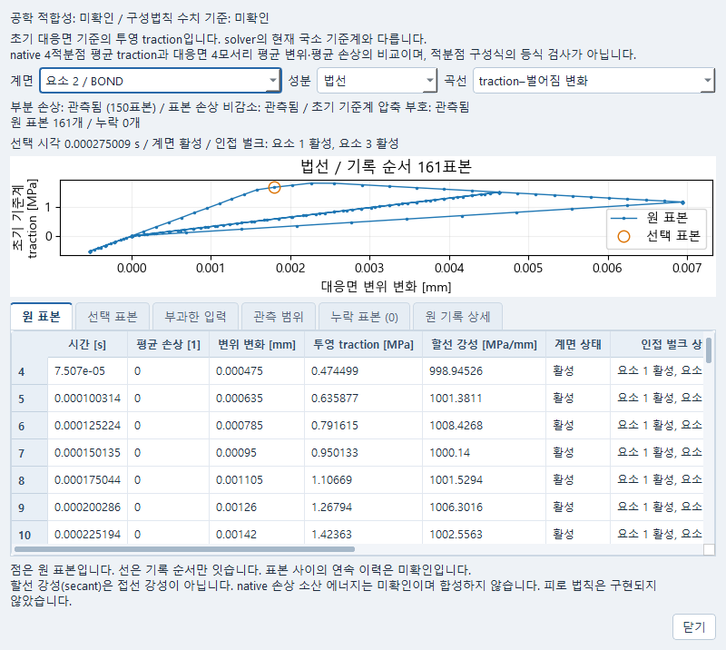
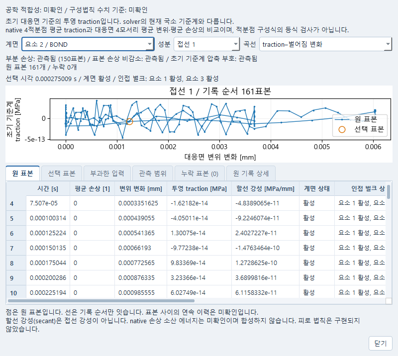

# LAW117 계면 변위 이력

같은 Simulation에 명시한 변위 이력을 보존하고 기존 고정 OpenCourant LAW117을 실행한다.
새 재료 적분기나 피로 모델은 추가하지 않는다. 입력은 기존 INP→native 변환 경로이며,
원 RAD에 이미 있는 하중 카드를 이 기능으로 덮어쓰지 않는다.

## 편집과 결과 선택

1. INP를 보관한 Simulation에서 **연구 → 충격 조건… → 벌크와 계면 → 변위 이력…**을 연다.
2. 실제 계면 재료·원 절점 집합과 X/Y/Z 방향을 선택하고 시간 [s]·부과 변위 [mm] 표를 편집한다.
   입력 검토와 곡선에서 부호·종료 시각을 확인한다. 취소는 원 입력을 유지한다.
3. **초안에 반영** 뒤 부모 편집창에서도 반영한다. 이 단계는 저장이나 계산을 요청하지 않는다.
   원문 편집으로 대상이 달라졌다면 변경 전후의 재료·절점 집합·이름·방향을 확인하고 명시적으로 다시 선택한다.
4. 기존 Simulation의 입력 검사·저장·계산 명령을 사용한다. 보존 계산을 선택한 뒤
   **연구 → 계면 이력 관측…**에서 원 표본과 곡선을 읽는다.
5. 요소와 법선/접선 성분·곡선 종류를 선택한다. 같은 시각의 손상·계면/벌크 활성·분리 변화·
   투영 traction·할선 강성·surrogate 차이를 확인한다. 표 선택과 곡선 선택은 같은 원 표본을 가리킨다.
   창을 닫으면 원 계산 선택으로 돌아간다. 관측창 열기·닫기·재열기는 저장이나 새 계산을 요청하지 않는다.









누락 시각은 이유와 함께 표시하고 곡선을 끊는다. 시각을 모르는 누락은 표본 사이를 연결하지 않는다.
변위 변화가 0인 할선 강성은 미정의이며 0으로 채우지 않는다. 아주 작은 값은 과학 표기로 읽고
크기만으로 물리적 유효성이나 수치 허용치 통과를 판단하지 않는다.

`settings.interface_histories`는 선택 항목이다. 이전 문서에 항목을 자동으로 추가하지 않는다.
한 이력은 다음 필드를 갖는다.

```python
{
    "name": "normal_z",
    "material": "BOND",
    "node_set": "MOVING",
    "component": "Z",
    "time_s": [0.0, 0.001, 0.002],
    "displacement_mm": [0.0, 0.005, 0.0],
    "frame": "MODEL_GLOBAL",
}
```

이 표는 문법 예시이며 부분 손상의 수용 입력이나 교정값이 아니다. 시간은 0에서 시작하여
엄격히 증가하고 Simulation 종료 시각에서 끝나야 한다. 첫 변위는 0이며 X/Y/Z 중 지정한
축만 구속한다. 길이가 같은 유한한 시간·변위 표 2~256행이 필요하다. 원 LAW117 재료의
위 대응면 전체를 포함하고 아래 대응면과 겹치지 않는 원 절점 집합을 선택한다.

같은 절점·축의 고정 조건, 겹친 이력, 비영 초기속도는 충돌로 거절한다. 이번 기능은
`COHESIVE_ONLY` 압축이며 같은 대응면의 TYPE24를 함께 적용하지 않는다. 재료·기하·법칙은
바꾸지 않고 기존 ID allocator로 GRNOD/FUNCT/IMPDISP만 추가한다. 적용된 정확한 카드와
원 모델/이력 신원은 기존 `b_definition.json`에 보존된다.

계산은 기존 Simulation의 실행 명령을 사용한다. 결과를 저장한 뒤 같은 문서를 다시 열면
원 설정·선택 결과·관측 파일을 재사용한다. 저장이나 재열기는 solver 실행을 요청하지 않는다.
이력 자체가 물성 교정, 준정적 정확도 또는 공학 적합성을 보증하지 않는다.

## 관측값 읽기

`interface_history_observations.json`은 실제 원 프레임 시각과 다음 값을 함께 보존한다.

- 원 요소 활성 상태와 양쪽 벌크의 활성 상태, native 평균 손상.
- 초기 대응면의 정상·접선 분리 변화, 원 분리량, 네 모서리의 변위 차.
- native global 평균 traction tensor의 원 9성분과 파생 투영값 [MPa].
- 초기 기저 및 현재 모서리로 구성한 중간면 기저. 후자는 solver 내부 기저와 동일하다고 주장하지 않는다.
- 평균값으로 계산한 surrogate와 signed residual [MPa], secant [MPa/mm].

압축은 초기 양의 두께를 뺀 정상 분리 변화가 음수인 경우다. 원 분리량이 아직 양수여도
압축일 수 있다. mean damage와 mean corner change를 결합한 surrogate는 적분점 구성식의
동등성 검증이 아니다. secant를 tangent stiffness로 읽지 않는다. 해당 수치 판정과
손상 소산 에너지·공학 적합성은 UNKNOWN으로 남는다.

부분 상태에는 실제 `0 < d < 1` 표본이 필요하다. 누락·삭제·비활성 표본은 0으로 채우거나
보간하지 않는다. 손상 비감소와 압축 부호 표시는 저장된 표본에 대한 관측이며, 표본 사이
연속시간 전체나 회전한 적분점 법칙의 검증이 아니다. 실패 실행의 원 상태를 읽기 성공으로
승격하지 않는다. 완전 삭제 후 자동 재접촉과 피로는 이번 기능 범위에 없다.

## 개발 검사

```powershell
python -X utf8 -m pytest tests/test_impact_interface_history.py -q
```

설치된 고정 runtime의 두 사전 선언 이력 검사는 별도 opt-in이다. 같은 입력을 성공을 위해
조정하거나 추가 campaign을 실행하는 용도가 아니다. 결과 및 정확한 실행 source는 실행
폴더의 원 입력, source snapshot, job, 관측 및 cold-reopen 기록으로 구분한다.


## 고정 두 이력의 실제 확인 (2026-10-18)

공개 `cohesive-coupon.inp`의 원 물성(강도 2/2 MPa, GI/GII 0.02 N/mm)을 유지했다.
초기속도는 비우고 MOVING 9~16의 Z 또는 X/Z 변위를 명시했다. 두 이력은
`tests/interface_history_fixtures.py`에 사전 선언돼 있으며 같은 Simulation owner와
기존 pinned converter/Starter/Engine/reader를 사용했다. 성공을 위한 이력 재조정이나 추가
solver 실행은 하지 않았다.

| 이력 | 실제 프레임 | 부분 손상 표본 | 최대 mean damage | 초기 기저 압축 표본 |
|---|---:|---:|---:|---:|
| normal | 160 | 150 | 0.860950 | 26 |
| mixed | 161 | 150 | 0.867993 | 22 |

둘 다 Starter 0 error/0 warning, Engine 정상 종료였으며 E1/E2/E3 활성을 확인했다.
저장된 손상 표본은 비감소했고, 초기 기저 압축 traction 부호를 관측했다. 제하·재개구의
원 변위·traction·잔존 secant와 mean surrogate 잔차를 보존했다. 구성식 수치 적합성 판정은
UNKNOWN이다. 두 입력은 별도 TYPE24를 쓰지 않는다.

normal의 마지막 실제 frame은 0.00397516 s, mixed는 0.00400001 s였다. 요청한 0.004 s로
끝점을 교체하거나 시간축을 맞추기 위한 보간을 하지 않았다. 같은 문서·결과를 저장한 뒤
별도 프로세스에서 새 job/solver probe 없이 재열었으며 원 결과·관측 해시가 같았다.

로컬 상세 실행은 `runs/interface-history-20261018/native-01/summary.json`, 각 case의
`retained.json`, `cold-reopen.json`, `process-ledger.json`, `source-sha256.json` 및
`source-snapshot`에 있다. actual run source와 이후 관측기 보완 source는 구분한다.
후자는 같은 원 프레임의 관측 동등성만 추가 확인했으며 원 파일을 변경하거나 재계산하지 않았다.

고정 두 입력의 설치 runtime 검사 재현 명령은 다음과 같다. 새 실행 폴더를 지정해야 한다.

```powershell
$env:CAELAB_RUN_INTERFACE_HISTORIES='1'
$env:CAELAB_INTERFACE_HISTORY_RUN_ROOT='runs/interface-history-new-check'
python -X utf8 -m pytest tests/test_impact_interface_history_runtime.py -q
```

이 명령은 두 native job을 실제 실행한다. 일반 검사에서는 해당 opt-in을 설정하지 않는다.
사용자 OS 직접 입력, 준정적 정확도, 피로·실물 교정·손상 소산 및 완전 삭제 후 자동 재접촉은
이번 두 입력으로 확인하지 않았다.
