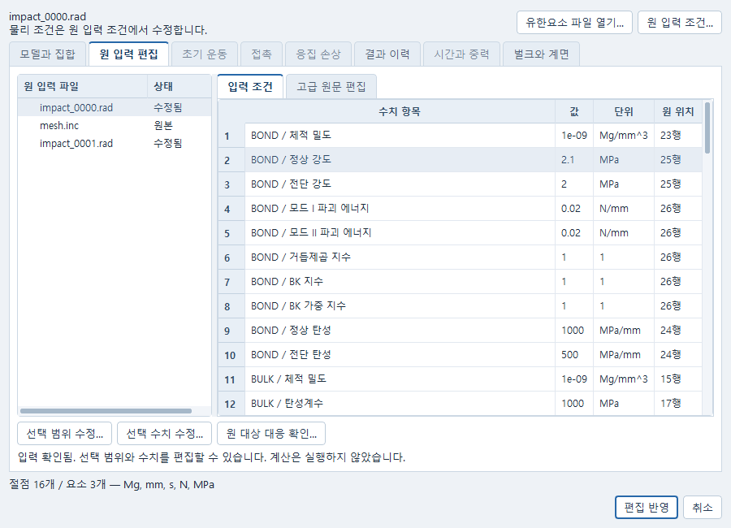
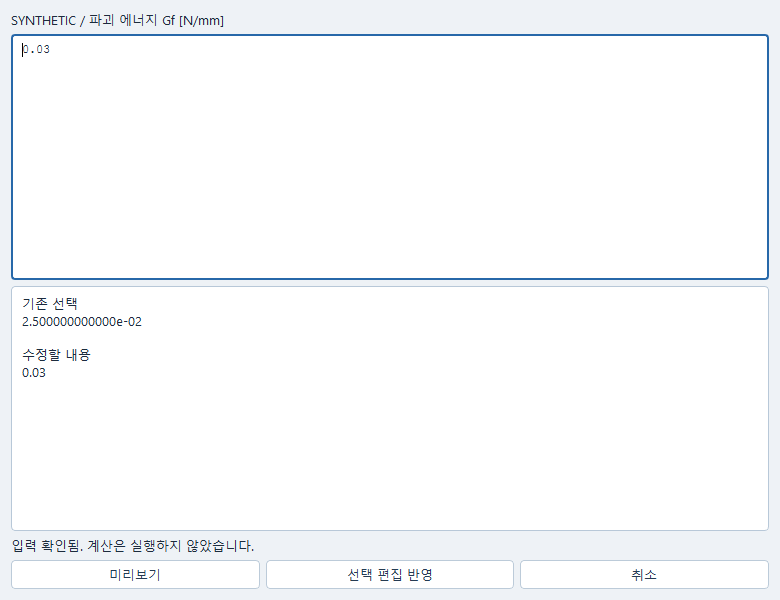
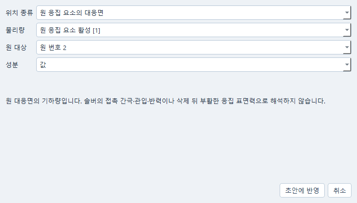

# Native RAD 원문 편집과 실행

Simulation에서 기존 Starter·Engine와 include 묶음을 열고 원문을 보존하며
제한된 물성·배정·집합·출력 수치를 편집한다. 기존 OpenCourant 실행기와 결과
reader를 그대로 사용한다. INP로 되돌려 변환하거나 전체 덱을 다시 쓰지 않는다.

## 지원하는 원 입력

- 원 `#RADIOSS STARTER`, native 2025, 입력·작업 단위 Mg/mm/s.
  단위를 명시적으로 확인해야 하며 다른 단위나 `/UNIT`를 자동 변환하지 않는다.
- 기존 ELAST/TETRA4·TYPE24와 원 `/TH/INTER` 경로.
- BRICK의 기존 단일 곡선 LAW36/PLAS_TAB과 INIEVO 조합.
  실제 PROP/SOLID Isolid24·1 IP, NRATE=1·VP=0·Fsmooth=0을 보존한다.
  INIEVO는 INITYPE=1, EVOTYPE=2, EVOSHAP=1, ILEN=0, FAILIP=1이다.
  LAW36 자체 파손 옵션이나 다른 FAIL을 겹쳐 적용하지 않는다.
- 양의 두께·올바른 대응 절점과 TYPE43을 가진 LAW117 계면.
  원 2025의 IMASS=2, IDEL·POWER/BK·gamma·Isym0 압축 규약을 유지한다.
  LAW117 재료에는 INIEVO를 배정하지 않는다. 별도 벌크 재료의 INIEVO와는
  같은 덱에서 공존할 수 있다.
- 실제 단일 요소를 가리키는 원 TH/BRIC 벌크 이력과 기존 접촉쌍 이력.
  기록하지 않은 출력이나 여러 적분점의 평균을 대신 생성하지 않는다.

벌크 E와 강도는 MPa, 체적 밀도는 Mg/mm³, INIEVO Gf와 계면 GI/GII는 N/mm다.
LAW117 EN/ET는 traction/분리량의 강성으로 **N/mm³ (= MPa/mm)**이며 벌크
탄성계수나 두께로 다시 환산하지 않는다. 기존 에너지·양두께·고정 옵션 검사를
그대로 적용한다. 원 카드의 출처를 읽었다고 재료 교정이나 온도 적용 범위가
확인된 것은 아니다. 교정·실물 적합성은 UNKNOWN으로 남는다.

## 열기·선택·편집

1. Simulation의 유한요소 파일 열기에서 Starter, Engine와 제출 폴더를 지정한다.
   같은 root의 `이름_0000.rad`와 `이름_0001.rad`, 상대 경로 include를 함께 보존한다.
2. `원 입력 조건…`에서 파일과 수치를 선택한다. 해당 원줄이 함께 선택된다.
   재료 강도·에너지·탄성·밀도, PART의 재료/속성 배정, 집합 대상과 출력 간격을
   명시적으로 편집하고 미리본 뒤 반영한다. 취소하면 현재 입력은 그대로다.
3. 고급 원문 편집도 같은 원 bytes 범위의 hunk를 만든다. 원파일은 바뀌지 않는다.
   미지원 카드나 미완성 값은 초안으로 보존할 수 있으나 영향 진단을 해결하기
   전에는 실행·직접 내보내기를 할 수 없다. 카드를 몰래 삭제하지 않는다.
4. 원 대상 배정이 바뀌면 기존 원 대상 검토에서 다시 확인한다. 같은 번호를
   재사용해도 기존 관측·운동·재료 배정이 다른 대상으로 조용히 옮겨가지 않는다.
5. 실제 원 요소·접촉쌍과 기록된 출력을 선택해 실행한다. 같은 Simulation을
   저장하고 다시 열면 같은 입력과 원 실행 결과를 읽는다. 열기·저장·재열기는
   계산이나 solver 재탐색을 시작하지 않는다.

수치 편집은 현재 source hash와 맞는 필드에만 적용한다. 원 source와 별도의
시간·운동·물성 설정을 바꿔 native 덱에 몰래 적용하는 것은 허용하지 않는다.
검사용으로 LAW36 별칭과 LAW117 선행 탄성을 기존 postflight에 대조하는 내부
사본을 만들지만, 내보낸 파일은 원파일별 bytes와 명시 hunk의 정확한 결합이다.
합법적인 고정 폭 숫자 표기와 원 제목 대소문자를 보존한다. MAT·BRICK가 include에
있어도 원 실행의 정확한 source pin으로 결과를 읽으며, 빈 include도 보존한다.
누락·변조된 include와 모든 선언 FUNCT–TABLE의 번호 충돌은 거절한다.

지연 TYPE24가 원문에 있으면 실제 접촉 ID와 Tstart를 읽는다. 원 Tstart를 0으로
다시 쓰는 INP 편집기를 호출하지 않는다. 명시 시각 gate는 자동 삭제 이벤트가
아니며, 실제 활성·삭제 관측과 표본 사이의 미확인을 구별한다.

## 2026-10-18 확인 범위

기존 공개 `bulk_interface/bulk_coupon.py`의 단요소 입력과
`cohesive_model.py`의 16절점·3요소 응집 시편을 기존 고정 converter와 domain
helper로 native 원문으로 만든 뒤, 별도의 RAD 문서로 열었다. 원 CRLF/include를
보존하고 bulk Gf 0.02→0.025 N/mm, 계면 정상 강도 2→2.1 MPa를 사전 명시했다.
장면 출력 간격은 절반으로 편집했다. 모션·단위·법칙·수용 기준을 바꾸거나
원 baseline과 응답이 같아야 한다는 조건을 만들지 않았다.

두 native 직접 실행은 Starter 오류·경고 0, Engine 정상 종료, 기존 owner 저장과
별도 Python 프로세스의 같은 settings/result 재열기를 통과했다. 직접 export는
명시 수정 bytes와 정확히 같고 실행 중 INP converter를 호출하지 않았다.
근거는 `runs/native-rad-materials-20261018/native-01/`의 원 입력·source SHA,
`job.json`, `observed.json`, `retained.json`, `cold-reopen.json`에 있다.

벌크 활성은 실제 22표본에서 삭제 bracket을 기록했다. 벌크 손상 합·소성변형률·
내부에너지 밀도·체적은 각 1표본이므로 삭제 직전의 연속 손상 진전이나 고유
INIEVO state를 입증하지 않는다. 원 TH는 22 record로 완전하며 OFF는
`[1, 0, …, 0]`이다. reader가 뒤의 비활성 21개를 제외한 것이므로 미보고값을
0으로 채우지 않는다. 계면 손상은 40개의 실제 보존 표본을 읽었다.
원 native 채널, derived opening, 미확인 전역 단위와 에너지를 구별한다.
없는 damage dissipation을 전체 내부에너지 차로 만들지 않았다.

실제 Windows 창에서는 두 native 문서의 원 수치 선택·원줄 연결·미리보기
취소·로컬 반영과 정확한 벌크/계면 결과 선택을 확인했다. 편집창 취소 후 Core와
기존 Job은 그대로였다. 대표 계면 결과를 실제 ParaView에서 열고 Post project를
저장한 뒤 같은 Simulation으로 돌아왔으며 새 Job·재계산은 0이었다.
근거는 `_workspace/native-rad-20261018/editor-02/`과 `post-02/`다.
좁은 원문 창에서도 수치·단위·원행을 함께 읽을 수 있도록 공통 표 폭을 교정했다.
첫 Post 검사에는 이전 사례의 21 frame 가정이 남아 실제 40 frame에서 실패했다.
원 실패와 소유 프로세스 정리를 보존하고 하네스의 사례 수만 바로잡았다.

이 확인은 native 편집·실행·저장 연결의 인수다. B2.6의 mesh/timestep 손상
campaign, 부분 손상 unload–compression–reopen, 완전 삭제의 자동 재접촉,
수명 예측이나 공학 적합성 승인을 뜻하지 않는다. 설치·runtime pin·provider는
변경하지 않았다. 실제 사용자 키보드·마우스 전체 입력은 별도 미확인이다.

```powershell
python -m pytest tests/impact_input_a/test_native_materials.py tests/impact_input_a/test_native_material_qt.py -q
$env:CAELAB_RUN_NATIVE_RAD_MATERIALS = '1'
$env:CAELAB_NATIVE_RAD_RUN_ROOT = 'C:/path/to/new/native-rad-check'
python -m pytest tests/impact_input_a/test_native_material_runtime.py -q
```

재현 실행에는 새 출력 폴더를 사용한다. 기존 입력·성공·실패·취소 기록을 덮지 않는다.
기존 [LAW36 공식 설명](https://help.altair.com/hwsolvers/rad/topics/solvers/rad/mat_law36_plas_tab_starter_r.htm)과
현재 고정 producer의 [벌크 카드 helper](../caelab/impact_bulk_deck.py),
[LAW117 helper](../caelab/impact_damage.py), [물리 gate](../caelab/adapters/impact_admission.py)를 함께 대조한다.

## 실제 화면






