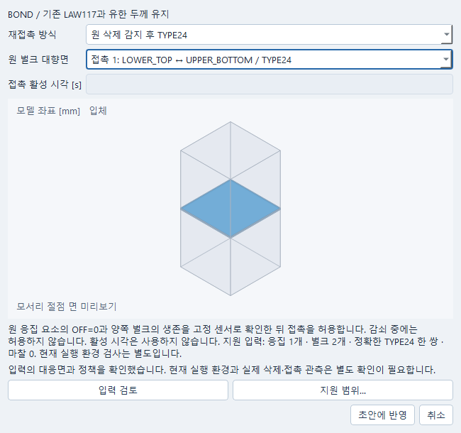

# 삭제 후 계면 재접촉

이 기능은 기존 LAW117 cohesive 요소가 완전히 삭제된 뒤, 살아 있는 양쪽 벌크 면의
TYPE24를 허용하는 한정 경로다. 기존 시간 지연 정책과 구별하며, 접촉 시작 시간을
삭제 조건으로 바꾸어 쓰지 않는다. 고정 OpenCourant source는
`cb760c206e346eff12161a2268b134ef9d48a4ef`다. runtime capability와 실제 전환의 확인은
각 실행 근거로 별도 기록한다.

기존 `interface_controls`의 한 항목에서 `reclosure='DELETION_GATED_TYPE24'`, 정확한
`contact_index`, `contact_start_s=None`을 지정한다. 최초 지원은 positive-thickness
cohesive 하나·인접 벌크 둘·마찰0 TYPE24 하나다. 원 LAW117/물성/두께·벌크 formulation과
적분점·시간 간격 scale은 바꾸지 않는다. 동시에 같은 면에 다른 접촉을 넣을 수 없다.

생성 센서는 원 요소 번호의 `OFF(id)`만 읽는다. cohesive OFF가 정확히0이고 벌크 둘의
OFF가 정확히1일 때만1을 반환한다. cohesive의 0~1 사이 값은 내력 감쇠 구간이므로
접촉을 허용하지 않는다. 누락·비유한 값·sentinel·벌크 fractional OFF는 꺼진 상태와 원 사유를
기록한다. 벌크 삭제 뒤의 재등장과 cohesive OFF0 뒤 재등장은 지원 경로로 복구하지 않는다.
TYPE24의 Idel1은 cohesive 삭제 뒤 살아 있는 벌크 면을 보존하고, 벌크 삭제 시 면 제거를
따르게 하기 위한 조건이다. sensor 상태와 실제 contact face 상태는 별도로 해석한다.

임의 사용자 Python을 실행하지 않는다. 검증된 원 ID와 고정 상대 trace 경로만 받은 생성
callback을 기존 owner가 정확한 bytes/hash로 승인한다. CPython DLL·stdlib 선택과 환경은
소유한 native 자식 프로세스에만 적용한다. 시스템 환경이나 solver pin은 변경하지 않는다.
첫 callback은 실제 로드된 Python DLL 경로·SHA256, Python 버전·prefix·base_prefix와
math 모듈 출처를 기록한다. 파일 모듈은 그 파일 해시를 남기고, 출처가 정확히
`built-in`인 내장 math만 파일·파일 해시가 없는 상태를 허용한다. DLL 조회나 모듈 출처
확인 실패는 원 오류와 UNKNOWN을 보존하며 접촉을 켜지 않는다.

## 호출과 보존

`b_definition.json`의 `interface.reclosure_policies`에 원 모델·cohort·geometry, native
contact/sensor ID, 함수명·callback 원문/hash, 정확한 카드와 trace 경로를 보존한다.
`caelab_reclosure_trace.jsonl`에는 phase/segment/PID/call ordinal, 원 TIME/DT, OFF 세 값,
이전 sensor 상태, 반환 gate, 초기화 상태와 사유를 매 호출 flush한다.

센서가 읽는 OFF는 같은 증분 끝의 새 값과 같다고 가정하지 않는다. 고정 source 순서에서
초기 두 callback을 독립적인 regular OFF publish 증거로 쓰지 않으며 세 번째부터 초기
all-live 핸드셰이크를 검사한다. TIME은 기록용이다. 승인되지 않은 restart segment에서
새로운 all-live 상태만으로 arm하지 않는다. restart는 같은 owner의 원 상태·source 계보와
따로 결합해야 한다.

원 PRINT/1의 cycle·time·DT와 callback 전체를 대조한다. 누락·중복·잘린 trace, 확인되지 않은
초기/최종 cycle 대응은 `EVERY_INCREMENT_UNKNOWN`이다. 알려진 위반은 trace가 불완전해도
보존한다. ANIM/TH 표본 또는 DELETE 메시지만으로 전 증분 안전을 주장하지 않는다.

## 결과 의미와 현재 확인 단계

첫 planar coupon의 gap는 초기 paired bulk-face의 signed separation [mm] 파생값이다.
TYPE24 내부 native PENE가 아니다. 정확한 pair의 native 누적 signed impulse [N s]와 실제
시간 구간의 평균 힘 [N]을 함께 읽는다. 구간 평균을 순간 힘이나 local penalty force의
절대합으로 바꾸지 않는다. 삭제 후 없는 cohesive stress를0으로 채우지 않는다.

P0는 짧은 무하중 capability 확인이다. DLL/math 초기화·actual 초기 OFF mapping·gate0·
PRINT/trace coverage만 대상으로 하며 물리 재접촉 성공이 아니다. P1은 사전 선언한
개방→압축→재개방 이력, P2는 같은 restart에서 살아 있던 벌크 하나를 명시 삭제하는
반례다. 이력/물성/시간/허용치를 성공에 맞춰 조정하지 않는다.

현재 domain 검사에서는 기존 converter와 카드/신원/고정 callback·fail-closed·불완전 trace
보존을 확인했다. 실제 native capability와 전환의 종료 여부는 후속 원 실행 기록에서 확인한다.
공학 적합성, 직접 native PENE 및 직접 매 증분 traction 측정은 UNKNOWN이다. 피로와 여러
cohesive를 한 pair로 묶는 확장은 포함하지 않는다.

2026-10-18의 고정 P0 한 실행은 기존 Simulation/JobManager로 수행했다. Starter는
0 error/0 warning, Engine은 정상 종료했다. Engine의 INACTI5 초기 침투 유지 안내는 원문을
보존했다. 실제 로드 DLL·stdlib 선택과 내장 math 출처, 초기 두 호출의 gate0·미armed 및
세 번째 호출의 all-live 확인, 전체 32 callback의 gate0를 관측했다. PRINT 표에는 cycle
0~30이 있고 Engine 총 cycle은31이다. 원 callback 하나는 SENSOR_INIT에 해당한다.
고정 source의 초기/말단 호출 순서와 대조한 별도 감사에서 초기1회·regular31회의 대응을
확인했다. 이 한정 fresh 실행의 기록 coverage는 완전하다. TIME/DT 원 float와 PRINT의
G11.4 token은 따로 보존하며 같은 DT나 bit-exact 시각을 요구하지 않는다.
같은 문서의 저장과 별도 Python 프로세스 재열기는 추가 solver 실행 없이 확인했다.

원 결과는 `runs/interface-reclosure-20261018/p0-native-01`에 보존한다. 이 실행은 삭제·재접촉
물리 검증이 아니며 P1/P2 성공으로 세지 않는다. 최초 결과의 audit와 원 PRINT 형식을 읽도록
교정한 후속 read-only audit는 서로 구별한다. 추가 native 계산이나 입력 조정은 하지 않았다.
최초 P0 결과의 UNKNOWN은 그대로 두었고, source 대응을 확정한 별도 감사는
`_workspace/interface-reclosure-20261018/p0-final-audit-04`에 있다. 이후 생성 receipt에는
이 고정 source의 초기/말단 대응을 명시한다. 실제 trace 누락·추가 tail·cycle 불일치가
발생하면 대응을 억지로 맞추지 않고 다시 UNKNOWN으로 보존한다.

고정 P1 한 실행은 원 LAW117·강도2 MPa·GI/GII 0.02 N/mm·시간 scale0.9를 유지하고
지정한 Z 개방0.030→압축-0.025→재개방0.010 mm 이력을 사용했다. source·Starter·Engine·
callback은 사전 선언 bytes와 일치했다. 7654 callback과 7653 PRINT cycle의 전수 대응에서
알려진 gate 위반은 없었다. 감쇠11행 동안 접촉은 꺼져 있었고, 0.000339448122792226 s의
완전 삭제 뒤 살아 있는 양쪽 벌크 조건에서만 접촉을 켰다. 이는 한 fresh 실행의 관측이며
다른 모델이나 증분 중 벌크 파손의 안전성을 일반화하지 않는다.

기존 reader의 정확한 접촉쌍 출력은 실제 TH 표본 시각으로 선택한다. 삭제 전 선택값은
힘/충격량0이고, 압축 구간에 시각이 속한50개의 구간 평균 힘은3.22088~3.30744 N이다.
재개방 구간에 시각이 속한75개는 평균 힘0·일정한 누적 충격량을 보였다. 이 평균은 누적
충격량의 centered secant(끝점은 한쪽 구간)다. 압축 구간 첫 값의 실제 support는
0.001740101957693696~0.0017601698637008667 s로 위상 경계 밖까지 걸친다. 각 값의
원 `force_support`를 보존하며 위상 안의 순간 힘50회 측정이나 위상 전체 평균으로 해석하지
않는다. 원 signed paired-face
separation은 압축에서 약-0.00201 mm, 재개방에서 약0.030 mm였다. 음수 간격도 그대로
보존했으며 이를 native PENE 또는 침투 허용치의 통과로 바꾸지 않는다. 삭제 후146프레임의
응집 활성은0이고 DAMA·traction tensor는 미확인 값이다. 없는 traction을0으로 만들지 않았다.
고정 source의 `SOFT×OFF` 내력 경로와 OFF 재등장0은 삭제 후 응집 내력 경로가 되살아나지
않는다는 source 근거다. 삭제 뒤 traction0을 직접 측정했다는 뜻은 아니다. 원값·단위·실제
시각과 support 경계는 `p1-analysis-02`의 별도 관측 기록에서 확인한다. 앞선01도 보존한다.

P1 원 결과는 `runs/interface-reclosure-20261018/p1-native-01`에 있으며, 같은 Simulation의
저장·별도 Python 프로세스 재열기는 새 계산 없이 완료했다.

이 P1의 수치·물리 타당성은 확인되지 않았다. 압축 접촉 전 약0.00036 s부터 내부에너지와
상부 벌크의 횡방향 속도가 급증했다. 마지막 Engine PRINT의 원 `ERROR=99.9%`는 native
표시 상한에 걸린 값이며, 내부에너지 약92350 N·mm에 비해 외부일은 약0.02001 N·mm다.
같은 이상은 원 binary TH와 animation의 실제 속도에도 남아 있다. HEPH 감쇠 에너지는
내부에너지에 포함되므로 hourglass energy0만으로 안정화 기여를 배제할 수 없다
([공식 SOLID 속성 설명](https://help.altair.com/hwsolvers/rad/topics/solvers/rad/prop_type14_solid_starter_r.htm)).
정확한 원인과 기여량은 UNKNOWN이다. 원 formulation·감쇠·시간·물성·허용값을 바꾸지 않았고,
정상 종료·gate 전환·구간 평균 힘을 에너지 균형이나 재접촉 물리 검증의 PASS로 쓰지 않는다.
P2의 실제 벌크 삭제와 물리 인수도 아직 완료되지 않았다. 최종0.004 s restart를0.00225 s의
압축 hold checkpoint로 재명명하거나 시각을 보정해 대신할 수 없다.
후속 설계 결정은 같은 Simulation의 저장 prefix에서 한정 child Job을 만드는 방식이다.
다만 현재 pinned Engine은 `TT > TSTOP` 종료 분기 뒤 최종 restart를 기록하므로 정확한
0.00225 s checkpoint 요건이 충족되지 않았다. 이 요건이 없는 상태에서 새 prefix나
child를 실행하지 않았으며, offset·한 step 허용·시각 명칭 변경으로 통과시키지 않는다.

## 창에서 편집하고 다시 열기

`충격 조건 → 벌크와 계면 → 계면 재접촉 → 선택 수정…`에서 `원 삭제 감지 후 TYPE24`를
선택한다. `원 벌크 대향면`으로 정확한 두 면을 확인하고 `입력 검토` 뒤 `초안에 반영`한다.
이 모드에서는 접촉 시작 시각을 입력하지 않는다. 기존 문서의 저장 명령으로 저장한다.
`취소`는 기존 정책과 초안을 유지한다. 알 수 없는 기존 정책이나 미지원 조합은 정상 정책으로
바꾸어 저장하지 않으며 원값과 진단을 보존한다. 입력 지원과 실제 runtime capability는 별개다.



원 P1의 사본을 기존 BulkPage 메뉴에서 열어 취소·반영·저장하고 별도 process로 재열었다.
일반/좁은 창의 한글·면 선택·비활성 시각 입력을 확인했고, 원 결과·callback·trace·audit·정의의
hash와 전체 settings를 보존했다. 이 UI 확인의 새 Job/solver/runtime probe는0이다.
Qt 이벤트 기반 확인이며 Windows 전체 직접 입력·물리 적합성의 인수로 확대하지 않는다.
의미 있는 P0/P1 통합 검토에서 잘린 trace가 앞선 위반을 잃는 오류를 발견해 교정했다.
마지막 한정 반례는 원 runtime 신원 PASS와 불완전 trace UNKNOWN, 이미 관측한 위반을
동시에 보존한다. 이 audit-only 교정을 새 native 실행으로 세지 않는다.

## 검사

```powershell
python -X utf8 -m pytest tests/test_impact_reclosure_policy.py -q
```

일반 검사는 native solver를 실행하지 않는다. 실제 P0/P1/P2는 사전 선언 입력·새 store·같은
Simulation/JobManager 및 소유한 프로세스 정리 경로를 사용한다.
