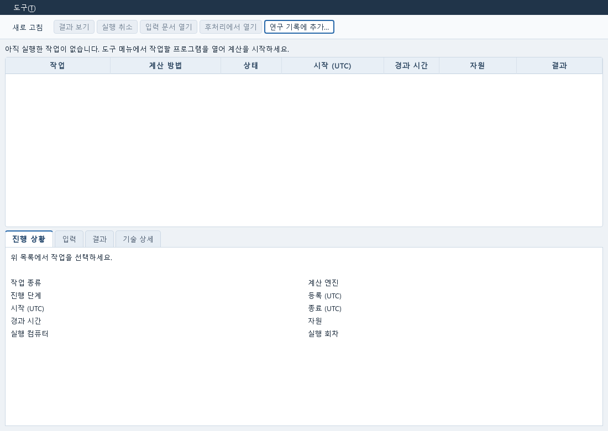
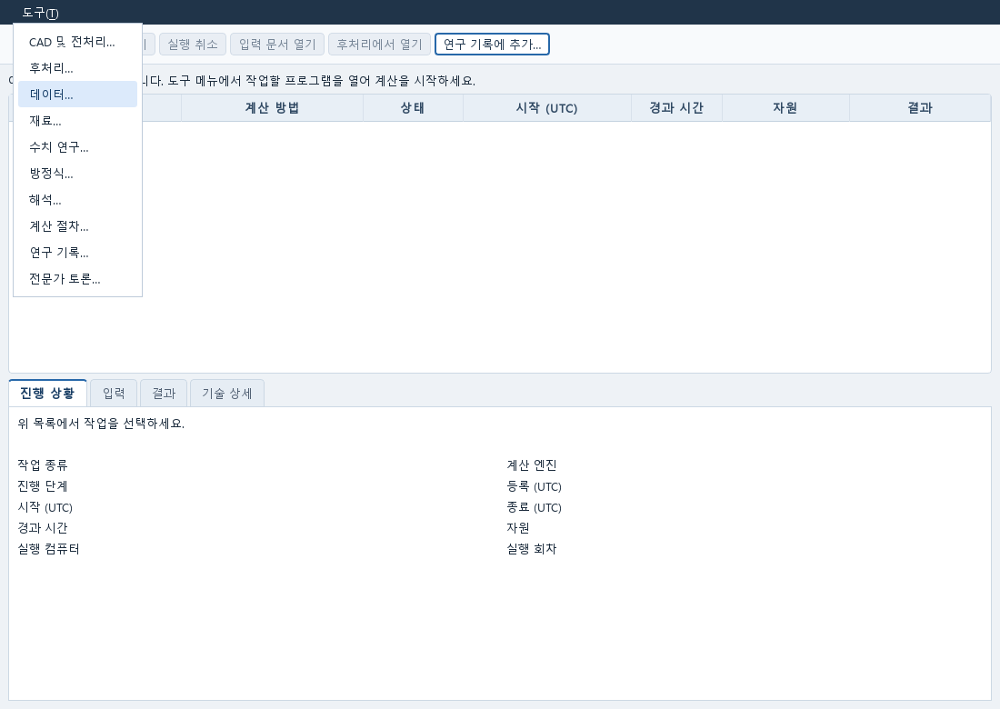

# Windows 설치와 실행

`Install-CAE-Lab.cmd`로 준비하는 기본 설치는 **전용 Python 실행 환경과 Research Qt 앱**입니다.
Windows 10/11 x64에서 실행하며, **FreeCAD·ParaView·Gmsh·외부 솔버는 자동으로 설치하거나
연결하지 않습니다.**

현재는 개발 버전입니다. 자료·질문 저장과 포함된 수치 예제 실행을 확인했습니다.
사용자 모델의 CAD 편집→해석→Post 작업을 바로 끝낼 수 있는 완성 배포본은 아닙니다.

## 처음 설치하기

1. [소스 ZIP](https://github.com/pikachu444/autonomous-cae-lab/archive/refs/heads/main.zip)을 내려받습니다.
2. 쓰기 권한이 있는 폴더에 압축을 풉니다. ZIP 안에서 실행하지 마세요.
3. 압축을 푼 폴더의 `Install-CAE-Lab.cmd`를 더블클릭합니다.
4. 설치가 끝나면 Windows 시작 메뉴의 **Autonomous CAE Lab**에서 사용할 프로그램을 엽니다.

설치 파일은 전용 Python과 필요한 패키지를 준비하고 현재 사용자의 시작 메뉴에
프로그램별 바로가기를 만듭니다. 설치 중에는 인터넷이
필요합니다. 기본 Research 실행에는 관리자 권한, Git, 시스템 Python, WSL이 필요하지
않습니다. 설치 후에도 압축을 푼 소스 폴더는 남겨 두세요.

다음 실행부터는 시작 메뉴에서 원하는 프로그램을 바로 여세요. **데이터**, **재료**,
**방정식**, **수치 연구**, **전문가 토론**, **해석**, **계산 절차**, **연구 기록**, **보고서**를
각각 실행합니다. **실행 관리**는 제출한 계산을 살펴보는 Runner 창입니다.
각 바로가기는 기존 실행 환경과 같은 작업 폴더를 사용합니다.

`Start-CAE-Lab.cmd`를 더블클릭하는 기존 방법도 유지합니다. 이때는 **Runner**가
열립니다. 아직 계산을 실행하지 않았다면 작업 목록이 비어 있는 것이 정상입니다.
왼쪽 위 **도구** 메뉴에서 필요한 프로그램을 별도 창으로 여세요.



**도구 → 데이터**를 선택하면 시험 CSV를 여는 Data 창이 뜹니다. **재료**, **수치 연구**,
**방정식**, **연구 기록** 등도 각 작업에 맞는 별도 창으로 열립니다.



위 이미지는 현재 Qt 프로그램의 빈 작업 상태와 메뉴를 렌더한 실행 화면 예시입니다.
새 PC의 다운로드·설치 과정을 촬영한 것은 아닙니다. 처음 해볼 조작은
[한글 사용 안내](USER_GUIDE_KO.md), CSV 피팅은 [재료 피팅 예제](DATA_MATERIAL_WORKFLOW.md)를
따라가세요.

명령어로 시작하려면 소스 폴더의 PowerShell에서 다음과 같이 실행합니다.

```powershell
.\Start-CAE-Lab.cmd -Tool numerical
.\Start-CAE-Lab.cmd -Tool expert
.\Start-CAE-Lab.cmd -Tool data
.\Start-CAE-Lab.cmd -Tool material
.\Start-CAE-Lab.cmd -Tool pde
.\Start-CAE-Lab.cmd -Tool study
```

`simulation`, `evaluation`, `runner`도 선택할 수 있습니다. 저장된 연구 문서는
`-DocumentId`, Runner 작업은 `-JobId`로 지정합니다. 창을 열지 않고 설치만 하려면
아래 명령을 실행합니다.

```powershell
.\Start-CAE-Lab.cmd -InstallOnly -ResearchUI
```

이 명령은 실행 환경만 준비합니다. 이미 설치한 환경에 시작 메뉴만 추가하려면 다음을 실행합니다.

```powershell
.\scripts\install-desktop-shortcuts.ps1
```

동일한 바로가기가 있으면 그대로 사용합니다. 사용자가 바꾼 바로가기나 다른 소스 폴더를
가리키는 바로가기는 덮어쓰지 않고 해당 경로를 알려 줍니다. 소스 폴더를 옮겼다면
Windows 시작 메뉴의 기존 **Autonomous CAE Lab** 바로가기 폴더를 확인해 필요 없는
바로가기만 직접 지운 뒤 새 위치에서 다시 만드세요. 연구 자료를 지울 필요는 없습니다.
기존 바로가기를 남기려면 다른 폴더를 지정합니다.

```powershell
.\scripts\install-desktop-shortcuts.ps1 -Destination "$env:APPDATA\Microsoft\Windows\Start Menu\Programs\CAE Lab 새 위치"
```

Sobol 민감도 분석에는 선택 패키지가 필요합니다. 다음 명령으로 기존 무료 패키지
SALib를 추가할 수 있습니다. 일반 DOE와 최적화에는 이 옵션이 필요하지 않습니다.

```powershell
.\Start-CAE-Lab.cmd -InstallOnly -ResearchUI -Sensitivity
```

## CAD와 후처리 열기

기본 설치에는 FreeCAD, ParaView, Gmsh, CalculiX가 포함되지 않습니다.
기존 설치를 연결해 사용합니다. 개발 환경에서 확인한 native 버전은
FreeCAD 1.1.4, ParaView 6.2.0입니다.

시작 메뉴의 **전처리**, **후처리**에서 각각 열 수 있습니다. 소스 폴더의
`Start-CAE-Pre.cmd`, `Start-CAE-Post.cmd`를 더블클릭해도 같습니다.
설치 경로가 연결되어 있지 않으면 FreeCAD 또는 ParaView 실행 파일을 선택하는 창이
나타납니다. 후처리에서는 이어서 결과 파일(VTU/PVD) 또는 저장한 프로젝트의
`project.json`을 고릅니다. 프로젝트를 고르면 저장된 분석을 바로 다시 엽니다. 파일을 여는 것만으로
솔버를 실행하지는 않습니다. 이 바로가기가 외부 프로그램까지 설치하는 것은 아닙니다.
선택한 FreeCAD·ParaView 위치는 현재 사용자의 PC에 각각 저장하므로 다음 실행에서
다시 고를 필요가 없습니다. 파일을 옮기거나 삭제했으면 다시 선택합니다. 명령어의
`-FreeCADExe`/`-ParaViewExe`와 서비스에 지정한 경로가 있으면 그 설정을 우선합니다.

CAD 예제나 저장한 후처리 프로젝트를 직접 지정하려면 아래 명령을 사용하세요.

아래 `C:\Tools\...`는 예시입니다. **실제로 설치한 실행 파일 경로로 바꾸세요.**
FreeCAD portable 설치라면 `bin` 폴더의 실행 파일을 지정합니다.
같은 설치의 `bin` 폴더에 Gmsh가 있으면 자동으로 연결합니다. 별도로 설치한 Gmsh를
사용하려면 전처리 실행 명령에 `-Gmsh 'C:\Tools\Gmsh\gmsh.exe'`를 덧붙이세요.

```powershell
.\scripts\start_cae_pre.ps1 -FreeCADExe 'C:\Tools\FreeCAD\bin\freecad.exe' -Source '.\examples\contact\two-feet.FCStd'
.\scripts\start_cae_post.ps1 -ParaViewExe 'C:\Tools\ParaView\bin\paraview.exe' -InputPath 'C:\MyResults\result.vtu'
```

첫 번째 명령에서 여는 CAD 예제는 저장소에 포함되어 있습니다. 두 번째 명령의 결과 파일
경로는 사용자가 가진 파일의 경로로 바꾸세요. 실제 메시 생성과 해석에는 해당 backend 설정도
필요합니다. [첫 사용 예제](USER_GUIDE_KO.md)와 [접촉 작업 안내](CONTACT_WORKFLOW.md)를 참고하세요.

저장한 후처리 프로젝트를 다시 열 때는 **후처리** 바로가기의 파일 선택 창에서 원 결과
파일 대신 프로젝트의 `project.json`을 고릅니다. 명령으로 열려면 아래처럼 지정하세요.
아래 경로도 실제 저장 위치로 바꾸세요.

```powershell
.\scripts\start_cae_post.ps1 -ParaViewExe 'C:\Tools\ParaView\bin\paraview.exe' -Project 'C:\MyResults\study\project.json'
```

ParaView의 **Macros → CAE Analysis controls**를 누르면 현재 프로젝트의 분석 창을
엽니다. 형상·필드·시각은 ParaView에서 보고, 분석 창에서는 측정 설정·값 조회·수치 연구
전달을 이어갑니다. [접촉 힘 이력 예제](USER_GUIDE_KO.md#접촉-결과의-힘-이력을-비교하고-계산-계획에-쓰기)에
현재 화면과 조작 순서를 정리했습니다.

Windows에서 위 실행 파일로 연 후처리는 ParaView 주 화면의 **Ctrl+S**로 분석 프로젝트를
저장합니다. **Macros → CAE Save project**도 같은 저장 동작입니다. 결과 데이터만 내보낼
때는 ParaView의 **File → Save Data**를 사용합니다.

창의 **X** 또는 **Alt+F4**로 닫을 때 변경 내용이 있으면 **저장**, **버리기**, **취소**를
고릅니다. 저장 실패나 취소 때는 창을 유지합니다.
일부 Windows 실행 환경에서는 버튼이 **예 / 아니요 / 취소**로 나옵니다. **예**는 저장 후
닫기, **아니요**는 저장하지 않고 닫기입니다. Properties에 적용하지 않은 변경이
있으면 먼저 **Apply** 또는 **Reset**으로 처리한 뒤 저장하세요.
**File → Exit** 메뉴에는 이 저장 확인이 아직 연결되지 않았으므로 먼저 저장하거나
X로 닫으세요. 단축키 연결 실패 안내가 나오면 저장 매크로를 사용합니다.

일부 native 기능은 고정된 upstream 소스를 사용합니다. ZIP에는 submodule 내용이
포함되지 않으므로 해당 기능을 개발하거나 실행할 때는 Git으로 받습니다.

```powershell
git clone --recurse-submodules https://github.com/pikachu444/autonomous-cae-lab.git
```

이미 Git으로 받은 저장소에서는 `git submodule update --init --recursive`로 준비합니다.

## 솔버와 재료 계산의 현재 지원 범위

기본 Research 설치에는 FELUPE 재료점 계산이 포함됩니다. 외부 솔버는 별도로 설치하고
연결해야 합니다.

| 계산 도구 | 이 앱에서 연결한 범위와 실행 기록 | 설치 환경 |
|---|---|---|
| CalculiX | 구조 해석·접촉 계산 연결. 최근 Windows에서 CAD 변경 후 계산과 결과 회수 확인 | 별도 Windows 설치 필요 |
| FELUPE | 선형 탄성·압축성 Neo-Hooke 재료점의 응력·접선 계산. 실제 계산 확인; 전체 FE 경계값 해석은 아님 | 기본 Research 설치에 포함 |
| Code_Aster | 일부 구조 해석 예제 연결. WSL/Linux 실행 기록 있음 | 별도 WSL/Linux 환경 필요 |
| FEniCSx | 일부 PDE·연성 예제 연결. WSL/Linux 실행 기록 있음 | 별도 WSL/Linux 환경 필요 |
| MFront/MGIS | 일부 재료 법칙의 재료점 계산 연결. WSL/Linux 실행 기록 있음 | 별도 WSL/Linux 환경 필요 |
| OpenRadioss·OpenCourant | 기존 강체 운동·접촉 예제와 제한된 사용자 FE 충격 모델. Windows에서 공개 응집 시편의 실제 계산·결과 변환·등록·저장 재열기 확인. 임의 모델의 물리 수용은 미확인, 기존 이상적 벽 충돌 검증은 미통과 | Linux 계산 환경 또는 별도 Windows 패키지. 아래 선택 설치 참고 |

FreeCAD는 CAD 전처리, Gmsh는 메시 생성, ParaView는 결과 후처리 도구입니다.
위 실행 기록은 각 프로그램의 전체 기능 지원이나 실제 설계의 안전성 검증을 뜻하지 않습니다.
WSL/Linux 계산 환경은 기본 Windows 설치에 포함되지 않습니다.
[계산 환경과 실행 기록](LOCAL_EXECUTION.md),
[OpenCourant 검증 범위와 남은 제한](OPENCOURANT_RUNTIME_QUALIFICATION_20261008.md)을 참고하세요.

### WSL 없이 사용하기

WSL을 사용할 수 없어도 `Start-CAE-Lab.cmd`의 기본 Windows 실행에는 영향이 없습니다.
Data 편집, Material 피팅과 FELUPE 재료점 계산, SciPy ODE와 수치 연구, 저장된 결과
읽기는 Windows에서 실행합니다. FreeCAD·ParaView와 CalculiX는 Windows용 별도 설치를
연결할 수 있습니다. FEniCSx·MFront 등 현재 Linux에서만 연결한 계산은 해당 환경이
준비될 때 실행하며, 그 모델의 입력 편집·저장을 전체 프로그램의 실행 조건으로 삼지 않습니다.

고급 서비스 스크립트 `cae-research-local.ps1`의 `Auto`도 이제 전용 Windows Python을
선택합니다. WSL은 아래처럼 `-Execution WSL`을 지정하거나 저장 설정에서 WSL을 명시한
경우에만 사용합니다. 이미 실행 중인
서비스가 끊겼을 때 다른 서비스나 작업 폴더로 몰래 전환하지는 않습니다. 기존 작업을
종료·복구한 뒤 원하는 환경과 작업 폴더를 명시해서 다시 여세요. Linux에만 저장된 파일과
native 실행 경로가 Windows에서 자동으로 바뀌는 것은 아닙니다.

### Windows용 충격 솔버 준비하기

WSL을 사용할 수 없는 PC에는 공식 OpenCourant Windows 패키지를 별도로 준비할 수
있습니다. **사용자 FE 충격** 모델은 이 패키지로 계산합니다. 공개 응집 시편의 계산과
결과 등록을 Windows에서 확인했으며, 지원 입력과 조작 순서는
[충격 조건 사용법](USER_GUIDE_KO.md#유한요소-모델에-충격-조건-넣기)에 있습니다.
데이터·재료 피팅·반복하중 평가 등 이 솔버를 쓰지 않는 작업에는 설치할 필요가 없습니다.

소스 폴더의 PowerShell에서 다음 명령을 실행합니다. 공식 고정 버전의 약 350 MB ZIP을
내려받아 사용자 폴더에 설치합니다. 관리자 권한이나 WSL은 필요하지 않습니다.

```powershell
powershell.exe -NoProfile -ExecutionPolicy Bypass -File .\scripts\install-opencourant-windows.ps1
```

인터넷이 없는 PC에서는 [공식 Windows ZIP](https://github.com/OpenCourant/OpenCourant/releases/download/latest-20261011/OpenCourant_win64.zip)을
다른 PC에서 미리 받아 옮긴 뒤 파일 위치를 지정합니다. 솔버 패키지의 오프라인 설치이며,
기본 Research 환경 전체의 오프라인 설치를 제공하는 것은 아닙니다.

```powershell
powershell.exe -NoProfile -ExecutionPolicy Bypass -File .\scripts\install-opencourant-windows.ps1 -Archive 'D:\Install\OpenCourant_win64.zip'
```

설치 위치는 `%LOCALAPPDATA%\AutonomousCAELab\runtimes\opencourant-windows-20261011\OpenCourant`입니다.
다른 위치가 필요하면 `-RuntimeRoot 'C:\CAE\OpenCourant-20261011'`을 추가하세요.
해당 폴더 아래에 `OpenCourant`가 생깁니다. 경로가 너무 길면 짧은 위치를 선택하세요.
다시 실행하면 동일한 원본 파일을 재사용합니다. 기존 파일을 사용자가 수정했거나 일부가
없으면 덮어쓰지 않고 중단하므로 새 설치 위치를 지정하거나 원본을 복구하세요.
중단된 다운로드도 남겨 두며, 완전한 공식 ZIP을 `-Archive`로 지정해 이어갈 수 있습니다.

설치는 시스템 PATH, 현재 계산 서비스와 기존 계산 자료를 바꾸지 않으며 해석을
실행하지 않습니다. 원본 패키지의 저작권·허가문을 함께 보존합니다. OpenCourant 본체와
Reader/H3D/Intel 구성요소는 허가 조건이 서로 다르므로 묶음 전체를 같은 라이선스로
취급하지 않습니다. [라이선스 확인 기록](design/20261012-desktop-planning/TOOLS_AND_LICENSES.md)을 참고하세요.

### 이미 설치한 WSL 계산 환경에 연결하기

기존 Ubuntu 환경에 FEniCSx나 MFront를 준비해 둔 개발 환경에서는 계산 서비스를
WSL에서 실행하고, 화면은 Windows Research 앱으로 열 수 있습니다. 새 WSL 환경을
설치하는 명령은 아닙니다. 저장소 폴더의 PowerShell에서 실행합니다.

```powershell
.\scripts\cae-research-local.ps1 -Execution WSL -Distribution Ubuntu -Port 8767 -Store runs\research-wsl
```

이 창을 열어 둔 채 다른 PowerShell에서 같은 저장소 폴더로 이동해 PDE 창을 엽니다.

```powershell
$caePython = Join-Path $env:LOCALAPPDATA 'AutonomousCAELab\windows-runtime\venv\Scripts\python.exe'
& $caePython -m apps.research.desktop --service http://127.0.0.1:8767 pde
```

마지막 `pde`를 `material`, `evaluation`, `numerical`, `runner`로 바꾸면 같은
작업 폴더를 사용하는 다른 도구가 열립니다. 종료하려면 실행 중인 계산을 먼저 확인한
뒤 서비스를 시작한 창에서 Ctrl+C를 누릅니다. 기본 Windows 서비스와 작업 폴더가
다르므로 기존 문서가 이 목록에 자동으로 나타나지는 않습니다.

현재 개발 환경에서는 이 연결 방식의 식 편집·저장·서비스 종료 후 재열기와 보존
결과 파일 읽기를 확인했습니다. 개별 솔버의 설치와 새 계산 성공은 별도로 확인해야
합니다. WSL 서비스의 결과를 Windows FreeCAD·ParaView로 여는 경로 전체는 아직
확인하지 않았습니다.

## Expert와 MCP

Expert 창에서 자료와 질문을 저장할 때와 실제 AI 응답을 받을 때는 필요한 준비가 다릅니다.
기본 설치만으로 AI가 연결되지는 않습니다. Expert의 **연결 설정…**에서 기존
OpenScience 설치와 프로필, 사용할 모델을 연결합니다. OpenScience 자체는 무료
오픈소스이며 별도 구독이 필요하지 않습니다. AI 모델의 로그인·이용 조건은 별개입니다.
이 프로젝트에서는 이미 보유한 ChatGPT 이용권 경로를 사용하며 추가 유료 API로 우회하지 않습니다.

Research 설치에는 Expert 실행에 필요한 MCP 패키지도 포함됩니다. Expert를 쓰기 위해
별도 MCP 클라이언트를 설정할 필요는 없습니다. PDF를 읽으려면 `-Documents`를 추가합니다.

```powershell
.\Start-CAE-Lab.cmd -InstallOnly -ResearchUI -Documents
.\Start-CAE-Lab.cmd -Tool expert -Documents
```

외부 AI 도구에서 우리 앱의 MCP를 호출하려는 경우에만 해당 클라이언트에
[연결 설정 예시](../openscience/workbench.json.example)를 등록합니다.
예시의 `python`은 아래 전용 환경의 실행 파일로 바꾸고, 작업 폴더는 저장소
루트로 지정합니다. 설치 명령을 실행해도 클라이언트에 자동으로 연결되지는 않습니다.

## 파일이 저장되는 곳

| 내용 | 기본 위치 |
|---|---|
| 전용 실행 환경 | `%LOCALAPPDATA%\AutonomousCAELab\windows-runtime` |
| Python 실행 파일 | 위 폴더의 `venv\Scripts\python.exe` |
| Research 문서와 결과 | `%LOCALAPPDATA%\AutonomousCAELab\research-store` |
| 로컬 연결 설정 | `%LOCALAPPDATA%\AutonomousCAELab\workbench-config.json` |

Research 창을 닫아도 공유 서비스는 남을 수 있습니다. 업데이트 후 서비스가 이전
코드나 설정을 사용한다고 나오면 작업을 저장하고
[서비스 종료·재실행 안내](WINDOWS_QUICKSTART.md#저장-위치와-서비스-재사용)를 따르세요.
다른 계산이 실행 중인 서비스를 임의로 종료하지 마세요.

설치 오류는 열린 콘솔의 마지막 오류와 실행 명령부터 확인합니다. `NOT_CONFIGURED`는
필요한 backend 또는 Expert 연결이 설정되지 않았다는 뜻입니다. 자세한 옵션과 복구는
[Windows 상세 안내](WINDOWS_QUICKSTART.md)에 있습니다. 오류를 공유할 때는 인증정보와
회사 자료를 제외해 주세요.
