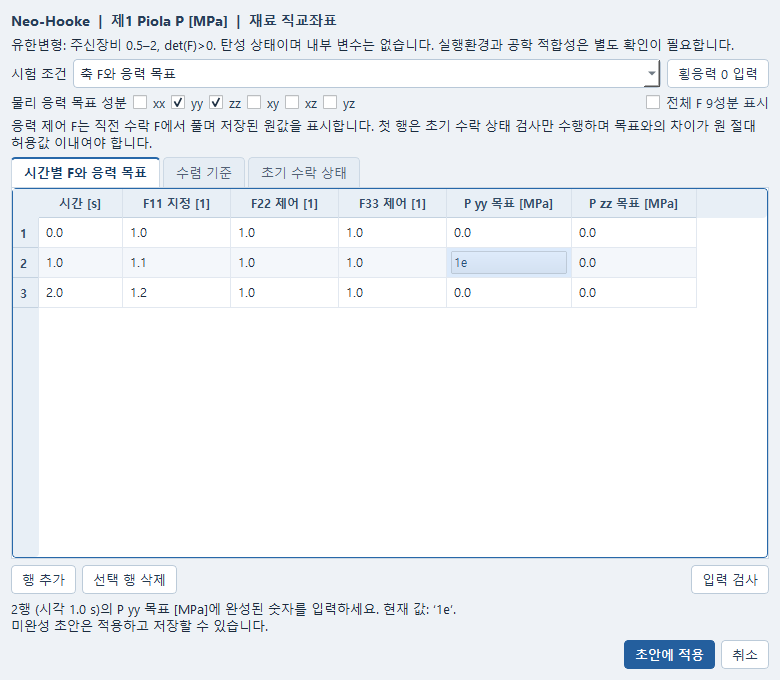
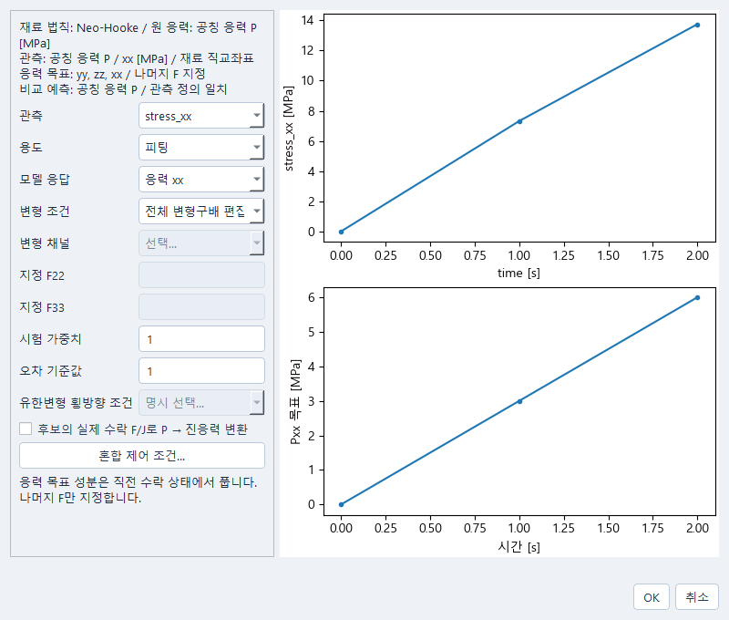

# 재료점 혼합 제어

재료 법칙 창의 **재료 법칙 → 혼합 제어 조건…**에서 시간별 변형구배와
응력 목표를 편집한다. 재료 계산과 다시험 계획은 같은 저장 입력을 사용한다.
새 F/J 변환기나 별도 적분기는 만들지 않았으며, 기존 `law_native_history`가
`material_control.solve_history`의 Newton 반복을 사용한다.

## 조건 입력

1. 재료 법칙, 계수와 응력 단위, 초기 수락 상태를 먼저 확인한다. 예제 물성을
   실제 재료의 교정값으로 사용하지 않는다.
2. **지정 F**는 모든 F 성분을 지정한다. **측정한 횡변형 F22/F33**도 같은 F
   지정 형식이며 측정값을 직접 입력하는 선택이다. 원 채널·시각의 연결은 시험
   조건 창의 기존 측정 이력 경로에서 설정한다.
3. **축 F와 응력 목표**에서는 목표 성분을 체크하고 각 시간의 응력을 입력한다.
   새로 켠 목표는 빈 값이다. **횡응력 0 입력**을 눌러야 yy와 zz가 명시적으로
   0이 된다. F22=F33=1인 구속 조건과 자유 횡수축은 서로 다르다.
4. 응력 제어 성분의 F는 저장된 원값을 표시하며 읽기 전용이다. 계산은 해당
   성분을 직전 수락 F에서 풀어 결정한다. 기본 표는 대각 성분과 필요한 성분을
   표시하며 **전체 F 9성분 표시**로 다른 성분을 확인할 수 있다.
5. **수렴 기준**의 원 절대·상대 허용값과 반복 제한을 확인한다. **초기 수락 상태**는
   확인용이며 이 창에서 초기 내부 변수를 자동 보정하거나 0으로 만들지 않는다.
6. **입력 검사 → 초안에 적용 → 변경 적용 → 저장**한다. 미완성 값은 초안으로
   적용하고 저장할 수 있지만 필수 입력 불량은 계산을 막는다. 창의 취소는 원
   입력을 바꾸지 않는다. 변경 적용 뒤에는 기존 Undo/Redo를 사용할 수 있다.

숫자가 미완성이면 입력 검사가 해당 행·실제 시각·성분·단위를 안내하고 오류 셀을
선택한다. 예를 들어 `2행 (시각 1.0 s)의 P yy 목표 [MPa]`와 `F11 [1]`을 구분한다.
원 엔진 진단은 안내의 툴팁에 보존한다. 형식이나 진단을 인식하지 못하면 원문을
보이며 임의로 특정 셀의 오류라고 판단하지 않는다.

다시험 계획의 **시험 조건 → 혼합 제어 조건…**도 같은 편집기를 사용한다.
시험별 응력 목표와 나머지 F 지정이 함께 보존된다. 계획에 연결하거나 저장하는
행위는 자동 피팅·예측 실행이 아니다.
xx 응력을 제어할 때 시험 조건 창의 아래 그래프는 저장된 F11 대신 Pxx 또는 σxx
목표를 응력 단위로 표시한다. 저장된 F11을 실제 지정 변형이나 계산된 해로 표시하지 않는다.





두 번째 화면의 xx 목표는 표시 확인용 미실행 입력이다. 함께 보이는 보존 응답은 기존
실행의 결과이며 이 목표를 새로 계산한 결과가 아니다.

## 현재 법칙별 범위

| 법칙 | 응력 목표 | 입력과 상태의 의미 |
|---|---|---|
| 압축성 Neo-Hooke | 제1 Piola P의 xx/yy/zz/xy/xz/yz | F 입력은 9성분. det(F)>0, 주신장비 0.5–2. 탄성 초기 F와 시각을 보존한다. |
| Drucker–Prager | 물리 미소변형 Cauchy σ의 같은 6성분 | Kelvin 변형률 성분 절댓값 ≤0.05, ‖F−Fᵀ‖≤0.15. 소성 변형률과 경화 상태를 수락된 증분 사이에 보존한다. |
| 단일 분기 Maxwell | 물리 미소변형 Cauchy σ의 같은 6성분 | 물리 변형률 성분 절댓값 ≤0.01. 실제 초 단위 Δt와 점성 상태를 사용한다. |

이는 현재 생산자 입력 계약의 범위다. Neo-Hooke의 물리 9성분 응답·접선 선언이
9성분 혼합 응력 제어를 뜻하지 않는다. 기존 탄성 `material.felupe` 단축창의
지원 조회를 상태 의존 법칙의 지원 판정으로 사용하지 않는다. 실행환경 유무와
실측 교정·강도·공학 적합성은 각각 별도로 확인해야 한다.

첫 행은 이미 수락된 초기 상태의 검사다. 제어 응력과 첫 목표의 차이가 **원
절대 허용값** 이내여야 한다. 첫 행에 Newton을 수행해 맞추지 않는다. 이후
반복은 원 `atol + rtol × max|target|`을 사용하고, 같은 증분의 각 trial은 같은
직전 수락 상태에서 시작한다. Maxwell의 Δt도 같은 상태의 시각에서 계산한다.
DP 꼭짓점이나 비미분 지점에서 고유 접선을 만들 수 없으면 원 실패를 보존한다.

## 결과와 실패 확인

보존 결과 하나를 선택하고 **혼합 제어 수렴과 수락 상태…**를 연다. 시간과
증분을 선택해 응력 목표·실제 응력, 전체 제어 성분의 최대 절대 잔차와 원 허용값,
반복 수를 읽는다. 초기 행의 경계 Newton 잔차와 반복은 생성되지 않으므로 0으로
채우지 않는다. **상태 원값**은 증분 시작 수락 상태, trial, 최종 수락 상태와
실제 F를 보여준다. **반복과 실패 진단**에는 원 반복·실패 진단이 남는다.

실패 증분은 수락하지 않는다. 마지막 수락 상태와 수락된 앞부분을 유지하고 없는
trial 응력이나 상태는 생성하지 않는다. 다른 입력으로 다시 평가할 때는 새 작업을
만들어 원 실패를 보존한다. 현재 편집 중인 계수를 바꾸더라도 보존 결과창은
선택한 실행의 원 입력을 읽는다.

## 확인한 범위와 재현

2026-10-18의 한정 합성 입력은 `tests/material_control_workflow_inputs.py`에 있다.
Neo-Hooke 자유/구속 각 1회, DP 자유 1회, Maxwell 실제 시각 0/0.37/1.11/2.5 s
1회, DP 예상 실패 1회와 동일 초기 상태의 작은 새 입력 재시도 1회까지 **총 6회**의
기존 재료점 작업을 실행했다. Neo-Hooke의 자유/구속 F와 축응력 차이, 혼합 경계의
실제 잔차, DP 실패 후 초기 상태 불변을 확인했다. 원 허용값을 올리거나 입력을
바꿔 추가 반복하지 않았다. native FE·solver·provider·새 fit 실행은 없다.

같은 문서의 실제 취소, 변경 적용/Undo/Redo, 문서 전환 중 수락 거절, 원 실행 입력의
결과 읽기, 미완성 목표 저장과 실행 거절, 세 법칙 계획의 모델 준비·저장·새 owner
읽기를 확인했다. 준비된 모델에서는 계산 함수를 호출하지 않았다. 일반/좁은 실제
Qt 창을 확인했으며 물리 OS 입력 인수와 공학적 적합성 승인을 뜻하지 않는다.

관련 검사:

```powershell
python -m pytest tests/test_material_control_workflow_ui.py tests/test_material_control_ui.py tests/finite_measure/test_workflow_context_ui.py -q
```

전용 Windows 검사 `tests/check_material_control_workflow_windows.py`의 `run`은
명시된 6개 새 작업을 실행한다. 기존 결과 읽기에는 `cold`, 모델 준비와 미완성
입력 확인에는 `validate`/`cold-validate`를 사용한다. 산출물과 원 실패·프로세스 정리는
로컬 `_workspace/material-control-20261018/`의 phase별 receipt에 보존한다.
