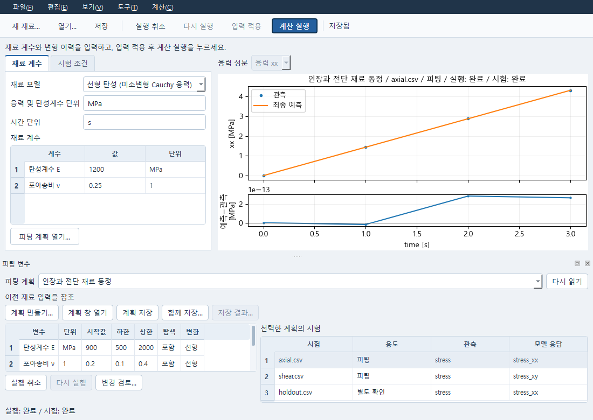
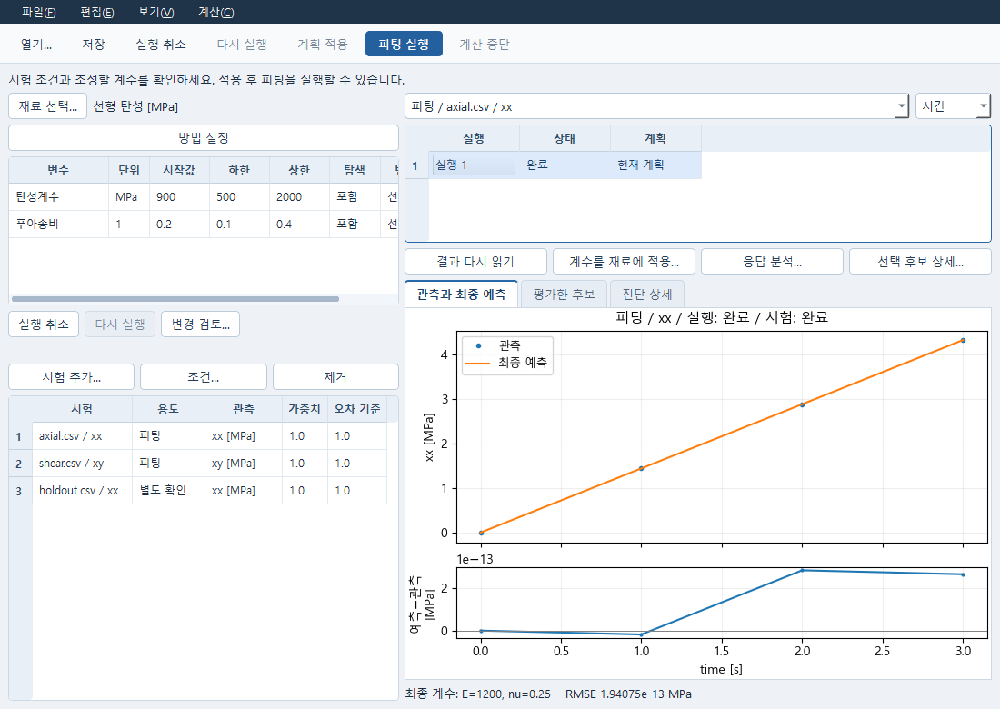
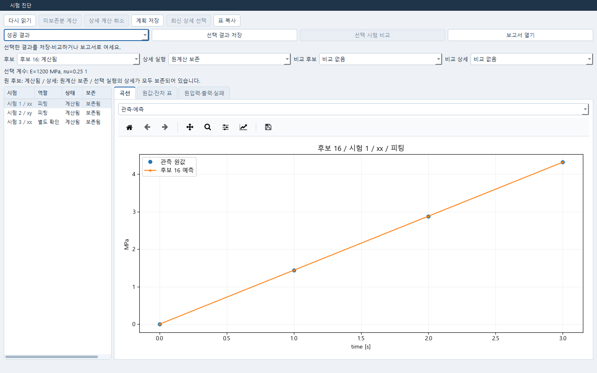

# Material의 피팅 변수 편집

Material의 **도구 → 피팅 계획 열기…** 또는 **피팅 변수 편집…**에서 현재 재료에 연결된 Numerical
계획을 선택한다. 각 계획의 시작값·범위·탐색 여부를 표에서 편집하고
**변경 검토… → 편집 적용 → 계획 저장**으로 확정한다. 검토 창은 현재 값과
편집 값을 함께 보여 준다. 적용은 계산을 시작하거나 Material 계수를 채택하지 않는다.

**피팅 계획 열기…**는 기존 계획 선택기를 열고, **새 피팅 계획…**과 패널의
**계획 만들기…**만 새 계획을 만든다. 독립 Numerical 창도 같은
`NumericalPlanVariablesWidget`을 새 인스턴스로 사용한다. 두 창의 입력 적용·계산은
메뉴와 도구 모음에서 같은 QAction을 사용한다.

계획을 바꾸어도 앞 계획의 미적용 셀은 남는다. 실행 취소는 포커스가 있는
표에 적용되며 Material 계수와 다른 계획의 셀을 바꾸지 않는다. 편집 중인
계획이 다른 창에서 변경되면 입력을 유지하고 충돌을 알린다. 이때 저장으로
미적용 셀을 건너뛸 수 없다. **계획 창 열기**는 같은 문서 소유자를 별도
Numerical 창으로 열며 기존 창의 표를 옮기지 않는다.

패널은 필요할 때 여는 도킹 창이다. 경계선을 끌어 Material 표와 변수 표의
높이를 조절하거나 분리할 수 있다. 변수 표와 선택한 계획의 시험 목록은 나란히
보이며 현재 재료와 계획의 참조 관계는 선택기 아래에 표시한다. 시험 행을 선택하면
그 계획의 보존된 동정 결과에서 관측·최종 예측·원단위 잔차를 큰 곡선으로 읽는다.
실행 뒤 계획을 편집했으면 곡선에 **이전 계획 입력**을 표시하고 원 실행의 시험 조건과
자료를 사용한다. 결과가 없는 시험·실패한 실행·다른 계획을 선택하면 이전 곡선을 지운다.
실행 전체와 개별 시험의 실패·취소 상태와 사유를 표시하며, 취소한 실행의 부분 출력은
최종 예측으로 표시하지 않는다. 분리된 관측 구간은 예측과 잔차에서도 선으로 잇지 않는다.
주기적인 문서 읽기는 보고 있는 계획 곡선을 보존한다. **보기 → 재료 계산 결과 보기**로
재료 자체의 저장된 계산을 보고, 계획의 시험 행을 선택하면 다시 그 시험 결과를 본다.
계획 저장과 **함께 저장…**은 기존 저장·부분 실패·복구 경로를 사용한다. 미적용 입력이나
저장하지 않은 계획이 있으면 Material의 닫기·문서 변경에서 보관 여부를 확인한다.

## Data에서 시험을 등록하고 동정하기

1. Data에서 시험 열·물리량·단위·계산 제외를 적용하고 가져오기를 실행한 뒤 저장한다.
   **자료 → 재료에서 사용…**으로 재료를 선택한다. 전달한 응답·실행·입력과 저장 결과가
   일치하는지 Material이 다시 읽어 확인한다.
2. Material에서 선택한 계획에 시험을 등록한다. **시험 조건**에서 실제 측정 변형 채널,
   지정 횡변형 F22/F33, 모델 응답과 피팅 또는 별도 확인 용도를 명시한다. 등록은 기존
   Numerical 계획의 `experiments`에 적용되며 재료 계수 변경이나 계산을 시작하지 않는다.
3. `examples/material-tests/axial.csv`와 `shear.csv`를 피팅에, 별도 `holdout.csv`를
   확인에 등록한다. 이 공개 자료의 시간은 s, 응력은 MPa이며 인장 자료는 xx, 전단 자료는
   xy를 사용한다. 측정 변형을 사용하고 F22=F33=1을 지정한다.
4. **계획 창 열기**로 같은 계획을 열어 E 시작값 900, 범위 500–2000 MPa와 ν 시작값 0.2,
   범위 0.1–0.4를 지정하고 두 변수를 탐색한다. **계획 적용 → 피팅 실행** 뒤 관측·최종 예측과
   별도 확인 곡선을 읽는다. 기존 FELUPE 경로에서 이 공개 자료는 E≈1200 MPa, ν≈0.25를 얻는다.
5. 실제 후보를 선택하고 **선택 후보 상세…**에서 정확한 후보와 상세 실행을 확인한다.
   필요한 미보존분은 명시적으로 계산하고 **선택 결과 저장** 후 **계수를 재료에 적용…**을
   확인한다. 재료와 계획을 저장하면 새 프로세스에서 계산 없이 결과와 채택한 계수를 다시 연다.

시험 등록 응답을 잃으면 검토한 입력과 명령을 유지한다. **시험 등록 결과 확인**은 같은
명령을 확인하므로 같은 시험을 중복 등록하지 않는다. 다른 창의 편집과 원자료 불일치는
현재 변수·계수·기존 결과를 보존하며 자동으로 다시 적용하지 않는다.

현재 시험·관측의 저장 소유자는 선택한 Numerical 계획이다. Material의 시험 목록은 그 계획을
보는 창이며, 독립적인 Material 다중 시험 저장 소유자를 새로 구현한 것은 아니다.

## 구현과 확인 범위

Material 호스트는 `material_plan_panel.py`이며 Numerical 팀의 새 인스턴스
`NumericalPlanVariablesWidget`과 실제 Pro의 `PlanOwnerAdapter`를 사용한다.
공통 초안·CAS·Undo 처리는 기존 문서 소유자에 남긴다. 호스트의 문서 복사본은
해당 위젯이 보유한 확인된 응답을 읽는 데만 사용한다.

2026-10-18 실제 Qt·HTTP·FELUPE 흐름에서 공개 axial/shear와 별도 holdout을 등록하고,
E≈1200 MPa·ν≈0.25의 동정과 holdout RMSE<1e−5를 확인했다. 정확한 후보의 상세 결과와
채택 증거를 저장해 원 재료에 적용하고, 별도 Python 프로세스에서 저장본을 계산 없이
다시 읽었다. 실패·취소·자료 구간, 원 실행 입력, 실제 HTTP poll 뒤 곡선 유지와 지연
응답 뒤 사용자 선택 보존을 확인했고 Astra 통합 검토의 차단 지적을 닫았다.
위 사진은 최종 저장 결과를 실제 Windows Qt에서 읽은 화면이다. 확인용 프로그램은
소유 Windows Job Object로 정리했다. 공개 합성 자료의 연결 확인이며 실험 재료의
동정 정확성·공학 적합성이나 OS 직접 입력 전체 인수를 뜻하지 않는다.

### 선행 편집 연결 확인

2026-10-15 초기 Pro 패키지와 Numerical의 위젯 후속 소스(공개
`document_snapshot()` 포함)를 격리된 전체 소스에 연결해 검증했다. 실제
LabHTTPServer/문서 소유자를 쓰는 검사는 두 계획의 편집 격리, 명시 검토·적용·저장,
검토 후 다른 창의 수정에 따른 충돌 보존을 확인한다. 실행 요청은 하지 않는다.
Windows Qt에서는 보통/좁은 Material 창과 검토 창을 읽고, 미확정 `1e` 입력 중
닫기 보류와 Esc, 같은 Plan을 여는 독립 Numerical 창, 저장을 확인했다.
`native_check.py`가 실행한 프로세스만 종료했다. Windows 클립보드 동작과
복구 저장·부분 저장 전체 완료를 이 검사로 주장하지 않는다.
