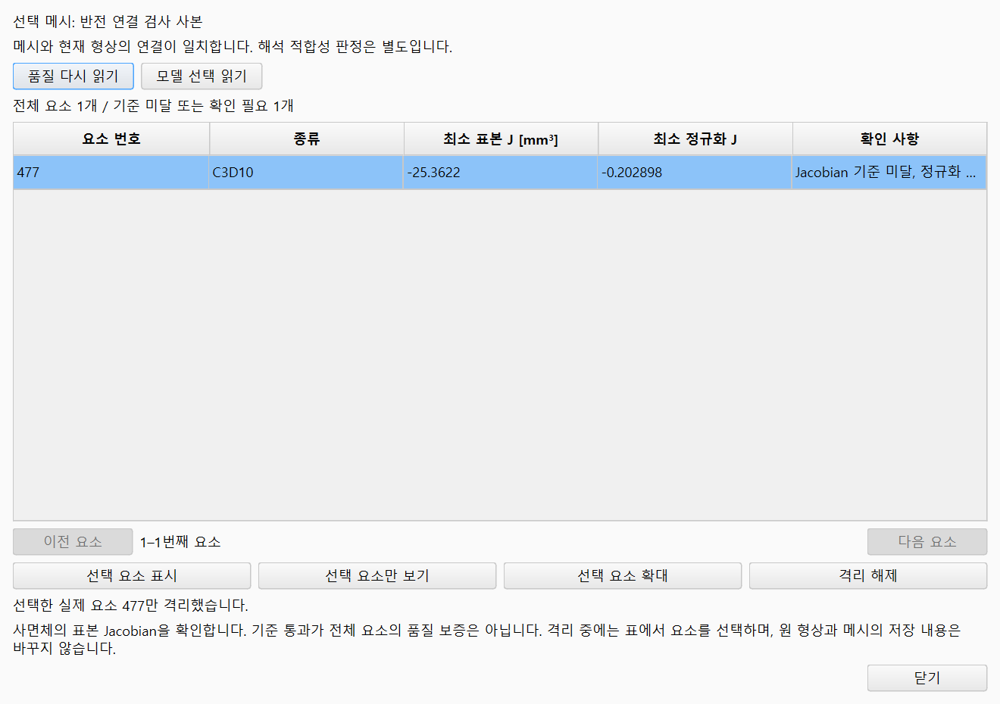
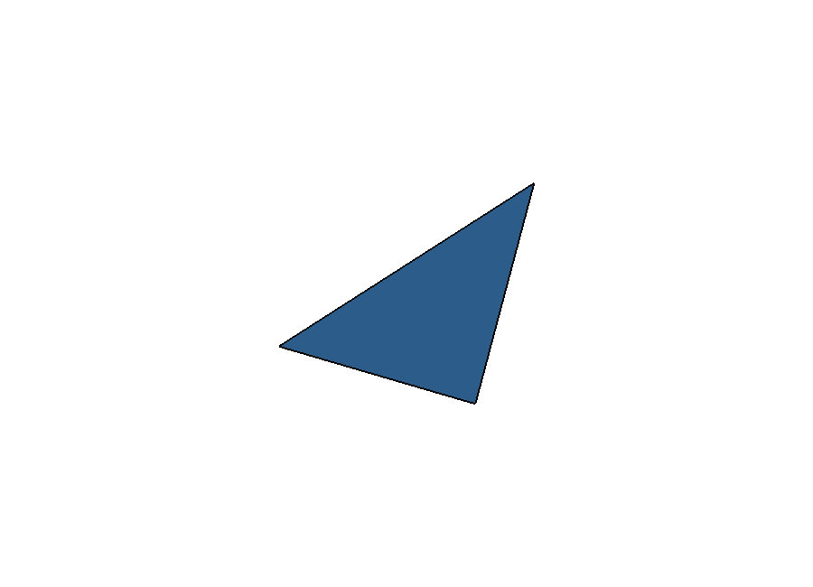

# 메시 요소 품질 확인

FreeCAD에서 메시를 선택한 뒤 **CAE 작업 → 메시 품질 확인…**을 엽니다.
현재 문서에 메시가 하나면 선택하지 않아도 그 메시를 사용합니다. 여러 메시가
있으면 트리에서 확인할 메시를 먼저 선택하세요.

1. 요소 표에서 행을 선택합니다. 여러 행은 Ctrl 또는 Shift로 선택할 수 있습니다.
   위·아래 화살표로 선택을 바꿀 수 있습니다. 모델에서 메시 요소 면을 선택했다면
   **모델 선택 읽기**로 같은 요소 번호의 행을 확인합니다. 메시 전체 선택과
   요소 면 선택은 구별합니다.
2. **표시**는 원 모델 위에 해당 요소를 표시합니다.
   **격리**는 다른 모델 기하를 일시적으로 숨깁니다.
   **확대**는 선택한 기하만 화면에 맞춥니다.
3. 격리 중 다른 행을 선택하면 이전 요소의 표시를 해제합니다. 새 선택을
   다시 표시하거나 확대하세요. 격리한 기하는 잘못된 요소 번호로 선택되지
   않도록 클릭 대상에서 제외하므로, 이때는 표에서 요소를 바꿉니다.
4. **복원** 또는 창 닫기로 원 보기와 선택을 복원합니다.
   저장·설계 변경·메시 생성·문서 전환에도 일시 표시를 정리합니다.

위 예시는 절점 연결을 반전시킨 검사 사본입니다. 선택한 477번 요소의 음수
Jacobian을 확인한 뒤 **격리**, **확대**를 눌렀습니다.
실제 사용자 모델의 해석 결과가 아니라 요소 선택 기능을 설명하는 예시입니다.

이 화면에서 **복원**을 누르면 원래 모델 표시와 카메라로 돌아갑니다.

## 해당 위치의 메시를 수정하기

확대한 위치에서 **표시**를 누르면 원형상이 다시 나타나고 확대 위치는
유지됩니다. 수정할 CAD 면·모서리·물체를 선택한 뒤 **해석 설정**의 영역 목록에서
이름을 입력하고 **선택을 영역으로 저장**을 누릅니다. 요소 번호로 CAD 면을 자동
지정하지 않으므로 실제 선택한 형상을 확인하세요.

**메시**에서 **국부 크기 적용 영역**을 고르고 **국부 요소 크기 [mm]**를 입력해
**국부 크기 적용**, **메시 생성**을 차례로 실행합니다. **CAE 작업 → 메시 품질 비교…**에서
보관된 이전 메시와 새 메시를 비교합니다. 나빠진 값도 그대로 표시됩니다.
**프로젝트 저장**으로 메시와 설정을 남기면 다시 열었을 때 같은 메뉴에서 이어갈 수 있습니다.

표는 기존 품질 검사기의 요소별 최소 표본 Jacobian과 정규화 값을 그대로 읽습니다.
음수 값과 기준 미달도 유지합니다. C3D10은 네 적분점 표본의 검사이며, 표본 기준
통과가 요소 전체의 품질 보증이나 해석 적합성 승인은 아닙니다. 요소 표시에는
사면체의 원 절점 연결을 사용하며, 표시를 위해 새 메시나 해석을 계산하지
않습니다. C3D4와 C3D10 사면체를 표시할 수 있고 다른 연결이나 유한하지 않은
좌표는 별도로 확인해야 합니다.

표는 한 번에 200개 요소를 읽으며 **이전 / 다음**으로 이어 봅니다.
요소 번호는 현재 메시의 실제 번호입니다. 재메시하면 번호가 달라질 수 있으므로
이전 메시와 같은 위치의 요소라고 짝짓지 않습니다. 메시가 바뀌었다는 안내가
나오면 **다시 읽기**를 누르세요. 메시 생성 중에는 일시 요소 보기를 바꿀
수 없습니다.

현재 형상과의 연결을 확인하지 못한 메시도 품질을 읽을 수 있습니다. 이 경우
상단 안내를 확인하고 현재 형상의 해석에 사용하기 전에 메시를 다시 생성하세요.
전후 효과는 **CAE 작업 → 메시 품질 비교…**에서 보관된 이전 메시와 같은 지표로
비교합니다. 재메시 성공과 품질 개선은 별도로 확인해야 합니다.

일시 요소 표시는 모델의 형상·메시·조건을 변경하거나 프로젝트에 새 결과로
저장하지 않습니다. 요소 검토를 위한 임시 기하는 기존 FreeCAD 3D 화면에서만
사용하며, 별도 뷰어 문서나 저장 대상으로 남지 않습니다.
