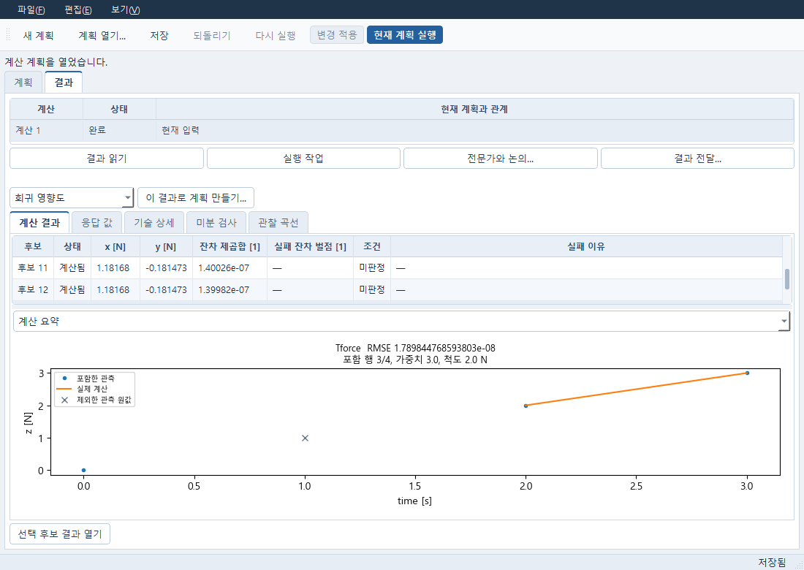
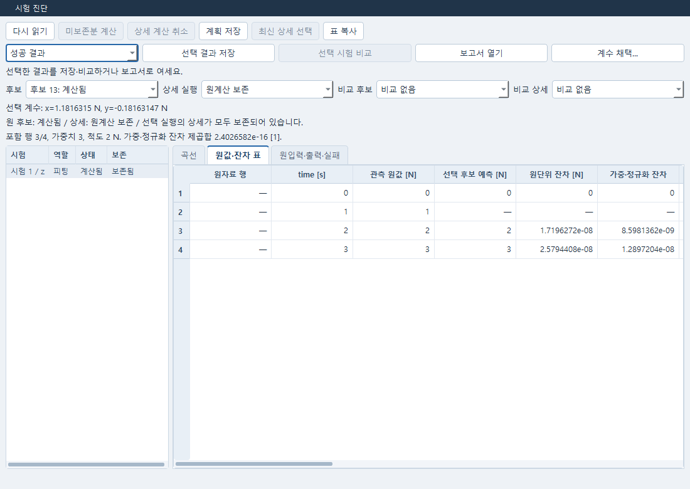
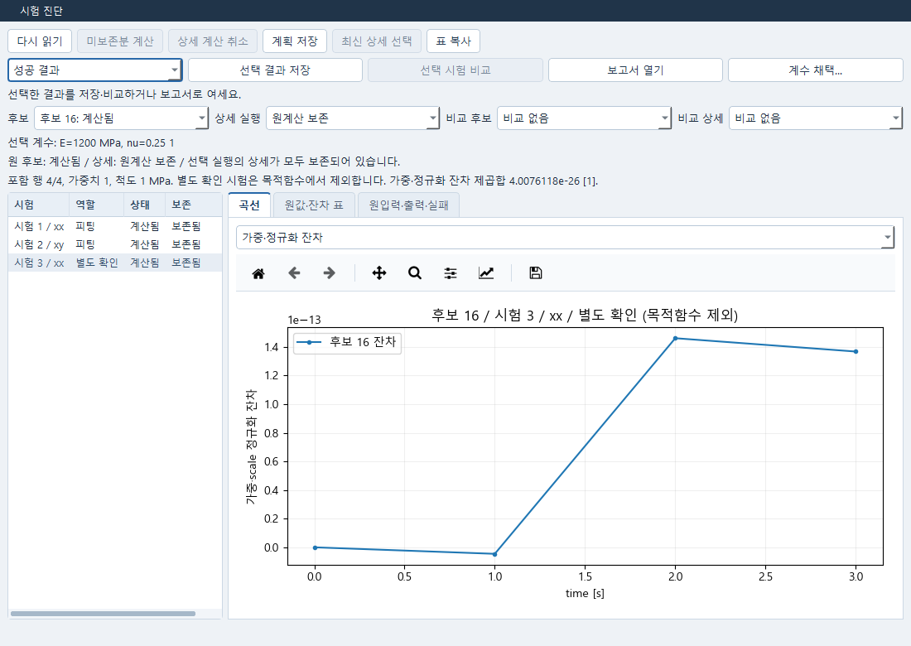
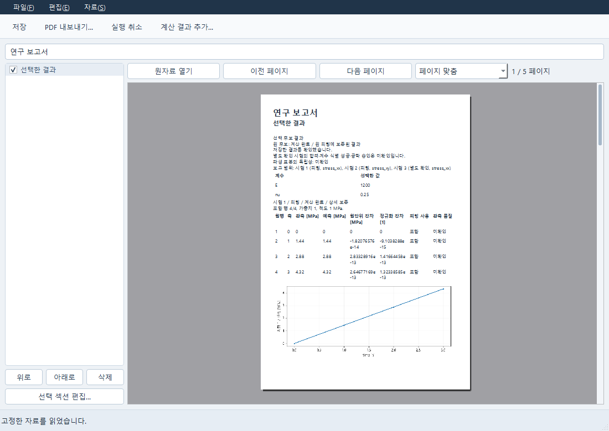

# 원 fit 후보 상세 — FN07 / FN21

요청: PRO-NUMERICAL-DETAIL-20261015-01 및 C1. **성공판단/채택/보고 gate와 최신 적용법은 `NUMERICAL_CANDIDATE_EVIDENCE_C1_KO.md`를 함께 읽는다. 아래 원 인도 작업에 C1이 추가된다.** 적용 기준은 사용자가 제공한 `e2f95b2`,
`codex/delivery-numerical-pde`의 첨부 소스다. 과거 PRO_REQUEST 머리말의 `4ac2e2a`로
되돌아가지 않는다. 이번 코드는 기존 수치 엔진을 교체하지 않는다.

## 사용 순서

NumericalWindow에서 원 fit 실행과 후보 행을 선택하고 **선택 후보 상세…**를 누른다.
RequestPlanWindow의 기존 후보 결과 열기에서도 fit이면 같은 전용 창으로 연결된다.
성공 후보뿐 아니라 실패 후보도 선택할 수 있다. 원 job/result 해시와 정확한
candidate_id가 창에 고정되며, 다른 job의 같은 문자열 ID로 바꾸지 않는다.

창 왼쪽에서 시험을 선택한다. **곡선**, **원값·잔차 표**, **원입력·출력·실패** 탭은
동일한 후보·attempt·시험을 사용한다. 표에는 원자료 행, 원 관측값, 예측, 원단위 잔차,
가중·scale 정규화 잔차, 실제 fit mask, 원 관측 mask, 역할, 단위, 원 변형 F가 나온다.
관측축 시간이 원 protocol 시간에 정확히 존재할 때만 그 행에 F를 붙인다.
축/시간이 다르면 F를 임의 보간하지 않는다. 전체 원 protocol은 원입력 탭에 남는다.
비교 후보/비교 상세를 선택하면 같은 시험·행의 보존값을 나란히 비교한다. 비교 선택은
평가·보간·채택·순위 계산을 실행하지 않는다. 표 순서를 정렬해 곡선과 분리하지 않는다.

`NOT_RETAINED`이면 출력이 저장되지 않은 것이다. 0, 정상 해, 추정 곡선으로 채우지 않는다.
원 fit의 최종 곡선만 있고 raw output이 없는 과거 결과는 `CURVE_ONLY`다.
보존된 실패는 실패 원인과 원입력으로 읽으며, 실패했다는 이유만으로 재평가하지 않는다.

미보존 상세가 있을 때 **미보존분 계산**을 누르면 새 `detail_eval` job/attempt가 생긴다.
원 검색은 다시 돌리지 않는다. 원 후보 계수와 원 실험 설정을 그대로 넘겨 미보존 시험만
기존 evaluator로 실행한다. 이미 보존된 시험은 새 attempt의 보존 prefix로 유지한다.
원 fit의 failure/objective/holdout 기록은 그대로 두며, 새 결과가 성공해도 원 실패 후보가
성공 후보로 바뀌지 않는다. holdout은 역할을 유지하고 원 검색 목적함수에 추가하지 않는다.

이전 상세 실행이 있으면 **최신 상세 선택** 후 미보존분만 이어서 평가한다. 과거 attempt를
보고 있을 때 최신 attempt를 몰래 합쳐 표시하거나 이미 완료된 시험을 다시 실행하지 않는다.
진행 중·상태 미확인인 attempt가 있으면 중복 실행을 막는다. **상세 계산 취소**는 선택한
상세 job에만 취소를 요청한다. 완료된 시험은 보존한다. 취소된 시험의 raw 출력이 일부 있으면
`PARTIAL_OUTPUT`, 계산 전이면 `NOT_EVALUATED`로 남겨 명시 재시도가 가능하다.
보존된 실패 출력은 이미 있는 상세이므로 이 버튼으로 다시 계산하지 않는다.

**계획 저장**은 기존 owner의 저장 명령이다. 원 fit와 상세 attempt, 현재 Numerical
문서의 draft를 함께 기존 개정 저장소에 보존한다. Material/Data를 대신 저장하는 명령이
아니다. 저장 후 새 owner에서 같은 문서·원 job·후보를 열고 상세 실행을 선택한다.
선택, 새로고침, polling, 저장, 재열기는 evaluator를 준비하거나 job을 제출하지 않는다.
창을 닫아도 owner 계산을 취소하지 않는다. 타이머와 읽기 결과 전달만 정리한다.

## 상태를 읽는 방법

### 포함 행·가중치·잔차 확인

시험을 선택하면 상단에 보존한 **포함 행수 / 전체 행수**, **가중치**, **척도와 원단위**가
나온다. 곡선의 파란 점은 포함 관측값이고 회색 ×는 제외한 관측 원값이다. 제외한 행을
삭제하거나 이웃 예측값으로 채우지 않는다. **원값·잔차 표**에서 같은 행의 원단위 잔차와
가중·정규화 잔차를 확인한다. 계산식은 상단 요약의 도움말에도 나온다.

`정규화 잔차 = (예측 − 관측) × sqrt(가중치 / 포함 행수) / 척도`

표본별 가중치가 있으면 `sqrt(표본 가중치)`도 곱한다. 요약의 잔차 제곱합은 이 보존된
정규화 잔차를 사용한다. 포함 행의 잔차가 하나라도 없으면 제곱합을 0으로 만들지 않고
미제공으로 표시한다. `soft_l1` 등 optimizer 내부 loss와 보존된 보통 잔차 제곱합은
같은 수치라고 가정하지 않는다. 별도 확인 시험은 명시적으로 **목적함수에서 제외**한다.

실패 후보의 **실패 잔차 벌점 [1]**은 검색을 계속하기 위한 원 설정값이다. 목적값과
별도 열에 표시하며, 작은 벌점이나 낮은 수치가 실패를 성공 또는 최선 후보로 바꾸지
않는다. 일반 최적화의 **조건** 열은 보존된 수치 제약의 충족·위반·미판정을 표시한다.
물성 식별 성공이나 공학 승인의 판정은 별개다.

**선택 결과 저장**으로 고정한 후보 증거를 보고서나 연구 기록에 연결할 수 있다.
원 Material에 이미 다른 입력이 적용되었다면 옛 Plan의 **계수 채택**은 거절된다.
취소·거절은 현재 재료와 옛 결과를 유지한다. 현재 재료를 명시적으로 새 계획에 연결해
다음 연구를 시작하며, 옛 결과를 새 입력의 계산 결과로 바꾸지 않는다.

2026-10-18 Windows 확인은 기존 공개 합성 관측을 사용한 선형 FELUPE 두 시험 피팅과
별도 확인 시험의 보존 결과를 재사용했다. 후보 `C000015`의 E는 약 1200 MPa,
nu는 약 0.25이며 보통 잔차 제곱합은 `7.55097573736635e-26`이다. 동일 증거의 기존
채택·Study·Report와 별도 Python 재열기를 읽는 동안 새 계산·피팅·예측 제출은 0이었다.
별도 합성 대수 예제는 포함 3/4행, 가중치 3, 척도 2 N을 확인했다. 이는 J2/DP 비교나
재료·지그 분리 Case A/B 전체 인수가 아니며 공학 적합성은 **UNKNOWN**이다.

다음은 같은 저장 결과를 읽은 실제 Windows 화면이다. 합성 대수 예제의 포함·제외 관측과
원단위/정규화 잔차를 구별하고, FELUPE 별도 확인 시험은 목적함수에 넣지 않는다.









예측의 필수 표본이나 보간의 원 인접 표본이 유효하지 않으면 해당 후보를 실패로 남긴다.
원 구간이 여러 개이면 구간 경계를 넘어 보간하지 않으며, 명시한 구간 범위·중첩 오류도
거절한다. 실패를 피하려고 관측 포함 행수나 원 가중치를 줄이지 않는다. Data가 확정한
편입과 원 피팅 마스크를 그대로 사용하며 원 관측의 표시 마스크와 혼합하지 않는다.

원 후보 상태와 상세 attempt 상태는 서로 다른 정보다. 시험마다 `retention`,
`execution_status`, `evaluation_status`, `origin`을 따로 둔다.

| 표시 | 의미 |
|---|---|
| RETAINED | 이 시험의 실제 평가/실패 출력이 보존됨. 성공이라는 뜻은 아님 |
| CURVE_ONLY | 원 최종 곡선은 있으나 전체 원출력이 없음 |
| NOT_RETAINED | 원 출력이 없거나 보존 한도 밖임 |
| PARTIAL_OUTPUT | 취소된 시험의 일부 raw 출력. 완료된 protocol로 취급하지 않음 |
| NOT_EVALUATED | 이 attempt에서 시작/완료하지 못한 시험 |
| SUCCEEDED / FAILED / PARTIAL_FAILURE | 시험 전체 결과를 구분한 attempt 상태 |
| CANCELLED / INTERRUPTED / UNKNOWN | 취소·컨트롤러 중단·상태 미확인. 성공으로 바꾸지 않음 |

원 evaluator는 성공했지만 예측/관측 단위나 metadata가 맞지 않는 경우,
`evaluation_status=SUCCEEDED`, 시험 비교 `execution_status=FAILED`가 된다. raw 출력은
그대로 남는다. 관측 event의 `NOT_OBSERVED`/`UNKNOWN`도 수치 0으로 바꾸지 않는다.

`CLEANUP_PENDING`은 기존 JobManager의 native 정리 미확인 상태다. 새 실행과 정상 저장
판정을 진행하지 않는다. 이 인도는 미회수 native 프로세스의 출력이나 강제 종료 시점의
메모리 내 중간값을 안전한 완료 결과로 봉인하지 않으며, 강제 종료 중 trial checkpoint
복구 기능을 새로 구현하지 않았다. 정상 반환된 취소/실패의 시험별 부분 결과와 구분한다.

## 원입력 고정과 실패 보호

`source`는 정확히 `document_id`, `job_id`, `input_revision`, `input_sha256`,
`result_sha256`으로 구성한다. `candidate_id`는 그 원 결과에서 하나만 찾아야 한다.
원 Plan draft와 원 입력 해시, 변수 이름/계수/단위/범위/변환, source rows, 두 mask,
role/weight/scale, observation metadata와 protocol/time/F를 검증한다. 비교에도 같은
source와 `fit_input.inputs_sha256`을 요구한다.

새 fit의 실행 경계에서 관측 ref를 기존 resolver로 해석한 뒤 `fit_input_snapshot`을
보존한다. 상세 읽기/평가는 현재 Material이나 편집된 Plan에서 입력을 다시 만들지 않는다.
과거 결과는 원 run.arguments에 이미 완전한 inline 관측과 설정이 있을 때만 소비한다.
동결 관측이 없고 observation_job/ref만 남은 옛 결과를 현재 자료로 재구성하지 않는다.
최종 곡선에 candidate_id가 없는 옛 결과는 최종 계수가 정확히 일치하는 성공 행이
하나일 때만 연결한다. 중복 계수 행이면 후보를 추측하지 않는다.

원 결과 해시가 바뀌거나 후보가 없거나 다른 candidate의 attempt이면 거절한다.
저장 결과의 hash/array 검증 실패는 `NOT_RETAINED`로 숨기지 않고 읽기 실패를 전달한다.
명령은 기존 session/generation CAS와 command_id receipt를 사용한다. 제출 응답이
유실되면 기존 JobManager request_id로 접수된 실행을 재연결한다. read는 재제출하지 않는다.

새 Workbench fit는 backend 등록, Python adapter 소스/버전, 알려진 Python 의존 버전,
external backend 설정 digest도 남긴다. 상세 제출 전과 실행 직전에 대조한다.
외부 설정 원문/credential은 복사하지 않는다. 설정 identity가 없던 legacy external fit는
현재 설정으로 몰래 실행하지 않는다. 이 digest는 native solver 실행 파일까지 새로
검증했다는 뜻이 아니다. native binary/build 자격 확인은 기존 adapter 경계에 남는다.

## 보존 한도와 성능

새 fit는 기본적으로 앞선 후보 최대 32개, 상세 payload 예산 16 MiB를 보존한다.
원 optimizer의 8-entry working cache와 원 평가 횟수는 유지한다. 최종 실제 fit/holdout
출력도 같은 바이트 예산 안에서 정확한 최종 후보에 연결한다. 보존을 위해 holdout이나
중간 후보를 추가 실행하지 않는다. candidate/detail의 cap reason은 결과에 남는다.
이 바이트 수는 상세 payload 회계이며 원 결과 전체 파일 크기 상한이라는 뜻은 아니다.

일반 RequestPlan의 기존 fit options에 다음 선택사항을 추가한다.

```json
"detail_retention": {"candidate_limit": 32, "byte_limit": 16777216}
```

후보 상한은 128, 바이트 상한은 67108864이다. 두 값 모두 0이면 새 후보 raw 보존을
끄며 이후 사용자가 명시 detail_eval로 읽을 수 있는 상세를 만들 수 있다. 기존 final
curve 저장 정책은 그대로다. UI 원출력 텍스트는 표시량을 1 MiB로 제한하고 명시 표시한다.
저장된 raw 데이터는 이 화면 절단으로 삭제되지 않는다.

## 원 인도의 Numerical-local packet — Data shared 계약 아님

신규 compiler나 related-save coordinator는 만들지 않았다. 아래는 Data와 합의되지 않은 legacy 제안이다. 최종 Data packet은 C1의 typed extension/주입 경계로 root가 연결한다. 기존 전용 consumer는
`consume_frozen_fit_inclusion(experiments, packet)`이다. Data가 컴파일한 원 실험을
원 fit 요청 `fit_inclusion`에 연결하거나 `freeze_fit_input(..., inclusion_packet=packet)`에
넘긴다. root가 Data 팀 실제 반환물과 이 consumer 경계를 연결한다.

packet.schema는 `caelab.frozen-fit-inclusion.v1`이고 packet.experiments는 원 실험과
동일 순서/개수의 행이다. 행에는 다음 필드가 모두 필요하다.

```text
experiment_id, source_rows, mask, role, weight, scale, unit,
observations_sha256, settings_sha256, observation_source_sha256
```

해시는 기존 `canonical_hash`와 `experiment_snapshot`의 정규화된 JSON을 기준으로 한다.
`observations_sha256`에는 원 `observations.mask`, source_rows, source column identity,
단위/좌표계/축/value 등의 관측 metadata 전체가 들어간다. `mask`는 기존 fit 엔진이
실제로 사용하는 mask다. `settings_sha256`은 time/F를 포함한 전체 실험 설정,
`observation_source_sha256`은 원 source/provenance 전체의 해시다. source가 없으면
`canonical_hash(None)`이다. compiler의 추가 provenance 필드는 제거하지 않는다.

현재 원 엔진은 experiment.mask와 observations.mask를 동일시하지 않는다. 전자는
실제 fit inclusion, 후자는 원 관측 metadata로 둘 다 보존한다. 이번 소비자가 과거
mask를 교정하거나 빠진 값을 보간해서 원 fit의 의미를 바꾸지 않는다. Data compiler가
선택한 mask를 명시 experiment.mask로 내보내야 한다. holdout의 원 행 중복 검사는
기존 `require_independent_rows`를 그대로 재사용한다. 이것은 raw contributor가 겹치는 파생 표본의 독립성을 검증하지 않는다. C1은 파생 표본 독립성을 `NOT_VERIFIED`로 표시한다.

## 원 인도(01)의 root 통합 — C1은 증분 패치 별도

새 파일 두 개가 제품 코드다.
`caelab/numerical_candidate_detail.py`는 읽기/보존/명시 실행/owner mixin이며,
`apps/research/numerical_candidate_detail_window.py`는 실제 PySide6 전용 창이다.
공유 파일 전체는 이 패키지에 넣지 않았다. `integration.patch`에만 다음 변경이 있다.

| 공유 파일 | 제한된 변경 |
|---|---|
| caelab/numerical.py | 원 fit 출력 capture hook, 최종 raw 연결; 검색 재작성 없음 |
| caelab/numerical_document.py | 기존 owner에 CandidateDetailMixin 결합 |
| caelab/workbench.py | operation 등록, 검증, 기존 evaluator dispatch, 원 입력 snapshot |
| caelab/workbench_client.py | 기존 인증된 document/result/status API만 사용하는 read facade |
| caelab/assist/experts.py | 기존 fit schema의 보존 옵션과 동결 관측 metadata/packet |
| apps/research/numerical_window.py | 정확한 원 후보 상세 action |
| apps/research/request_plan_window.py | 기존 후보 결과 action의 fit 분기 |

새 HTTP route, 두 번째 JobManager, 별도 데이터베이스는 없다. 기존 document_command
route가 `numerical.detail_eval` owner command를 전달한다. `Client.numerical_candidate_detail`
메서드는 기존 document_read/document_result/status만 호출한다. 서비스 직접 API는
`Workbench.numerical_candidate_detail`이다.

패키지의 새 source/tests/docs를 checkout에 복사한 다음 root가 공유 패치를 적용한다.
새 파일이 이미 있으면 먼저 해당 작성자 변경을 비교하며 덮어쓰지 않는다.

```sh
git -c core.whitespace=cr-at-eol apply --check integration.patch
git -c core.whitespace=cr-at-eol apply integration.patch
python -m pytest -q tests/test_numerical_candidate_detail.py tests/test_numerical_candidate_detail_boundaries.py tests/test_numerical_candidate_detail_felupe.py tests/test_numerical_candidate_detail_ui.py tests/test_workbench_numerical.py -rs
```

패치는 첨부 원본의 CRLF를 유지한다. 실제 root의 동시 수정이 있으면 hunk를 대조해서
통합한다. 작성본 전체 shared 파일로 교체하지 않는다. 새 의존성/유료 API/WSL 명령을
추가하지 않는다. FELUPE와 PySide6는 원 pyproject의 기존 선택 의존성을 사용한다.

독립 창을 호출해야 할 때는 실행 중인 기존 로컬 service와 원 문서/job/candidate ID로
연다. localhost는 기존 controller 전송 주소일 뿐, 제품 화면은 native Qt이다.

```sh
python -m apps.research.numerical_candidate_detail_window --service http://127.0.0.1:PORT --document-id N... --job-id J... --candidate-id C000001
```

## 원 인도(01)의 실행 구분 — C1의 최신 증거는 DELIVERY.md 참고

패키지 `evidence/`에 실제 pytest 출력, JUnit, 환경 버전, 설치 실패 로그,
원 ZIP 해시와 fresh-copy patch 적용 검사를 둔다. 합성 fixture를 실제 FELUPE 결과라고
부르지 않는다. 실제 FELUPE 전용 테스트는 tension/shear fit와 별도 biaxial holdout,
양의 중간 후보 및 음의 mu 원 실패 후보, Material/Plan 편집, 원 hash 유지와 새 owner를
검사하도록 작성했다. 해당 라이브러리가 없는 환경에서는 명시 SKIP한다.

이번 환경에서는 실제 FELUPE 계산, PySide6 창 실행, Windows native 상호작용,
완전한 Workbench/HTTP 초기화는 NOT_RUN이다. 첨부에 없는 native 데스크톱 import를
가짜 구현으로 메우지 않았다. 공통 dispatcher 검사는 Workbench.__init__만 사용하지 않고
실제 submit/resource/_execute 경계를 기존 owner/JobManager와 연결한 별도 시험이다.

원 FN08/18~24의 이산/종속 변수, gradient/MDO, Windows PDE 확대, 다른 mesh/time
mapping, 사용자 law 실제 FE pair는 이 인도로 종료하지 않는다. FN02 관련 저장/Plan
widget도 다른 의미 단위다. 기존 correlated-normal UQ, dimensioned SciPy ODE,
P1 linear weak, RBF/실평가, Sobol, epsilon/DE, exact-same-mesh 전달은 재작성하지 않았다.
