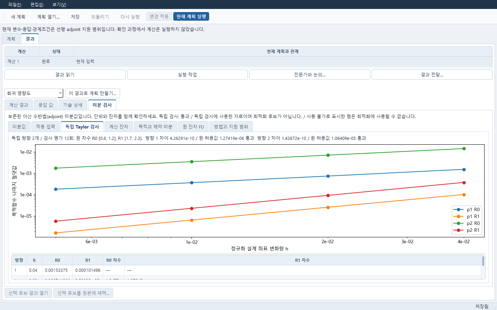
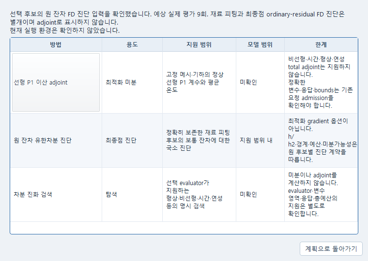
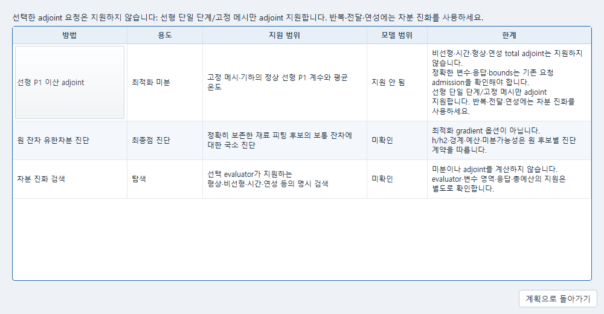

# 미분법 선택과 보존 결과 확인

계산 계획의 **미분법 지원 확인**에서 선택한 입력에 대한 지원 여부와 방법별 범위를
확인합니다. 재료 피팅 계획에서는 **계산 → 미분법 지원…**으로 같은 표를 엽니다.
이 표를 여는 동작은 계산하지 않습니다. 표의 **미확인**은 아직 해당 입력의 지원을
검사하지 않았다는 뜻이며, 설치 또는 공학적 승인을 의미하지 않습니다.
모델의 지원 범위와 별도로 현재 실행 환경은 확인하지 않았다고 본문에 표시합니다.
최종점 FD의 예상 평가는 현재 차분 간격을 사용합니다. 정확히 보존된 Jacobian을
재사용하면 원 결합 검증 후 새 모델 평가를 0회로 표시합니다.

| 연구 작업 | 선택할 기존 경로 |
|---|---|
| 고정 geometry·고정 메시의 정상 선형 scalar P1 열전도 | **선형 이산 adjoint (SLSQP)**. 지원 연속 계수와 평균 온도의 실제 적분 목적·제약을 선택합니다. |
| 재료 역해석의 선택 후보 진단 | 별도 **ordinary-residual FD 최종점 진단**. 원 관측·포함 행·가중치·척도에 대한 h/h2 검사를 사용합니다. optimizer의 변경된 Jacobian을 재사용하지 않습니다. |
| 형상·비선형·시간·연성 최적화 | 기존 **차분 진화(DE)**. 분야 평가와 명시 예산을 사용하며 전체 연성 adjoint로 표시하지 않습니다. |
| 정수·범주·종속 변수 | 지원되는 탐색을 사용합니다. 미지원 gradient 요청을 거절하며 변수를 몰래 연속 변수로 바꾸지 않습니다. |

선형 adjoint를 고르면 전도율·열원·경계온도 등 지원 계수와 **평균 온도 [K]**의
유한요소 적분 응답을 확인합니다. 한 단계·전달/반복 없음·온도 비의존 전도율 등
[원 선형 계약](s2_mdo_adjoint/NUMERICAL_CONTRACT.md)을 벗어나면 해당 방법을 거절합니다.
원 설정이나 목표를 자동으로 바꾸지 않습니다. **변경 적용 → 현재 계획 실행**은
별도 명시 동작입니다.

**독립 미분 검사**는 고정 두 방향·중앙 간격·Taylor 간격을 사용합니다. 초기점이
경계에 있어 고정 검사점이 범위를 벗어나면 내부 초기값을 선택하거나 독립 검사를
명시적으로 해제합니다. 검사 간격을 잘라 맞추거나 기준을 완화하지 않습니다.
원문제·수반·독립 검사 평가가 같은 실제 실행 예산을 소비합니다.

**결과 → 미분 검사**에서 다음을 확인합니다.

- **미분값**, **계산 잔차**, **목적과 제약 미분**은 보존한 실제 adjoint 값·단위·사용
  상태를 보여 줍니다. 실패·취소된 부모나 미완료 독립 검사 아래의 원 성공 값은
  최적화에 사용할 수 있는 값으로 바뀌지 않습니다.
- **독립 Taylor 검사**는 원 두 방향의 차이·원 허용값과 R0/R1 자료를 보여 줍니다.
  그림이나 결과를 읽는 동안 검사를 다시 실행하지 않습니다.
- **원 잔차 FD**는 원 최종점 진단의 중앙/한쪽 차분, 활성 경계, h/h2, 차분 차이와
  원 허용값, 실제 평가·예산을 보여 줍니다. 부족 예산·비매끄러운 응답의 실패와 없는
  미분값은 그대로 남습니다. 경계 한쪽 진단은 전체 공간의 미분 가능성 증명이 아닙니다.
- **방법과 지원 범위**는 원 결과의 선언과 제출 당시 선택을 현재 편집 중인 방법과
  구별합니다. 원 결과에 방법이 없으면 추정해 DE 또는 adjoint로 채우지 않습니다.

계획을 저장한 뒤 같은 실행을 선택해 다시 읽을 수 있습니다. 현재 입력을 고치거나
방법을 바꿔도 과거 결과를 다시 계산하지 않습니다. 새 계산은 새 실행으로 보존합니다.
일관성 검사의 성공은 통계 신뢰구간·전역 유일성·공학적 적합성의 승인이 아닙니다.

## 재사용하는 실제 근거

[기존 Windows 선형 실행](s2_mdo_adjoint/WINDOWS_ACCEPTANCE_KO.md)은 실제 callable jac를
SciPy SLSQP에 전달했고, 원문제 16회와 adjoint 4회로 예산 80 중 20회를 사용했습니다.
두 독립 방향은 원 기준에서 통과했고 adjoint 내부 유한차분 호출은 0입니다. 현재 화면
인수에서는 이 저장 결과를 읽으며 새 FE·adjoint·전체 최적화 campaign을 반복하지 않습니다.

B7.4의 공개 `P=(x+y)t` 합성 대수 예제는 soft_l1 최소제곱 16회와 DE 24회 뒤 각각
명시 ordinary-residual FD 9회를 보존했습니다. 이 자료의 FD와 DE를 adjoint로 부르지
않으며, FELUPE 재료 실험이나 비선형 재료 동정의 공학 인수로 확대하지 않습니다.
비선형 Picard의 보존 `NOT_CONVERGED` 후보도 목적값 없음·실패·예산을 유지합니다.

실제 실행·보존 읽기·controlled 반례를 구분하며, 네 범주 범용 adjoint·새 solver·새
native campaign·유료 provider를 추가하지 않습니다. 공학 적합성은 **UNKNOWN**입니다.

2026-10-18 실제 Windows HTTP/Qt 확인에서는 위 선형 Plan의 방법을 DE로 선택하고 지원
범위를 읽은 뒤 **실행 취소**로 원 adjoint·독립 검사 옵션을 복원해 저장했습니다. 별도
Python으로 같은 원 결과를 다시 열었습니다. 보존한 비선형 Picard Plan에서 adjoint를
명시 선택한 반례는 기존 admission이 거절했으며, 실행 취소 뒤 원 DE와 실패 결과가
유지됐습니다. 기존 원 잔차 FD의 실제 평가 9회·원 계획 9회·holdout 0회도 읽었습니다.
이 확인 과정에서 새 job·solver·fit·predict 제출은 0입니다.

활성 경계의 한쪽 FD, 비미분 가능점의 h/h2 실패, 부족 예산의 평가 0회, 늦은 지원 조회
응답의 편집 보존은 작은 controlled 반례로 확인했습니다. 이는 새 실제 재료 시험이나
일반 비선형 adjoint의 검증 결과가 아닙니다.

## 실제 화면

보존한 선형 결과의 두 방향 Taylor 검사입니다. 원 R0/R1과 허용값을 유지합니다.

좁은 창에서 현재 FD 요청의 예상 9회와 실행 환경 미확인을 함께 읽습니다.

비선형 Picard에서 adjoint를 선택한 요청은 기존 지원 관문에서 거절됩니다.

