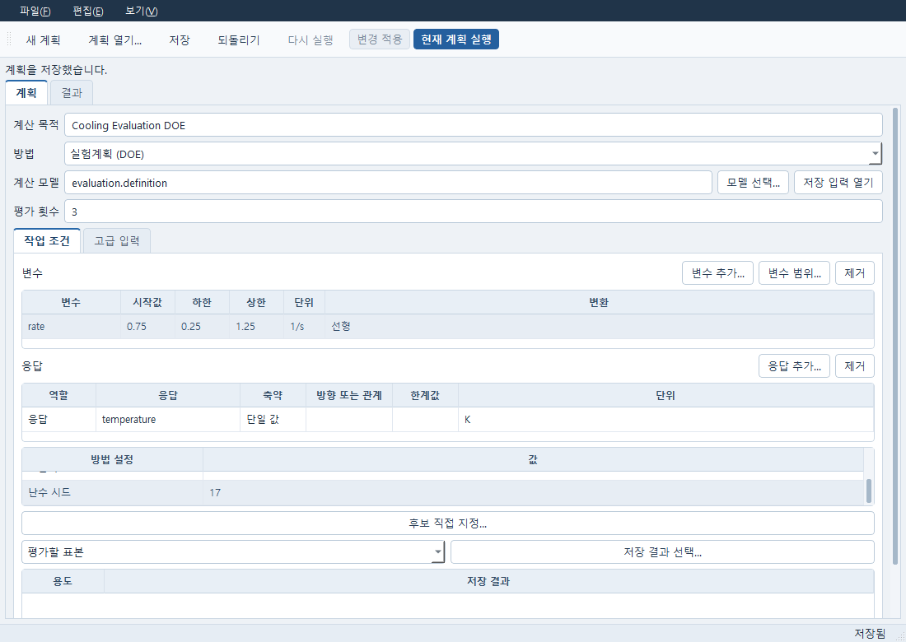
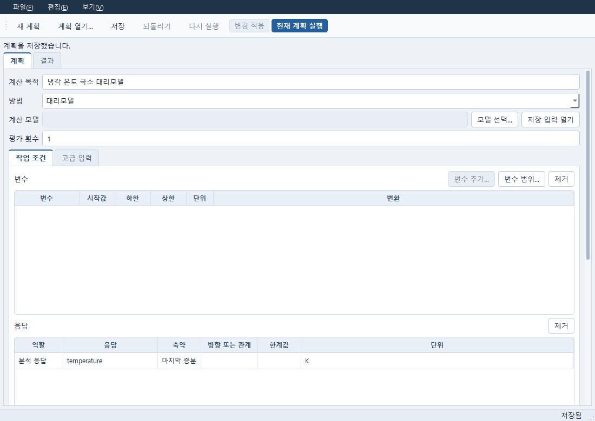
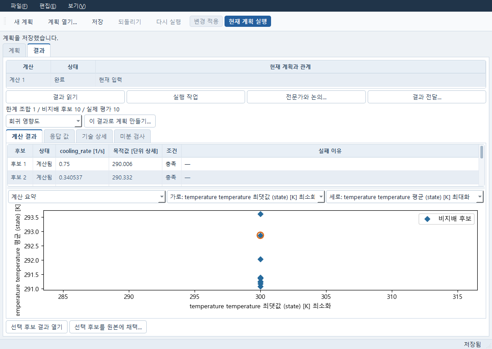
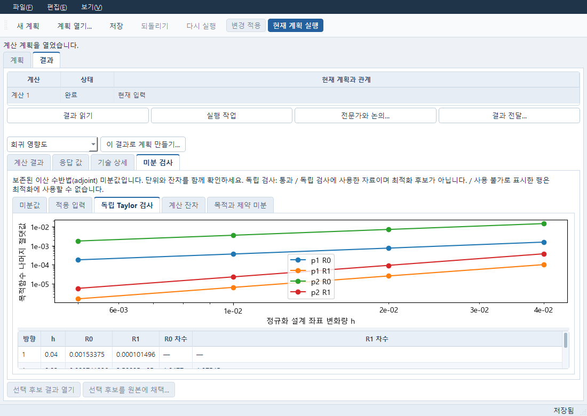
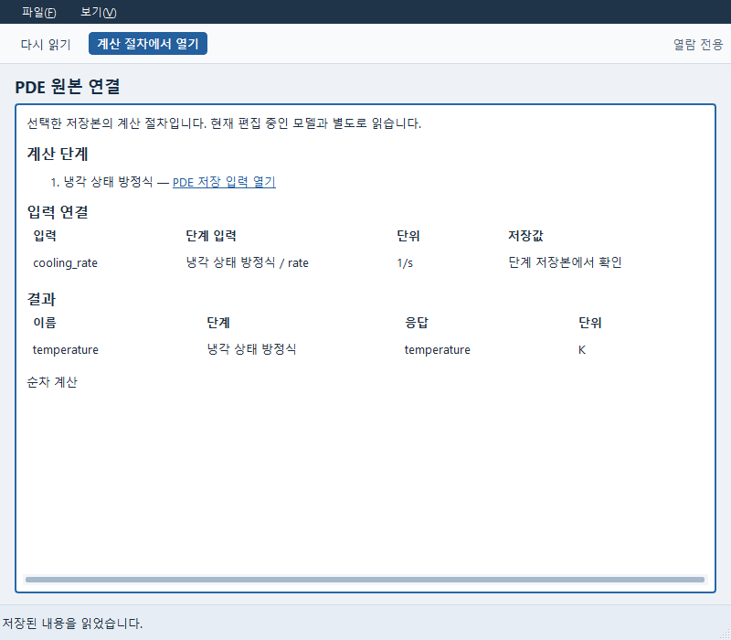
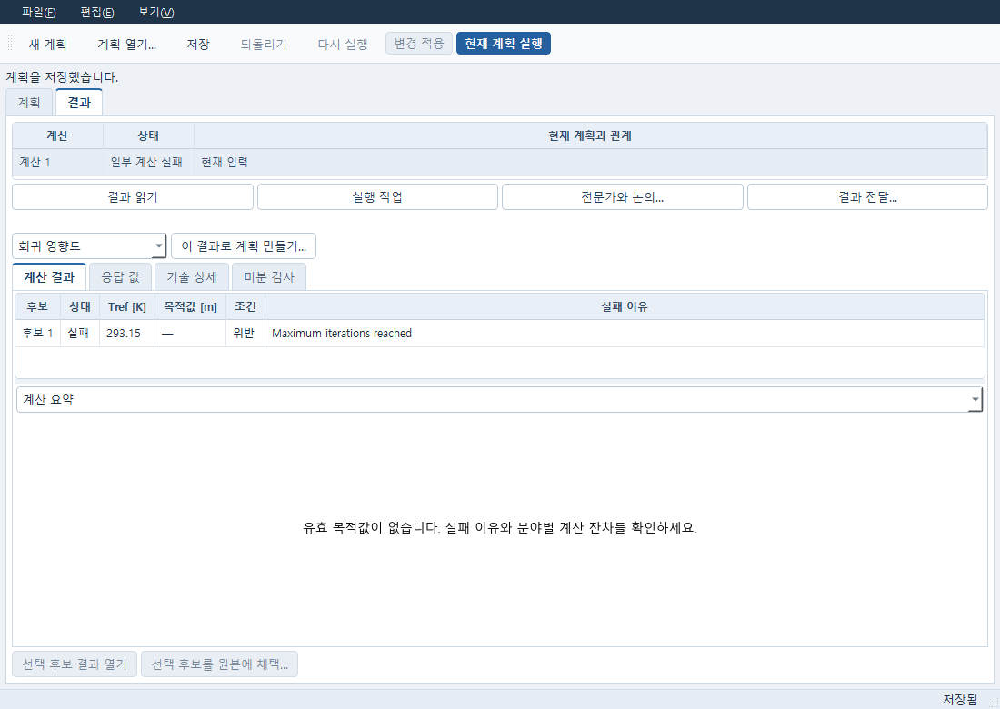

# 저장한 계산 절차로 수치 연구하기

`Start-CAE-Lab.cmd -Tool numerical`로 독립 계산 계획을 엽니다. CAD, AI와
유료 서비스는 필요하지 않습니다. Windows의 기존 SciPy ODE와 scikit-fem P1
평가기를 사용합니다. 필요한 패키지가 없는 선택은 원 오류를 확인하고 수정하세요.
Linux 전용 선택을 Windows에서 실행한 것으로 표시하지 않습니다.

## 저장 입력 선택과 실행

1. **계획**에서 목적과 방법을 정하고 **모델 선택…**으로 저장한 Evaluation을
   고릅니다. **변수 추가…**에서 실제 등록된 입력과 단위를 선택하고 범위를 편집합니다.
2. 응답 선택에서는 실제 보존 실행의 응답을 고릅니다. 목표·제약은 단위와 성분,
   위치, 축약 방법까지 확인합니다. 시간 곡선의 마지막 값과 평균은 다른 목표입니다.
3. 방법 설정과 평가 횟수를 정한 뒤 **변경 적용 → 현재 계획 실행**을 누릅니다.
   변경 적용, 저장, 결과 읽기는 계산을 제출하지 않습니다. 잘못된 초안도 저장하고
   고칠 수 있으며, 실행 오류를 성공 결과로 바꾸지 않습니다.
4. **결과**에서 계산 이력과 실제 후보를 선택합니다. 목적값이 없는 실패 후보는
   표에 남습니다. **선택 후보 결과 열기**에서 분야별 원 입력·잔차·실패를 확인합니다.
5. **저장 입력 열기**는 이 계획에 선택한 정확한 저장본을 엽니다. 원본 편집기에서
   이후 수정한 현재 입력과 구별합니다. **원본 문서 열기**로 현재 편집기로 돌아갑니다.

실행 이력은 제출 당시의 정의를 보존합니다. 원본 수정이나 모델 재선택은 과거 계산을
다시 평가하지 않습니다. 새로운 원본을 사용하려면 새 계획의 모델을 명시적으로 선택하세요.

## 미분법과 반복 계산의 범위

| 작업 | 기존 방법과 확인할 근거 |
|---|---|
| 고정 메시의 정상 선형 P1 열전도, 연속 계수 | **선형 이산 adjoint (SLSQP)**. 허용 profile 확인 후 원문제·수반 잔차, 미분 단위, 두 독립 방향 Taylor 검사를 봅니다. |
| 재료 역해석의 최종 후보 진단 | 기존 ordinary-residual FD. 수정되지 않은 물리 잔차에서 h와 h/2, 방향 일관성을 확인하고 경계에서는 한쪽 차분을 사용합니다. 최적화기가 수정한 Jacobian을 대신 사용하지 않습니다. |
| 비선형·시간·형상·연성 최적화 | 기존 **차분 진화**를 명시적으로 선택합니다. 이 결과에 전체 연성 adjoint가 있는 것으로 표시하지 않습니다. |
| 정수·범주 등 혼합 변수 | 지원되는 탐색 방법을 사용합니다. 미지원 gradient 요청은 거절하며 연속 변수로 조용히 바꾸지 않습니다. |

선형 profile과 원 기준은 [S2 계약](s2_mdo_adjoint/NUMERICAL_CONTRACT.md),
[Windows 선형 결과](s2_mdo_adjoint/WINDOWS_ACCEPTANCE_KO.md)에 있습니다.
FD의 차분 일관성 성공은 통계 신뢰구간이나 전역 유일성의 증거가 아닙니다.

Picard 반복은 저장한 Evaluation의 공유 값·전달·수렴식을 그대로 사용합니다.
`NOT_CONVERGED` 후보는 완료된 단계 출력이 있어도 목적값과 유효 응답에서 제외합니다.
후보 수와 실제 분야 실행 수는 다릅니다. 예산은 각 실제 분야/수반 실행에 소비됩니다.
차분 진화는 기존 최소 집단 5, 최소 세대 1을 요구하므로 명목 평가 예산은 최소 10입니다.
`실패 시 중지`를 지정하면 첫 실패 뒤 새 후보를 실행하지 않습니다.
`MAX_GENERATIONS`는 최적성이나 반복 수렴을 의미하지 않습니다.

## 보존 대리모델과 세 개 이상의 목표

실제 표본을 저장한 뒤 **이 결과로 계획 만들기… → 대리모델 학습**을 선택합니다.
학습 자료와 별도 검증 자료, 동일한 변수·단위·응답 축약을 지정하세요.
국소 RBF는 이웃 수와 학습 자료를 저장합니다. 새 점의 예측은 명시 실행 때만
국소 계수를 계산하며, 보존 예측을 다시 여는 동작은 학습이나 예측을 하지 않습니다.

예측점 한 행을 고르고 **예측점 실제 평가** 계획을 만든 뒤 별도로 실행합니다.
**예측과 실제 비교…**에서 같은 좌표의 두 보존값과 차이를 확인하세요. 예측을 실제
계산으로 채택할 수 없습니다. 저장 모델의 SciPy 버전·입력 의미가 달라지면 오류를
확인하고 새 모델을 명시적으로 만들어야 합니다.

다목적 탐색에서는 세 개 이상의 목표도 전체 차원으로 비지배 후보를 계산합니다.
가로·세로 축 변경은 투영만 바꾸며 Pareto 집합을 다시 계산하지 않습니다.
목표의 응답·축약·위치·단위와 방향을 함께 확인하세요.

실제 후보를 원본에 적용할 때는 **선택 후보를 원본에 채택…**에서 이전 값·후보 값·단위를
검토하고 **확인한 입력 채택**을 누릅니다. 취소하면 원본은 유지됩니다. Evaluation
채택은 변경한 단계의 새 입력 문서를 만들고 원 계산 절차의 참조를 바꿉니다.
이전 단계 원본과 과거 결과는 남고, 채택 자체는 계산을 실행하지 않습니다.

## 이번 Windows 연결 확인

기존 저장 냉각 Evaluation에서 변수 범위 0.25–1.25 1/s, seed 17, DOE 3개를
실제 HTTP/Qt로 선택·실행했습니다. 별도 검증 ODE 2개와 국소 RBF의 명시 실평가
1개를 더 실행했습니다. 0.7 1/s에서 마지막 온도의 예측은 290.00589143964316 K,
실제값은 290.0091188234884 K, 실제−예측은 0.00322738384522836 K였습니다.
이 차이에 새 공학 합격 기준을 부여하지 않습니다.

같은 냉각 곡선의 마지막 값 최소화·평균 최대화·최댓값 최소화로 DE 10개를 실행하고,
전체 3차원 비지배 집합과 투영 변경 불변을 확인했습니다. 서로 독립인 세 물리 목표의
검증으로 확대하지 않습니다. 실제 후보 채택을 취소한 뒤 수락하고 새 PDE 단계와 원본
복귀·저장을 확인했습니다. 별도 Python cold에서 계산/학습/예측 호출과 새 job은 0입니다.

기존 S2 Picard 정의는 Windows에서 직접 한 번 12단계로 실행했습니다.
평균 온도 337.5856696398144 K, 최대 변위 0.0010267525599439555 m였고,
마지막 온도 변화 1.6968812133200117e-7 K는 원 한계
4.4693148847726574e-6 K와 비교했습니다. 최대 반복을 1로 정한 별도 반례는
2단계 뒤 `NOT_CONVERGED`였고 목적값 없음·최선 후보 없음으로 보존했습니다.
[기존 Linux MDO·상태 격리·정확 prefix 재사용 근거](s2_mdo_adjoint/ACCEPTANCE_RESULTS.md)는
재사용하며, Windows 120단계 MDO 전체를 이번에 재실행한 것은 아닙니다.
공학 적합성은 **UNKNOWN**입니다.

실제 입력·결과와 owned-process 정리는 `runs/numerical-evaluation-20261018-03/`,
`-04/`, `-05/`, `-06/`, `-10/`, `-13/`에 연결됩니다. 첫 공통 응답 선택 거절,
0세대 입력 거절, 검사 helper의 옛 key/terminal 오해와 실패-only 차트 오류도 원 폴더에
보존했습니다. 후속 UI/cold 확인은 성공한 물리 계산을 반복하지 않았습니다.

공유 입력을 채택하면 연결된 각 단계의 새 저장 입력과 공유 초기값을 함께 보존합니다.
후보에 없는 공유 입력은 원 저장 초기값을 사용합니다. 이 채택 경계는 두 대상이 있는
통제된 보존 후보로 확인했으며, 새로운 공유 변수 FE 탐색을 실행한 근거는 아닙니다.

## 실제 화면

