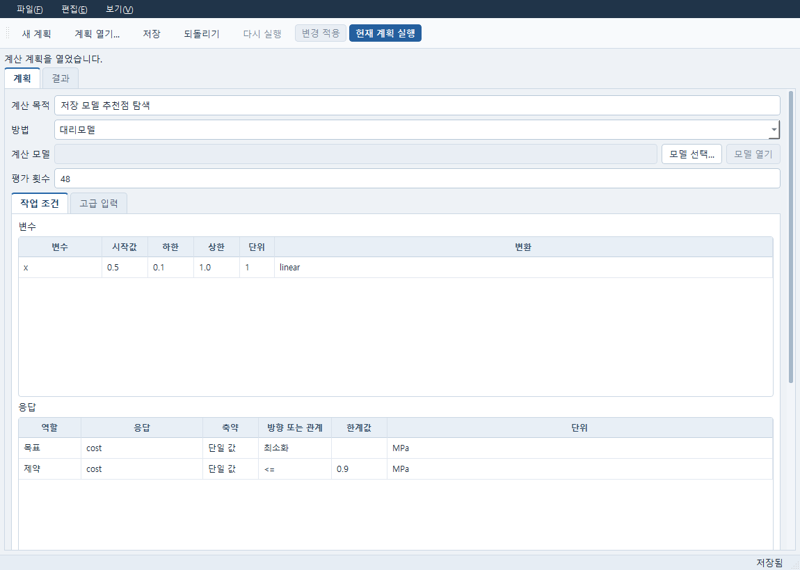
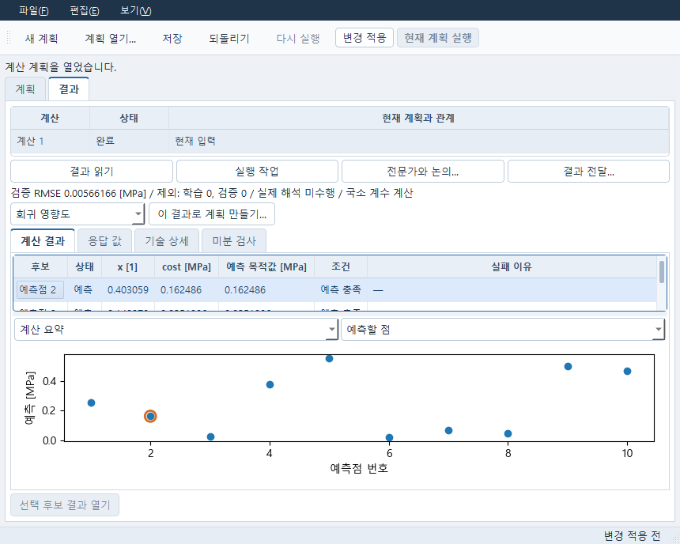

# 결합분포, Sobol 비교와 저장 대리모델

Numerical의 **파일 → 일반 수치 계획…**에서 시작합니다. 계산할 모델이 필요한
방법에서는 저장한 Material, PDE, Simulation 또는 Evaluation을 선택하고 변수와
응답의 단위를 확인하세요. 파일을 열거나 과거 결과를 읽는 동작은 새 계산을 하지 않습니다.
실행하려면 변경을 적용한 뒤 **현재 계획 실행**을 눌러야 합니다.

## 변수 사이의 상관이나 공분산을 지정하기

1. 방법을 불확실성 분석으로 바꾸고 변수 범위, 주변분포, 표본 수와 분포 근거를
   입력합니다. 범위나 물리적 분포를 모르면 임의 값으로 채우지 말고 미지정 상태로 둡니다.
2. **분포와 상관…**의 결합 가정에서 사용할 관계를 고릅니다.
   **다변량 정규분포 공분산**은 물리 정규분포만 지원합니다. 행과 열의 변수 순서대로
   공분산을 입력하세요. 예를 들어 MPa와 mm 변수 사이의 공분산 단위는 MPa×mm이며,
   대각값은 각 변수의 표준편차 제곱입니다. **Gaussian copula**에는 무차원 잠재 정규
   상관을 입력합니다. 이는 변환한 물리 변수의 Pearson 상관과 다릅니다.
3. 확인 후 적용하고 실행합니다. 행렬의 순서·대칭·양의 준정부호·단위나 분산이 맞지
   않으면 평가 전에 중단합니다. 범위를 벗어난 분포 꼬리를 잘라서 실행하지 않습니다.
   범위를 넓히거나 적절한 유계 주변분포를 명시적으로 선택하세요.
4. 결과의 분포 창에서 응답과 구간을 고르면 해당 원표본 행과 막대가 함께 선택됩니다.
   전체, 유효, 실패 수를 확인하세요. 평균·분위수와 유효 표본 초과율은 성공한 평가에
   조건부인 값입니다. 전체 표본 초과율은 실패값을 모르므로 하한~상한으로 표시합니다.

저장하면 원 결합 선언, 단위, 표본 순서와 실패 행이 함께 남습니다. 다시 열어도
분포를 다시 추출하거나 평가하지 않습니다. 결합분포는 사용자가 선언한 가정이며
측정된 실제 분포나 공학 승인으로 바뀌지 않습니다.

## 같은 Sobol 설계 계열의 N/2N 비교

1. Sobol 표본 계획에서 변수 순서·단위·범위, 난수 시드, 2차 효과 포함 여부를 정하고
   기본 표본 수 N을 입력합니다. 실제 평가 예산은 N×(변수 수+2), 2차 효과 포함 시
   N×(2×변수 수+2)를 충족해야 합니다.
2. 저장한 표본 결과에서 **Sobol 표본 평가** 계획을 만들고 실제 모델로 평가합니다.
   그 결과에서 **Sobol 분석** 계획을 만들고 사용할 응답을 선택해 실행·저장합니다.
3. 같은 조건으로 기본 표본 수만 2N으로 늘린 별도 표본·평가·분석을 저장합니다.
4. N 분석에서 **Sobol N/2N 비교** 계획을 만들고 **저장 결과 선택…**으로
   `기준 N 분석`과 `확장 2N 분석`을 연결합니다. 비교를 실행하면 보존된 지수와
   신뢰구간 반폭, 차이가 나옵니다. **Sobol 수렴 비교 보기…**에서 표를 엽니다.

비교 자체는 새 표본·해석·지수 계산을 하지 않습니다. 누락되거나 재정렬된 표본,
다른 응답·단위·범위·시드, 같은 크기의 두 분석은 비교할 수 없습니다. 원 설계 식별이
보존되지 않은 과거 분석은 소급 재계산하지 않으므로 새 비교에 사용할 수 없습니다.
실제 평가기·고정 설정·원 모델이 다르거나 정확한 실제 DOE 조건이 보존되지 않은
과거 분석도 N/2N 비교는 차단합니다. 단독 열기와 분석은 유지됩니다.
미정 지수는 빈 값으로 유지됩니다. 유한한 N/2N 차이만으로 수렴을 보증하지 않습니다.

## 국소 RBF를 저장하고 새 점 예측하기

1. 실제 평가한 학습 자료와 별도 검증 자료를 각각 저장합니다. 같은 점이 두 자료에
   겹치거나 학습점이 중복되면 학습을 거절합니다.
2. **대리모델 학습** 계획에서 두 자료와 응답을 선택합니다. `이웃 수`에서
   `전역`을 선택하거나, 필요한 이웃 수를 입력해 국소 모델을 명시적으로 선택합니다.
3. 실행 결과의 검증 오차와 지원영역을 확인하고 계획을 저장합니다. 국소 모델은
   학습 좌표·응답·이웃 규칙과 설정을 숫자 형식으로 보관합니다.
4. 저장 결과에서 **저장 모델로 예측** 계획을 만들고 **예측할 점…**에서 새 좌표를
   입력해 실행합니다. 국소 모델은 이때 새 점의 국소 계수를 계산하며 결과에도 이를
   표시합니다. 지원영역 밖 예측은 별도로 표시됩니다.

저장한 모델과 기존 예측을 다른 위치에서 열 때는 재학습·예측·물리 계산을 하지 않습니다.
모델 복원은 저장 당시와 같은 SciPy 버전을 요구합니다. 버전이나 숫자 archive가 맞지
않으면 오류를 확인하고 호환되는 환경에서 원 저장 자료를 여세요. 조용히 재학습하지 않습니다.

## 저장 모델로 추천점을 찾고 실제 계산으로 확인하기

공개 합성 자료로 만든 계획의 실제 Qt 화면입니다. 변수 범위와 목표·제약을 기존 표에서
고칩니다. 사진의 `cost`는 예제 응답 이름이며 사용자의 실제 물리량을 뜻하지 않습니다.

1. 보존 모델이 있는 결과에서 **저장 모델로 추천점 찾기** 계획을 만듭니다.
2. 기존 표에서 변수 범위, 목표 방향과 제약 한계값을 편집합니다.
   **저장 모델 예측 탐색…**에서는 제약을 추가·삭제하고 탐색 세대·집단 크기·시드를
   바꿀 수 있습니다. 취소하면 원 편집을 유지합니다. 추천점 탐색은 기존 차분 진화와
   저장 예측기만 사용합니다.
3. 다른 저장 모델을 쓰려면 용도를 `저장 모델`로 고른 뒤 **저장 결과 선택…**을
   누릅니다. 현재 범위·목표·제약은 자동으로 새 의미에 맞춰 덮어쓰지 않습니다.
   변수 순서·단위·변환·응답의 물리적 의미가 다르면 실행을 거절합니다.
4. 실행·저장 후 결과 표에서 예측점 한 행을 고르고 **예측점 실제 평가** 계획을
   만듭니다. 확인 대화상자에서 원 학습 자료의 실제 평가기를 확인하세요. 새 계획을
   실행해야 실제 계산이 일어납니다. **예측과 실제 비교…**는 같은 좌표의 두 보존값을
   읽어 차이를 보여 줍니다.

예측 목적값과 예측 제약 충족은 실제 평가 결과가 아닙니다. 학습 지원영역 밖 표시,
실패와 중단 기록을 보존하며 예측값은 실제 결과 채택 관문을 통과하지 못합니다.
실제 확인의 평가기·고정 설정·변수 단위나 원 모델이 달라지면 같은 모델의 확인으로
비교할 수 없습니다. 새 확인 결과를 저장하고 다시 열어 원 예측과 비교하세요.

사진은 공개 합성 자료의 저장된 예측 후보를 읽은 실제 창입니다. **예측**과
**예측 충족**은 대리모델의 판단입니다. 선택한 후보를 실제 계산으로 확인하는 동작은
위 순서의 **예측점 실제 평가**에서 별도로 시작합니다.

이 안내는 결합 UQ, 설계별 Sobol 비교, 국소 모델 보관과 저장 모델 추천 흐름을 다룹니다.
전체 Numerical의 모든 최적화·MDO·미분 방법이나 모든 물리 평가기 조합의 검증 완료를
뜻하지 않습니다. 독립 실행의 기본 사용법은 [Numerical 사용 안내](USER_GUIDE_KO.md)를
함께 보세요.
