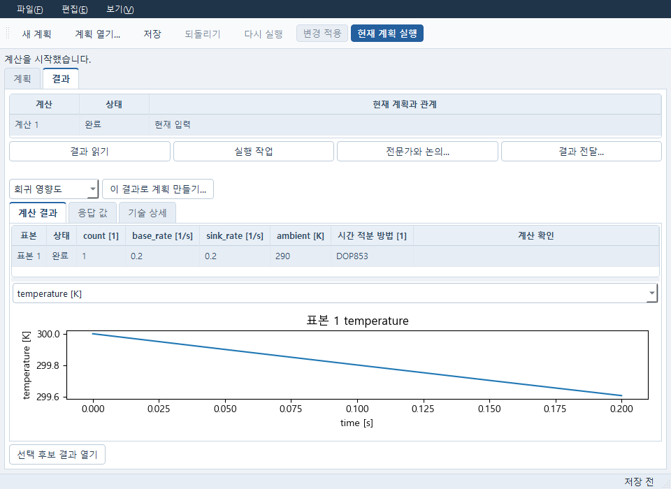
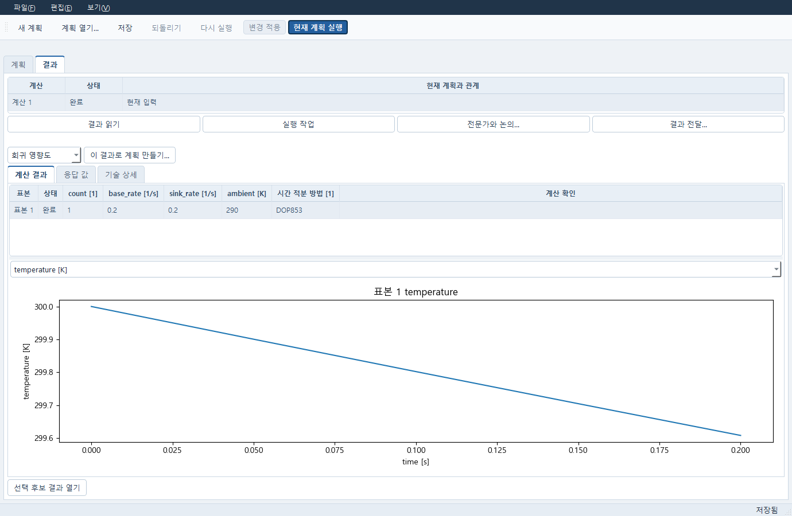

# 혼합 변수 Plan 편집과 보존 표본 선택

기존 계산 계획 창에 혼합 변수 편집과 원 계산 결과 선택을 연결했다. 핵심 계산은
실제 Pro가 작성한 기존 엔진을 사용한다. 편집·명시 적용·저장·새 세션 재열기와
정상·좁은 창을 확인했다. 아래에서 확인한 범위와 남은 범위를 구분한다.

## 사용하는 순서

1. 계산 계획에서 모델과 입력을 고르고, 사용할 모델 변수를 추가한다.
2. `변수 범위…`를 열어 연속값·정수·이산값·범주와 탐색·고정·종속식 중 필요한 방식을 정한다.
3. 하한·상한, 실제 선택값 또는 종속식을 편집하고 `입력 확인`을 누른다. 오류가 있으면 해당 행과 식의 위치가 선택된다.
4. `초안에 적용`으로 돌아온 뒤 계획의 `변경 적용`과 `저장`을 명시적으로 실행한다. 취소는 원 계획을 바꾸지 않는다.
5. 지원되는 DOE 또는 DE에서 `현재 계획 실행`을 누른다. 결과에서 표본을 선택하면 그 표본의 원 입력값과 보존된 응답 곡선을 본다.

위 화면은 공개 ODE 예제를 실제 한 번 계산한 결과다. 정수·이산값·고정값·종속식과
시간 적분법 선택을 함께 사용했다. 계산 예제이며 장비나 재료의 적합 판정은 아니다.

미완성 입력도 초안으로 보관할 수 있다. 입력 검사에 실패하거나 선택한 방법이 변수 종류를
지원하지 않으면 계산은 시작되지 않는다. 범주는 화면 순번 대신 선택한 실제 값으로 저장된다.

## 연결과 지원 범위

`numerical_mixed_variables.MixedVariablesDialog(variables, descriptors, parent,
operation='doe')`는 기존 PlanTable과 worksheet delegate를 사용한다. 변수 종류는
연속/정수/이산값/범주, 용도는 탐색/고정/종속식이다. 실제 descriptor의 표시명과
범주 선택지의 원 id/label/value·순서를 보존한다. 선택지 순서는 위/아래로 편집하고
계산기에 전달하는 값은 선택지 번호가 아닌 실제 문자열이다. 이산값은 별도 값 표에서
편집한다. 종속식의 계산 결과는 GUI가 다시 계산하지 않는다.

`입력 확인`은 Pro의 `variable_schema`/`normalize`/`admit_domains`/`capability`만
호출한다. 단위·선택지·의존 오류의 원 진단은 tooltip에 있고 알려진 원인은 한국어로
표시한다. Core가 제공한 path/line/column으로 오류 행과 식의 위치를 선택한다.
`초안에 적용`은 유효하지 않은 원문도 그대로 부모에게 돌려준다. 이는 계산 허용이
아니며 실제 owner의 기존 검증/실행 관문이 유지된다. 취소는 caller 입력을 바꾸지 않는다.
로컬 실행 취소/다시 실행은 이 대화상자의 도메인 초안만 대상으로 한다.
생략한 시작값은 공개 normalize의 정적 기본값을 표시하되 원 초안에는 필드를 넣지 않는다.
수정/실행 취소 뒤 오래된 오류 안내는 지운다. 읽기·선택·저장은 종속식을 계산하지 않는다.

`numerical_mixed_plan`은 기존 계획 창에 연결된 전용 함수다. `domain_button`은 기존 변수
명령 행에 넣고, `open_domain_editor`는 기존 readonly `Client.describe_inputs`를
사용한다. 승인한 document/session/generation과 전체 로컬 초안이 같을 때만
`_edit_structure`로 검토한 변수 목록을 반영한다. 자동 owner 적용·저장·실행은 없다.
`refresh_variable_sheet`는 기존 표의 범주 시작값을 정확한 문자열 콤보로, 종속
시작값을 읽기 전용으로 표시한다. `limit_unsupported_execution`은 기존 action 정책
뒤에서 지원 없는 계산만 막으며 다른 관문이 막은 Run을 다시 켜지 않는다.
기존 모델 변수 선택기도 같은 공개 descriptor를 사용한다. 수치/범주를 함께 선택하고
변수 표시명·단위·원 현재값·실제 선언 범위를 보여주며 원 ID는 tooltip에 둔다.

`numerical_mixed_results.RetainedMixedSelection(table, response_combo)`는 기존
후보 표와 응답 선택기를 소비한다. `set_result(result, exact_source)`는 공개
`validate_retained_table`로 보존 캡슐을 검사하고, 선택마다 동일 후보 ID/원 입력/
실제 응답/원 source를 deep copy로 돌려준다. 보존 결과를 읽는 동안 resolve,
표본 생성, solver/JobManager는 호출하지 않는다. 정수는 int, 범주는 실제 문자열이며
표시는 범주 label이다. 실패·종속값 제외·없는 응답은 0이나 성공으로 바꾸지 않는다.
새 원본이나 검증 실패는 이전 선택을 해제한다. 기존 shared handler의 후보 선택은
첫 열의 표시 순번 대신 `Qt.UserRole`의 정확 ID를 사용한다.
계산 요약과 선택 표본의 실제 응답을 모두 유지한다. 같은 결과를 다시 읽어도 선택
receipt를 새로 발행하지 않으며 다른 결과/원본에서는 선택을 해제한다. legacy 결과로
돌아가면 mixed consumer는 기존 응답 선택기에 개입하지 않는다. 크기를 줄일 때 선택
행을 보이게 스크롤하고, 그래프의 단위 축은 기존 Matplotlib layout으로 다시 맞춘다.
ODE 표시명은 해당 실행의 동결 입력을 공개 describe_inputs로 읽는다. 실시간 모델이나
새 evaluator는 읽지 않는다.

`numerical_variable_display.refresh_frozen_material_display`는 기존 계수 표의
탐색 bool을 체크박스로 그리고 실제 셀의 true/false·저장 bool을 보존한다. 키보드
Space와 체크박스 클릭만 값을 바꾸며 다른 창을 수정하지 않는다. 변수 이름은 Plan에
동결된 Material의 공개 descriptor에서 읽고 실제 모델명은 기존 Material 선택기의
선형 탄성/Neo-Hooke 표시를 사용한다. 단위/숫자/탐색/좌표 열을 기존 왼쪽 패널에
맞추며 선형/로그의 원 토큰은 바꾸지 않는다. Material embedded fit 표나 Data C01
raw capsule/owner API는 확장하지 않는다. mixed fit/LS/UQ/Sobol/RBF 지원을 주장하지 않는다.

Windows 유지 런타임의 영향 검사는 편집·오류·키보드·선택·늦은 응답 19개다. 큰
Core 회귀/solver 캠페인은 반복하지 않았다. 초기 17개와 메타데이터 별도 8개는 4.23초,
이후 변경한 poll/transport 3개는 0.61초, 실제 선택기 회귀 1개는 별도로 통과했다.
공개 ODE descriptor를 읽은 실제 선택기에서 Ctrl 선택과 정상/좁은 창도 확인했다.

통합 전 같은 소스와 공유 연결을 조합한 검사에서는 실제 Workbench 문서를 열어 변수 범위 검토→
로컬 초안 반영→명시 적용→저장→controller 종료→다른 세션 재열기를 확인했다.
입력 변경 전후 Run 활성 상태, 새 입력값/정수 종류/종속식/선택지 보존도 확인했다.
같은 과정에서 새 Job 제출을 예외로 막았다. GUI가 실제 새 계산을 시작한 수용은 아니다.

표본/곡선 선택은 실제 Pro가 앞서 생성한 Linux ODE24 결과의 원 bytes를 Windows에서
읽었다. 전용 결과 위젯과 공유 계획 창에서 같은 후보/실제 곡선, int/실제 범주 문자열,
같은 결과 재읽기 시 선택 유지, 정상 1380×900/좁은 960×700을 확인했다. 공유 창의
run 행은 이 원 결과를 투영하기 위한 명시적 view-only fixture다. 이번 새 계획이 그
24개를 계산하거나 저장했다는 근거가 아니며 원 결과와 source를 다시 쓰지 않는다.

로컬 자료는 `_workspace/delivery-numerical-pde/mixed-gui/`에 있다. `composed-process-03`
및 `native-05`가 owner 적용·저장·재열기, `visible-result-process-03` 및
`visible-result-03`이 최종 보이는 결과 탭, `picker-process-03`/`picker-03`이 선택기다.
기존 controller를 닫지 않은 driver 실패, fixture의 input_generation 누락, 선택기
import 및 driver method binding 실패 원본은 각 이전 process 폴더에 보존했다.
모든 native check는 정확히 자기 Windows Job을 종료했고 최종 결과는 exit0/job_empty다.
실제 MoAI ast-grep Python 규칙은 전용 4모듈에서 발견 항목 0이며 전체 검토를 대신하지 않는다.

전용 네 모듈과 기존 Numerical/계산 계획 창 두 곳의 연결을 함께 통합했다.
기존 저장·원문 복구·후보 채택과 다른 팀의 공통 변경을 유지한다. 핵심 계산 엔진이나
공통 스키마를 GUI에서 다시 작성하지 않았다.

독립 읽기 후 반복 갱신의 delegate 3개를 재사용하도록 보완했다. 최초1/2개가 21회
갱신 뒤 21/42개로 늘던 원인을 제거했고, 해당 수량·동일 인스턴스·표시명 변경 1개만
0.77초 확인했다. 렌더와 owner 흐름은 다시 실행하지 않았다. 긴 descriptor 이름과
긴 복합 단위의 별도 native 화면은 미검증이다. composed 결과 JSON의 owner_writes:0와
복사한 하네스의 owner/solver0 문구는 잔여 기록이므로 전체 owner 흐름의 주장에 쓰지
않는다. 실제 numerical.update/document.save는 쓰기를 했으며, 새 Job/solver0 및
편집 대화상자·결과 읽기의 무쓰기를 구분한다. 원 로그/JSON은 고치지 않았다.

## 실제 새 계산과 재열기

별도 Windows Qt 창의 `현재 계획 실행`으로 기존 HTTP·문서 owner·JobManager를 거쳐
공개 ODE의 DOE 한 표본을 실제 계산했다. 정수 count=1, 이산 base_rate=0.2/s,
종속 sink_rate=0.2/s, 고정 ambient=290K와 DOP853 선택을 사용했고, 0–0.2초의
다섯 시각 결과를 같은 표본의 원 곡선으로 표시했다. 창의 저장 요청은 실제 반영됐다.
초기 검사 driver의 20초 대기는 HTTP 저장 완료보다 먼저 끝나 실패했으므로 원 실패는
보존했다. 같은 저장소의 완료된 저장 명령을 확인한 뒤 새 Python·HTTP 서비스·owner에서
같은 저장 초안과 결과를 다시 읽었다. 두 번째 계산은 실행하지 않았다.

자료: 담당 작업트리의 `_workspace/delivery-numerical-pde/mixed-gui/actual-typed-01/`,
`actual-cold-01/` 및 각 process 기록. 실제 계산은 한 Job·한 모델 호출이며 재열기는
새 Job 0회다. 확인한 두 창 크기에서 원 표본·값·곡선은 같았고 각 Windows Job이
종료됐다. 이산·범주 피팅/최소제곱/UQ/Sobol/전역 RBF, 긴 이름·복합단위 전용 화면,
전체 FN20·물리 qualification은 이번 동선으로 완료 처리하지 않는다.
