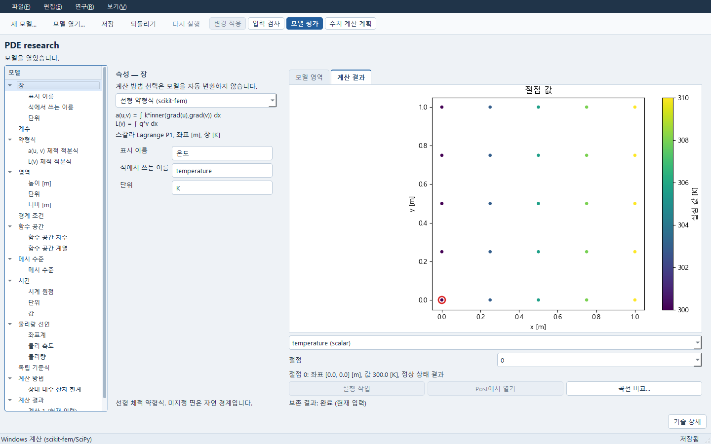

# Windows PDE 작업 흐름

PDE는 CAD나 AI 연결 없이 로컬 서비스의 같은 문서를 편집하고 계산합니다.
Windows에는 기존 SciPy 초기값 ODE와 scikit-fem의 직사각형 P1 열전도·선형
스칼라 약형식·등방 소변형 평면응력 열탄성 경로가 있습니다. 이 안내에서는 ODE와
명시 스칼라 약형식의 정상 열전도 두 작업을 확인합니다. 두 작업은 기존 엔진을 사용하며
서비스와 PDE 창을 같은 Python 환경에서 실행합니다.

## 열고 편집하기

NumPy 2.3.5, SciPy 1.17.0, scikit-fem 12.0.2와 PySide6가 설치된 프로젝트
환경에서 서비스와 창을 각각 실행합니다. 이미 실행한 서비스가 있으면 그 주소를
사용합니다. 같은 저장소를 두 서비스가 동시에 열지 않습니다.

```powershell
python -m apps.lab --store runs/my-pde --port 18767
python -m apps.research.pde_window --service http://127.0.0.1:18767
```

1. **파일 → 새 모델…**에서 **상태 방정식 (단위가 있는 ODE)** 또는
   **Windows 공간 약형식 (scikit-fem / 실제 SI 온도)**를 선택합니다.
2. 왼쪽 모델 트리에서 식·계수·단위·경계 조건·초기 조건을 선택해 편집합니다.
   계산 방법 목록을 바꾸는 것만으로 기존 입력이 다른 모델로 변환되지는 않습니다.
3. **입력 검사**는 식 문법·차원·선언을 검사합니다. 계산을 실행하지 않습니다.
   오류가 있으면 해당 입력으로 이동합니다. 잘못된 초안도 **저장**할 수 있지만
   **모델 평가**는 사용할 수 없습니다.
4. **변경 적용** 후 **모델 평가**를 눌러 명시적으로 실행합니다.
   실행할 때마다 별도 계산이 남습니다. 결과를 열거나 저장해도 재계산하지 않습니다.
5. **계산 결과**에서 보존한 계산을 선택합니다. 수정 전 결과는 그 입력 관계를
   표시합니다. **저장** 후 같은 서비스에서 **모델 열기…**로 문서를 다시 열거나,
   서비스를 종료한 뒤 같은 `--store`로 다시 시작해 엽니다.

단위는 지원하는 SI 식으로 선언합니다. `K`, `s`, `m`, `1/s`, `W/(m*K)`,
`W/m**3` 등을 사용합니다. 임의 Python 실행은 지원하지 않습니다.
열기·닫기에서 **취소**를 선택하면 현재 편집 내용과 선택한 보존 결과가 남습니다.

## ODE: 냉각 초기값 문제

상태 `temperature`의 단위는 `K`, 초기값은 `305`로 설정합니다.
미분식은 `-rate*(temperature-ambient)`, 계수는 다음과 같습니다.

| 이름 | 값 | 단위 |
|---|---:|---|
| rate | 0.75 | 1/s |
| ambient | 290 | K |
| initial | 305 | K |

독립 기준식은 `ambient+(initial-ambient)*exp(-rate*t)`입니다.
시간은 0–10 s, 출력 수 101, RK45, 상대 허용값 `1e-7`, 상태 절대 허용값
`1e-7 K`, 최대 시간 간격 `0.25 s`를 사용합니다. 기준식의 `initial` 계수와
상태 초기값은 별도 입력이므로 둘을 함께 수정합니다.

결과 목록에서 실제 상태, 사용자 기준식, 실제 값에서 기준식을 뺀 오차를
선택할 수 있습니다. 결과 옆 **적분 잔차: 솔버가 보고하지 않음**은
`NOT_REPORTED_BY_SOLVER` 원기록입니다. 기준식 오차를 적분 잔차로 바꾸지 않습니다.
취소된 계산은 SciPy가 수락한 단계의 출력 시각과 상태를 보존하며, 시험 RHS 호출을
수락된 해로 기록하지 않습니다. 사건·대수 구속식·공간장은 이 ODE 범위에 없습니다.

## P1: 제조해를 가진 정상 열전도

직사각형 너비·높이를 각각 `1 m`, 장을 `temperature [K]`로 둡니다.
계수는 `k=200 W/(m*K)`, `q=1000 W/m**3`, `left_value=300 K`,
`right_value=310 K`, `length=1 m`입니다.

```text
a(u,v): k*inner(grad(u),grad(v))
L(v):   q*v
reference: left_value+(right_value-left_value)*x/length+q*x*(length-x)/(2*k)
```

왼쪽·오른쪽은 각각 `left_value`, `right_value`의 Dirichlet 경계입니다.
명시하지 않은 위·아래는 자연 경계입니다. 한 축 셀 수는 `[2,4]`, 상대 대수
잔차 한계는 기존 `1e-9`를 사용합니다.

실제 장이 있으면 **계산 결과**는 온도장을 먼저 표시합니다. 절점을 선택하면
좌표 `[m]`, 온도 `[K]`, 정상 상태 시각 의미를 확인할 수 있습니다.
같은 결과를 다시 읽으면 유효한 장·절점 또는 사용자가 고른 스칼라를 유지합니다.
다른 계산을 열면 그 계산의 장을 표시합니다. 잔차와 오차 스칼라는 결과 목록에 남습니다.



[좁은 창의 같은 온도장](images/desktop-recovery/pde-narrow.png)과
[ODE 기준식·실제 해·잔차 미보고 표시](images/desktop-recovery/pde-ode.png)도 확인했습니다.

**연구 → 메시와 오차 비교…**는 해당 계산이 기록한 메시별 자유도·잔차·오차를
읽습니다. scikit-fem의 `dofs`와 FEniCSx의 `global_dofs`는 같은 자유도 열에
표시하며, 값이 없으면 **미제공**으로 남기고 해당 점을 그리지 않습니다.
행 또는 그래프 점을 선택하면 같은 원기록을 확인합니다.

- L2 오차: `sqrt(integral((uh-uref)^2 dA))`, 단위 `K*m`.
- H1 반노름 오차: `sqrt(integral(|grad(uh-uref)|^2 dA))`, 단위 `K`.
- 상대 대수 잔차: `L2(A_II*u_I-b_condensed)/L2(b_condensed)`.
  분모가 0이면 원래의 절대 L2 잔차를 사용합니다.
- 적분 차수는 8입니다. 사용자 기준식과 적분한 오차이며 모든 식의 해석적 정확
  적분을 주장하지 않습니다. 그래프 아래에 보존한 정의와 기준식을 표시합니다.

이 예의 실제 Windows 관측값은 자유도 9/25, 상대 잔차 0/
`5.478215025182044e-16`, L2 `0.11410886614691797`/
`0.028527216536732715 K*m`, H1 `0.7216878364870319`/
`0.3608439182435163 K`입니다. 이는 해당 제조해와 입력의 실행 기록이며
물리·설계 적합성은 `UNKNOWN`, 출하는 `NOT_RELEASED`입니다.

## 지원 범위와 재현 검사

이 안내의 P1 차원 약형식은 스칼라·선형·직사각형과 허용된 식에 한정합니다.
FEniCSx 차원 약형식 및 확장 공간 모델은 설치된 Linux 서비스가 필요한 별도
어댑터입니다. Windows 서비스에서도 그 초안의 편집·저장·보존 결과 읽기는
가능하지만 해당 계산은 플랫폼 안내와 함께 차단합니다.
상세 식 규칙은 [차원 ODE와 약형식](RESEARCH_003.md),
Linux 공간 모델의 원 범위·검증 기준은 [기능별 검증 매뉴얼](VERIFICATION_SCOPE.md#pde·simulation·evaluation와-장-전달)과
[공간장 명세](PDE_RESEARCH_FIELDS_PACKET.md)를 참고합니다.
이 Windows 작업 흐름은 Linux 실행이나 PDE 앱 전체의 인수를 뜻하지 않습니다.

개발용 절차·기준·재현 명령과 실행 기록은 [기능별 검증 매뉴얼](VERIFICATION_SCOPE.md#pde·simulation·evaluation와-장-전달)에 모았습니다. 일반 사용에는 검사 스크립트 실행이 필요하지 않습니다.
