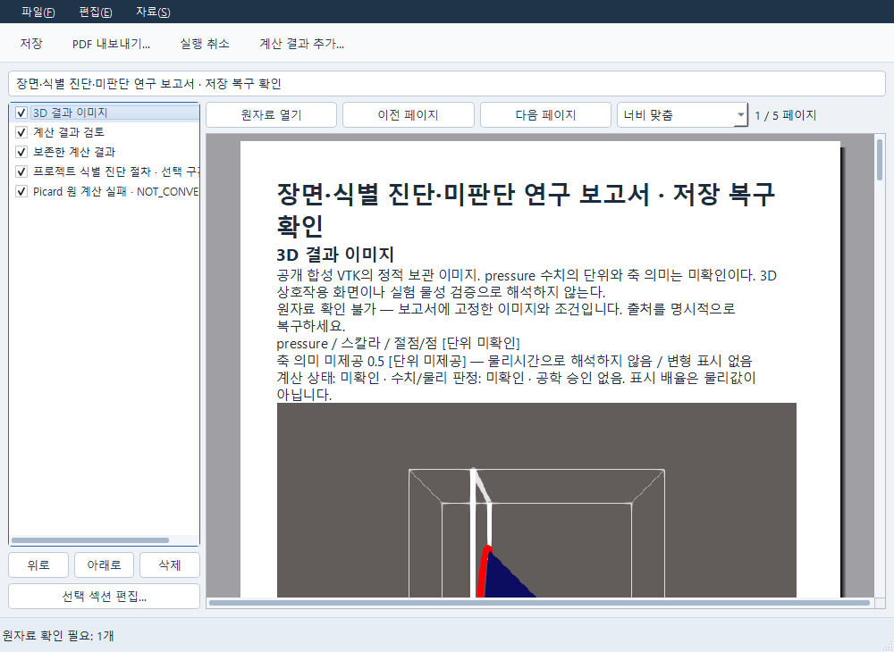
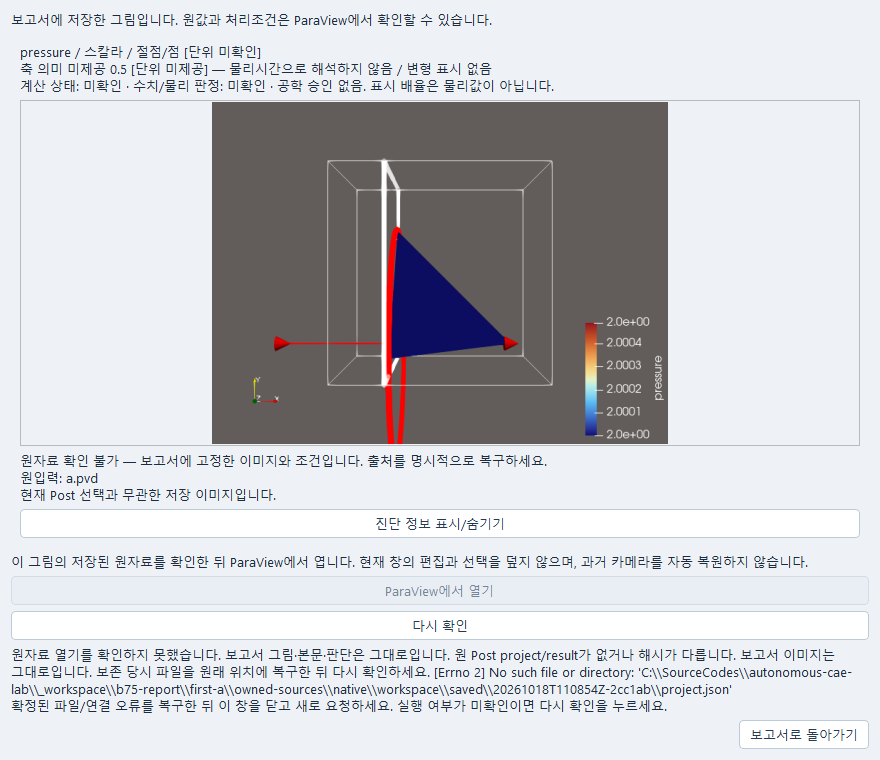
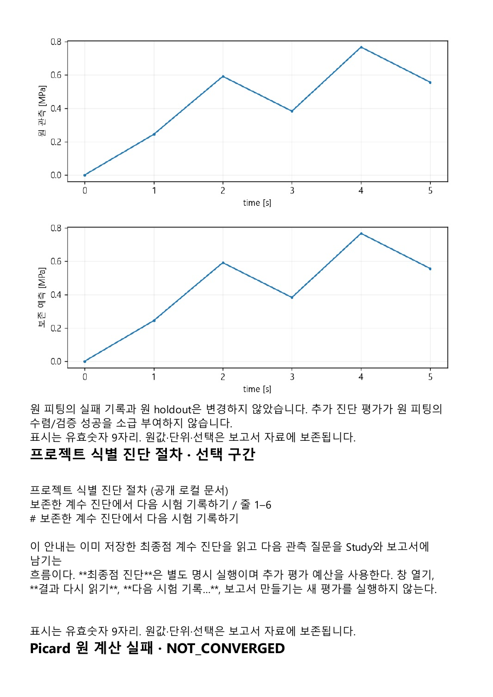
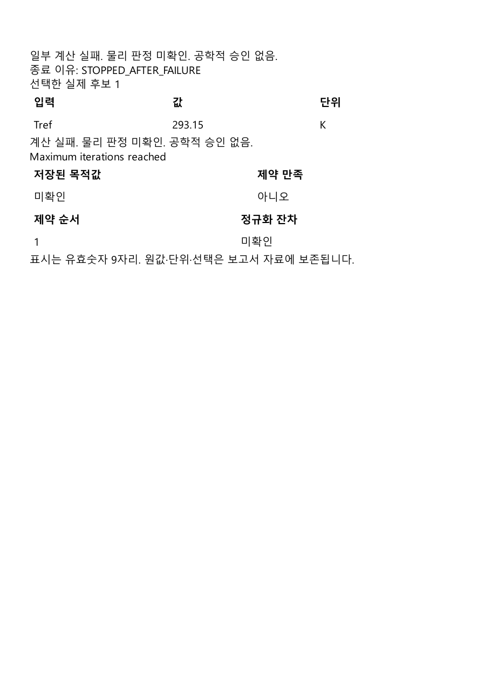

# 장면·연구·원자료를 한 보고서에 보관하기

Report는 저장한 그림과 선택한 원값·판단을 함께 편집하는 독립 창이다. 그림은 정적 PNG이며, 계산이나 공학적 승인을 실행하지 않는다. Data·Numerical·Study·문헌의 원자료는 각각의 정확한 저장 버전으로 고정된다.

## 작업 순서

1. Post에서 결과와 처리조건을 확인하고 적용·저장한다. 필드·성분·프레임·색 범위·변형 표시 배율을 정한다. 단위나 축 의미가 미확인이면 그 표시를 유지한다.
2. Report의 **자료 → 3D 결과 이미지 추가…**에서 대상 결과를 명시적으로 선택한다. **선택한 결과 캡처**를 누른 뒤 그림과 조건을 읽고 **이 이미지 적용**을 누른다. 취소하면 보고서 구성은 바뀌지 않는다. 전송 결과를 확인하지 못하면 **같은 요청 상태 확인**으로 원 요청을 확인한다.
3. Study에서 근거를 읽고 판단을 직접 작성·저장한다. 미판단 상태를 결론이나 승인으로 바꾸지 않는다. 문헌은 실제 읽은 구간과 개정·해시를 고정한다.
4. Report의 **자료 → 저장된 연구 추가…**로 연구를 선택한다. 기존 장면과 본문 뒤에 연구 본문·근거가 추가된다. 추가 전체를 실행 취소하거나 다시 실행할 수 있다. **저장된 연구 적용…**은 기존 섹션을 교체하는 별도 동작이다.
5. **계산 결과 추가…**에서 정확한 저장 계산과 후보·응답·구간을 선택한다. 실패 결과는 실패 이유와 미확인 수치 그대로 보관한다. **문헌 추가…**로 별도의 문헌 구간을 넣을 수도 있다. 최신 결과로 자동 대체하지 않는다.
6. 왼쪽 섹션을 선택해 페이지로 이동한다. 작은 창에서는 **너비 맞춤**으로 본문·표를 확대하고 스크롤한다. **선택 섹션 편집… → 설명 적용**으로 설명을 반영한 뒤 저장한다. 미적용 설명은 **수정 취소**로 버릴 수 있다.
7. 저장 후 PDF나 Markdown으로 내보낸다. 보고서에 보관한 원 그림·수치·조건이 출력된다. 원자료 열기는 별도 명령이며, 원창의 선택·편집과 보고서의 편집은 서로 덮어쓰지 않는다.

## 오류와 재개

- 이미지 조건을 바꿨다면 새 캡처로 추가하거나 명시적으로 교체한다. 설명·표시 크기 변경은 보관 픽셀이나 원 장면을 수정하지 않는다.
- 저장 전송 결과가 불명확하면 **전송 다시 시도**로 같은 요청을 확인한다. 저장 쓰기 실패 뒤에도 미확정 상태가 남으면 **서버 저장 상태 확인…**에서 서버 입력을 확인하고 명시적으로 현재 편집을 계속한다. 저장을 다시 눌러야 새 저장본이 만들어진다. 기존 저장본은 유지된다.
- 내보내기 실패는 이전 출력 파일을 유지한다. 원자료 상태가 달라졌거나 편집이 바뀌면 다시 확인한 뒤 내보낸다.
- 외부 원본 폴더를 옮겨도 보고서에 저장한 그림·본문·원값은 남는다. **원자료 열기**에서 연결 오류를 확인하고 **보고서로 돌아가기**로 복귀한다. 보관 그림은 현재 ParaView의 대화형 장면이 아니다. 문헌 원 파일이 없어도 보관된 정확한 문헌 개정을 읽을 수 있다. 권한 거절과 파일 누락은 별개다.
- 원자료가 없는 섹션은 경고를 포함한 초안으로 내보낼지 사용자가 선택한다. 이 선택으로 미확인·실패 판정이 바뀌지 않는다. 취소하면 기존 출력은 유지된다.
- 이전 보고서에 입력 단위가 보관되지 않았다면 **미제공**으로 남는다. 정확한 원 결과를 다시 선택해 명시적으로 추가하면 단위를 포함한 새 자료를 보관할 수 있다. 이전 자료와 저장본을 바꾸거나 단위를 추측하지 않는다.

## 확인한 범위

2026-10-18의 실제 Windows Qt·로컬 HTTP 흐름에서 공개 합성 VTK/PVD의 ParaView 6.2.0 장면을 한 번 캡처했다. pressure의 단위·축 의미와 계산 상태는 미확인, 공학적 판정은 미승인으로 유지했다. 같은 보고서에 기존 재료 식별의 자유 mu·고정 lmbda=5 MPa 진단, 명시적 미판단 Study, 프로젝트 절차 문서의 정확한 한 구간, 보존된 Picard 미수렴 결과를 넣었다. 절차 문서는 학술 검증 자료로 간주하지 않았다.

새 계산·provider 호출 없이 저장 쓰기 실패와 부분 PDF 생성 실패에서 이전 저장본·출력 보존을 확인했다. 별도 Python 프로세스에서 외부 원본 폴더가 없는 상태로 같은 보고서·판단·정확한 자료 해시·원 PNG를 다시 읽고 재출력했다. 이는 이 보관·편집·복구 흐름의 확인이며, 모델의 물리적 타당성이나 전체 OS 입력 자동화의 승인을 뜻하지 않는다.
