# 화면을 보고 시작하기

모델을 만들고 해석하려면 **전처리**, 계산 결과를 보려면 **후처리**를 여세요.
CSV 작업은 **데이터**, 재료 계수 편집은 **재료**, 여러 조건의 비교는 **수치 연구**에서
시작합니다. 각 프로그램은 따로 사용하며 **문서 연결**은 작업 사이의 관계를 보고 싶을 때 엽니다.

조작은 이 안내를 따르고, 실행·저장·복구의 확인 기준은
[기능별 검증 매뉴얼](VERIFICATION_SCOPE.md)에서 확인하세요.

처음이라면 [Windows 설치 안내](INSTALL_KO.md)를 따라 설치한 뒤 시작 메뉴의
**Autonomous CAE Lab**에서 프로그램을 고르세요. `Start-CAE-Lab.cmd`를 더블클릭하면
**실행 관리**가 열립니다. 계산한 적이 없다면 빈 목록이 정상입니다.

기본 해석은 [곡면 클램프 예제](../examples/solid-clamp/README_KO.md)를 따라
FreeCAD FEM·Gmsh·CalculiX·ParaView로 진행할 수 있습니다. 솔버 없이 자료 작업부터
해보려면 [공개 CSV 읽기](#데이터에서-시험-파일-읽기)나 [재료 피팅](DATA_MATERIAL_WORKFLOW.md)을 선택하세요.

| 하려는 일 | 열 프로그램 |
|---|---|
| 형상을 고치고 메시·재료·하중 준비 | [전처리](#전처리에서-형상과-해석-조건-준비하기) |
| 결과의 3D 형상·필드·곡선 비교 | [후처리](#후처리에서-결과-보고-비교하기) |
| CSV의 열·단위·쓸 구간 지정 | [데이터](#데이터에서-시험-파일-읽기) |
| 재료 모델의 계수와 변형 이력 편집 | [재료](#재료에서-응력-응답-계산하기) |
| 피팅·실험계획·탐색과 후보 비교 | [수치 연구](#수치-연구에서-계획과-후보-비교하기) |
| 방정식·영역·경계 조건 편집 | [방정식](#방정식에서-모델-편집하고-계산하기) |
| 지원 해석 모델의 조건과 결과 확인 | [해석](#해석에서-모델-조건과-결과-확인하기) |
| 저장한 모델을 순서대로 계산·장 전달 | [계산 절차](#계산-절차에서-여러-모델-연결하기) |
| 실행 중이거나 끝난 작업 확인 | [실행 관리](#실행-관리에서-작업-살펴보기) |
| 자료를 읽고 질문·토론 | [전문가 토론](#전문가-토론에서-자료와-질문-저장하기) |
| 질문·근거·메모·판단 모으기 | [연구 기록](#연구-기록에-근거와-판단-모으기) |
| 선택한 자료로 페이지 구성·출력 | [보고서](#보고서에서-선택한-자료-정리하기) |
| 문서 관계 보기·지원 작업 사본 만들기 | [문서 연결](#문서-연결에서-관계와-이동-사본-확인하기) |

아래 사진은 실제 프로그램 화면입니다. 빈 편집창, 공개 합성 입력, 보존 결과를 읽은 화면을
각각 구분했습니다. 사진에 보이는 수치는 따라 해볼 예제이며 사용자 모델의 안전성 판정이
아닙니다. 화면 일부를 보여 주는 사진에서는 프로그램의 전체 메뉴가 보이지 않을 수 있습니다.

## 전처리에서 형상과 해석 조건 준비하기

**전처리**는 FreeCAD에서 형상을 편집하고 메시·재료·구속·하중을 준비하는 작업입니다.
기본 설치와 별도로 FreeCAD를 연결해야 합니다.

일반 FEM 작업은 모델 트리의 솔버를 선택하고 아래 **계산 → 기본 해석 → FreeCAD에서 계산…**을
누릅니다. 기존 FreeCAD 솔버 창에서 입력 작성과 실행을 마친 뒤 결과 객체를 선택해
**선택 결과를 ParaView에서 열기**를 누릅니다. 자세한 단계와 내보내기 단위는
[곡면 클램프 예제](../examples/solid-clamp/README_KO.md)를 보세요.
선택한 결과는 같은 연구 작업에 연결된 후처리에서 열립니다.
입력을 보존해 제출하고 작업 이력을 관리하는 기존 기능은 **계산 관리** 탭에 있습니다.

사진은 판재 셸의 **설정 패널 부분**입니다. 3D 결과 화면이 아닙니다.
시작 파일은 [판재 예제](../examples/shell/Open-Example.cmd)입니다. 더블클릭하면 원본을
보존한 새 작업 사본이 열립니다.

1. **판재 → 판재 셸…**에서 두께와 압력을 고칩니다.
2. **두께·방향 보기 → 메시 법선 확인 → 속성 적용**으로 대상과 방향을 확인합니다.
3. 해석 환경을 준비했다면 **입력 준비 → 계산 실행 → 결과 열기**로 이어갑니다.

계산 전에는 설정과 방향이, 계산 후에는 결과가 보여야 합니다. **프로젝트 저장** 후 저장한
전처리 프로젝트를 다시 열어 이어가세요. 예제 시작 파일을 다시 누르면 새 사본을 만듭니다.
메시·솔버를 찾지 못하면 [설치 안내](INSTALL_KO.md#cad와-후처리-열기)에서 연결을 확인하세요.
형상 변경 뒤 끊어진 면은 실제 대상을 다시 선택해야 합니다.
자세한 순서는 [판재 셸](SHELL_WORKFLOW_KO.md), [CAD 치수 편집](USER_GUIDE_KO.md#1-cad-예제를-열고-치수-바꾸기),
[보](BEAM_WORKFLOW_KO.md), [접촉](CONTACT_WORKFLOW.md) 안내를 따르세요.
추가 조건은 [적층 셸](composite-shell/USAGE_KO.md), [스프링과 댐퍼](CONNECTOR_KO.md),
[볼트 체결](PRETENSION_KO.md)에서 입력·결과·재편집 순서를 확인할 수 있습니다.

저장한 해석 결과의 변위를 다른 모델의 경계조건으로 쓰려면 **변위 가져오기…**를 엽니다.
**원본 결과 → 적용할 면 → 변위 확인** 순서로 결과와 3D의 면·X/Y/Z 성분을 고르고 적용합니다.
기존 조건과 겹칠 때만 교체할 조건을 명시하며, 미리 고정 조건을 만들 필요는 없습니다.
**프로젝트 저장 → 계산 관리 → 입력 생성**으로 이어갑니다.

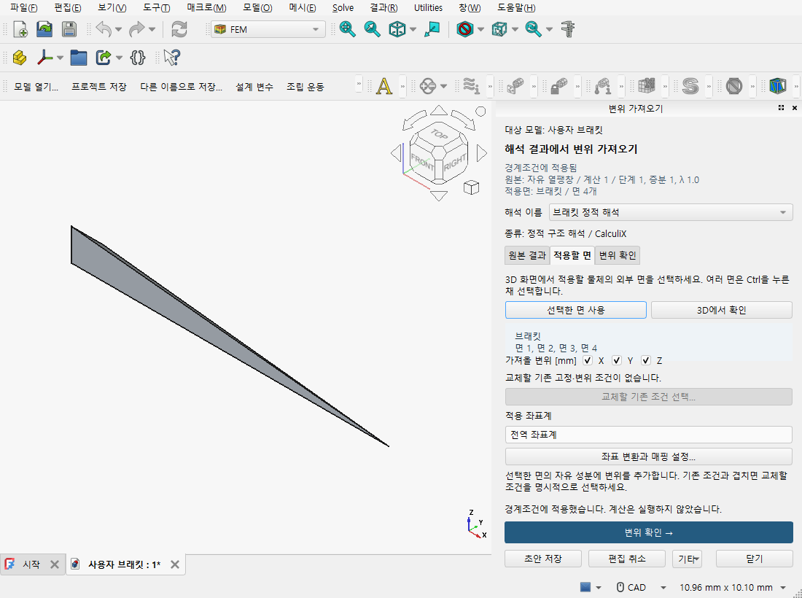

사진은 계산을 실행하지 않고 저장한 변위 정의를 다시 연 화면입니다. **해석 이름**은 사용자가
지정한 이름이며, 아래 **종류**는 실제 솔버·단계 설정에서 확인합니다. 현재 지원하는 기준 외부 면·
C3D10·단일 선형 정적 수신과 상세 조작은 [변위 가져오기](STRUCTURAL_U_TRANSFER_KO.md)를 따르세요.

## 후처리에서 결과 보고 비교하기

**후처리**는 ParaView에서 이미 계산한 VTU/PVD 등의 결과를 읽는 프로그램입니다.
별도로 설치한 ParaView가 필요하며, 결과를 여는 것만으로 해석을 실행하지 않습니다.

FreeCAD의 **선택 결과를 ParaView에서 열기**도 같은 연구 작업에 연결된 후처리를 엽니다.
결과를 읽은 뒤 아래의 비교·측정·프로젝트 저장 기능을 사용합니다. ParaView의 native
필터·선택·3D 화면을 그대로 사용하며, 저장한 분석은 연구 기록과 전문가 토론으로
이어갈 수 있습니다. 새 버튼의 직접 OS 클릭은 아직 확인하지 못했습니다.

사진은 공개 합성 힘 자료를 실제 ParaView에서 비교한 값을 표시한 **곡선 창**입니다.
처음에는 본인의 VTU/PVD 파일 또는 저장한 후처리 프로젝트의 `project.json`을 준비하세요.

1. **후처리** 바로가기로 파일을 열고 ParaView에서 필드·성분·시각을 고릅니다.
2. **Macros → CAE Analysis controls**로 분석 창을 엽니다. **새 비교**에서 A/B 자료를 고르고
   **물리량 확인…**으로 단위와 성분을 확인합니다.
3. 필요한 **변환 설정…**을 정한 뒤 **미리보기 → 적용 → 비교 곡선…**으로 원값과 차이를 봅니다.

곡선의 축과 단위, 값이 없는 구간을 확인하세요. **Ctrl+S** 또는 **Macros → CAE Save project**로
저장하고 다음에는 `project.json`을 엽니다. 파일을 옮겼다면 **원파일 다시 연결…**을 사용합니다.
현재 **File → Exit**에는 저장 확인이 연결되지 않았으므로 먼저 저장하거나 X로 닫으세요.
[파일 열기·저장](INSTALL_KO.md#cad와-후처리-열기), [결과 비교](POST_COMPARISON.md),
[시험 곡선 비교](POST_CURVES.md)에 준비할 자료와 복구 순서가 있습니다.

비교에 빠지면 안 되는 위치는 **변환 설정… → 필수 영역과 적분**에서 지정합니다.
**영역과 적분 결과…**에서 유효점과 성분별 적분·오차를 봅니다.
[영역과 적분 안내](POST_COMPARISON.md#필수-비교-영역과-체적-적분)의 실제 Qt 화면을 참고하세요.

## 데이터에서 시험 파일 읽기

**데이터(Data)**는 CSV를 가져와 열·단위·원행을 확인하고 계산에 쓸 구간을 정하는 창입니다.
시작 예제는 [axial.csv](../examples/material-tests/axial.csv)입니다.

사진은 공개 합성값을 표시해 읽기와 선택을 확인한 실제 프로그램 창입니다. 솔버 결과 화면은 아닙니다.

1. **CSV 열기… → 시험 열 설정…**에서 시간 `time_s`와 응력 `stress_MPa`, 단위 s·MPa,
   성분 xx를 선택합니다. 자세한 변형 열 설정은 [재료 피팅 예제](DATA_MATERIAL_WORKFLOW.md)를 따르세요.
2. **설정 적용 → 가져오기** 후 **가져온 값**과 곡선을 확인합니다.
3. 표의 행이나 곡선의 점·구간을 선택합니다. 계산에서 빼려면 표의 우클릭 메뉴에서
   **계산에서 제외**를 명시적으로 선택합니다. 점을 선택한 것만으로 제외되지는 않습니다.

**저장 → 열기…**로 같은 문서를 다시 열면 보존한 값을 읽습니다. 값이 이상하면 원본 미리보기의
구분 문자·머리글, 열·단위부터 확인하세요. 단위 이름만 바꿔서는 숫자가 환산되지 않습니다.
[파일 가져오기](DATA_FILE_OPENING_KO.md), [처리 단계와 미리보기](DATA_PROCESSING_KO.md),
[큰 변형의 시험 자료](finite-measure/USAGE_KO.md)로 이어갈 수 있습니다.

힘과 표점 변위로 큰 변형의 응력·변형률을 구할 때는
[train.csv](../examples/finite-measure/train.csv)를 열고 **편집 → 유한변형 시험 설정…**을 사용합니다.

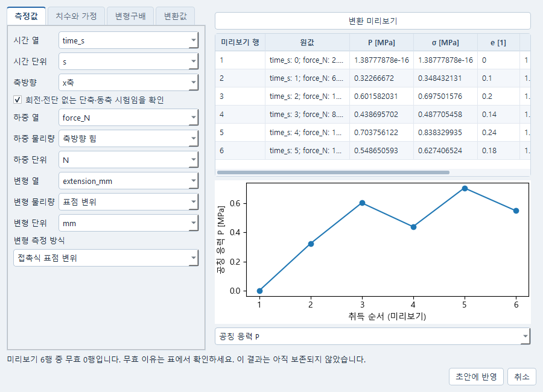

사진은 공개 합성 시험의 실제 변환 미리보기입니다. A0·L0와 측정 근거를 지정하고
**변환 미리보기 → 초안에 반영**으로 이어갑니다. 미리보기만으로 결과가 보관되지는 않습니다.
진응력에 필요한 현재 면적·부피비 등의 근거와 처리 결과 보존 순서는
[유한변형 사용법](finite-measure/USAGE_KO.md#시험-자료-열기와-변환)을 따르세요.

## 재료에서 응력 응답 계산하기

**재료(Material)**는 재료 법칙·계수·변형 이력을 정해 응력을 계산하는 창입니다.
시험의 관측값과 모델을 비교하고 계수를 동정하는 작업도 같은 창에서 진행합니다.

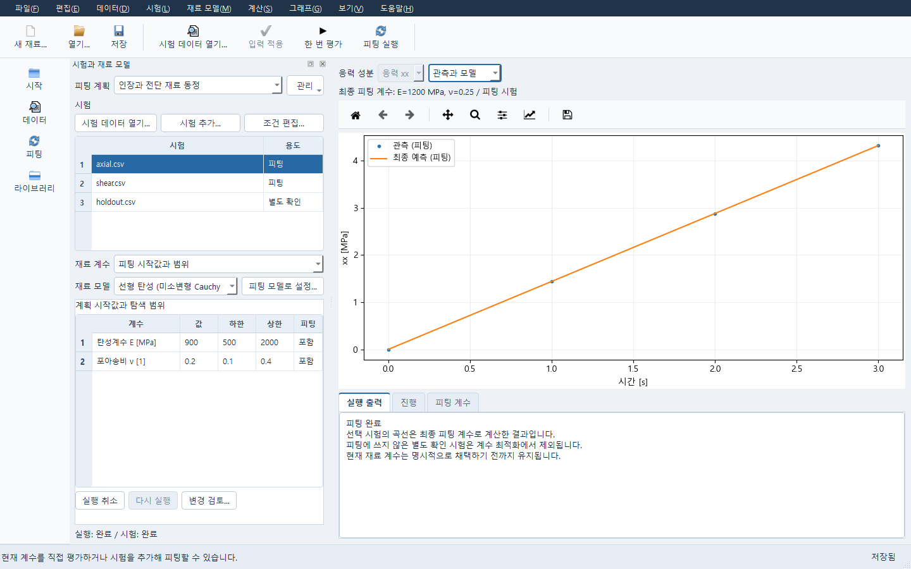

사진은 공개 합성 시험의 저장된 피팅 결과를 별도 프로세스에서 다시 연 실제 창입니다.
왼쪽 E=900 MPa·ν=0.2는 시작값, 오른쪽 곡선은 최종 E=1200 MPa·ν=0.25입니다.
새 단회 평가의 [실제 관측·예측 화면](images/manual/material-evaluation.png)은 E=1500 MPa로
계산한 holdout 시험을 보여 줍니다. 이후 재료 계수를 고쳐서 **이전 계수**로 표시됩니다.
두 화면의 결과를 현재 편집 계수로 새로 계산한 것처럼 표시하지 않습니다.

화면 배치는 MCalibration의 Calibrate/Load Case를 기준으로 합니다. 왼쪽 위에서 시험을
선택하고, 아래에서 재료 모델과 계수를 편집합니다. 오른쪽은 선택 시험의 관측·예측
곡선이며, 그 위에 **실제로 계산한 계수**를 표시합니다. 잔차는 그래프 보기에서 따로
고릅니다. 아래의 실행 출력·진행·피팅 계수는 같은 계산의 상태와 결과입니다.
**파일 → 새 재료…**로 시작하거나 저장한 재료를 **열기…**로 엽니다.

1. 사용할 **재료 모델**과 응력·시간 단위를 확인합니다. **현재 재료 계수**와 시험 조건을
   고쳤으면 **입력 적용**으로 반영합니다.
2. **피팅 계획**을 고르거나 **관리 → 계획 만들기…**로 만듭니다. **시험 데이터 열기…**에서
   본인의 파일을 읽어 열·단위·관측량을 지정하고 가져온 뒤, **시험 추가…**로 등록합니다.
   **조건 편집…**에서 변형 이력·횡방향 조건과 피팅/별도 확인 용도를 정합니다.
3. **한 번 평가**는 선택 시험을 현재 재료 계수로 계산합니다. 피팅 시작값은 바꾸지 않습니다.
   시험이 없으면 현재 재료의 자체 변형 이력을 계산합니다.
4. **피팅 시작값과 범위**에서 값·하한·상한·피팅 포함 여부를 정하고 변경을 검토·적용한 뒤
   **피팅 실행**을 누릅니다. 별도 확인 시험은 계수 동정에 쓰지 않습니다.
5. **피팅 계수 → 최종 계수 검토·채택…**에서 근거와 변경을 확인합니다. 곡선을 읽거나
   피팅을 실행한 것만으로 현재 재료 계수가 바뀌지는 않습니다.

상단 **저장**은 재료와 선택한 피팅 계획을 기존 저장 절차로 함께 보관합니다. 일부 저장이
실패하면 성공한 쪽을 유지하고 실패한 쪽의 결과를 확인합니다. 입력을 고쳐도 이전 결과는
바뀌지 않습니다. 현재 재료를 바꿨다면 피팅에 사용할 모델을 다시 명시적으로 설정하세요.
실행이 막히면 계수·단위·변형 이력과 실제 계산 환경을 확인하세요. 이 Material 화면의
선택 시험 단회 평가는 FELUPE 선형 탄성·Neo-Hooke를 지원합니다. 다른 법칙의 지원은
각 법칙 편집기와 계산 환경에서 별도로 확인해야 합니다.
횡방향 신장비를 1로 고정한 조건은 자유 수축 인장시험과 다릅니다.
[기본 응력 계산](USER_GUIDE_KO.md#재료-모델의-응력-응답-확인하기),
[사진의 시험 이력과 자유 횡수축](finite-measure/USAGE_KO.md#material과-피팅으로-이어가기),
[측정 이력과 횡방향 제어](MATERIAL_CONTROL_KO.md), [재료 법칙 사용법](law-native/README_KO.md)을 참고하세요.

## 수치 연구에서 계획과 후보 비교하기

**수치 연구(Numerical)**는 피팅·실험계획·탐색을 설정하고 실제 후보와 결과를 비교하는 창입니다.

사진은 정수·이산값·시간 적분법 선택을 함께 사용한 공개 냉각 ODE 계산 결과입니다.
먼저 [냉각 모델 만들기](USER_GUIDE_KO.md#온도가-시간에-따라-변하는-문제)를 따라 **방정식**의
**새 모델… → 상태 방정식 (단위가 있는 ODE)**를 만들고 저장하세요.
그 모델의 **수치 계산 계획**으로 이 창을 엽니다. 사진과 같은 혼합 변수 설정은
[공개 ODE 계산 순서](NUMERICAL_MIXED_GUI.md#사용하는-순서)를 따릅니다.

1. **계획** 탭에서 계산 방법과 모델을 확인하고 **변수 추가…**, **변수 범위…**로 조건을 정합니다.
2. **변경 적용 → 현재 계획 실행** 후 **결과** 탭의 계산을 선택하고 **결과 읽기**를 누릅니다.
3. 표본을 선택해 그 입력과 응답 곡선을 함께 봅니다. 이전 결과를 보는 동안에도 계획은 별도로 편집합니다.

**저장 → 계획 열기…**로 같은 계획과 결과를 다시 엽니다. 실행이 막히면 선택한 방법이 변수
종류를 지원하는지 확인하세요. 후보를 선택하는 것만으로 재료 계수가 채택되지는 않습니다.

입력 중인 `1e`처럼 아직 적용할 수 없는 원문을 남기려면 창을 닫을 때 **편집 원문 보관**을
고릅니다. 다시 열어 **파일 → 보관한 편집 원문… → 이 원문 복구**로 되돌리세요. 이전 세션의
원문은 기준 문서를 확인한 뒤 복구합니다. 보관이나 복구만으로 입력 적용·저장·계산을 하지는
않습니다. 보관에 실패하면 창을 유지하므로 원문을 확인하고 같은 보관 요청을 재시도하세요.

[혼합 변수 예제](NUMERICAL_MIXED_GUI.md), [공개 CSV 피팅과 명시 채택](DATA_MATERIAL_WORKFLOW.md),
[후보 상세 결과](NUMERICAL_CANDIDATE_DETAIL_KO.md)를 작업별로 따라가세요.

변수 사이에 상관이 있거나 저장한 대리모델로 새 후보를 찾을 때는
[결합분포·Sobol 비교·저장 모델 안내](NUMERICAL_EXTENSIONS_KO.md)를 따르세요.
추천점의 예측값을 본 뒤 **예측점 실제 평가**로 실제 계산과 비교할 수 있습니다.

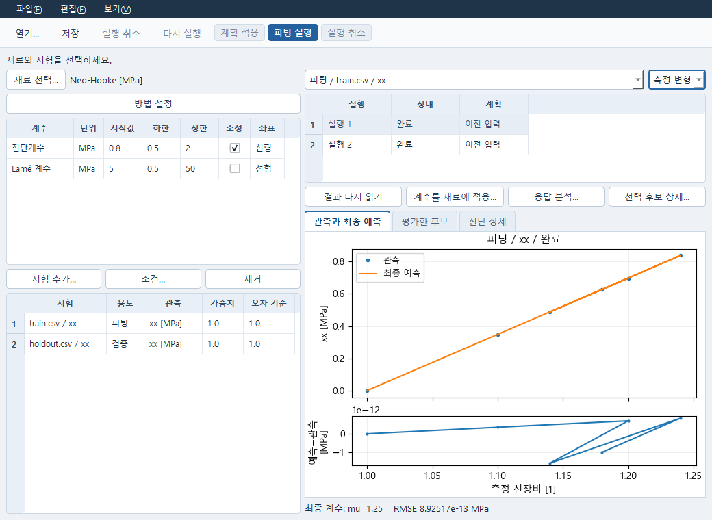

이 사진은 공개 Neo-Hooke 합성 시험을 실제 피팅한 별도 예입니다. 피팅용·검증용 시험을 나누고
**조건…**에서 관측과 예측의 측도를 맞춥니다. **계수를 재료에 적용…**은 선택한 결과를 검토한 뒤
명시적으로 채택하는 단계입니다. [시험 변환부터 피팅·저장까지](finite-measure/USAGE_KO.md#material과-피팅으로-이어가기)를
따라가세요. 사용자 재료를 검증한 결과는 아닙니다.

## 방정식에서 모델 편집하고 계산하기

**방정식(PDE)**은 식·계수·영역·경계 조건을 정하는 창입니다.

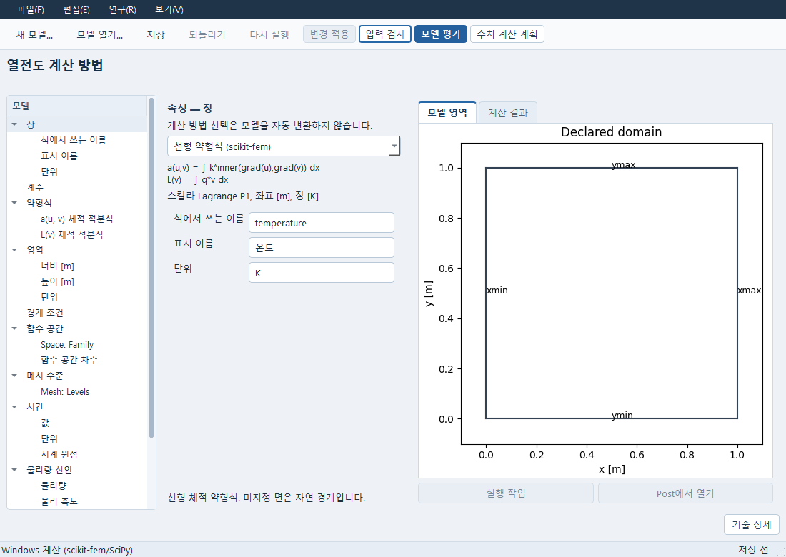

사진은 Windows 공간 약형식의 **입력 영역**입니다. 오른쪽 사각형은 계산한 온도장이 아닙니다.
**새 모델… → Windows 공간 약형식**으로 사진과 같은 모델을 만듭니다.

1. **영역**의 너비·높이 1 m와 **계수**의 왼쪽 온도 `left_value` 300 K·오른쪽 온도
   `right_value` 310 K를 확인합니다.
   **경계 조건**에서 두 값을 왼쪽·오른쪽 면에 지정한 기본 설정을 확인하세요.
2. **입력 검사 → 변경 적용 → 모델 평가**를 누릅니다.
3. **계산 결과**에서 실행과 온도장을 고릅니다. 기본 문제의 온도는 왼쪽 300 K에서 오른쪽 310 K로 변합니다.

**저장 → 모델 열기…**로 모델과 이전 결과를 다시 읽습니다. 오류가 있으면 화면에 표시된 식·단위·
경계 조건을 고쳐 다시 검사하세요. 이 공간 예제는 기본 Windows의 scikit-fem으로 계산하며
CAD·WSL이 필요 없습니다. 지원 범위는 직사각형의 스칼라 선형 P1 약형식입니다.
[Windows 약형식·열전도 예제](s1_windows_transfer/README_KO.md),
[냉각 모델과 다른 계산 환경](USER_GUIDE_KO.md#pde-모델-편집과-결과-보기)을 참고하세요.

## 해석에서 모델 조건과 결과 확인하기

**해석(Simulation)**은 지원하는 구조·열·동해석 등의 모델을 편집하는 창입니다.
일반 CAD 형상은 전처리에서 준비하며, 여기의 모델마다 지원 조건이 다릅니다.

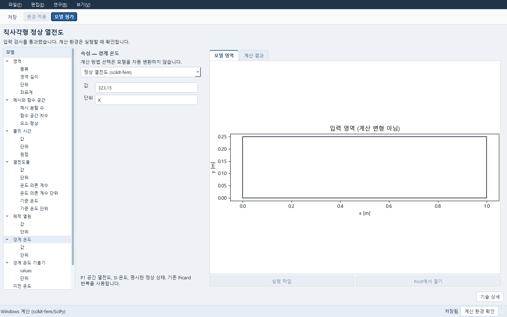

사진은 저장한 정상 열전도 모델의 **평균 온도 결과**입니다. 한 값은 항목·값·단위 표로
표시하며, 아래 응답 선택에서 온도장을 고르면 실제 공간 결과로 전환합니다.
기본 Windows에서 같은 종류의 모델을 열려면
**새 해석 모델… → 정상 열전도 (scikit-fem)**를 고릅니다. 기본 영역은 1 m × 0.25 m이며,
사진의 보존 평균 온도는 323.15 K입니다.

1. 왼쪽 항목을 골라 영역·온도·열전도율을 확인하고 **연구 → 입력 검사**, 이어서 **변경 적용 → 저장**을 누릅니다.
2. **계산 환경 확인** 후 **모델 평가**를 누릅니다. 설치 확인만으로 계산하지는 않습니다.
3. **계산 결과**에서 실행을 고르고 필드·성분·위치와 단위를 확인합니다.

**해석 모델 열기…**로 저장 모델을 다시 엽니다. 실행 환경이 없으면 조건을 저장한 뒤 해당
환경을 준비하세요. 다른 솔버로 자동 대체하지 않습니다.
[해석 모델 사용법](USER_GUIDE_KO.md#해석-모델을-따로-편집하고-다른-도구에-연결하기),
[열전도 예제](s1_windows_transfer/README_KO.md), [충격·동해석](DYNAMIC_WORKFLOW_KO.md)을 참고하세요.

충격 모델의 **충격 조건… → 벌크와 계면**에서는 원 재료의 손상 교정 표와 계면 재접촉,
추가 결과를 편집합니다. [벌크·계면 화면 안내](IMPACT_BULK_INTERFACE_KO.md#화면에서-편집하고-저장하기)의
실제 화면과 순서를 따라가세요. 시험 중인 기능의 지원 범위와 필요한 교정자료도 함께 확인합니다.

**반복하중 피로 평가**에서는 **피로 조건 → 반복하중 조건…**에서 이력과 교정자료를 지정합니다.
계산 후 **연구 → 사이클과 누적값…**에서 결과를 봅니다. [피로 평가 화면 안내](fatigue/USAGE_KO.md)에
실제 화면, 공개 합성 예제와 저장·재개 순서가 있습니다.

**저장 재료 · FELUPE Hex8 시편**에서는 **연구 → 두 영역 열변형 조건…**으로 접합한 두
벌크 영역을 편집합니다. 길이·두께와 메시, 각 층의 열팽창계수·기준 온도·탄성 또는 단일
Maxwell 물성, 온도 이력, 지지와 관측 위치를 직접 지정하세요. **입력 초안에 반영 → 변경
적용 → 저장** 후 계산합니다. 이미 확인한 메시에서는 `1e` 같은 미완성 숫자도 저장되며,
필수값을 고치기 전에는 계산이 차단됩니다. 새 메시의 치수나 빈 온도 이력은 조건창에서
수정해야 합니다.

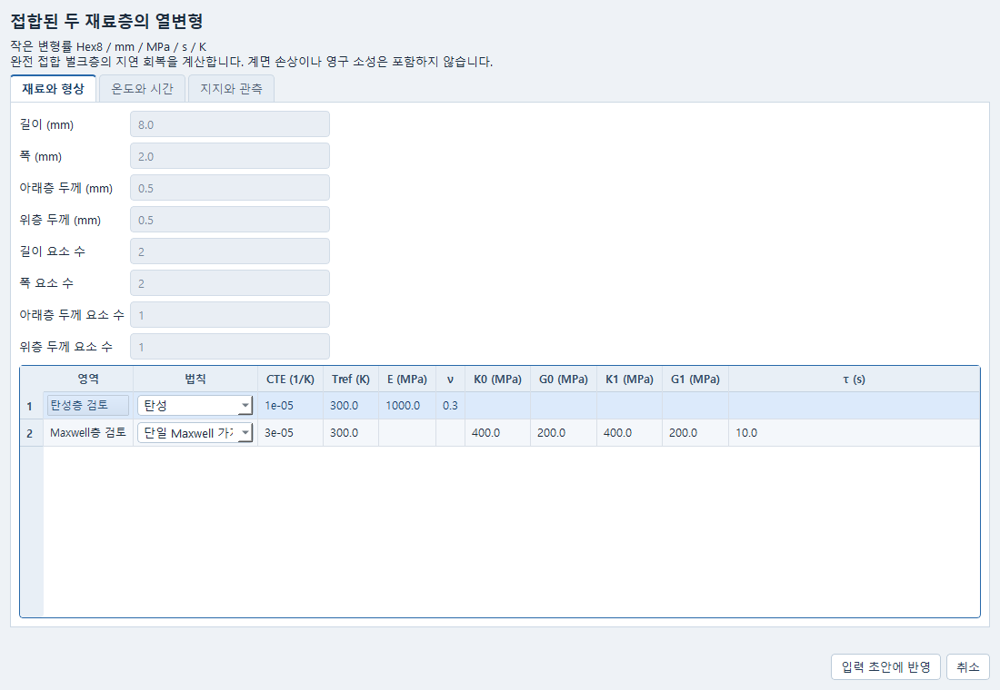

결과에서는 곡률, 선택 셀·적분점의 응력·온도·전체/열/기계 변형률과 내부 상태를 구별합니다.
**보존 열변형 상태에서 계속…**은 선택 결과의 마지막 수락 상태와 미래 시간·온도를 확인해
새 모델을 작성합니다. 기존 결과를 덮어쓰거나 자동 계산하지 않습니다. 현재 범위는 작은
변형, 공유 면으로 완전 접합한 두 영역과 명시 온도 이력입니다. 독립 곡률 정확도 검사는
아직 실패한 상태이므로 정량 설계 승인에 사용하지 마세요.

## 계산 절차에서 여러 모델 연결하기

**계산 절차(Evaluation)**는 저장한 모델의 실행 순서와 전달할 값을 정하는 창입니다.
모델의 재료·하중 자체는 각 원래 창에서 편집합니다.

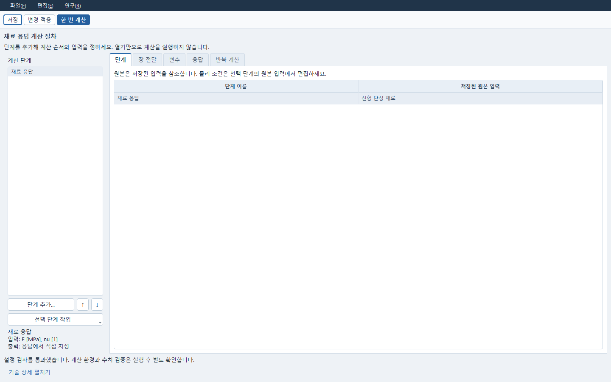

사진은 저장한 냉각 방정식 단계의 설정과 **이전 입력의 보존 결과**입니다. 위의 편집 단계와
아래의 계산 당시 결과를 구분해 표시합니다. 왼쪽에서 단계를 고르면 원본·입출력이 바뀝니다.
설정 검사와 실제 계산은 별개입니다.
먼저 Material 또는 PDE·해석 창에서 사용할 모델을 저장하세요.

1. **파일 → 새 계산 절차…**를 연 뒤 **단계 추가…**에서 저장한 선형 탄성 재료를 고릅니다.
2. **응답**에서 읽을 출력과 단위를 정하고 **연구 → 입출력 확인**으로 검사합니다.
   여러 모델을 잇는 경우에만 단계를 더하고 **장 전달**에서 공급·수신 관계를 지정합니다.
3. **변경 적용 → 한 번 계산** 후 **단계 실행**에서 각 단계의 상태와 응답을 확인합니다.

**저장 → 계산 절차 열기…**로 조건과 실행을 다시 읽습니다. 원 모델을 바꿨다면 먼저 그 모델을
저장하고 **원본 교체…**로 사용할 저장본을 선택하세요. 실패 단계는 이전 성공 단계와 구별됩니다.
[기본 순서와 재계산](USER_GUIDE_KO.md#여러-계산-단계를-연결해-실행하기),
[다른 메시 사이 온도 전달](s1_windows_transfer/README_KO.md)에 예제와 지원 범위가 있습니다.

## 실행 관리에서 작업 살펴보기

**실행 관리(Runner)**는 각 도구가 제출한 계산을 모아 보는 창입니다. 여기에서 물리 조건을
처음 만들지는 않습니다.

사진은 빈 목록을 보여 주는 실제 프로그램 화면입니다. 다른 도구에서 계산한 뒤 이 창으로 돌아오세요.

1. **새로 고침** 후 작업을 선택해 **진행 상황**을 봅니다.
2. **결과 보기**로 응답·표·곡선을 읽습니다. **입력 문서 열기**로 조건 편집창에 돌아갑니다.
3. 실행 중인 작업을 멈추려면 해당 행을 선택하고 **실행 취소**를 누릅니다.

창을 닫았다가 **실행 관리**를 다시 열면 같은 작업 목록을 조회합니다. 문서 저장은 원래 도구에서
합니다. 창을 닫는 것만으로 계산이 취소되지 않으며 **취소 요청됨**은 종료 확인 전입니다.
실패·부분 결과와 종료 미확인은 [Runner 복구 안내](RUNNER_RECOVERY_KO.md)를 따르세요.

등록한 SSH·Slurm·PBS 환경이 있다면 **도구 → 원격 실행…**에서 입력 묶음과 자원을
선택합니다. 제출·상태 확인·취소·결과 회수의 순서는 [원격 실행 안내](remote_execution/USAGE_KO.md)에
설명했습니다. 현재 원격 연결은 로컬 대역으로 확인했으며 실제 서버 접속은 미확인입니다.

## 전문가 토론에서 자료와 질문 저장하기

**전문가 토론(Expert)**은 자료를 골라 질문하고 발언·답변을 읽는 창입니다.
자료와 질문의 저장에는 AI 연결이 필요하지 않습니다.

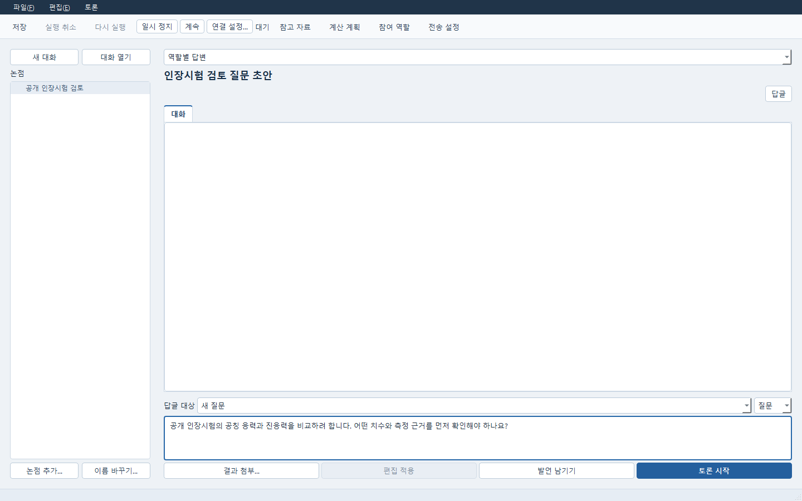

사진은 질문만 작성한 상태입니다. 답변을 요청하거나 역할을 선택한 화면은 아닙니다.
질문과 관련된 시험 설명서·공개 논문·저장한 계산 결과를 선택해 시작하세요.

1. **파일 → 새 대화…**로 제목을 정하고 **참고 자료 → 파일 추가…**로 자료를 넣습니다.
2. 자료를 골라 **원문 읽기**로 확인한 뒤 질문을 작성하고 **파일 → 저장**합니다.
3. 답변을 받으려면 **연결 설정…**, **참여 역할**, **전송 설정**을 확인한 뒤
   **토론 시작**을 누릅니다. 설정이 없다면 질문을 초안으로 저장해 두세요.

**파일 → 대화 열기…**로 같은 대화를 다시 엽니다. 답변이 실패하면 실패 이유와 전송·연결 설정을
확인하세요. 질문을 저장하거나 자료를 읽는 동작은 AI 요청이 아닙니다.
**역할별 답변**은 등록한 역할마다 지시·자료 범위·도구를 적용하고 앞선 발언을 이어받습니다.
**자료 토론 (Co-STORM)**은 여러 관점의 조사와 발언을 논점 지도·인용 보고서로 정리합니다.
현재 Co-STORM은 공유 모델을 사용하며, 예제 역할 이름만으로 분야 전문성이 보장되지는 않습니다.

**연구팀**은 담당별 자료·도구로 독립 조사한 뒤 상대 주장에 질문하고 답변하는 방식입니다.
**팀 검토…**에서 배정과 자료를 정하고 **연구 시작**을 누릅니다. 계산 결과로 후속 질문을
준비하거나, 막힌 과제를 사유와 함께 미해결로 남길 수 있습니다.
[연구팀 사용법과 화면](research-team/USAGE_KO.md)에서 전체 조작 순서를 확인하세요.

주제만으로 공개 문헌을 조사하려면 연결 설정과 해당 대화의 전송 설정에서 공개 검색을
각각 허용해야 합니다. 이 경로는 Crossref의 서지 정보와 제공된 초록을 읽습니다.
논문 본문까지 읽었다고 표시하지 않으며, 초록이 없는 논문은 서지 정보만 보여 줍니다.
저장된 인용을 다시 여는 동작은 보관한 원문을 읽으며 새 검색이나 AI 요청을 하지 않습니다.
실제 응답에는 사용할 모델의 기존 로그인·이용 조건이 적용됩니다. 지원하는 로그인 경로와 Co-STORM 자료 토론은
[Expert 시작 안내](USER_GUIDE_KO.md#2-자료를-넣고-질문토론연구-기록-저장하기),
[연결 설정](EXPERT_CONNECTION.md)에 설명했습니다.

## 연구 기록에 근거와 판단 모으기

**연구 기록(Study)**은 연구 질문에 문헌·저장 결과·발언을 모으고 메모·판단을 남기는 창입니다.

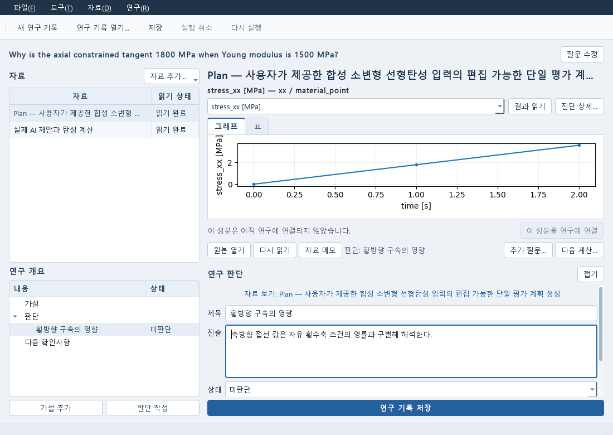

사진은 저장된 합성 응력 결과를 읽고 판단을 편집하는 화면입니다.
처음에는 저장소의 `README.md` 같은 공개 텍스트 문헌 하나로 시작할 수 있습니다.

1. **파일 → 새 연구 기록**에서 질문을 적습니다.
2. **자료 추가… → 문헌 추가… → 파일 가져오기…**로 자료를 읽고 **선택한 문헌 연결**을 누릅니다.
3. 목록에서 자료를 선택해 본문을 읽고 **자료 메모**, **판단 작성**으로 의견을 남깁니다.

**연구 기록 저장 → 파일 → 연구 기록 열기…**로 문서와 자료를 다시 확인합니다.
읽기에 실패하면 **다시 읽기**로 확인하세요. 새 원문으로 바꾸려면 **문헌 다시 선택…**에서 직접 고릅니다.
메모를 저장해도 계산이나 AI 요청은 시작되지 않습니다.
[문헌 연결과 복구](STUDY_LITERATURE_KO.md),
[결과·발언을 연구에 모으기](USER_GUIDE_KO.md#계산과-논의를-study에-모아-다시-열기)를 참고하세요.

## 보고서에서 선택한 자료 정리하기

**보고서(Report)**는 선택한 문헌·계산값·곡선·그림과 설명을 페이지로 구성하는 독립 창입니다.
Expert 안의 토론 보고서 탭과는 별도입니다.

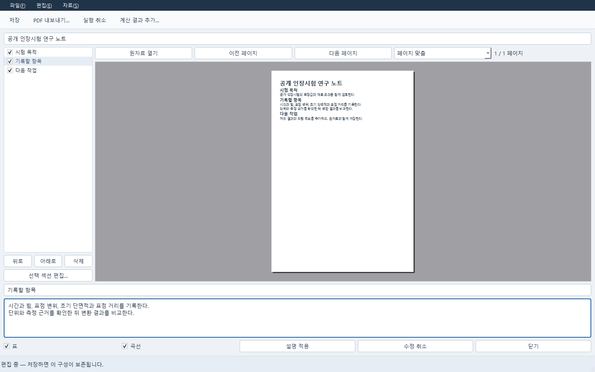

사진은 공개 인장시험 안내문을 편집하는 **저장 전 초안**입니다. 아래 설명 편집칸이 열려 있습니다.
시작 자료는 저장한 Study나 Data·계산 결과입니다. 문헌만 담은 Study에서도 보고서를 만들 수 있습니다.

1. Study의 **파일 → 보고서 만들기…**를 누르거나 보고서의 **자료 → 계산 결과 추가…**로 자료를 고릅니다.
2. 섹션을 선택하고 **선택 섹션 편집…**에서 제목·설명을 고친 뒤 **설명 적용**을 누릅니다.
3. 페이지를 확인하고 **저장**, 필요하면 **PDF 내보내기…**를 누릅니다.

**파일 → 열기…**로 같은 보고서를 다시 읽습니다. **원자료 열기**는 선택한 자료를 확인하는 기능이며
보고서의 보관 내용을 최신 결과로 바꾸지 않습니다. 미적용 설명이 있으면 적용하거나 수정 취소한 뒤
저장하세요. 원자료를 읽지 못해도 정상 보관된 값·그림은 남습니다.
[보고서 사용법](EXPERIMENT_REPORT.md#4-독립-보고서),
[다른 폴더로 옮겨 이어 쓰기](portable_connection_c3b/USAGE_KO.md)를 참고하세요.

## 문서 연결에서 관계와 이동 사본 확인하기

**문서 연결**은 선택해서 여는 연결 보기입니다. 다른 도구를 시작하기 위한 필수 첫 화면이 아닙니다.

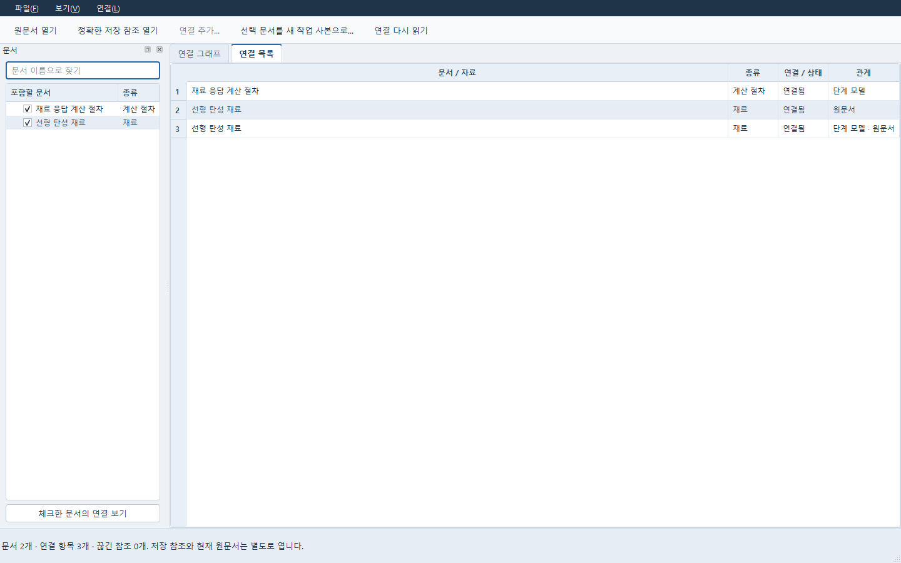

사진은 저장한 보고서를 선택해 직접 연결된 연구·결과·외부 자료의 관계를 읽은 화면입니다.
물리 계산은 실행하지 않았습니다. 먼저 사용할 모델·자료·연구를 각 도구에서 저장하세요.

1. 왼쪽에서 항목을 체크하고 **체크한 항목의 연결 보기**를 누릅니다.
2. **연결 그래프 / 연결 목록** 탭에서 대상을 고르고 **해당 앱에서 열기** 또는 **저장본 열기**로
   내용을 확인합니다. 기본 **선택 항목 중심 보기**에서는 직접 연결된 항목과 아래 관계표를
   함께 봅니다. 관계 행을 고르고 **연결 항목 선택**으로 이동합니다.
3. 전체 연결을 보려면 **선택 항목 중심 보기**를 해제합니다. 전체 배치에서 카드를 끌어 놓은
   위치는 선택 주변의 임시 배치와 별도로 보존됩니다.
4. 옮길 때는 **선택 문서를 새 작업 사본으로…**에서 포함 목록을 확인하고 아직 없는 새 폴더를 지정합니다.

복사한 폴더를 다시 열려면 [사본 실행 안내](portable_connection_c3b/USAGE_KO.md#옮긴-사본-열기)를
따라 실제 사본 위치를 지정하세요. 기존 폴더는 덮어쓰지 않습니다. 지원되는 Data·Material·수치 계획과
계산 결과·그림 보고서에 이어 Study·Expert·문헌 보고서도 포함할 수 있습니다.
[연구 기록과 토론 옮기기](portable_study_expert/USAGE_KO.md)에서 실제 포함 목록과
새 위치의 편집·질문 전송 순서를 확인하세요. CAD·후처리 전체 이동은 아직 미완료입니다.
[PDE·해석 작업 사본](portable-physics/USAGE_KO.md)도 현재 모델과 보존 결과를 옮겨
편집·저장하고, 현재 PC에서 명시적으로 새 계산을 실행할 수 있습니다. 원 계산의
실패·취소와 이전 입력 표시는 그대로 남습니다.
[계산 절차의 단계·전달값 옮기기](portable-evaluation/USAGE_KO.md)에서는 단계와 원 입력을
함께 포함하고, 새 위치에서 이전 단계 결과·전달값·완료 단계 재사용을 확인할 수 있습니다.
최종 종합 결과 없이 실패한 계산도 실제 남아 있는 완료 단계와 실패 기록을 보관합니다.
이동 전 원본도 보관하세요. [연결과 작업 사본](USER_GUIDE_KO.md#문서-연결을-선택해서-열기)에 자세히 설명했습니다.

연결 목록에 ‘참조 끊김’이 보일 때

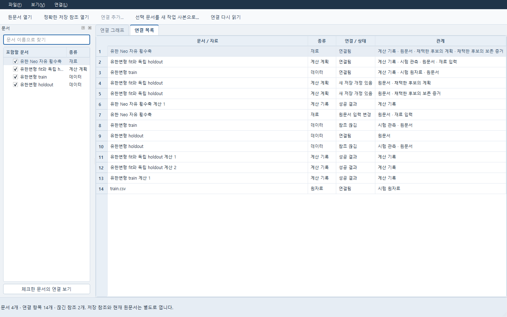

이 사진은 첫 사용 예제와 별개로 보관한 유한변형 예제의 읽기 상태입니다. 시험 관측 두 항목을
확인할 수 없으며, 이 화면을 찍으면서 복구하거나 재계산하지 않았습니다.
해당 항목을 선택해 읽기 안내를 확인하고 원 문서·자료의 저장 상태와 위치를 확인하세요.
연결을 바꿔야 할 때는 **연결** 메뉴에서 원본을 선택하고 영향 확인 후 반영합니다.
자세한 순서는 [연결 안내](USER_GUIDE_KO.md#문서-연결을-선택해서-열기)를 따르세요.

## 사진의 기준과 읽는 방법

이 안내는 2026-10-15의 실행기와 10월 16일까지 반영한 한국어 사용법을 기준으로 작성했습니다. 기존 사진은 원래 안내의
촬영·입력 조건을 유지합니다. 사진 속 예제 수치와 함께 각 작업의 상세 안내에서 필요한 자료·단위·
실행 환경을 확인하세요.

| 사진 묶음 | 원래 화면과 기준 |
|---|---|
| 판재 셸·후처리 곡선 | 10월 14일 공개된 [판재](SHELL_WORKFLOW_KO.md)와 [후처리 비교](POST_COMPARISON.md)의 실제 FreeCAD·ParaView 작업 화면 일부 |
| Data | [재료 피팅 안내](DATA_MATERIAL_WORKFLOW.md)의 공개 합성 자료로 읽기·선택을 보여 준 실제 Data 창, 10월 15일 한국어 표시 반영 |
| 유한변형 입력·피팅 | 10월 15일 공개 합성 시험의 변환 미리보기와 보존된 FELUPE 피팅 결과. [사용법](finite-measure/USAGE_KO.md) 참조 |
| Numerical | 10월 15일 공개된 [혼합 변수 안내](NUMERICAL_MIXED_GUI.md)의 실제 공개 ODE 계산 결과 |
| 저장 모델 추천·연구 사본 | 10월 16일 [수치 확장](NUMERICAL_EXTENSIONS_KO.md)과 [연구 사본](portable_study_expert/USAGE_KO.md)의 실제 Qt 창. 공개 합성 자료이며 실제 시험·AI 답변과 구별 |
| PDE | [Windows 공간 계산 안내](s1_windows_transfer/README_KO.md)의 10월 15일 입력 편집 화면 |
| Runner | 10월 14일 공개된 [첫 사용 안내](USER_GUIDE_KO.md)의 빈 작업 화면 |
| Study | 10월 14일 공개된 실제 연구 기록 창. 보관한 합성 결과와 사용자 판단 편집 |
| Simulation·Evaluation | 10월 19일 기존 저장본을 다시 연 실제 Windows 창. 평균 온도/공간장과 선택 단계의 보존 이력 표시; 새 계산 없음 |
| 문서 연결 | 10월 19일 기존 저장 묶음의 선택 중심 보기. 실제 연결·선택·배치 표시이며 새 물리 계산 없음 |
| Material | 10월 19일 MCalibration 기준으로 교정한 실제 창. 합성 시험의 저장된 피팅 결과와 실제 단회 평가를 구별하며 본문 캡션을 따름 |
| Expert·Report | 이 안내를 위한 10월 15일 실제 창 촬영. 각 사진 아래의 입력·읽기 범위 참조 |

지원 범위가 더 넓어졌는지는 각 상세 안내와 [현재 제품 상태](../CURRENT_STATE.md)에서 확인하세요.
