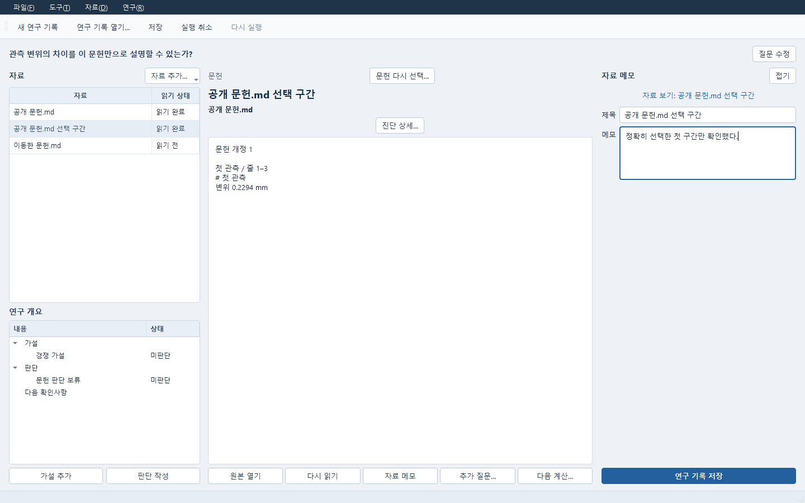

# 연구 기록에 문헌 연결하기

Study는 Expert 계정이나 계산 없이도 문헌을 읽고 가설, 판단, 다음 확인사항을
저장할 수 있습니다. 문헌을 연결하는 동작은 모델 전송이나 공학 승인을 뜻하지 않습니다.

1. **자료 추가… → 문헌 추가…**를 누릅니다. **파일 → 문헌 추가…**도 같은 창을 엽니다.
2. **파일 가져오기…**에서 PDF, Markdown, UTF-8 텍스트 또는 CSV를 고릅니다.
   가져온 파일은 로컬 문헌 보관함에 남습니다. 본문을 읽고 연결할 문헌을 체크한 뒤
   **선택한 문헌 연결**을 누릅니다. 여러 문헌을 체크했다면 이번에 연결할 문헌 하나를 고릅니다.
3. Study 자료 목록에서 문헌을 선택해 보관된 본문을 읽습니다. **자료 추가… → 문헌 구간 선택…**에서
   쪽 또는 절과 행 범위를 선택하면 실제 읽은 구간이 별도 근거로 추가됩니다. 전체 보관 본문도
   선택할 수 있습니다. 이전 근거와 판단 연결은 유지되므로 판단에서 사용할 구간을 직접 고릅니다.
   보관된 추출 본문의 범위만 뜻하며, PDF의 이미지·표를 모두 해석했다는 뜻은 아닙니다. **자료 메모**로 메모를
   작성하고, 판단에서 지지하거나 반박하는 자료를 직접 고릅니다. **원본 열기**는
   정확히 연결한 보관 본문을 별도 읽기 창에서 엽니다. PDF 원본 파일의 외부 프로그램
   실행과는 별개입니다. 텍스트가 없는 PDF는 OCR 없이 읽을 수 있는 본문으로 처리하지 않습니다.
4. **저장**한 뒤 **파일 → 연구 기록 열기…**에서 같은 연구 기록을 다시 엽니다.
5. 저장한 문헌과 판단으로 보고서를 만들려면 **파일 → 보고서 만들기…**를 누릅니다.
   문헌의 보관 본문과 작성한 판단이 보고서에 고정됩니다. 보고서를 저장하고 다시 열어도
   같은 자료를 사용하며, 이 동작은 새 계산이나 모델 질의를 실행하지 않습니다.

보관함에 새로운 원문이 있어도 기존 연결은 유지됩니다. **다시 읽기**는 기존 원문을
재확인하며 최신 원문으로 바꾸지 않습니다. 가져온 파일의 외부 경로를 옮겨도 보관된 본문은
계속 읽을 수 있습니다. **자료 추가… → 문헌 파일 다시 연결…**에서 같은 내용의 파일을 고르면
기존 개정·근거·판단을 유지하며 새 가져오기 작업을 만들지 않습니다. 내용이 다르면 확인창에서
추가를 확인해 새 문헌 개정과 새 근거로 추가합니다. 기존 판단이 가리키는 근거는 자동으로 바뀌지 않습니다.
가져오기 응답이 끊기면 **문헌 연결 결과 확인…**에서 같은 작업을 확인합니다.
미확정 연결이 있으면 다른 자료나 연구 기록의 파일 연결을 시작하지 않습니다.
안내에 표시된 원래 연구 기록과 자료로 돌아가 **문헌 연결 결과 확인…**을 먼저 누르세요.
확인 전에는 원래 자료의 삭제와 **문헌 다시 선택…**이 잠깁니다. 메모 편집과 다른 자료의 편집은 계속할 수 있습니다.
원래 자료가 이전 상태로 바뀌는 것을 막기 위해 해당 연구 기록의 실행 취소·다시 실행도 확인 후 사용할 수 있습니다.

보관된 원문 자체를 읽지 못하면 **읽을 수 없음**, 선택한 쪽·절이 없으면 **구간 없음**으로 구분합니다.
**다시 읽기**로 재확인하거나 **문헌 구간 선택…**에서 보관된 유효 구간을 새 근거로 고르세요.
보관 원문 자체가 없으면 문헌 선택창에서 사용 가능한 원문을 가져오거나 선택해야 합니다.
파일을 다시 고르는 것만으로 누락된 과거 보관본을 복원했다고 처리하지 않습니다.
원문이 없어도 질문, 메모와 판단은 편집하고 저장할 수 있습니다.

새 원문을 쓰려면 해당 문헌을 선택한 뒤 **문헌 다시 선택…**을 누릅니다.
선택창에서 **보관함의 최신 원문** 또는 다른 문헌을 읽은 뒤 명시적으로 연결하세요.
**취소**는 연구 기록을 바꾸지 않습니다. 연결하면 같은 자료 항목의 원문만 바뀌며
직접 붙인 자료 이름, 메모와 지지·반박 관계, 사용자가 작성한 판단은 유지됩니다. 연결한 본문을 확인하고
저장하면 새 연구 개정으로 남으며 이전 저장본은 보존됩니다.

이번 확인은 공개 합성 문헌을 사용한 로컬 저장·읽기·복구와 Windows Qt 화면입니다.
공개 Markdown의 두 절 중 한 절 선택, 미판단 유지, 원파일 이동, 동일 내용 재연결,
변경 내용의 새 개정, 응답 유실 후 재확인, 잘못된 구간과 보관본 누락 구분을 실제 로컬 HTTP와 Qt에서 확인했습니다.
저장한 뒤 모든 창과 서비스를 닫고 새 Python 프로세스에서 같은 저장소를 열어 원 근거·판단과 새 개정의 본문을 재확인했습니다.
실제 계정 질의, OCR, 일반 3D 결과 이미지 보고서 연결과 실제 장비 실행은 이번 확인 범위에 포함되지 않습니다.

[좁은 창의 판단과 미판단 상태](images/desktop-recovery/study-judgment-narrow.png),
[변경 파일의 새 개정 확인](images/desktop-recovery/study-new-revision.png),
[응답 유실 때 원 요청을 보존하는 안내](images/desktop-recovery/study-pending-recovery.png)를
실제 Windows Qt에서 확인했습니다.
