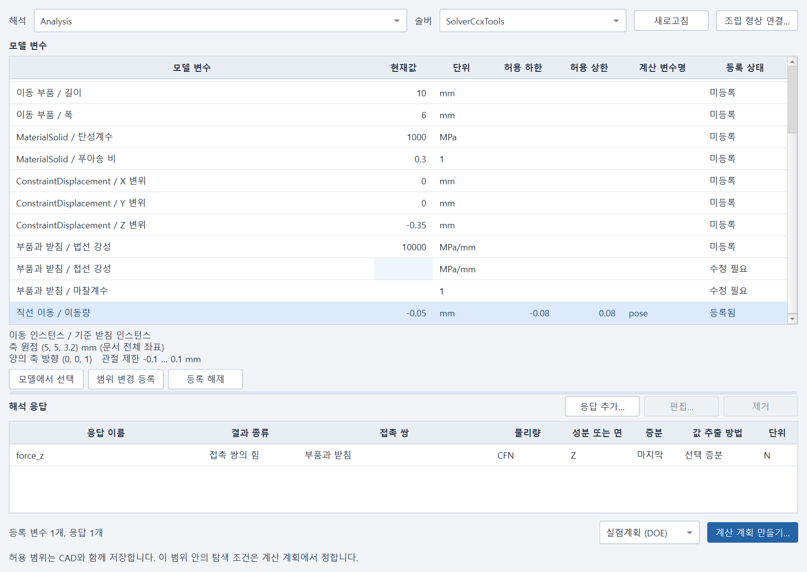
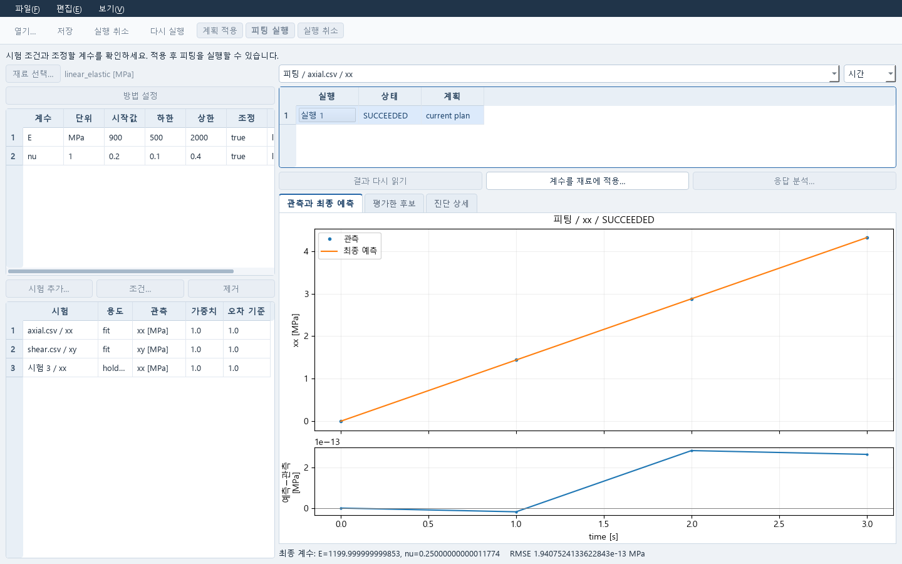
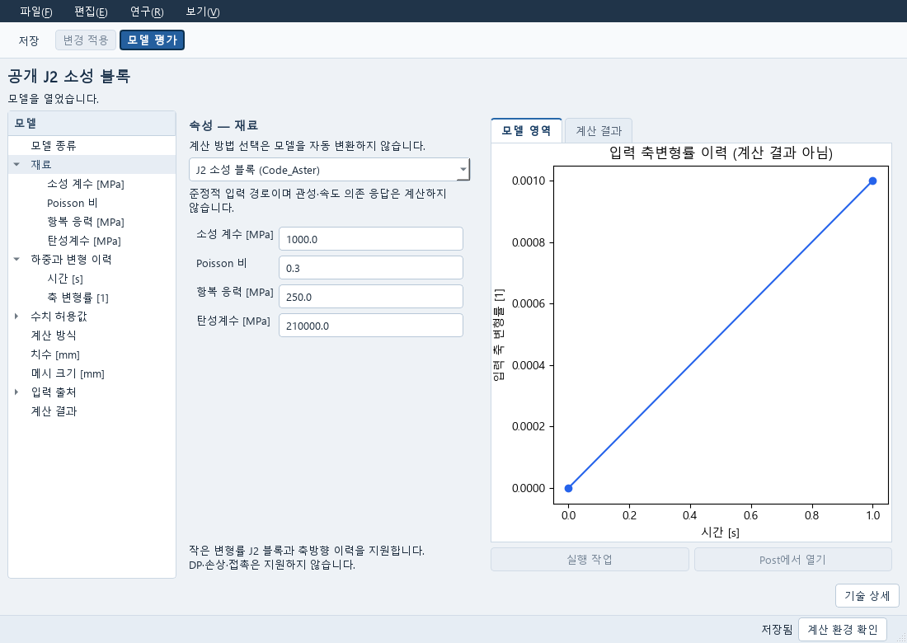
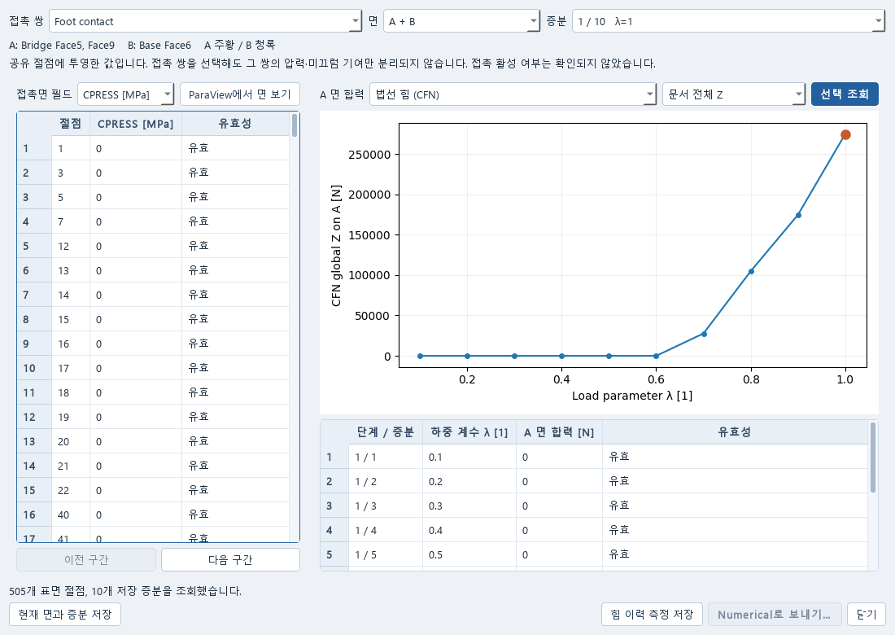

# 처음 해볼 작업

먼저 [설치 안내](INSTALL_KO.md)를 따라 기본 환경을 준비하세요. 아래 예제는 저장소에
들어 있는 공개 자료를 사용합니다. 개발자의 로컬 `runs` 폴더가 없어도 시작할 수 있습니다.

## 1. CAD 예제를 열고 치수 바꾸기

FreeCAD를 설치했다면 소스 폴더에서 다음 명령을 실행합니다. 실행 파일 경로는 실제 설치
위치로 바꾸세요.

```powershell
.\scripts\start_cae_pre.ps1 -FreeCADExe 'C:\Tools\FreeCAD\bin\freecad.exe' -Source '.\examples\contact\two-feet.FCStd'
```

모델은 받침대 `Base`와 두 발이 있는 `Bridge`입니다. `Bridge`는 `Stock`에서
`Notch`를 뺀 편집 가능한 형상입니다.

1. 모델 트리에서 `Stock`을 선택합니다.
2. 속성의 `Length`를 **20 mm에서 22 mm**로 바꿉니다.
3. 다시 계산한 형상을 확인합니다. 최종 형상을 보려면 `Stock`, `Notch`는 숨기고
   `Base`, `Bridge`를 표시합니다.
4. 다른 이름으로 저장한 뒤 닫고 다시 열어 치수가 남아 있는지 확인합니다.

이 예제 파일에는 재료, 하중, 접촉, 메시와 해석 결과가 들어 있지 않습니다.
형상을 편집한 것과 해석을 마친 것은 구분해서 확인하세요.

접촉 해석을 준비하려면 FEM의 Analysis에서 **Contact**를 엽니다. 두 발의 아래 면을
A로, 받침대의 위 면을 B로 선택하고 **Show faces**로 확인한 뒤 **Apply draft**를 누릅니다.
재료·구속·하중을 지정하고 **Prepare separate body meshes**와 Mesh 탭에서 각 물체의
메시를 만듭니다. Gmsh와 CalculiX 연결이 필요합니다.

개발 때 사용한 공개 예제 조건은 다음과 같습니다.

| 항목 | 값 |
|---|---|
| 탄성계수 / 포아송비 | 210,000 MPa / 0.3 |
| 구속 | 받침대 바닥 고정 |
| 지정 변위 | Bridge 윗면 (0, 0, -0.3) mm |
| 힘 | 두 발에 합계 100 N, -Z 방향 |
| 초기 형상 간극 | 0.2 mm |

연결 동작을 확인하기 위한 합성 조건이며 실제 설계 권장값은 아닙니다.
실행 방법, 결과 열기와 형상 변경 후 참조 복구 절차는
[접촉 작업 안내](CONTACT_WORKFLOW.md)에 있습니다. 형상을 바꾼 뒤에는 옛 면 번호만 믿지 말고 실제 면을 다시 확인하세요.

### 설계 변수를 계산 계획으로 넘기기

해석 조건을 준비한 모델에서 **Numerical…**을 누릅니다. **모델 변수** 표에서
치수, 재료 계수, 하중 또는 지원되는 관절 좌표를 선택하세요. **모델에서 선택**으로
대상을 확인하고 허용 하한·상한과 계산 변수명을 입력한 뒤 **범위 변경 등록**을 누릅니다.
관절 좌표를 고르면 축 원점, 양의 방향과 관절 제한이 표 아래에 보입니다.
여러 행을 편집한 경우 한 행을 등록해도 다른 행의 입력은 남습니다. **변경 미등록**인
행은 계산 계획을 만들기 전에 등록하세요. 계획 버튼을 누르면 해당 행으로 이동합니다.
해석을 바꿨다가 돌아와도 각 해석의 편집 중인 범위와 응답을 유지합니다.

**해석 응답**에서 **응답 추가…**를 눌러 변위, 접촉력 또는 접촉면 결과를 고릅니다.
단위와 성분, 어느 증분을 읽을지 확인하세요. 실험계획 또는 최적화를 고르고
**계산 계획 만들기…**를 누르면 Numerical에서 조건을 이어 편집합니다.
계획을 여는 것만으로 해석이 실행되지는 않습니다. 현재 조립 좌표 연결은 고정된 부품과
이동 부품 두 인스턴스, 단일 회전 또는 이동 관절을 지원합니다. 중첩 조립과 여러 관절의
종속 동작은 아직 이 후보 계산 경로에 연결되지 않았습니다.

아래는 저장된 합성 조립 예제를 실제 FreeCAD의 연구 패널에서 읽은 화면입니다.
선택한 이동 관절의 값과 허용 범위, 접촉력 응답을 보여 줍니다.



## 2. 자료를 넣고 질문·토론·연구 기록 저장하기

```powershell
.\Start-CAE-Lab.cmd -Tool expert
```

1. **파일 → 새 대화…**에서 대화 제목을 정합니다.
2. 위쪽 **참고 자료 → 파일 추가…**에서 저장소의 `README.md`를 선택합니다.
   목록에서 자료를 선택하고 **원문 읽기**로 내용을 확인합니다.
3. 아래 입력칸에 질문을 적습니다. 예: “CAD 예제를 해석하려면 무엇을 준비해야 하는가?”
4. **파일 → 저장**을 누릅니다. 입력한 질문과 선택한 자료가 함께 저장됩니다.
5. **파일 → 대화 열기…**에서 같은 대화를 골라 질문과 자료를 다시 확인합니다.

자료와 질문을 저장하는 데 AI 연결은 필요하지 않습니다. 실제 답변을 받으려면
아래 연결과 역할·전송 설정을 준비하세요.

### AI 연결과 역할 선택

1. **연결 설정…**을 엽니다. **연결 설정** 탭에서 기존 OpenScience의
   **로그인 설정 폴더**, **실행 도구 폴더**, **기본 모델**을 지정합니다.
   **폴더 확인**으로 필요한 로컬 파일을 확인할 수 있습니다.
2. **역할** 탭에서 **역할 파일 불러오기…** 또는 **예제 역할 불러오기**를 누릅니다.
   역할별 모델을 비워 두면 표에 표시된 기본 모델을 사용합니다. 행을 선택하고
   **선택 역할 상세…**를 누르면 실제 지시와 자료 분류를 읽을 수 있습니다.
3. **자료 전송** 탭에서 허용할 질문·자료·결과를 선택하고 **설정 적용**을 누릅니다.
   설정은 파일에 저장한 뒤 현재 연결에 적용합니다. 진행 중인 작업이 있으면 창을
   열어 두세요. 작업이 끝난 뒤 적용합니다. 그 전에 닫았다면 다시 열어 **설정 적용**을 누릅니다.
4. 대화 창의 **참여 역할**에서 참여할 역할을 선택합니다.
   **전송 설정**에서 **질문 전송 허용**과 필요한 경우 **선택 자료 전송 허용**을 선택합니다.
5. 질문을 적고 **토론 시작**을 누릅니다. 발언이 있는 대화에서는 **질문 보내기**로 표시됩니다.
   답변을 읽은 뒤 **파일 → 저장**으로 보관합니다.

OpenScience 자체의 구독은 필요하지 않습니다. 현재 연결은 기존 ChatGPT 이용권과
로그인을 쓰는 `openai-codex` 경로를 지원합니다. 예시 역할은 재료 모델과 시험·수치 결과를
검토하도록 지시한 AI이며, 별도 학습한 모델이나 전문 자료집은 아닙니다. 자료 분류의
이름만으로 원문이 들어오지는 않습니다.

**설정 적용**과 **폴더 확인**은 로그인이나 실제 모델 응답을 시험하지 않습니다.
적용에 실패하면 하단 안내에 따라 **다시 적용**하거나 설정 창을 다시 여세요.
파일이 다른 곳에서 바뀌었다면 **다시 읽기**로 최신 설정을 불러와 편집합니다.
오류 원문과 확인 항목은 **확인 상세 펼치기**에서 볼 수 있습니다.
저장을 시작하기 전 **취소**는 편집을 버립니다. 저장이 시작되면 버튼이 **닫기**로 바뀌며,
창을 닫아도 이미 시작한 파일 저장은 계속됩니다.

발언을 선택하고 **답글**을 누르면 그 발언에 관한 질문을 이어 쓸 수 있습니다.
**발언 남기기**는 사용자의 의견을 기록합니다. **일시 정지**는 다음 응답 요청을 멈추며
이미 실행 중인 응답은 취소하지 않습니다. **계속**으로 이어갑니다.
공개 문헌 검색은 **전송 설정 → 공개 논문 검색 허용**을 선택합니다. 현재 검색기는
Crossref이며 유료 원문을 구매하지 않습니다.

**역할별 답변** 모드는 선택한 역할이 순서대로 답하는 방식입니다. 아래 자료 토론과
구분해서 선택합니다. 저장된 옛 발언 본문은 자동으로 다시 쓰지 않습니다.

### 자료를 함께 검토하고 보고서 만들기

1. 새 대화에서 **자료 토론 (Co-STORM)**을 선택합니다. **참고 자료**에서 쓸 자료를
   고르고 **참여 역할**, **전송 설정**을 확인합니다.
2. 질문을 입력하고 **토론 시작**을 누릅니다. 초기 조사는 여러 응답을 거칩니다.
   한도에 도달하면 작업을 보관하고 멈춥니다. 설정을 확인한 뒤 **다시 시도**로 이어갑니다.
3. 왼쪽 논점을 고르면 관련 발언으로 이동합니다. 발언의 인용 번호로 원문을 엽니다.
   의견을 입력하고 **참여하기**를 누르면 다음 단계에 반영됩니다.
   입력 없이 토론을 더 읽으려면 **다음 발언**을 누릅니다.
4. **보고서 → 보고서 작성**으로 내용을 정리합니다. 인용 자료를 확인한 뒤
   **파일 → 저장**으로 대화와 함께 보관합니다. **내보내기…**로 Markdown 또는 HTML 파일을 만듭니다.

선택한 자료와 기존 로그인으로 초기 토론, 사용자 참여, 보고서 작성과 저장·재열기를
확인했습니다. 재시도 중 새 입력 보존과 논점 지도 교정도 반영했습니다.
대화와 보고서는 문단·표·수식을 구분해 표시합니다. 보고서를 읽는 동안 질문 입력창은
접히며, **대화로 돌아가기**를 누르면 작성 중인 질문과 읽던 위치가 유지됩니다.
수식을 복사하면 원래 수식 문법을 받습니다. 지원하지 않거나 화면 폭에 맞지 않는 긴
수식은 원문으로 표시하며, 내보낸 Markdown과 HTML에도 원래 수식을 보존합니다.
전체 화면의 사용성 확인은 계속 진행 중입니다.
새 자료 토론 모드에서 계산 계획이
자동 생성되는 것은 아닙니다. 계산 제안과 결과 전달은 아래 **역할별 답변** 경로를 씁니다.
자세한 범위는 [자료 토론 안내](CO_STORM_PROTOCOL.md)를 참고하세요.

### 제안을 계산하고 결과로 토론 이어가기

1. 답변을 선택하고 위쪽 **계산 계획**에서 제안을 고릅니다.
   **계산 계획 열기**를 누르면 별도 Numerical 창이 열립니다.
2. **계획** 탭에서 계산 방법과 입력값을 확인·수정한 뒤 **변경 적용**,
   **현재 계획 실행**을 누릅니다.
   제안을 열기만 해서는 계산이 시작되지 않습니다.
3. **결과** 탭의 계산 이력에서 결과를 선택하고 **결과 읽기**로 확인합니다.
   **저장**으로 결과까지 보관합니다. 입력을 다시 고칠 때는 **계획** 탭으로 돌아갑니다.
   두 탭을 오가도 편집 중인 입력과 선택한 결과는 유지됩니다.
4. Expert로 돌아와 **결과 첨부…**를 누릅니다. 저장한 Numerical 문서와 계산을 고르고,
   전달할 결과 값을 선택합니다. 값을 선택하지 않으면 계산 상태만 첨부됩니다.
5. 결과에 관한 질문을 적고 **전송 설정 → 첨부 결과 전송 허용**을 선택한 뒤
   **질문 보내기**를 누릅니다. **파일 → 저장**으로 대화를 보관합니다.

결과 첨부와 AI 전송은 별도 동작입니다. 실제 AI 제안의 탄성계수를 바꿔 FELUPE 계산을
실행하고 AI가 응력값을 읽어 설명하는 흐름을 확인했으며, 입력은 합성 탄성 예제였습니다.
모든 버튼을 직접 조작한 전체 사용성 확인은 아직입니다. 일반 메뉴는 한국어로 표시하지만
고급 입력의 모델 항목과 일부 전문 설정은 영어입니다. 원본 연결은 **원본 문서 열기**,
상세 연결 정보는 **보기 → 연결 정보…**에서 확인할 수 있습니다.

### 계산과 논의를 Study에 모아 다시 열기

Study는 연구 질문에 계산 결과와 논의 내용을 함께 연결하는 문서입니다.
먼저 Numerical과 Expert에서 보관할 결과·발언을 저장합니다.

```powershell
.\Start-CAE-Lab.cmd -Tool study
```

1. **파일 → 새 연구 기록**을 선택합니다. 위쪽 **질문 수정**에서 연구 질문을 적고
   **질문 접기**를 누르면 읽을 공간이 넓어집니다.
2. 왼쪽 **자료 추가… → 계산 결과 추가…**에서 저장한 Numerical 문서와 계산을 고릅니다.
   **대화 발언 추가…**에서는 저장한 Expert 대화와 보관할 발언을 고릅니다.
3. 왼쪽 자료 목록에서 항목을 선택하면 중앙에 발언 본문이나 결과의 그래프·표가 나타납니다.
   단위를 함께 확인하세요. 읽기에 실패하면 **다시 읽기**를 누릅니다.
4. **자료 메모**를 누르면 읽던 자료 옆에 편집 영역이 열립니다. 좁은 창에서는 아래에 열립니다.
   판단을 남기려면 **판단 작성**을 누르고 **지지하는 자료**, **반박하는 자료**를 직접 고릅니다.
   목록의 자료 이름을 누르면 작성 중인 판단을 유지한 채 해당 자료를 읽을 수 있습니다.
5. **연구 기록 저장**이나 **파일 → 저장**을 누릅니다. **접기**는 편집 영역만 접습니다.
   **파일 → 연구 기록 열기…**에서 같은 문서를 다시 열고 자료와 메모를 확인합니다.

결과에서 다른 성분을 살펴보는 것만으로 연구에 연결한 값이 바뀌지는 않습니다.
바꾸려면 **이 성분을 연구에 연결**을 누른 뒤 저장하세요.

자료를 선택한 뒤 **원본 열기**, **추가 질문…**, **다음 계산…**으로
이어갈 수 있습니다. 판단을 선택한 경우에는 화면에 표시된 판단을 바탕으로 후속 작업을 만듭니다.
연결한 원래 결과·발언은 그대로 보존하며, 읽거나 메모를 저장하는 것만으로
계산이나 AI 응답을 새로 만들지 않습니다. 메모와 판단의 저장은 설계의 안전성 승인이 아닙니다.

### 표 파일을 가져와 수치 연구로 이어가기

```powershell
.\Start-CAE-Lab.cmd -Tool data
```

1. **CSV 열기…**에서 파일을 고릅니다. 등록된 자료 폴더의 파일은 **원본 선택…**에서
   고릅니다. **원본 미리보기**에서 구분 문자와 머리글을 확인합니다.
2. **가져오기 설정 → 열 및 단위**에서 X축에 쓸 시간 등의 열과 채널별 원본 열을 정합니다.
   단위와 필요한 배율·보정값을 입력합니다. 열 번호는 0부터 시작합니다. 단위 이름만
   바꿔서는 숫자가 변환되지 않습니다.
3. 필요하면 **시험 조건**을 적고 **행 선택**에서 계산에 쓸 구간을 정합니다.
   **품질이 불량한 행**, **화면에서 숨길 행**은 계산 제외와 별개입니다.
4. **설정 적용 → 가져오기**를 누릅니다. 왼쪽 **가져온 데이터**에서 항목을 골라
   **가져온 값**과 아래 그래프를 읽습니다. **가져오기 설정**을 다시 누르면 설정을 접고
   값을 읽는 공간이 넓어집니다. 쓰던 설정은 그대로 남습니다.
5. **재료 피팅…**에서 관측할 응력과 재료 법칙을 선택합니다. 피팅 창에서 시험 조건을
   정한 뒤 실행합니다. **전문가에게 질문…**으로 자료를 전달할 수도 있습니다.
   연결한 문서를 여는 것만으로 계산이나 AI 응답이 실행되지는 않습니다.
6. **저장**한 문서를 **열기…**로 다시 열면 보존된 값을 읽습니다. 원본을 다시 가져오지 않습니다.

시험 파일의 열과 단위를 지정하고 두 계수를 피팅한 뒤 검증용 시험과 비교해 계수를 채택하는 과정은
[공개 CSV로 따라 하는 재료 피팅](DATA_MATERIAL_WORKFLOW.md)에 설명했습니다.
아래는 예제의 실제 피팅 결과입니다. 이 합성 예제에서는 횡방향 변형을 구속했습니다.
실제 재료 시험의 승인 결과가 아닙니다.



### 재료 모델의 응력 응답 확인하기

Material에서는 재료 계수와 변형 이력을 직접 정해 응력 응답을 계산합니다.
시험 데이터로 계수를 피팅하는 작업은 [재료 피팅 안내](DATA_MATERIAL_WORKFLOW.md)를
따라 Numerical 창에서 진행합니다. 선택한 계수를 명시적으로 채택해야 Material에 반영됩니다.

```powershell
.\Start-CAE-Lab.cmd -Tool material
```

1. **재료 모델**을 선택하고 응력 및 탄성계수 단위와 시간 단위를 확인합니다.
2. **재료 계수** 표의 값을 수정합니다. **변형 이력** 표에는 시간별 변형구배 F를 입력합니다.
   오른쪽에 가려진 성분은 표의 가로 스크롤로 확인합니다. **행 추가**로 시점을 늘릴 수 있습니다.
3. **입력 적용**을 누른 뒤 **계산 실행**을 누릅니다. 실행할 수 없는 입력은 진단 상세에서
   원인을 확인하고 고칩니다.
4. **계산 결과**에서 완료한 계산을 고릅니다. 위쪽 그래프와 아래 **계산값**에서
   응력을 확인합니다. Ctrl 또는 Shift를 누르고 여러 계산을 선택하면 비교할 수 있습니다.
5. 입력을 바꾸면 기존 결과에는 이전 입력의 계산이라는 표시가 남습니다. 새로운 입력으로
   계산하려면 다시 **입력 적용 → 계산 실행**을 누릅니다.
6. **저장**으로 문서와 결과를 보관합니다. **열기…**로 다시 열 때 보존된 계산을 재실행하지 않습니다.

이 창은 지정한 변형구배에서 재료 모델의 응력을 계산합니다. 기본 예제처럼 F22와 F33을
1로 고정한 조건은 횡방향 변형을 구속하므로, 자유롭게 수축하는 인장시험과 구별해서 해석하세요.

## 3. 실제 수치 계산과 결과 파일 만들기

`examples/workbench_numerical.py`는 합성 재료 데이터의 피팅과 검증 구간 비교,
DOE·최적화·불확실성 계산을 수행합니다. CAD, 외부 솔버, AI 계정 없이 실행합니다.
먼저 기본 Research 설치를 마친 뒤 소스 폴더에서 실행하세요.

```powershell
$caePython = Join-Path $env:LOCALAPPDATA 'AutonomousCAELab\windows-runtime\venv\Scripts\python.exe'
$exampleOutput = Join-Path (Get-Location) ('runs\first-study-' + (Get-Date -Format 'yyyyMMdd-HHmmss'))
& $caePython .\examples\workbench_numerical.py --output $exampleOutput
```

결과를 덮어쓰지 않도록 매번 새 폴더를 사용합니다. 실행이 끝나면 해당 폴더를 엽니다.

| 결과 | 확인할 내용 |
|---|---|
| `fit-holdout.png` | 피팅과 별도 검증 구간의 곡선 비교 |
| `fit`, `callable-doe`, `optimization` | 계산별 입력·결과 |
| `uq`, `epsilon` | 불확실성·다목적 계산 결과 |
| `summary` | 연구 요약 |

2026-10-13 Windows의 전용 실행 환경에서 이 예제를 끝까지 실행해 위 파일 생성을 확인했습니다.
해당 실행은 약 11초였으며 PC에 따라 달라집니다.

계산은 실제 수치 엔진을 사용하지만 입력은 합성 예제입니다. 사용자 재료의 물성을
검증한 결과는 아닙니다. 이 예제는 Python 사용 경로이며 GUI 전체 사용성 완료를 뜻하지 않습니다.

## 실행 목록에서 계산 확인하기

Runner는 각 도구에서 실행한 작업을 모아 보여 줍니다. 시작 파일을 옵션 없이 열거나
`Start-CAE-Lab.cmd -Tool runner`로 실행합니다. 처음에는 작업 목록이 비어 있습니다.
**도구** 메뉴에서 사용할 프로그램을 열어 계산한 뒤 Runner에서 확인하세요.

1. 위 목록에서 작업을 선택하면 **진행 상황**에 상태, 시작·종료 시각과 실행 자원이 보입니다.
2. **결과 보기**로 저장 결과를 읽습니다. **결과 항목**을 골라 그래프나 **계산값**을 확인합니다.
   결과를 읽거나 작업을 선택하는 동작은 계산을 다시 실행하지 않습니다.
3. **입력 문서 열기**로 원래 편집 화면으로 돌아갑니다. 지원하는 공간 결과는
   **후처리에서 열기**, 연구에 쓸 결과는 **연구 기록에 추가…**로 이어갑니다.
4. 실행 중에는 **실행 취소**를 누릅니다. 여러 후보를 계산하는 작업은 **전체 계산 취소**로
   표시됩니다. **취소 요청됨**은 아직 종료 전이며, **취소 완료**가 실제 종료 확인입니다.
   **추적 중단** 또는 **프로세스 종료 미확인**이면 프로그램이 끝났다고 단정하지 마세요.

같은 이름의 작업은 시작 시각으로 구별하고, 정확한 실행 ID와 입력 기록은 **기술 상세**에서
확인할 수 있습니다. ID는 작업 이름 위에 마우스를 올려도 보입니다.

## PDE 모델 편집과 결과 보기

`Start-CAE-Lab.cmd -Tool pde`로 독립 창을 엽니다. **모델 열기…**에서 저장한 모델을
고르거나 **새 모델…**로 시작합니다. 왼쪽에서 영역, 방정식, 경계 조건을 선택하면
가운데에 속성이, 오른쪽에 모델 영역이 나타납니다.

1. 속성을 수정하고 **입력 검사**로 잘못된 식이나 지원하지 않는 설정을 확인합니다.
   오류는 **기술 상세**를 접어도 화면에 남습니다.
2. **변경 적용**으로 편집을 반영합니다. **모델 평가**는 선택한 계산 환경이 있을 때
   실행할 수 있습니다. 모델 편집과 저장 자체에는 솔버 설치가 필요하지 않습니다.
3. 왼쪽 **계산 결과**에서 이전 계산을 선택합니다. **계산 결과** 탭에서 필드와 절점을
   고르면 값과 단위를 확인할 수 있습니다. 입력을 고쳐도 이전 결과는 보존됩니다.
4. **실행 작업**으로 진행 상태를, **Post에서 열기**로 지원 결과를 확인합니다.
   반복 계산은 **수치 계산 계획**으로 이어갑니다. **저장** 후 같은 모델을 다시 열 수 있습니다.

현재는 지원 모델의 설정 편집기입니다. 모든 PDE나 약형식을 작성하는 범용 편집기는
아닙니다. 계산 방법을 바꿔도 모델이 자동 변환되지는 않습니다. 별도 실행 환경이 필요한
계산 방법은 [설치 안내](INSTALL_KO.md)의 지원 범위를 확인하세요.

## 해석 모델을 따로 편집하고 다른 도구에 연결하기

`Start-CAE-Lab.cmd -Tool simulation`으로 독립 해석 창을 엽니다.
**새 해석 모델…**에서 사용할 모델을 고릅니다. 모델 이름에는 계산 프로그램과
지원하는 문제가 함께 표시됩니다. CAD 구조 해석과 정해진 블록·직사각형 예제의
지원 범위가 다르므로, 선택한 모델의 안내를 먼저 확인하세요.

아래는 공개 J2 블록의 재료 조건을 편집하는 실제 Qt 화면입니다. 오른쪽 그래프는
입력한 축변형률 이력이며, 해석 결과가 아닙니다.



1. 왼쪽에서 **형상**, **재료**, **하중과 변형 이력** 등 수정할 항목을 고릅니다.
   선택한 모델에 있는 조건만 편집할 수 있습니다. 숫자 옆의 단위를 확인하세요.
2. 표시되는 영역 그림이나 입력 이력으로 조건을 확인합니다. 입력 이력은 사용자가
   정한 하중이나 변형을 보여 주며, 아직 계산한 응력·변위 결과는 아닙니다.
3. **입력 검사**로 설정을 확인한 뒤 **변경 적용**, **저장**을 누릅니다.
   잘못된 값을 포함한 초안도 저장할 수 있지만, 오류를 고치기 전에는 계산할 수 없습니다.
4. 계산하려면 **계산 환경 확인**으로 선택한 프로그램의 설치를 확인하고
   **모델 평가**를 실행합니다. 설치 확인만으로 해석을 실행하지는 않습니다.
   별도 실행 환경은 [설치 안내](INSTALL_KO.md)를 참고하세요.
5. 왼쪽 **계산 결과**에서 실행을 고르면 그때 저장한 결과를 읽습니다.
   **실행 작업**은 진행 상태를, **Post에서 열기**는 지원하는 공간 결과를 엽니다.
   입력을 수정해도 이전 결과가 새 입력의 계산값으로 바뀌지는 않습니다.
6. 반복 탐색을 하려면 **수치 계산 계획**으로 이어갑니다. 여러 모델을 순서대로
   실행하려면 아래의 계산 절차 창에서 저장한 모델을 단계로 추가합니다.
   다른 창을 여는 것만으로 새 해석을 시작하지 않습니다.

**해석 모델 열기…**에서 같은 모델을 다시 열어 편집을 이어갈 수 있습니다.
편집·저장과 이전 결과 열람에는 솔버가 필요하지 않습니다. 새 해석에는 선택한
프로그램과 해당 모델의 실행 지원이 필요합니다. 일반 충돌·손상·피로를 포함한
모든 해석이 이 창에서 지원되는 것은 아닙니다.

## 여러 계산 단계를 연결해 실행하기

Material이나 PDE에서 각각 저장한 모델을 계산 순서로 묶을 수 있습니다.
계산 절차 창은 독립적으로 실행하며, 수치 탐색을 하려는 경우에만 Numerical에 연결합니다.

```powershell
.\Start-CAE-Lab.cmd -Tool evaluation
```

1. **단계 추가…**에서 저장한 모델을 고릅니다. 왼쪽 목록의 위·아래 버튼으로 순서를
   바꾸고 **단계** 표에서 알아보기 쉬운 이름을 붙입니다.
2. 물리 조건을 바꾸려면 **선택 단계 작업 → 원본 입력 열기**를 사용합니다.
   바꾼 원본을 저장한 뒤 **원본 교체…**로 이 평가에 사용할 버전을 직접 고릅니다.
3. 앞 단계의 장을 다음 단계에 전달하려면 **장 전달**에서 공급 단계의 출력과 수신
   단계의 입력을 선택합니다. 각 모델이 제공하는 연결만 고를 수 있습니다. 현재 장 전달은
   같은 메시의 같은 위치를 사용하며, 단위가 다른 값을 자동 변환하지 않습니다.
4. **변수**에는 탐색에서 바꿀 입력, **응답**에는 비교할 출력과 단위를 정합니다.
   서로 되먹임하는 계산은 **반복 계산**에서 반복 수와 응답별 허용값을 정합니다.
5. **변경 적용** 후 **한 번 계산**을 누릅니다. 아래 **단계 실행**에서 선택한 계산의
   단계별 상태를 읽고, **수렴 기록**에서 반복의 잔차를 확인합니다. 단계가 모두 끝났어도
   수렴 조건을 충족하지 못하면 미수렴으로 남습니다.
6. 단계 실행 행을 고르면 **선택 단계의 값**에서 보존된 응답을 읽습니다.
   **선택 결과 열기**는 그 단계의 결과를 엽니다. 배열 자료의 전체 공간 비교 화면은
   아직 개발 중이므로 값의 요약만으로 장 전달이 올바르다고 판단하지 마세요.
7. **저장**한 뒤 **파일 → 계산 절차 열기…**로 같은 절차와 실행 기록을 다시 엽니다.
   **연구 → 수치 계산 계획**을 선택하면 같은 정의로 탐색을 준비할 수 있습니다.
   여는 것만으로 새 계산을 실행하지 않습니다.

실패한 계산은 먼저 저장합니다. **계산 작업**에서 같은 입력의 재계산을 준비하면
앞에서부터 연속으로 성공한 단계만 골라 재사용할 수 있습니다. 정의를 바꾼 뒤의
부분 재사용과 반복 중간 상태에서의 재개는 아직 지원하지 않습니다. 이전 실패 결과는
그대로 남고 재계산은 새 실행으로 기록됩니다.

## 접촉 결과의 힘 이력을 비교하고 계산 계획에 쓰기

이 경로는 접촉 해석에서 생성한 결과와 `contact-inspection.json`이 있을 때 사용합니다.
일반 결과 파일은 ParaView에서 따로 열어 볼 수 있지만, PVD 파일만 열었다고 접촉 쌍의
설정과 힘 이력이 자동으로 연결되지는 않습니다.

1. Runner에서 해당 계산의 **후처리에서 열기**를 누르거나,
   [Post 실행 명령](INSTALL_KO.md#cad와-후처리-열기)으로 저장한 후처리 프로젝트를 엽니다.
   ParaView의 **Macros → CAE Analysis controls**에서 분석 창을 엽니다.
2. 왼쪽 **원 결과**에서 대상을 고르고 **접촉 결과…**를 누릅니다. 독립 결과를 추가할
   때는 **결과 파일 추가…**에서 해당 `contact-inspection.json`을 직접 선택합니다.
3. **접촉 쌍**, A/B 면, **증분**과 **접촉면 필드**를 고릅니다.
   **ParaView에서 면 보기**로 형상을 확인합니다. 오른쪽은 A 면의 합력입니다.
   전체·법선·접선 힘과 문서 전체 X/Y/Z 성분을 고른 뒤 **선택 조회**를 누릅니다.
   정적 해석의 가로축은 시간(초)이 아니라 **하중 계수 λ**입니다.
4. 그래프의 점이나 이력 표의 행을 고르면 그 증분을 확인할 수 있습니다.
   조회 조건을 바꾸면 이전 표가 남아 있으므로 다시 **선택 조회**를 누릅니다.
   조회 실패 시에는 마지막 성공 값이라고 표시하며 실패를 새 결과로 덮어쓰지 않습니다.
5. 사용할 힘과 성분을 확인한 뒤 **힘 이력 측정 저장**을 누릅니다.
   **Numerical로 보내기…**에서 사용할 계산 계획, 응답 열과 곡선의 축을 확인합니다.
   기존 계획에 보낼 때도 관측을 검토하고 명시적으로 추가하며, 취소하면 추가하지 않습니다.
6. Numerical에서는 사용할 모델과 예측 응답을 정한 뒤 계획을 적용·저장합니다.
   측정 곡선을 보내는 것만으로 해석이나 피팅이 실행되지는 않습니다.
   후처리 프로젝트를 저장해 다시 열면 같은 측정과 선택을 이어 볼 수 있습니다.

아래는 보관된 예제 해석을 실제 ParaView에 연결해 읽은 Qt 화면입니다.
절점에 투영된 압력과 접촉 쌍의 합력은 서로 다른 결과이며, 이 화면만으로
접촉 활성 여부나 설계의 안전성을 판정하지 않습니다.



## 내 모델과 결과로 이어가기

기존 결과는 ParaView Post에서 직접 열 수 있습니다. FreeCAD 모델이나 AI 연결을
먼저 만들 필요는 없습니다. [설치 안내의 Post 실행 명령](INSTALL_KO.md#cad와-후처리-열기)에
사용할 결과 파일을 넣으세요.

MCP는 별도 클라이언트 설정 후 같은 로컬 문서와 명령을 호출하는 선택적 연결입니다.
“모델링부터 해석·전문가 토론까지 전부 자동 완료”하는 설치본을 제공하지는 않습니다.
문헌 검색도 연결된 도구의 지원 범위 안에서 공개 자료를 조회하며, 유료 원문을 구매하지 않습니다.

현재 가능한 작업과 개발 중인 연결은 [현재 개발 상태](../CURRENT_STATE.md), Python·CLI
상세 예시는 [영문 기술 참고](REFERENCE_EN.md)에서 확인할 수 있습니다.
