# 처음 해볼 작업

각 창이 무슨 일을 하는지 먼저 보려면 [화면별 사용 안내](SCREEN_GUIDE_KO.md)를 여세요.
자기 모델로 시작하려면 아래 Workbench 흐름을 사용하세요. 뒤의 작업 안내에는 공개 예제도 있습니다.

먼저 [설치 안내](INSTALL_KO.md)를 따라 기본 환경을 준비하세요. 아래 예제는 저장소에
들어 있는 공개 자료를 사용합니다. 개발자의 로컬 `runs` 폴더가 없어도 시작할 수 있습니다.

기능의 확인 기준·개발 검사·남은 제한은 [기능별 검증 매뉴얼](VERIFICATION_SCOPE.md)에서 확인하세요.

## Workbench에서 모델과 토론 이어가기

1. **Start-CAE-Lab.cmd** 또는 시작 메뉴의 **워크벤치**를 엽니다. **모델 열기…**에서 자기 FCStd 또는 caepre 파일을 고릅니다.
2. **FreeCAD에서 편집**으로 모델을 엽니다. FEM의 재료·메시·하중·구속·접촉·솔버 객체를 편집하고, FreeCAD의 기본 저장과 CalculiX 계산 명령을 사용합니다. 일반 FCStd는 원래 선택한 파일을 엽니다. 다른 이름으로 저장했다면 **저장 모델 다시 연결…**에서 마지막 저장 파일을 지정합니다.
3. 계산 후 Workbench의 **결과 또는 로그 선택…**에서 실제 결과·입력·로그 파일을 연결합니다. 로그를 선택하면 원문을 읽고 **다시 읽기**로 갱신할 수 있습니다. FRD·VTU·PVD·VTT 결과는 **ParaView에서 열기**로 확인합니다.
4. **선택 자료로 토론**하면 현재 파일 내용을 원 대화의 새 참고 자료로 추가합니다. **원 대화 이어가기**에서도 질문할 수 있습니다. FreeCAD의 **CAE 연구 → 선택 대상으로 논의…**, ParaView의 **Macros → CAE Discuss selection**은 현재 선택 범위를 같은 대화에 전달합니다. 연결 설정에서 공급자와 전송 범위를 정하고 질문을 전송합니다. 제안은 Plan에서 고친 뒤, 연결 모델을 열어 조건을 적용하고 직접 계산합니다. 새 결과를 다시 선택해 원 대화에 추가합니다.
5. **연구 저장** 후 창을 닫습니다. 다음 실행에서 **연구 계속하기**로 모델 연결·자료·대화를 다시 엽니다. 파일을 옮겼다면 모델이나 선택 자료의 위치를 다시 연결합니다. 재열기만으로 계산이나 LLM 호출을 시작하지 않습니다.

FreeCAD에서 독립적으로 저장하고 계산할 수 있습니다. 기존 CAE Lab 확장 조건이 담긴
문서는 **CAE 연구 → 저장된 확장 조건 편집…**에서 해당 조건을 확인·적용합니다.
아래에서 FreeCAD의 CAE Lab 전용 패널을 사용하는 안내는 이 확장 편집 경로에 해당합니다.

## 문서 연결을 선택해서 열기

시작 메뉴의 **문서 연결** 또는 다음 명령으로 문서와 보존 결과의 관계를 함께 봅니다.
다른 도구를 사용하기 위해 이 창을 먼저 열 필요는 없습니다.

```powershell
.\Start-CAE-Lab.cmd -Tool connection
```

왼쪽에서 문서를 체크하고 **체크한 문서의 연결 보기**를 누릅니다. 그래프와 목록은
같은 대상을 선택합니다. **원문서 열기**는 편집 도구로, **정확한 저장 참조 열기**는
선택한 저장본이나 보존 결과로 이어집니다. 지원되는 연결 항목에서는 **연결** 메뉴로
원본을 선택하고 변경 영향을 확인한 뒤 반영합니다. 영향 확인에서 취소하면 원문서를 바꾸지 않습니다.

이동용 작업 사본에는 지원하는 연구 문서의 저장본, 보관한 미완성 편집과 결과를
함께 포함합니다. 공학 자료·그림을 담은 보고서도 옮겨 편집·저장할 수 있습니다.
FreeCAD 모델은 [모델 옮기기](native-project/PRE_KO.md), ParaView 분석은
[분석 옮기기](native-project/POST_KO.md)의 지원 부품·reader와 파일 복구 범위를 확인하세요.
[모델과 연구 문서 함께 옮기기](native-project/RESEARCH_KO.md)에서는 Study·Report의 근거도
같은 사본에 포함합니다.
**선택 문서를 새 작업 사본으로…**에서 포함할 문서와 파일 목록을 확인하고
기존 폴더와 겹치지 않는 새 폴더를 지정합니다. 미완성 편집은 명시적으로 보관한 상태를
포함하며, 사본에서 내용을 확인한 뒤 현재 편집으로 재개할 수 있습니다. 보관 이후에
입력한 내용까지 자동으로 포함되는 것은 아닙니다.
사본의 문서와 결과는 원 보관소와 구별됩니다. 다른 보관소를 함께 열 때는 별도 포트를 사용합니다.

```powershell
.\Start-CAE-Lab.cmd -Store 'D:\연구 사본' -Port 8767 -Tool connection
```

위 Store에는 실제로 만든 사본 폴더를 지정합니다. 새로 계산하기 전에도 보존 결과를 읽을 수 있습니다.
[현재 저장·복구 확인 범위](VERIFICATION_SCOPE.md#편집부분저장복구이동-사본)에서 미완성 편집의 지원 범위와 남은 작업을 확인하세요.
[보고서를 옮겨 이어 쓰는 방법](portable_connection_c3b/USAGE_KO.md)은 별도 안내합니다.

## 1. CAD 예제를 열고 치수 바꾸기

FreeCAD를 설치했다면 소스 폴더에서 다음 명령을 실행합니다. 실행 파일 경로는 실제 설치
위치로 바꾸세요.

```powershell
.\scripts\start_cae_pre.ps1 -FreeCADExe 'C:\Tools\FreeCAD\bin\freecad.exe' -Source '.\examples\contact\two-feet.FCStd'
```

모델은 받침대 `Base`와 두 발이 있는 `Bridge`입니다. `Bridge`는 `Stock`에서
`Notch`를 뺀 편집 가능한 형상입니다.

1. 모델 트리에서 `Stock`을 선택합니다.
2. 속성의 `Length`를 **20 mm에서 22 mm**로 바꿉니다.
3. 다시 계산한 형상을 확인합니다. 최종 형상을 보려면 `Stock`, `Notch`는 숨기고
   `Base`, `Bridge`를 표시합니다.
4. 다른 이름으로 저장한 뒤 닫고 다시 열어 치수가 남아 있는지 확인합니다.

이 예제 파일에는 재료, 하중, 접촉, 메시와 해석 결과가 들어 있지 않습니다.
형상을 편집한 것과 해석을 마친 것은 구분해서 확인하세요.

접촉 해석을 준비하려면 FEM의 Analysis에서 **접촉**을 엽니다. 두 발의 아래 면을
A로, 받침대의 위 면을 B로 선택하고 **면 보기**로 확인한 뒤 **접촉 적용**을 누릅니다.
재료·구속·하중을 지정하고 **물체별 메시 준비**와 메시 탭에서 각 물체의
메시를 만듭니다. Gmsh와 CalculiX 연결이 필요합니다.

개발 때 사용한 공개 예제 조건은 다음과 같습니다.

| 항목 | 값 |
|---|---|
| 탄성계수 / 포아송비 | 210,000 MPa / 0.3 |
| 구속 | 받침대 바닥 고정 |
| 지정 변위 | Bridge 윗면 (0, 0, -0.3) mm |
| 힘 | 두 발에 합계 100 N, -Z 방향 |
| 초기 형상 간극 | 0.2 mm |

연결 동작을 확인하기 위한 합성 조건이며 실제 설계 권장값은 아닙니다.
실행 방법, 결과 열기와 형상 변경 후 참조 복구 절차는
[접촉 작업 안내](CONTACT_WORKFLOW.md)에 있습니다. 형상을 바꾼 뒤에는 옛 면 번호만 믿지 말고 실제 면을 다시 확인하세요.

### 판재의 두께와 압력을 바꿔 계산하기

[Windows 설치 안내](INSTALL_KO.md)에 따라 설치를 마친 뒤
`examples/shell/Open-Example.cmd`를 더블클릭합니다. 판재 형상과 S8 메시,
재료·구속·압력 조건이 들어 있는 모델을 새 작업 사본으로 엽니다.
공개 원본과 이전 작업은 그대로 남습니다.

**판재 → 판재 셸…**에서 저장된 설정을 읽습니다. 두께와 압력을 고치고
**두께·방향 보기**로 면 방향을 확인합니다. **메시 법선 확인 → 속성 적용 →
입력 준비 → 계산 실행** 순서로 진행합니다. `ccx.exe` 2.22가 실행 환경에 있어야 합니다.
계산이 끝나면 **결과 열기**로 ParaView에 전달합니다. 프로젝트를 저장하면 다음에
같은 조건과 결과로 작업을 이어갈 수 있습니다. 이어서 작업하려면 저장한 전처리
프로젝트를 여세요. 시작 파일을 다시 실행하면 별도의 새 작업 사본이 열립니다.
다른 크기의 판재를 만들 때는 기존 `examples/shell/OpenPlate.FCMacro`를 사용합니다.

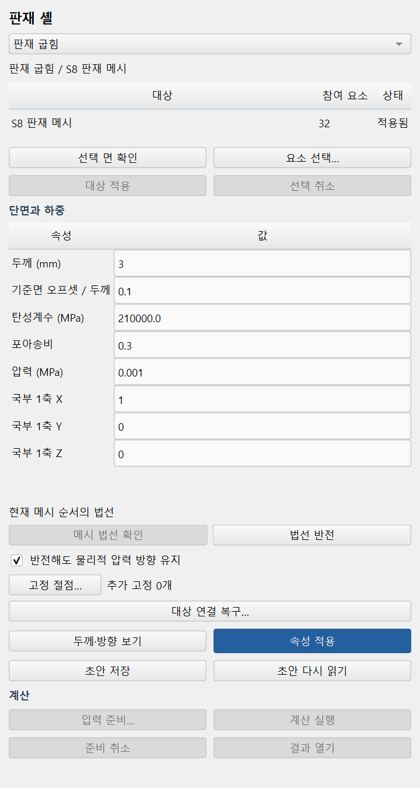

위 화면은 실제 FreeCAD에서 연 편집 패널입니다. 아래는 Windows CalculiX로 계산한
판재의 상·하면 복원 응력 중 XX 성분을 실제 ParaView에서 표시한 결과입니다.
복원 응력은 정확한 표면 적분점 응력과 다릅니다. 지원 범위와 방향·오프셋·실패 복구는
[판재 셸 사용법](SHELL_WORKFLOW_KO.md)을 참고하세요.

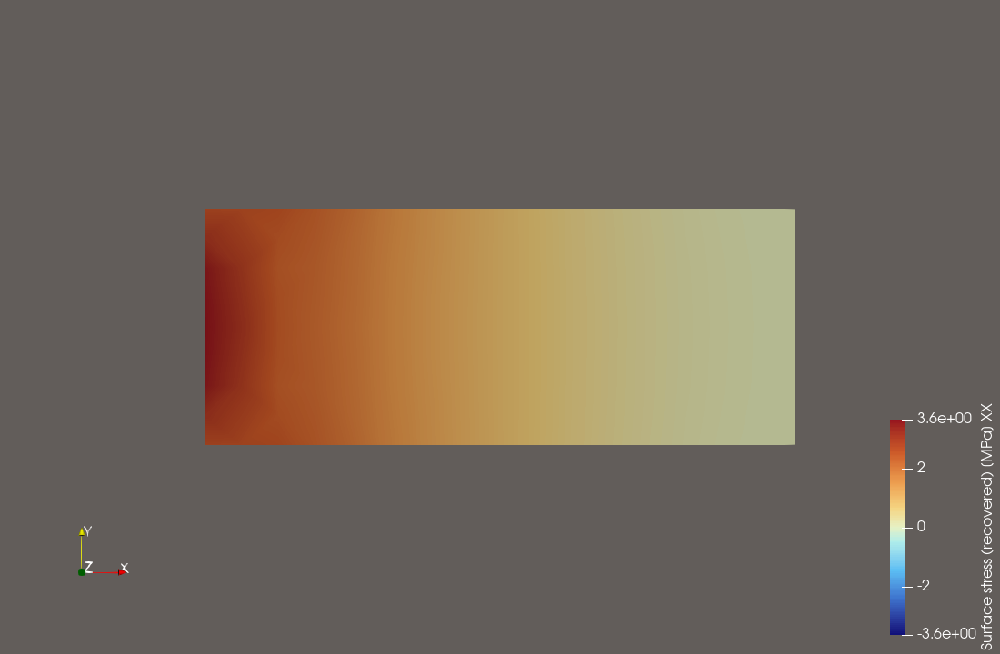

### 보의 단면과 끝 하중을 바꿔 계산하기

설치를 마친 뒤 `examples/beam/Open-Example.cmd`를 더블클릭합니다.
길이 1000 mm의 보와 직사각 단면, 선 메시와 끝 모멘트가 있는 새 작업 사본을 엽니다.
**빔 → 빔 설정…**에서 단면과 끝 조건을 고치고 **적용**한 뒤 입력을 준비해 계산합니다.
계산이 끝나면 성분을 골라 표와 곡선을 함께 보고 **성분 표 저장…**으로 CSV를 저장합니다.
전처리 프로젝트를 저장하면 다음에 같은 모델을 열어 수정하고 계산을 이어갈 수 있습니다.

아래는 Windows에서 실제 계산한 예제의 단면 굽힘 모멘트를 읽은 Qt 결과 창입니다.
결과를 여는 데 FreeCAD나 솔버를 다시 실행할 필요는 없습니다.
회전각과 지지부 합반력 모멘트는 아직 제공하지 않습니다. 전체 순서와 지원 범위는
[빔 작업 안내](BEAM_WORKFLOW_KO.md)에 있습니다.

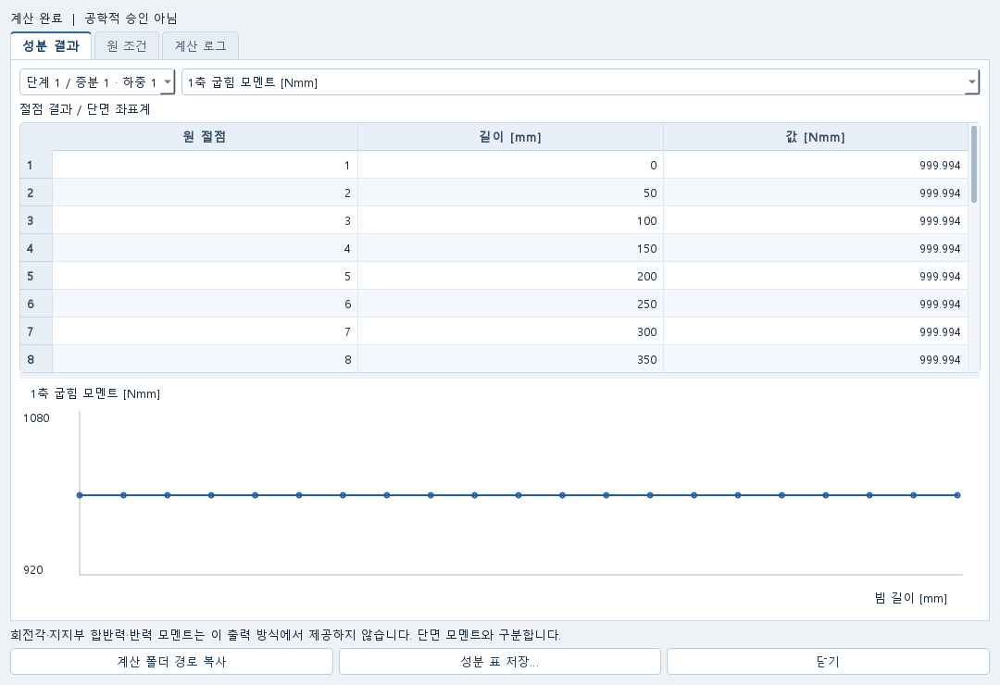

### 메시를 다시 만든 뒤 품질 비교하기

전처리에서 **해석 설정 → 메시**의 요소 크기나 국부 크기를 바꾸고 **메시 생성**을
실행하면 이전 메시가 문서에 보관됩니다. 모델 트리에서 현재 메시를 선택한 뒤
상단 **CAE 작업 → 메시 품질 비교…**를 엽니다. 문서에 현재 메시가 하나뿐이면
선택하지 않아도 그 메시를 엽니다. 여러 물체의 메시가 있으면 하나를 직접 선택하세요.

비교 창의 **이전 메시** 목록에서 기준으로 삼을 재메시 기록을 고릅니다. 요소 수와
불량 요소 수, 요소별 최소 Jacobian의 범위와 분포를 이전/현재 순서로 읽습니다.
변화는 현재 값에서 이전 값을 뺀 값입니다. 처음 메시를 만들기 전의 보관본은 비어
있을 수 있으며, 이때 극값과 변화는 **확인 불가**로 표시합니다. 없는 값을 0으로
간주하지 않습니다. 분포 구간이 서로 다르면 각 분포를 따로 읽으세요.

모델을 편집한 뒤에는 **다시 조회**를 누릅니다. 형상과 메시의 연결을 확인할 수
없다는 경고가 있으면 비교 숫자만 보고 현재 형상에 맞는 메시라고 판단하지 마세요.
보관본이 삭제됐으면 다른 기록을 선택합니다. 비교 창은 메시를 다시 만들거나
문서를 저장하지 않습니다. 메시와 보관 기록을 남기려면 기존 **프로젝트 저장**을
사용하고, 저장한 프로젝트를 다시 열어 같은 메뉴에서 비교합니다.

이 비교는 C3D10의 네 Gauss 표본에서 구한 요소별 최소값을 사용합니다. 전체 요소의
품질 보증이나 해석 적합 판정은 아닙니다. 불량 요소의 위치를 확인하려면
**CAE 작업 → 메시 품질 확인…**에서 행을 고르고 **격리** 또는
**확대**를 누릅니다. **복원**으로 원래 보기로 돌아갑니다.
여러 요소 선택과 모델에서 고른 요소를 표에서 찾는 방법은
[메시 요소 품질 확인](MESH_QUALITY_KO.md)에 있습니다.

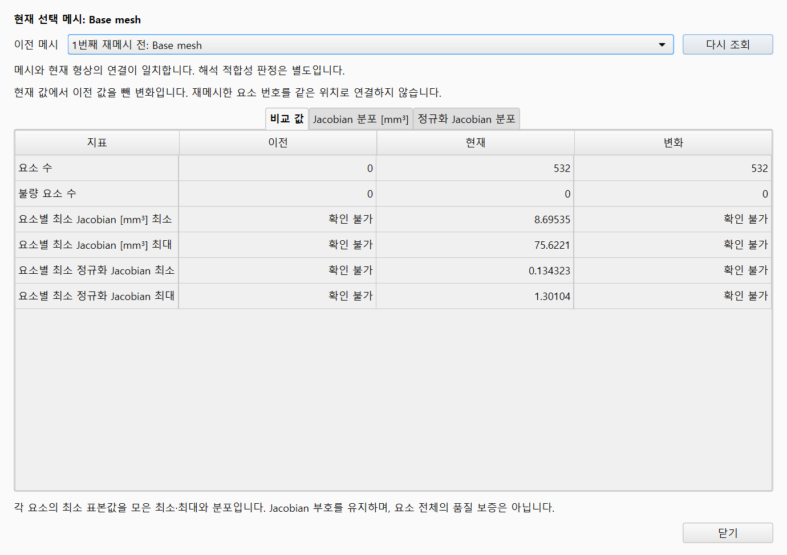

위 화면은 실제 저장 모델을 FreeCAD에서 연 결과입니다. 처음 메시를 만들기 전의
빈 보관본과 현재 532개 요소를 비교하므로 이전 극값은 확인 불가로 나옵니다.

### 삭제한 치수의 연결 복구하기

등록했던 치수나 부품을 삭제하면 연구 변수 목록에 **연결 복구 필요**가 표시됩니다.
정상적으로 연결된 다른 변수는 계속 편집할 수 있습니다.

1. 해당 변수 행을 선택하고 **치수 연결 복구…**를 누릅니다.
2. **새 대상**에서 연결할 치수를 고르고, 영향을 확인할 솔리드와 기존 범위 안의
   시험 값을 입력합니다.
3. **형상 영향 확인**을 누릅니다. 시험 값으로 형상이 바뀌는지 확인한 뒤 원래
   모델로 돌아옵니다. 연결을 바꾸려면 **연결 적용**, 유지하려면 **취소**를 누릅니다.
4. 복구한 변수의 값을 편집해 형상을 확인하고 `.caepre`로 저장합니다. 문서를 닫고
   다시 열어도 같은 치수와 변수 이름·범위·모드를 유지합니다.

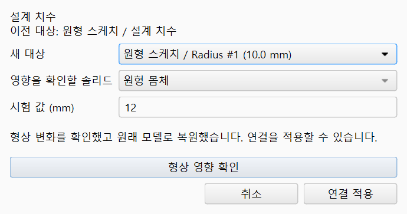

위 화면은 공개 스케치 예제의 실제 FreeCAD 창입니다. mm 길이 치수를 지원하며,
표현식으로 정해지는 치수나 이미 다른 변수에 등록된 치수는 새 대상으로 쓸 수 없습니다.
같은 이름으로 삭제·재생성한 치수의 이력까지 자동 판별하지는 못하므로 실제 대상을
확인하세요. 직접 따라 할 두 모델은 [CAD 변수 복구 예제](../examples/cad_parameters/README.md)에 있습니다.

### 설계 변수를 계산 계획으로 넘기기

해석 조건을 준비한 모델에서 **Numerical…**을 누릅니다. **모델 변수** 표에서
치수, 재료 계수, 하중 또는 지원되는 관절 좌표를 선택하세요. **모델에서 선택**으로
대상을 확인하고 허용 하한·상한과 계산 변수명을 입력한 뒤 **범위 변경 등록**을 누릅니다.
관절 좌표를 고르면 축 원점, 양의 방향과 관절 제한이 표 아래에 보입니다.
여러 행을 편집한 경우 한 행을 등록해도 다른 행의 입력은 남습니다. **변경 미등록**인
행은 계산 계획을 만들기 전에 등록하세요. 계획 버튼을 누르면 해당 행으로 이동합니다.
해석을 바꿨다가 돌아와도 각 해석의 편집 중인 범위와 응답을 유지합니다.

**해석 응답**에서 **응답 추가…**를 눌러 변위, 접촉력 또는 접촉면 결과를 고릅니다.
단위와 성분, 어느 증분을 읽을지 확인하세요. 실험계획 또는 최적화를 고르고
**계산 계획 만들기…**를 누르면 Numerical에서 조건을 이어 편집합니다.
계획을 여는 것만으로 해석이 실행되지는 않습니다. 현재 조립 좌표 연결은 고정된 부품과
이동 부품 두 인스턴스, 단일 회전 또는 이동 관절을 지원합니다. 중첩 조립과 여러 관절의
종속 동작은 아직 이 후보 계산 경로에 연결되지 않았습니다.

아래는 저장된 합성 조립 예제를 실제 FreeCAD의 연구 패널에서 읽은 화면입니다.
선택한 이동 관절의 값과 허용 범위, 접촉력 응답을 보여 줍니다.


## 2. 자료를 넣고 질문·토론·연구 기록 저장하기

```powershell
.\Start-CAE-Lab.cmd -Tool expert
```

1. **파일 → 새 대화…**에서 대화 제목을 정합니다.
2. 위쪽 **참고 자료 → 파일 추가…**에서 저장소의 `README.md`를 선택합니다.
   목록에서 자료를 선택하고 **원문 읽기**로 내용을 확인합니다.
3. 아래 입력칸에 질문을 적습니다. 예: “CAD 예제를 해석하려면 무엇을 준비해야 하는가?”
4. **파일 → 저장**을 누릅니다. 입력한 질문과 선택한 자료가 함께 저장됩니다.
5. **파일 → 대화 열기…**에서 같은 대화를 골라 질문과 자료를 다시 확인합니다.

자료와 질문을 저장하는 데 AI 연결은 필요하지 않습니다. 실제 답변을 받으려면
아래 연결과 역할·전송 설정을 준비하세요.

### AI 연결과 역할 선택

1. **연결 설정…**을 엽니다. **연결 설정** 탭에서 기존 OpenScience의
   **로그인 설정 폴더**, **실행 도구 폴더**, **기본 모델**을 지정합니다.
   **폴더 확인**으로 필요한 로컬 파일을 확인할 수 있습니다.
2. **역할** 탭에서 **역할 파일 불러오기…** 또는 **예제 역할 불러오기**를 누릅니다.
   역할별 모델을 비워 두면 표에 표시된 기본 모델을 사용합니다. 행을 선택하고
   **선택 역할 상세…**를 누르면 실제 지시와 자료 분류를 읽을 수 있습니다.
3. **자료 전송** 탭에서 허용할 질문·자료·결과를 선택하고 **설정 적용**을 누릅니다.
   설정은 파일에 저장한 뒤 현재 연결에 적용합니다. 진행 중인 작업이 있으면 창을
   열어 두세요. 작업이 끝난 뒤 적용합니다. 그 전에 닫았다면 다시 열어 **설정 적용**을 누릅니다.
4. 대화 창의 **참여 역할**에서 참여할 역할을 선택합니다.
   **전송 설정**에서 **질문 전송 허용**과 필요한 경우 **선택 자료 전송 허용**을 선택합니다.
5. 질문을 적고 **토론 시작**을 누릅니다. 발언이 있는 대화에서는 **질문 보내기**로 표시됩니다.
   답변을 읽은 뒤 **파일 → 저장**으로 보관합니다.

OpenScience 자체의 구독은 필요하지 않습니다. 현재 연결은 기존 ChatGPT 이용권과
로그인을 쓰는 `openai-codex` 경로를 지원합니다. 예시 역할은 재료 모델과 시험·수치 결과를
검토하도록 지시한 AI이며, 별도 학습한 모델이나 전문 자료집은 아닙니다. 자료 분류의
이름만으로 원문이 들어오지는 않습니다.

**설정 적용**과 **폴더 확인**은 로그인이나 실제 모델 응답을 시험하지 않습니다.
적용에 실패하면 하단 안내에 따라 **다시 적용**하거나 설정 창을 다시 여세요.
파일이 다른 곳에서 바뀌었다면 **다시 읽기**로 최신 설정을 불러와 편집합니다.
오류 원문과 확인 항목은 **확인 상세 펼치기**에서 볼 수 있습니다.
저장을 시작하기 전 **취소**는 편집을 버립니다. 저장이 시작되면 버튼이 **닫기**로 바뀌며,
창을 닫아도 이미 시작한 파일 저장은 계속됩니다.

발언을 선택하고 **답글**을 누르면 그 발언에 관한 질문을 이어 쓸 수 있습니다.
**발언 남기기**는 사용자의 의견을 기록합니다. **일시 정지**는 다음 응답 요청을 멈추며
이미 실행 중인 응답은 취소하지 않습니다. **계속**으로 이어갑니다.
공개 문헌 검색은 **전송 설정 → 공개 논문 검색 허용**을 선택합니다. 현재 검색기는
Crossref이며 유료 원문을 구매하지 않습니다.

**역할별 답변** 모드는 선택한 역할이 순서대로 답하는 방식입니다. 아래 자료 토론과
구분해서 선택합니다. 저장된 옛 발언 본문은 자동으로 다시 쓰지 않습니다.

### 자료를 함께 검토하고 보고서 만들기

1. 새 대화에서 **자료 토론 (Co-STORM)**을 선택합니다. **참고 자료**에서 쓸 자료를
   고르고 **참여 역할**, **전송 설정**을 확인합니다.
2. 질문을 입력하고 **토론 시작**을 누릅니다. 초기 조사는 여러 응답을 거칩니다.
   한도에 도달하면 작업을 보관하고 멈춥니다. 설정을 확인한 뒤 **다시 시도**로 이어갑니다.
3. 왼쪽 논점을 고르면 관련 발언으로 이동합니다. 발언의 인용 번호로 원문을 엽니다.
   의견을 입력하고 **참여하기**를 누르면 다음 단계에 반영됩니다.
   입력 없이 토론을 더 읽으려면 **다음 발언**을 누릅니다.
4. **보고서 → 보고서 작성**으로 내용을 정리합니다. 인용 자료를 확인한 뒤
   **파일 → 저장**으로 대화와 함께 보관합니다. **내보내기…**로 Markdown 또는 HTML 파일을 만듭니다.

선택한 자료와 기존 로그인으로 초기 토론, 사용자 참여, 보고서 작성과 저장·재열기를
확인했습니다. 재시도 중 새 입력 보존과 논점 지도 교정도 반영했습니다.
대화와 보고서는 문단·표·수식을 구분해 표시합니다. 보고서를 읽는 동안 질문 입력창은
접히며, **대화로 돌아가기**를 누르면 작성 중인 질문과 읽던 위치가 유지됩니다.
수식을 복사하면 원래 수식 문법을 받습니다. 지원하지 않거나 화면 폭에 맞지 않는 긴
수식은 원문으로 표시하며, 내보낸 Markdown과 HTML에도 원래 수식을 보존합니다.
전체 화면의 사용성 확인은 계속 진행 중입니다.
새 자료 토론 모드에서 계산 계획이
자동 생성되는 것은 아닙니다. 계산 제안과 결과 전달은 아래 **역할별 답변** 경로를 씁니다.
자세한 범위는 [자료 토론 안내](CO_STORM_PROTOCOL.md)를 참고하세요.

### 제안을 계산하고 결과로 토론 이어가기

1. 답변을 선택하고 위쪽 **계산 계획**에서 제안을 고릅니다.
   **계산 계획 열기**를 누르면 별도 Numerical 창이 열립니다.
2. **계획** 탭에서 계산 방법과 입력값을 확인·수정한 뒤 **변경 적용**,
   **현재 계획 실행**을 누릅니다.
   제안을 열기만 해서는 계산이 시작되지 않습니다.
3. **결과** 탭의 계산 이력에서 결과를 선택하고 **결과 읽기**로 확인합니다.
   **저장**으로 결과까지 보관합니다. 입력을 다시 고칠 때는 **계획** 탭으로 돌아갑니다.
   두 탭을 오가도 편집 중인 입력과 선택한 결과는 유지됩니다.
4. Expert로 돌아와 **결과 첨부…**를 누릅니다. 저장한 Numerical 문서와 계산을 고르고,
   전달할 결과 값을 선택합니다. 값을 선택하지 않으면 계산 상태만 첨부됩니다.
   선택 목록은 원결과의 물리량·성분·단위를 표시하며 실제 응답 연결은 유지합니다.
   같은 계산과 같은 응답을 다시 선택해도 첨부는 늘어나지 않습니다.
   선택 중 원자료나 대화가 변경되면 편집한 질문을 유지한 채 첨부를 중단합니다.

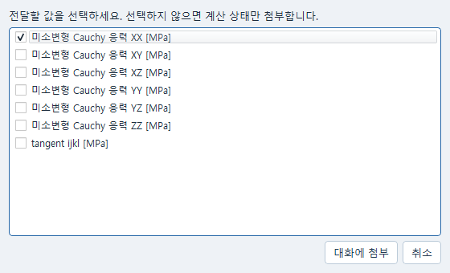

5. 결과에 관한 질문을 적고 **전송 설정 → 첨부 결과 전송 허용**을 선택한 뒤
   **질문 보내기**를 누릅니다. **파일 → 저장**으로 대화를 보관합니다.

결과 첨부와 AI 전송은 별도 동작입니다. 실제 AI 제안의 탄성계수를 바꿔 FELUPE 계산을
실행하고 AI가 응력값을 읽어 설명하는 흐름을 확인했으며, 입력은 합성 탄성 예제였습니다.
모든 버튼을 직접 조작한 전체 사용성 확인은 아직입니다. 일반 메뉴는 한국어로 표시하지만
고급 입력의 모델 항목과 일부 전문 설정은 영어입니다. 원본 연결은 **원본 문서 열기**,
상세 연결 정보는 **보기 → 연결 정보…**에서 확인할 수 있습니다.

### 계산과 논의를 Study에 모아 다시 열기

Study는 연구 질문에 계산 결과와 논의 내용을 함께 연결하는 문서입니다.
먼저 Numerical과 Expert에서 보관할 결과·발언을 저장합니다.

```powershell
.\Start-CAE-Lab.cmd -Tool study
```

1. **파일 → 새 연구 기록**을 선택합니다. 위쪽 **질문 수정**에서 연구 질문을 적고
   **질문 접기**를 누르면 읽을 공간이 넓어집니다.
2. 왼쪽 **자료 추가… → 계산 결과 추가…**에서 저장한 Numerical 문서와 계산을 고릅니다.
   **대화 발언 추가…**에서는 저장한 Expert 대화와 보관할 발언을 고릅니다.
3. 왼쪽 자료 목록에서 항목을 선택하면 중앙에 발언 본문이나 결과의 그래프·표가 나타납니다.
   단위를 함께 확인하세요. 읽기에 실패하면 **다시 읽기**를 누릅니다.
4. **자료 메모**를 누르면 읽던 자료 옆에 편집 영역이 열립니다. 좁은 창에서는 아래에 열립니다.
   판단을 남기려면 **판단 작성**을 누르고 **지지하는 자료**, **반박하는 자료**를 직접 고릅니다.
   목록의 자료 이름을 누르면 작성 중인 판단을 유지한 채 해당 자료를 읽을 수 있습니다.
5. **연구 기록 저장**이나 **파일 → 저장**을 누릅니다. **접기**는 편집 영역만 접습니다.
   **파일 → 연구 기록 열기…**에서 같은 문서를 다시 열고 자료와 메모를 확인합니다.

결과에서 다른 성분을 살펴보는 것만으로 연구에 연결한 값이 바뀌지는 않습니다.
바꾸려면 **이 성분을 연구에 연결**을 누른 뒤 저장하세요.

자료를 선택한 뒤 **원본 열기**, **추가 질문…**, **다음 계산…**으로
이어갈 수 있습니다. 판단을 선택한 경우에는 화면에 표시된 판단을 바탕으로 후속 작업을 만듭니다.
연결한 원래 결과·발언은 그대로 보존하며, 읽거나 메모를 저장하는 것만으로
계산이나 AI 응답을 새로 만들지 않습니다. 메모와 판단의 저장은 설계의 안전성 승인이 아닙니다.

### 수치 계산 결과를 연구 창으로 보내기

Numerical에서 보낼 계산을 선택하고 **결과 전달…**을 누릅니다.
**계산 결과 보내기**에서 응답을 고른 뒤 **연구 창으로 보내기**를 누르세요.
받는 Study 또는 Expert 창의 **받은 결과 확인…**에서 대상 연구와 응답을 확인하고
**연구 기록에 추가**를 누릅니다. 취소하면 원래 편집 내용은 그대로 남습니다.
추가한 결과를 계속 보관하려면 받는 창에서 변경 사항을 적용하고 저장하세요.
전달과 확인만으로 새 계산이나 AI 응답을 만들지는 않습니다. Expert에서 첨부 후
**편집 적용**을 하면 **편집 → 실행 취소**로 되돌릴 수 있고, 저장한 대화를 다시 열어 같은 결과를 읽을 수 있습니다.
새 발언이나 부분 응답이 들어와도 변경되지 않은 이전 발언의 본문 선택은 유지됩니다.

이 경로는 선택한 계산의 전체 후보 이력을 함께 연결합니다. 표에서 선택한 후보
하나만 추출하는 기능은 아닙니다. 재료 계수 하나를 채택하려면 Numerical의
**계수를 재료에 적용…**을 사용하세요. 내부 식별자는 필요한 경우에만
**기술 정보 보기**로 펼쳐 확인할 수 있습니다.

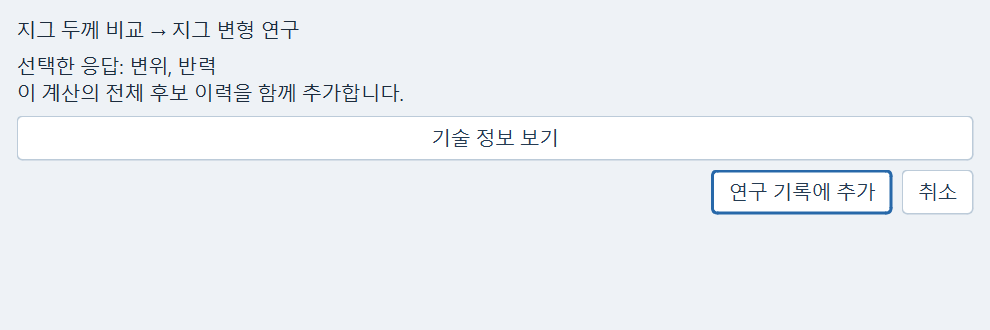

위 화면은 전달 조작을 설명하기 위한 시험 자료입니다. 실제 해석 결과나 물리 검증
자료로 사용하지 않습니다. 전달 응답을 받지 못한 경우 새 연구를 만들지 말고
**보기 → 전달 상태 확인**으로 기존 창의 상태부터 확인하세요.

### 표 파일을 가져와 수치 연구로 이어가기

```powershell
.\Start-CAE-Lab.cmd -Tool data
```

1. **CSV 열기…**에서 파일을 고릅니다. 등록된 자료 폴더의 파일은 **원본 선택…**에서
   고릅니다. **원본 미리보기**에서 구분 문자와 머리글을 확인합니다.
2. **가져오기 설정 → 열 및 단위**에서 X축에 쓸 시간 등의 열과 채널별 원본 열을 정합니다.
   단위와 필요한 배율·보정값을 입력합니다. 열 번호는 0부터 시작합니다. 단위 이름만
   바꿔서는 숫자가 변환되지 않습니다.
3. 필요하면 **시험 조건**을 적고 **행 선택**에서 계산에 쓸 구간을 정합니다.
   **품질이 불량한 행**, **화면에서 숨길 행**은 계산 제외와 별개입니다.
4. **설정 적용 → 가져오기**를 누릅니다. 왼쪽 **가져온 데이터**에서 항목을 골라
   **가져온 값**과 아래 그래프를 읽습니다. **가져오기 설정**을 다시 누르면 설정을 접고
   값을 읽는 공간이 넓어집니다. 쓰던 설정은 그대로 남습니다.
5. **재료 피팅…**에서 관측할 응력과 재료 법칙을 선택합니다. 피팅 창에서 시험 조건을
   정한 뒤 실행합니다. **전문가에게 질문…**으로 자료를 전달할 수도 있습니다.
   연결한 문서를 여는 것만으로 계산이나 AI 응답이 실행되지는 않습니다.
6. **저장**한 문서를 **열기…**로 다시 열면 보존된 값을 읽습니다. 원본을 다시 가져오지 않습니다.

시험 파일의 열과 단위를 지정하고 두 계수를 피팅한 뒤 검증용 시험과 비교해 계수를 채택하는 과정은
[공개 CSV로 따라 하는 재료 피팅](DATA_MATERIAL_WORKFLOW.md)에 설명했습니다.
힘·표점 변위·치수로 공칭응력과 진응력을 구해 큰 변형의 시험과 비교하는 과정은
[유한변형 시험 데이터 사용법](finite-measure/USAGE_KO.md)을 참고하세요.
아래는 예제의 실제 피팅 결과입니다. 이 합성 예제에서는 횡방향 변형을 구속했습니다.
실제 재료 시험의 승인 결과가 아닙니다.


### 재료 모델의 응력 응답 확인하기

Material에서는 재료 계수와 변형 이력을 직접 정해 응력 응답을 계산합니다.
시험 데이터로 계수를 피팅하는 작업은 [재료 피팅 안내](DATA_MATERIAL_WORKFLOW.md)를
따라 Numerical 창에서 진행합니다. 선택한 계수를 명시적으로 채택해야 Material에 반영됩니다.

```powershell
.\Start-CAE-Lab.cmd -Tool material
```

1. **재료 모델**을 선택하고 응력 및 탄성계수 단위와 시간 단위를 확인합니다.
2. **재료 계수** 표의 값을 수정합니다. **변형 이력** 표에는 시간별 변형구배 F를 입력합니다.
   오른쪽에 가려진 성분은 표의 가로 스크롤로 확인합니다. **행 추가**로 시점을 늘릴 수 있습니다.
3. **입력 적용**을 누른 뒤 **계산 실행**을 누릅니다. 실행할 수 없는 입력은 진단 상세에서
   원인을 확인하고 고칩니다.
4. **계산 결과**에서 완료한 계산을 고릅니다. 위쪽 그래프와 아래 **계산값**에서
   응력을 확인합니다. Ctrl 또는 Shift를 누르고 여러 계산을 선택하면 비교할 수 있습니다.
5. 입력을 바꾸면 기존 결과에는 이전 입력의 계산이라는 표시가 남습니다. 새로운 입력으로
   계산하려면 다시 **입력 적용 → 계산 실행**을 누릅니다.
6. **저장**으로 문서와 결과를 보관합니다. **열기…**로 다시 열 때 보존된 계산을 재실행하지 않습니다.

이 창은 지정한 변형구배에서 재료 모델의 응력을 계산합니다. 기본 예제처럼 F22와 F33을
1로 고정한 조건은 횡방향 변형을 구속하므로, 자유롭게 수축하는 인장시험과 구별해서 해석하세요.

## 3. 실제 수치 계산과 결과 파일 만들기

`examples/workbench_numerical.py`는 합성 재료 데이터의 피팅과 검증 구간 비교,
DOE·최적화·불확실성 계산을 수행합니다. CAD, 외부 솔버, AI 계정 없이 실행합니다.
먼저 기본 Research 설치를 마친 뒤 소스 폴더에서 실행하세요.

```powershell
$caePython = Join-Path $env:LOCALAPPDATA 'AutonomousCAELab\windows-runtime\venv\Scripts\python.exe'
$exampleOutput = Join-Path (Get-Location) ('runs\first-study-' + (Get-Date -Format 'yyyyMMdd-HHmmss'))
& $caePython .\examples\workbench_numerical.py --output $exampleOutput
```

결과를 덮어쓰지 않도록 매번 새 폴더를 사용합니다. 실행이 끝나면 해당 폴더를 엽니다.

| 결과 | 확인할 내용 |
|---|---|
| `fit-holdout.png` | 피팅과 별도 검증 구간의 곡선 비교 |
| `fit`, `callable-doe`, `optimization` | 계산별 입력·결과 |
| `uq`, `epsilon` | 불확실성·다목적 계산 결과 |
| `summary` | 연구 요약 |

2026-10-13 Windows의 전용 실행 환경에서 이 예제를 끝까지 실행해 위 파일 생성을 확인했습니다.
해당 실행은 약 11초였으며 PC에 따라 달라집니다.

계산은 실제 수치 엔진을 사용하지만 입력은 합성 예제입니다. 사용자 재료의 물성을
검증한 결과는 아닙니다. 이 예제는 Python 사용 경로이며 GUI 전체 사용성 완료를 뜻하지 않습니다.

## 실행 목록에서 계산 확인하기

Runner는 각 도구에서 실행한 작업을 모아 보여 줍니다. 시작 파일을 옵션 없이 열거나
`Start-CAE-Lab.cmd -Tool runner`로 실행합니다. 처음에는 작업 목록이 비어 있습니다.
**도구** 메뉴에서 사용할 프로그램을 열어 계산한 뒤 Runner에서 확인하세요.

1. 위 목록에서 작업을 선택하면 **진행 상황**에 상태, 시작·종료 시각과 실행 자원이 보입니다.
2. **결과 보기**로 저장 결과를 읽습니다. **결과 항목**을 골라 그래프나 **계산값**을 확인합니다.
   결과를 읽거나 작업을 선택하는 동작은 계산을 다시 실행하지 않습니다.
3. **입력 문서 열기**로 원래 편집 화면으로 돌아갑니다. 지원하는 공간 결과는
   **후처리에서 열기**, 연구에 쓸 결과는 **연구 기록에 추가…**로 이어갑니다.
4. 실행 중에는 **실행 취소**를 누릅니다. 여러 후보를 계산하는 작업은 **전체 계산 취소**로
   표시됩니다. **취소 요청됨**은 아직 종료 전이며, **취소 완료**가 실제 종료 확인입니다.
   **추적 중단** 또는 **프로세스 종료 미확인**이면 프로그램이 끝났다고 단정하지 마세요.

같은 이름의 작업은 시작 시각으로 구별하고, 정확한 실행 ID와 입력 기록은 **기술 상세**에서
확인할 수 있습니다. ID는 작업 이름 위에 마우스를 올려도 보입니다.

## PDE 모델 편집과 결과 보기

Windows에서 WSL 없이 실행하는 공간 약형식·열전도·열탄성과 다른 메시 사이 온도 전달은
[열전도와 장 전달 예제](s1_windows_transfer/README_KO.md)를 참고하세요. 실제 화면과
저장된 결과를 여는 방법을 함께 설명합니다.

`Start-CAE-Lab.cmd -Tool pde`로 독립 창을 엽니다. **모델 열기…**에서 저장한 모델을
고르거나 **새 모델…**로 시작합니다. 왼쪽에서 영역, 방정식, 경계 조건을 선택하면
가운데에 속성이, 오른쪽에 모델 영역이 나타납니다.

1. 속성을 수정하고 **입력 검사**로 잘못된 식이나 지원하지 않는 설정을 확인합니다.
   오류는 **기술 상세**를 접어도 화면에 남습니다.
2. **변경 적용**으로 편집을 반영합니다. **모델 평가**는 선택한 계산 환경이 있을 때
   실행할 수 있습니다. 모델 편집과 저장 자체에는 솔버 설치가 필요하지 않습니다.
3. 왼쪽 **계산 결과**에서 이전 계산을 선택합니다. **계산 결과** 탭에서 필드와 절점을
   고르면 값과 단위를 확인할 수 있습니다. 입력을 고쳐도 이전 결과는 보존됩니다.
4. **실행 작업**으로 진행 상태를, **Post에서 열기**로 지원 결과를 확인합니다.
   반복 계산은 **수치 계산 계획**으로 이어갑니다. **저장** 후 같은 모델을 다시 열 수 있습니다.

### 온도가 시간에 따라 변하는 문제

**새 모델… → 상태 방정식 (단위가 있는 ODE)**를 고르면 간단한 냉각 문제에서 시작합니다.
초기 온도는 300 K, 주위 온도는 290 K, 냉각 계수는 0.5 1/s입니다. 상태의 초기값과
미분식, 계수의 값과 단위, 계산할 시간 구간을 각각 편집합니다. 기본 미분식은
`-rate*(temperature-ambient)`이며 시간 단위는 초입니다.

**입력 검사 → 변경 적용 → 모델 평가** 순서로 계산하면 선택한 실행의 온도 이력을
읽을 수 있습니다. 기준식을 지정했으면 같은 시각의 기준값과 오차도 비교합니다.
초기값을 바꿀 때 기준식에 쓰인 별도 계수 `initial`도 자신이 비교하려는 문제에 맞춰
정하세요. 기준식은 실제 계산 조건을 자동으로 추정하지 않습니다. **저장**한 뒤 다시
열면 같은 모델과 이전 계산을 이어서 볼 수 있습니다. 이 계산은 설치된 SciPy를 사용하며
FEniCSx나 CAD가 필요하지 않습니다. 사건 탐지와 대수 구속식은 아직 지원하지 않습니다.

### 단위가 있는 약형식과 메시 비교

새 모델에서 단위가 있는 약형식을 고르면 좌우 온도가 300 K와 310 K인 직사각형 문제로
시작합니다. 장과 계수의 단위, 영역 크기, 체적 적분식과 경계식을 정하고 메시 수준을
추가합니다. 식을 검사하는 단계에서는 계산하지 않습니다. **모델 평가**는 설치된
FEniCSx에서 각 메시의 실제 해를 구합니다.

실행을 선택한 뒤 **연구 → 메시와 오차 비교…**에서 메시별 오차를 비교하고,
**Post에서 열기**로 지원하는 공간 결과를 확인합니다. 온도장의 2차원 L2 오차 단위는
K·m, H1 반노름 오차 단위는 K입니다. 이 모델은 직사각형의 스칼라 선형 문제를 지원하며
일반 비선형·벡터 약형식이나 모든 영역으로 확대해 사용할 수는 없습니다.

계산 방법을 바꿔도 모델이 자동 변환되지는 않습니다. 필요한 실행 환경은
[설치 안내](INSTALL_KO.md), 상세 지원 범위와 예제 명령은
[구성식·PDE 연구 안내](RESEARCH_003.md)를 참고하세요.

## 해석 모델을 따로 편집하고 다른 도구에 연결하기

`Start-CAE-Lab.cmd -Tool simulation`으로 독립 해석 창을 엽니다.
**새 해석 모델…**에서 사용할 모델을 고릅니다. 모델 이름에는 계산 프로그램과
지원하는 문제가 함께 표시됩니다. CAD 구조 해석과 정해진 블록·직사각형 예제의
지원 범위가 다르므로, 선택한 모델의 안내를 먼저 확인하세요.

아래는 공개 J2 블록의 재료 조건을 편집하는 실제 Qt 화면입니다. 오른쪽 그래프는
입력한 축변형률 이력이며, 해석 결과가 아닙니다.


1. 왼쪽에서 **형상**, **재료**, **하중과 변형 이력** 등 수정할 항목을 고릅니다.
   선택한 모델에 있는 조건만 편집할 수 있습니다. 숫자 옆의 단위를 확인하세요.
2. 표시되는 영역 그림이나 입력 이력으로 조건을 확인합니다. 입력 이력은 사용자가
   정한 하중이나 변형을 보여 주며, 아직 계산한 응력·변위 결과는 아닙니다.
3. **입력 검사**로 설정을 확인한 뒤 **변경 적용**, **저장**을 누릅니다.
   잘못된 값을 포함한 초안도 저장할 수 있지만, 오류를 고치기 전에는 계산할 수 없습니다.
4. 계산하려면 **계산 환경 확인**으로 선택한 프로그램의 설치를 확인하고
   **모델 평가**를 실행합니다. 설치 확인만으로 해석을 실행하지는 않습니다.
   별도 실행 환경은 [설치 안내](INSTALL_KO.md)를 참고하세요.
5. 왼쪽 **계산 결과**에서 실행을 고르면 그때 저장한 결과를 읽습니다.
   **실행 작업**은 진행 상태를, **Post에서 열기**는 지원하는 공간 결과를 엽니다.
   입력을 수정해도 이전 결과가 새 입력의 계산값으로 바뀌지는 않습니다.
6. 반복 탐색을 하려면 **수치 계산 계획**으로 이어갑니다. 여러 모델을 순서대로
   실행하려면 아래의 계산 절차 창에서 저장한 모델을 단계로 추가합니다.
   다른 창을 여는 것만으로 새 해석을 시작하지 않습니다.

**해석 모델 열기…**에서 같은 모델을 다시 열어 편집을 이어갈 수 있습니다.
편집·저장과 이전 결과 열람에는 솔버가 필요하지 않습니다. 새 해석에는 선택한
프로그램과 해당 모델의 실행 지원이 필요합니다. 충격·응집 손상·반복하중의 지원
조건은 아래에 따로 설명합니다. 모든 종류의 충돌이나 피로 모델을 지원하지는 않습니다.

## 유한요소 모델에 충격 조건 넣기

Windows에서 공개 응집 시편의 계산, 결과 파일 등록, 연구 기록 연결과 저장·재열기를
확인했습니다. 아래는 지원하는 유한요소 입력으로 조건을 만들고 계산하는 순서입니다.
임의의 CAD 모델과 모든 충돌 법칙이 지원된다는 뜻은 아닙니다.

Windows용 [충격 솔버 설치 안내](INSTALL_KO.md#windows용-충격-솔버-준비하기)를 먼저
확인하세요. 모델 편집·저장에는 솔버가 필요하지 않으며, 실제 계산에만 사용합니다.

1. 독립 **해석** 창에서 **새 해석 모델… → 사용자 FE 충격 (OpenCourant)**를 고릅니다.
   **연구 → 충격 조건… → 유한요소 파일 열기…**에서 주 INP와 포함 파일을 찾을 작업 폴더를 고릅니다. 형상만 있는
   CAD 파일이 아니라 메시·재료·밀도·집합이 들어 있는 유한요소 파일이 필요합니다.
   길이 mm, 시간 s, 힘 N, 응력 MPa, 질량 Mg 단위를 확인하세요.
2. 운동용 절점 집합이 없으면 **모델과 집합**에서 요소 집합을 골라 **운동 대상 만들기…**를 누릅니다.
   강조된 절점과 좌표 범위를 확인한 뒤 이름을 정합니다. **초기 운동**에서 그 집합을 추가하고 속도를 지정합니다. 선택한 행의 병진 속도,
   각속도, 회전 중심을 아래 XYZ 입력에서 편집합니다. 높이에서 놓는 경우와 높이를
   충돌 직전 속도로 환산하는 경우는 구분하며, 두 경우 모두 중력 설정이 필요합니다.
3. 필요한 접촉면이 없으면 **모델과 집합 → 접촉면 만들기…**에서 표의 행이나 형상 면을 선택합니다.
   선택한 면의 위치와 면적을 확인하고 만듭니다. **접촉**에서 맞닿을 두 면 집합과 마찰계수를 고릅니다.
   접촉쌍을 지정하지 않아도 자동으로 모든 물체의
   충돌을 찾아 주는 방식은 아닙니다.
4. **결과 이력**에서 보고 싶은 물리량과 원 모델의 절점 또는 요소 번호, 성분을
   지정합니다. 예를 들어 특정 요소의 zz 응력이나 특정 절점의 Z 가속도를 고릅니다.
   **시간과 중력**에서 종료 시간과 결과 저장 간격을 정합니다.
5. **편집 반영 → 변경 적용 → 저장**을 누릅니다. 지원하지 않는 입력이나 잘못된 값은
   고친 뒤 계산해야 합니다. **해석 모델 열기…**에서 저장한 조건을 다시 열 수 있습니다.
6. **모델 평가**로 계산을 시작합니다. 완료되면 **계산 결과**에서 실행과 보고 싶은
   이력을 고릅니다. 그래프는 실제 저장된 시각의 값이며, 마지막 저장 시각이 설정한
   종료 시간과 항상 같지는 않습니다. **저장**한 뒤 연구 기록으로 연결하면 같은
   실행 결과를 읽으며 판단을 이어갈 수 있습니다.
7. **Post에서 열기**로 등록된 공간 결과를 엽니다. ParaView의 시간 선택에서 저장된
   시각을 옮겨 변형과 필드를 봅니다. 계면 손상은 셀 배열 `3DELEM_Damage`이며, 벌크
   요소에는 적용되지 않습니다. 단위 없는 손상값 0은 이 법칙에서 손상이 없는 상태입니다.

다음은 공개 두 물체 예제에서 윗물체의 접촉면을 고르는 실제 Windows Qt 화면입니다.
파란 면은 사용자가 선택한 입력 면이며, 계산 결과의 압력이나 응력이 아닙니다.
`examples/impact/include-project/model.inp`를 열어 같은 작업을 따라 할 수 있습니다.
면 만들기, 운동 지정, 저장과 실행의 값은 [다부품 입력 예제](IMPACT_DAMAGE_WORKFLOW.md#공개-다부품-입력으로-따라-하기)에 있습니다.

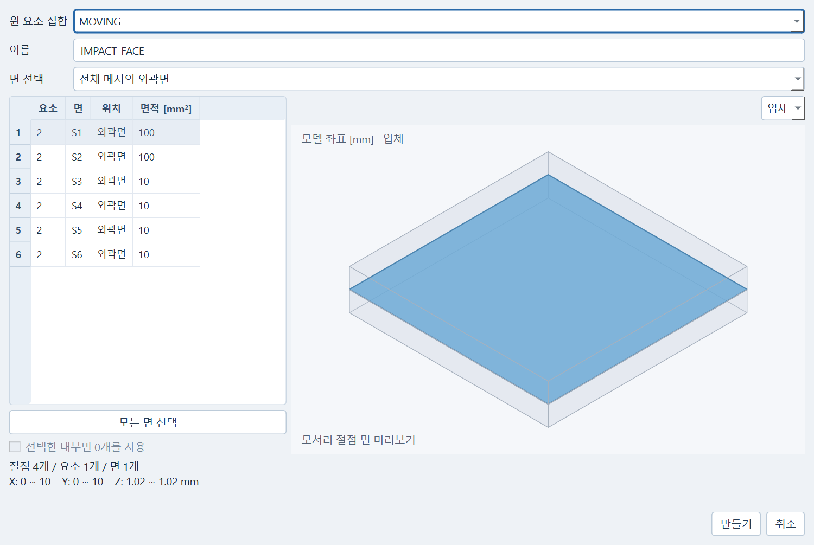

아래는 공개 합성 시편에서 손상·분리·응력·가속도를 선택하는 실제 Qt 화면입니다.
표의 값은 결과를 읽을 위치와 성분이며 계산된 응력값이 아닙니다.

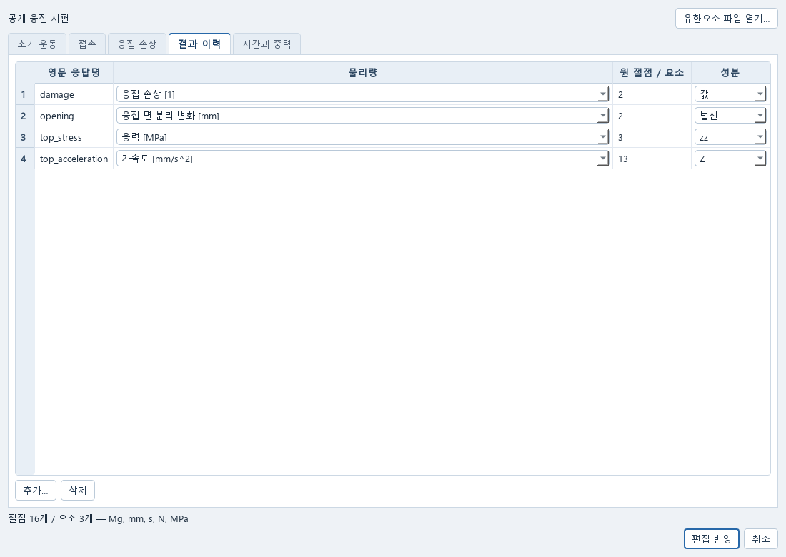

아래는 같은 공개 시편을 실제 계산한 뒤 ParaView에서 연 결과입니다. 두 벌크 사이의
얇은 계면이 파란색이며, 이 예제에서 읽은 손상값은 0입니다. 색 범위는 0–1이고,
위아래 회색 영역은 계면 손상 대상이 아닙니다.

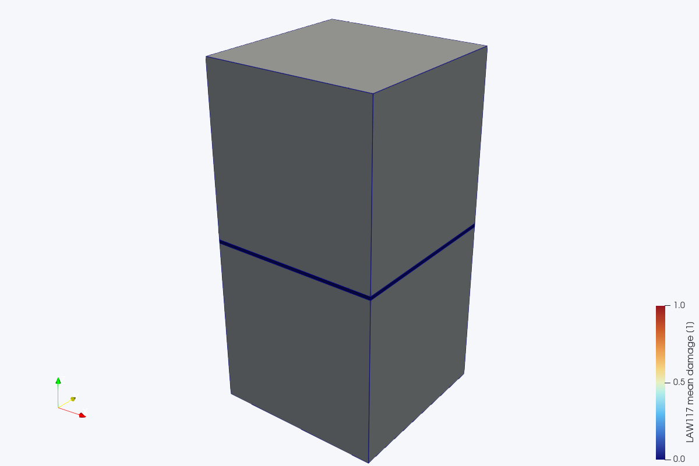

접착 계면 손상을 계산하려면 두께가 있는 응집 요소와 해당 재료 시험값도 필요합니다.
지원 요소·재료·접촉 범위와 FreeCAD 연결은 [충격·손상 상세 안내](IMPACT_DAMAGE_WORKFLOW.md)에
있습니다. 계산 종료는 설계 안전성 판정과 별개이며, 공개 예제의 재료값을 실제 부품에
그대로 적용해서는 안 됩니다.

## 저장한 응력 이력으로 반복하중 평가하기

시간에 따른 응력 CSV가 있으면 WSL이나 충격 솔버 없이 반복하중을 평가할 수 있습니다.
현재 지원 범위는 한 위치의 부호 있는 수직 응력과 사용자가 제공한 S–N 시험 자료입니다.
다축 피로나 균열 성장, 반복 소성과 연동한 수명을 계산하는 기능은 아닙니다.

1. **데이터**에서 시간 [s]과 응력 [Pa 또는 MPa] 열을 지정합니다. 응력 성분과
   측도, 측정 위치, 고정된 기준계를 입력하고 **가져오기**, **저장**을 누릅니다.
   결측·제외 구간은 임의로 이어 붙이지 않습니다.
2. **해석 → 새 해석 모델… → 반복하중과 S–N 누적**을 고릅니다.
   **연구 → 반복하중 조건… → 응력 이력 선택…**에서 저장한 문서와 계산,
   응력 성분을 고르면 원 곡선이 나타납니다.
3. **시험점 추가**로 응력 진폭과 수명 사이클 수를 입력합니다. 진폭은 작은 값부터,
   수명은 큰 값부터 입력하세요. 시험 자료의 출처, 재료·환경 조건, 평균 응력과
   온도의 적용 범위도 지정합니다. 원자료를 잘못 골랐다면 다시 선택하거나 **취소**합니다.
4. **편집 반영 → 변경 적용 → 저장 → 모델 평가**를 누릅니다. 조건을 저장하거나
   원 곡선을 보는 것만으로 계산하지는 않습니다. 잘못된 입력은 고친 뒤 실행할 수 있습니다.
5. 계산 결과를 고르고 **연구 → 사이클과 누적값…**을 엽니다. 사이클 행을 선택하면
   원 응력 곡선의 시작·끝 점이 함께 표시됩니다. 시험 범위를 벗어난 사이클은 이유와
   함께 미정으로 남고, 계산 가능한 부분의 합과 전체 누적값을 구분합니다.
6. 계산이 끝난 문서를 **저장**합니다. 다시 열어 조건과 결과를 이어 보거나
   **연구 기록**으로 연결해 해당 결과를 보며 판단을 작성할 수 있습니다.

**선택한 닫힌 이력을 반복 블록으로 가정**은 사용자가 직접 선택하는 조건입니다.
아무 이력에나 자동으로 남은 수명을 표시하지 않습니다. 지원 조건과 공개 합성 예제는
[반복하중 상세 안내](IMPACT_DAMAGE_WORKFLOW.md#반복하중-저장-응력--사이클--누적값)에 있습니다.
예제의 S–N 값은 실제 재료 시험값이 아닙니다.

아래는 공개 합성 응력을 실제로 계산해 저장한 결과를 다시 연 Qt 화면입니다.
선택한 반사이클의 시작·끝 점을 원 곡선에서 확인할 수 있습니다. 이 그림을 읽거나
행을 선택하는 동안 새 계산은 실행하지 않았습니다.

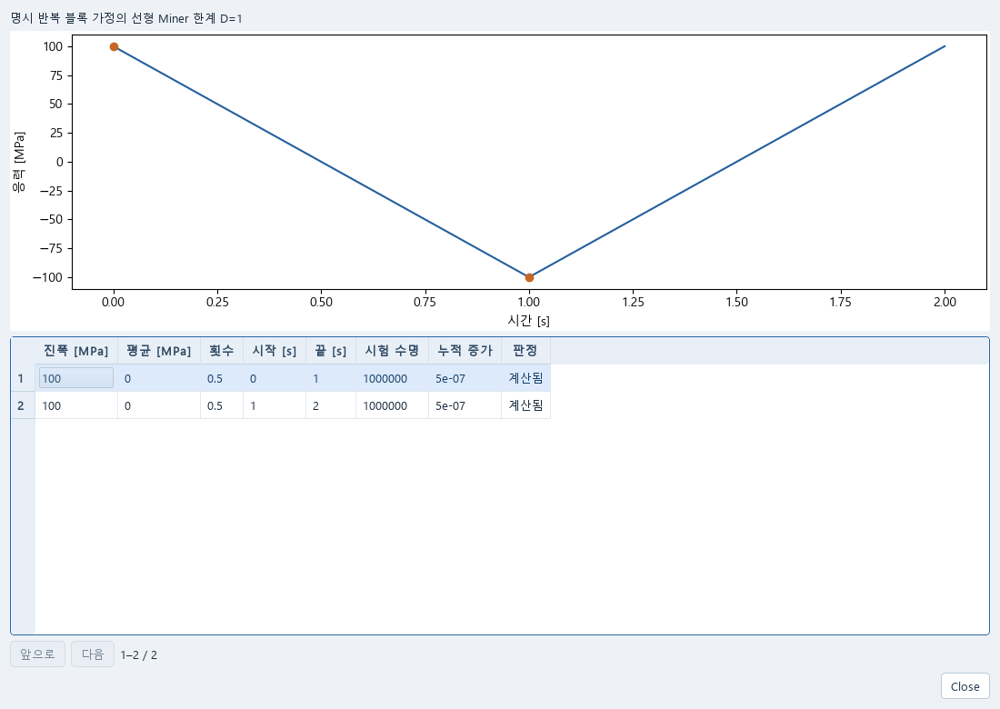

## 여러 계산 단계를 연결해 실행하기

Material이나 PDE에서 각각 저장한 모델을 계산 순서로 묶을 수 있습니다.
계산 절차 창은 독립적으로 실행하며, 수치 탐색을 하려는 경우에만 Numerical에 연결합니다.

```powershell
.\Start-CAE-Lab.cmd -Tool evaluation
```

1. **단계 추가…**에서 저장한 모델을 고릅니다. 왼쪽 목록의 위·아래 버튼으로 순서를
   바꾸고 **단계** 표에서 알아보기 쉬운 이름을 붙입니다.
2. 물리 조건을 바꾸려면 **선택 단계 작업 → 원본 입력 열기**를 사용합니다.
   바꾼 원본을 저장한 뒤 **원본 교체…**로 이 평가에 사용할 버전을 직접 고릅니다.
3. 앞 단계의 장을 다음 단계에 전달하려면 **장 전달**에서 공급 단계의 출력과 수신
   단계의 입력을 선택합니다. 각 모델이 제공하는 연결만 고를 수 있습니다. 기본 직접 전달은
   같은 메시의 같은 위치를 사용합니다. 서로 다른 메시의 온도 전달은
   [온도 전달 예제](s1_windows_transfer/README_KO.md)처럼 보간 방식을 명시하고 단위·시각을 확인합니다.
4. **변수**에는 탐색에서 바꿀 입력, **응답**에는 비교할 출력과 단위를 정합니다.
   서로 되먹임하는 계산은 **반복 계산**에서 반복 수와 응답별 허용값을 정합니다.
5. **변경 적용** 후 **한 번 계산**을 누릅니다. 아래 **단계 실행**에서 선택한 계산의
   단계별 상태를 읽고, **수렴 기록**에서 반복의 잔차를 확인합니다. 단계가 모두 끝났어도
   수렴 조건을 충족하지 못하면 미수렴으로 남습니다.
6. 단계 실행 행을 고르면 **선택 단계의 값**에서 보존된 응답을 읽습니다.
   **선택 결과 열기**는 그 단계의 결과를 엽니다. **전달값 보기…**에서는 계산 당시의
   공급값과 수신값을 절점별 표와 그래프로 비교합니다. 위 목록에서 전달과 반복을
   선택하고, 표의 행을 고르면 그래프에서 같은 절점을 확인할 수 있습니다.
   수신 계산의 실패 여부와 값의 일치는 따로 표시합니다. 편집 중인 조건을 적용하거나
   새 계산을 시작하지 않습니다. 같은 메시의 스칼라 직접 전달과 지원되는 P1 삼각형 메시
   사이 온도 보간값을 확인할 수 있습니다.
7. **저장**한 뒤 **파일 → 계산 절차 열기…**로 같은 절차와 실행 기록을 다시 엽니다.
   **연구 → 수치 계산 계획**을 선택하면 같은 정의로 탐색을 준비할 수 있습니다.
   여는 것만으로 새 계산을 실행하지 않습니다.

실패한 계산은 먼저 저장합니다. **계산 작업**에서 같은 입력의 재계산을 준비하면
앞에서부터 연속으로 성공한 단계만 골라 재사용할 수 있습니다. 정의를 바꾼 뒤의
부분 재사용과 반복 중간 상태에서의 재개는 아직 지원하지 않습니다. 이전 실패 결과는
그대로 남고 재계산은 새 실행으로 기록됩니다.

## 연결된 저장 자료 읽기

연구 문서에서 연결 자료를 열면 저장 당시의 내용이나 계산 결과가 별도 창에 나타납니다.
결과 성분을 고르고 **결과 읽기**를 누르면 그래프와 표로 확인할 수 있습니다.
연결이 끊기면 **다시 읽기** 또는 F5로 같은 자료를 다시 요청합니다.

입력을 고치려면 상단의 **재료에서 열기**, **PDE에서 열기**처럼 대상 프로그램의
이름이 적힌 버튼을 누르세요. 현재 편집 문서를 열며 저장 당시 내용으로 덮어쓰지 않습니다.
계산 결과에서는 **실행 기록에서 열기**로 해당 계산을 엽니다. 자료를 읽거나 다른 창을
여는 것만으로 계산을 다시 실행하지 않습니다. 자세한 연결 오류는 **보기 → 진단 상세…**에서
확인할 수 있습니다.

## 조립한 부품의 움직임 확인하기

FreeCAD의 **조립 운동** 패널에서 조립을 고릅니다. **부품과 관절**에서 연결할
부품과 면을 정하고, **시간과 구동**에서 각 관절의 회전이나 직선 이동을 입력합니다.
**구동 적용 → 운동 미리보기 → 운동 계산**을 누르면 자세를 확인하거나 재생할 수
있습니다. **미리보기 취소**는 원래 설계 자세로 돌아갑니다. 확인한 자세를 설계에
남기려면 **현재 자세를 설계에 적용**을 사용하세요.

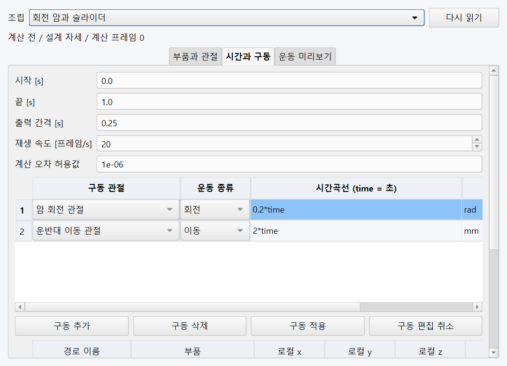

작업을 중단하려면 **프로젝트 저장**을 누르세요. 아직 적용하지 않은 관절 설정이나
완성하지 못한 구동식도 저장됩니다. 프로젝트를 다시 열어 입력을 마저 고친 다음,
**관절 적용**과 **구동 적용**을 누르면 운동 계산을 이어갈 수 있습니다.
편집을 버리고 마지막 적용값으로 돌아가려면 해당 **편집 취소**를 사용하세요.
문서를 닫거나 다시 연결할 때 미저장 편집이 있으면 저장 여부를 묻습니다.
[조립 운동 사용법](ASSEMBLY_WORKFLOW.md)에 관절 선택, 참조 복구와 지원 범위를
설명했습니다.

움직이는 점의 좌표를 분석하려면 **점 경로**에서 대상을 지정하고 계산된 경로를
읽으세요. 표의 행이나 곡선의 점을 선택하면 같은 프레임을 확인할 수 있습니다.
**선택 프레임의 3D 자세 보기**로 모델의 자세를 확인하고, **CSV 저장…**으로
좌표를 내보내거나 **Data에서 열기**로 독립 Data 앱에 보낼 수 있습니다.
Data에서는 파일을 다시 고를 필요 없이 **가져오기**를 눌러 표와 곡선을 읽습니다.
FreeCAD 1.1.4에서 새로 계산한 경로는 표·곡선·CSV와 Data에 같은 **계산 시각**을 표시합니다.
**설계 자세** 행에는 시간을 붙이지 않습니다. 예전 저장본의 **출력 격자 시간**은
당시 환산값 그대로이며 새 계산 시각과 구별합니다. 조립 프로젝트를 저장하면 읽은
경로와 선택이 남으며, 다시 열어 경로를 보는 것만으로 운동을 재계산하지 않습니다.

Data 문서도 저장한 뒤 다시 열어 곡선을 이어 볼 수 있습니다. 설계 자세의 좌표는
원자료에 남기되 시간 곡선에서는 제외합니다. 아래는 저장한 실제 운동 경로를
Data에서 다시 연 화면입니다.

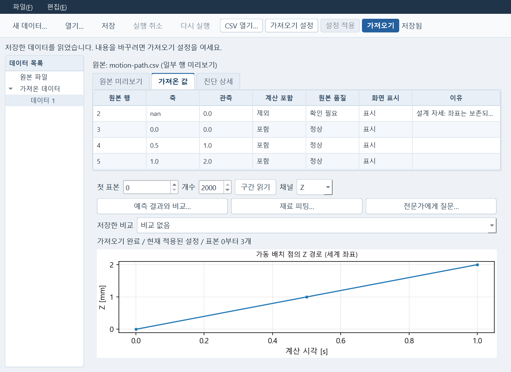

### 다른 관절의 움직임에 맞춰 구동하기

**시간과 구동**에서 따라 움직일 관절의 행을 고릅니다. 아래 **구동 방식**을
**다른 구동 따라가기**로 바꾸고 **기준 구동**을 선택하세요.

예를 들어 회전 구동의 시간식을 `90*time`, 출력 단위를 `deg`로 지정하고,
따라갈 이동 구동의 비율을 `2`, 비율 단위를 `mm/deg`, 영점 이동을 `0 mm`로
지정합니다. 끝 시간을 1초로 두고 적용·계산하면 끝 자세에서 180mm 이동합니다.
기준 시간식을 `45*time`으로 바꾸어 다시 적용·계산하면 종속 이동은 90mm가 됩니다.

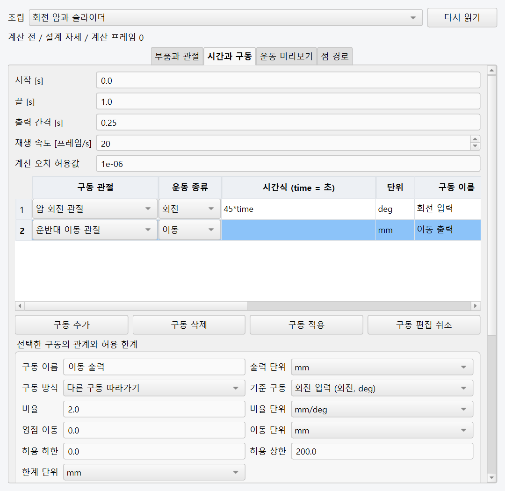

화면은 기준식을 `45*time`으로 수정해 저장한 실제 FreeCAD 패널입니다.
허용 하한·상한을 지정하면 계산 구간 전체에서 한계를 지킬 수 있는지 확인합니다.
순환 연결·잘못된 단위·한계 초과는 해당 구동 행에서 고치세요. 입력을 완성하지
못했더라도 **프로젝트 저장**으로 남겨 두고 다시 열어 계속 편집할 수 있습니다.

현재 관계는 기준값에 비율을 곱하고 영점 이동을 더하는 방식입니다. 여러 기준값을
사용하는 일반 관계식은 아직 지원하지 않습니다. 위 예에서 출력 간격을 0.5초로 지정하면
**점 경로**의 0·0.5·1초에서 이동량 0·90·180mm를 확인할 수 있습니다. 좌표는 선택한 점의
세계 좌표이므로 부품의 회전도 반영됩니다. 아래 저장본은 운동을 다시 계산하지 않고
경로를 읽은 화면입니다.

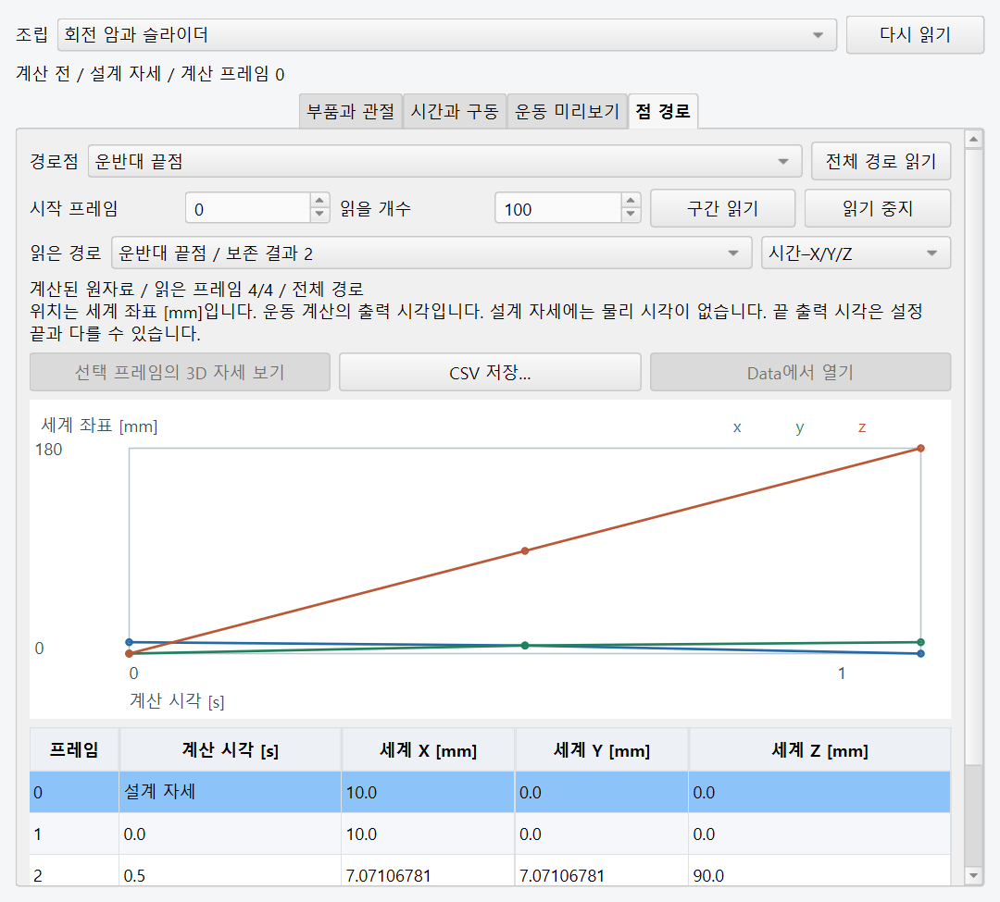

속성창에서 운동 시간을 직접 바꾸면 **시간과 구동**에서 값을 확인하고 다시 적용하세요.
이전 경로는 과거 자료로 남습니다. 계산 프레임과 시간의 대응을 확인할 수 없는 경우에는
시간 곡선으로 쓰지 않으며 원좌표를 표·CSV로 보존합니다.

## 기본 재료와 고정·힘 조건 편집하기

FreeCAD의 **해석 모델 → 재료**에서 기본 재료를 선택한 뒤 **FreeCAD에서 재료 편집**을
누르세요. 탄성 물성과 단위는 FreeCAD 설정창에서 바꿉니다. 소성 곡선과 기하 비선형
설정은 기존 CAE Lab 페이지에서 다룹니다.

**영역과 조건**에서 기존 고정·힘 조건을 선택하고 **FreeCAD에서 조건 편집**을 누르세요.
힘의 크기만 바꾸면 별도의 대상 확인은 필요 없습니다. 적용 면이나 방향을 바꿨다면
3D에서 확인한 뒤 **현재 적용 대상 확인**을 누르세요. 설정창을 취소하거나 닫는 동작을
대상 확인으로 취급하지 않습니다.

형상이 바뀌어 대상이 맞지 않으면 현재 면을 선택해 **선택한 면으로 변경**하세요.
힘 방향까지 복구해야 할 때는 **복구할 힘 방향**에서 새 모서리 영역 또는 면의 법선을
고릅니다. 지정 변위의 값은 기존 FreeCAD 속성창에서 편집합니다.
실제 FreeCAD 설정창의 수락·취소와 저장·재열기 확인은 아직 남아 있습니다.

## 접촉 모델에 단계별 하중 넣기

FreeCAD 아래쪽 **계산 → 계산 관리**에서 **입력 파일 생성…**과 **입력 보존 후 계산**을 구분해
사용합니다. **계산 목록…**은 실행 중인 작업과 이전 결과를 엽니다. 응답이 끊기면
**다시 확인**으로 같은 작업의 상태를 조회합니다. **다시 연결**은 진행 중인 작업을
완료하거나 취소한 뒤 사용하세요. 편집 패널 위쪽의 **대상 문서**를 확인하면 여러
CAD 문서를 열어 놓았을 때 어느 모델을 수정하는지 구분할 수 있습니다.

두 면이 떨어지거나 미끄러지지 않게 연결하려면 **접촉 → 새 접촉**에서 A/B 면을
고르고 **묶음 접촉**을 선택합니다. **묶음 허용거리 [mm]**는 연결할 절점을 찾는
거리입니다. **접촉 적용 → 계산 관리 → 입력 파일 생성… → 입력 보존 후 계산**으로 이어갑니다.
기본은 원래 절점 위치를 유지합니다. 작은 간극을 맞추려면 **계산 시 면에 맞춤**을
선택하세요. 현재는 평면 C3D10 기준 면 내부로 한 곳에 대응되는 절점만 지원하며,
곡면·면 경계·겹치는 후보나 연쇄 조정은 입력 생성 전에 알려 줍니다. 원 CAD와
메시는 그대로 두고 계산 초기형상에서 조정합니다.

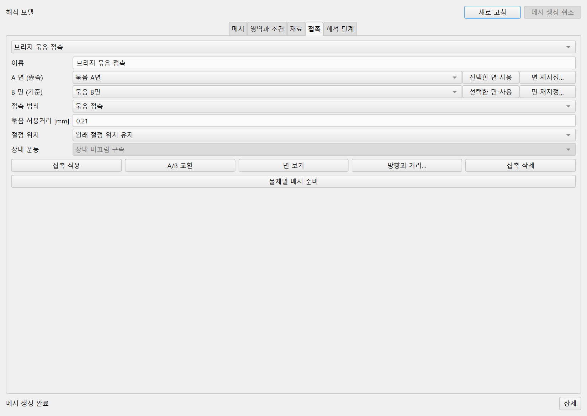

결과에서는 변위·응력·절점 힘을 읽습니다. 절점 힘에는 가해진 하중도 포함되므로
전부 반력으로 해석하면 안 됩니다. 묶음 접촉은 마찰 접촉의 압력·미끄럼 결과와
다릅니다. 자세한 제약과 면 재지정은 [묶음 접촉 안내](CONTACT_WORKFLOW.md#묶음-접촉)를
참고하세요.

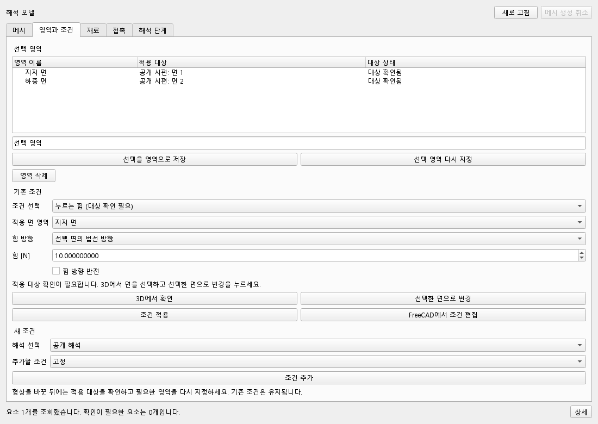

이 사진은 이전 Qt 배치에 공개 시안 데이터를 넣은 모습입니다. 현재 고정·힘 조건의 값은
위의 FreeCAD 편집 경로를 사용합니다. 사진을 계산 결과나 새 배치의 조작 확인으로 보지 마세요.

재료·메시·지지 조건을 준비한 FreeCAD 모델에서 시작합니다. 모델을 여는 방법은
[CAD와 후처리 열기](INSTALL_KO.md#cad와-후처리-열기), 상세 설정과 지원 범위는
[접촉 작업 안내](CONTACT_WORKFLOW.md#2026-10-14-후속-접촉-간격과-해석-단계)를 참고하세요.

1. **접촉**에서 두 면과 접촉 법칙을 정합니다. **방향과 거리…**로 선택한 면과 법선을
   확인합니다. 표시되는 거리는 부호 없는 면 사이 거리이며 관통 깊이는 아닙니다.
2. **해석 단계**에서 단계를 추가하고, 각 단계의 하중을 표와 곡선으로 편집합니다.
   예를 들어 첫 단계는 0→100 N 가압, 다음 단계는 100→0 N 제하로 정합니다.
   정적 해석의 가로축은 단계 진행값이고, 암시적 동적 해석은 시간(s)입니다.
3. **단계 적용** 후 저장합니다. **입력 파일 생성…**으로 실제 입력을 읽고 사본을
   내보낼 수 있습니다. 이때는 계산하지 않으며, **입력 보존 후 계산**을 눌러야 시작합니다.
   하중이나 변위 조건을 추가·삭제했다면 **조건 새로 읽기**로 바뀐 항목을 확인하세요.
   기존 곡선은 유지하며, 확인한 내용을 **단계 적용**해야 문서에 반영됩니다.
4. Runner의 **계산 단계…**에서 도달한 증분과 당시의 조건 곡선을 확인합니다.
   실패한 설정을 고치려면 **이 계산의 조건 수정…**으로 계산 당시 입력의 사본을 엽니다.
   현재 편집 중인 모델이나 이전 계산 결과를 덮어쓰지 않습니다.
5. **저장된 접촉 결과 열기**로 후처리를 이어갑니다. 실패·취소 후 남은 결과는
   완료된 해석과 구분해 읽습니다. 힘 이력을 계산 계획에 쓰는 방법은 다음 절을 따릅니다.

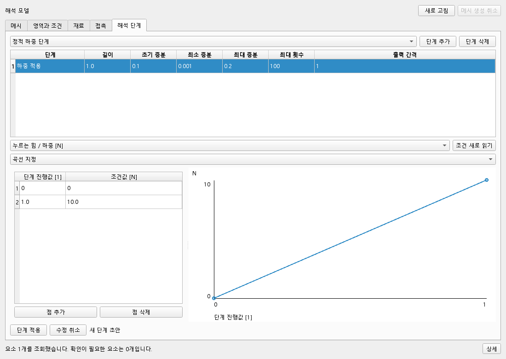

위 화면은 0→10 N으로 증가하는 하중 입력 예시입니다. 왼쪽 표를 편집하면 오른쪽
곡선이 함께 바뀝니다. 계산 결과가 아니라 실제 제품의 입력 편집 화면입니다.

## 접촉 결과의 힘 이력을 비교하고 계산 계획에 쓰기

이 경로는 접촉 해석에서 생성한 결과와 `contact-inspection.json`이 있을 때 사용합니다.
일반 결과 파일은 ParaView에서 따로 열어 볼 수 있지만, PVD 파일만 열었다고 접촉 쌍의
설정과 힘 이력이 자동으로 연결되지는 않습니다.

1. Runner에서 해당 계산의 **후처리에서 열기**를 누르거나,
   [Post 실행 명령](INSTALL_KO.md#cad와-후처리-열기)으로 저장한 후처리 프로젝트를 엽니다.
   ParaView의 **Macros → CAE Analysis controls**에서 분석 창을 엽니다.
2. 왼쪽 **원 결과**에서 대상을 고르고 **접촉 결과…**를 누릅니다. 독립 결과를 추가할
   때는 **결과 파일 추가…**에서 해당 `contact-inspection.json`을 직접 선택합니다.
3. **접촉 쌍**, A/B 면, **증분**과 **접촉면 필드**를 고릅니다.
   **ParaView에서 면 보기**로 형상을 확인합니다. 오른쪽은 A 면의 합력입니다.
   전체·법선·접선 힘과 문서 전체 X/Y/Z 성분을 고른 뒤 **선택 조회**를 누릅니다.
   정적 해석의 가로축은 시간(초)이 아니라 **하중 계수 λ**입니다.
4. 그래프의 점이나 이력 표의 행을 고르면 그 증분을 확인할 수 있습니다.
   조회 조건을 바꾸면 이전 표가 남아 있으므로 다시 **선택 조회**를 누릅니다.
   조회 실패 시에는 마지막 성공 값이라고 표시하며 실패를 새 결과로 덮어쓰지 않습니다.
5. 사용할 힘과 성분을 확인한 뒤 **힘 이력 측정 저장**을 누릅니다.
   **Numerical로 보내기…**에서 사용할 계산 계획, 응답 열과 곡선의 축을 확인합니다.
   기존 계획에 보낼 때도 관측을 검토하고 명시적으로 추가하며, 취소하면 추가하지 않습니다.
6. Numerical에서는 사용할 모델과 예측 응답을 정한 뒤 계획을 적용·저장합니다.
   측정 곡선을 보내는 것만으로 해석이나 피팅이 실행되지는 않습니다.
   후처리 프로젝트를 저장해 다시 열면 같은 측정과 선택을 이어 볼 수 있습니다.

Windows ParaView 주 화면에서는 **Ctrl+S** 또는 **Macros → CAE Save project**로
프로젝트를 저장합니다. 창의 **X**나 **Alt+F4**로 닫을 때 변경 내용이 있으면 저장 여부를
고릅니다. **취소**하면 계속 편집할 수 있습니다. **File → Exit** 메뉴를 쓸 때는
먼저 저장하세요. 이 메뉴의 닫기 확인은 아직 연결되지 않았습니다.

아래는 보관된 예제 해석을 실제 ParaView에 연결해 읽은 Qt 화면입니다.
절점에 투영된 압력과 접촉 쌍의 합력은 서로 다른 결과이며, 이 화면만으로
접촉 활성 여부나 설계의 안전성을 판정하지 않습니다.


## 단위나 좌표계가 다른 결과 비교하기

후처리 분석 창의 **새 비교**에서 기준 결과 A와 비교 결과 B를 고르고, 비교할
물리량을 선택합니다. **물리량 확인…**에서 단위와 성분을 확인한 뒤 필요한 경우
**변환 설정…**에서 좌표 정렬·시간 대응을 지정합니다. **미리보기**로 원값과 변환값,
차이를 확인하고 **적용**한 다음 프로젝트를 저장합니다.

아래는 실제 편집기에 시안용 압력 자료 두 개를 넣은 화면입니다. 이 그림의 이름과
입력값은 계산 결과가 아닙니다. 공개 합성 벡터 자료의 변환·저장·재열기는 실제
ParaView에서 확인했습니다. **비교 곡선…**으로 표에 읽은 점의 A/B와 차이를 보고
점을 선택하면 같은 결과의 표와 3D 위치를 연결합니다. 적용한 비교 결과에서 점이나
경로를 측정해 저장한 뒤, 그 측정을 다시 비교할 수도 있습니다.
시간표와 시험 곡선은 아래의 **시간·시험 곡선 비교**에서 축을 맞춥니다.
저장한 측정을 다시 비교할 때 X/Y 성분, 응력 성분, 전체 크기와 차이의 정의를
구별합니다. 서로 다른 성분은 같은 숫자여도 차이 0으로 처리하지 않습니다.
예전 저장본에 성분 정보가 빠져 있으면 **물리량 확인…**에서 원 성분을 지정하세요.
비교 대상 B에 값이 없는 구간도 유효한 A 원값은 읽을 수 있고, 차이는 양쪽 값이
있는 곳에만 표시합니다. 예전 측정에서 이미 빠진 값은 새로 측정해야 합니다.

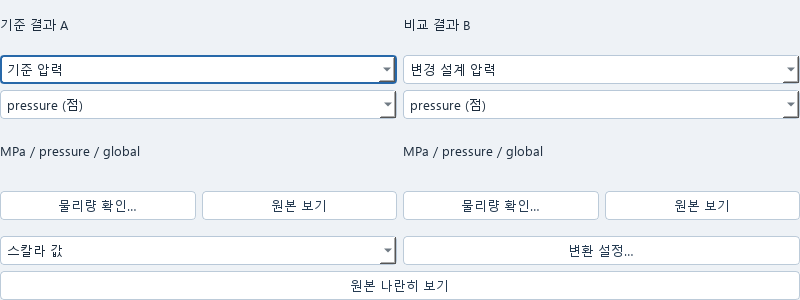

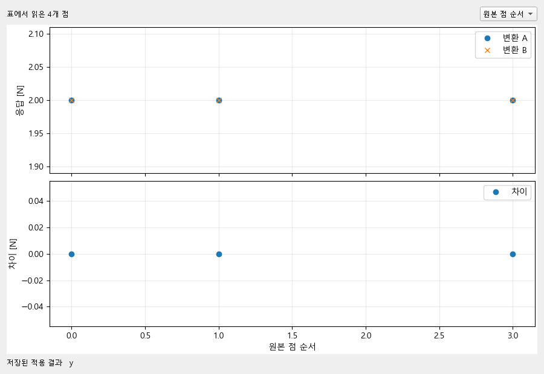

[변환 설정과 공개 예제](POST_COMPARISON.md)에서 지원 범위와 실행 방법을 확인할 수 있습니다.

시험 CSV와 해석의 시간 이력을 비교하려면 **분석 추가 → 시간·시험 곡선 비교…**를
선택합니다. 저장한 Data 채널을 가져와 비교할 성분과 단위, 시간 원점을 맞추면
원곡선과 차이를 같은 창에서 읽을 수 있습니다. 원하는 비교를 적용·저장하면
다시 열어 이어 볼 수 있습니다. [시험 곡선 비교 안내](POST_CURVES.md)에 준비할
자료와 공개 예제, 원자료 위치가 바뀌었을 때의 복구 방법을 적었습니다.

## 결과 파일이 바뀌었을 때 이어가기

파일을 옮겼다면 후처리 분석 창에서 원자료를 선택하고 **원파일 다시 연결…**로
새 위치를 지정합니다. 다시 계산해 파일 내용까지 바뀌었다면 **변경 자료로 새 프로젝트…**를
누르세요.

1. **파일 선택…**에서 새 VTU 또는 PVD 결과를 고릅니다.
2. **새 프로젝트 폴더**에 새 폴더나 비어 있는 폴더를 지정합니다.
3. **변경 내용 미리보기**로 달라진 파일, 필드와 시각 범위를 확인합니다.
4. **새 프로젝트 열기**를 누릅니다. 기존 측정과 비교는 이전 프로젝트에 남고,
   새 결과는 별도 프로젝트에서 분석합니다.

아래는 공개 합성 PVD 자료를 실제 ParaView로 읽은 정보를 표시한 Qt 창입니다.
필드 비교는 새 자료의 첫 시각 기준입니다. 모든 시각의 값이나 물리적 동등성을
판정하는 화면은 아닙니다.

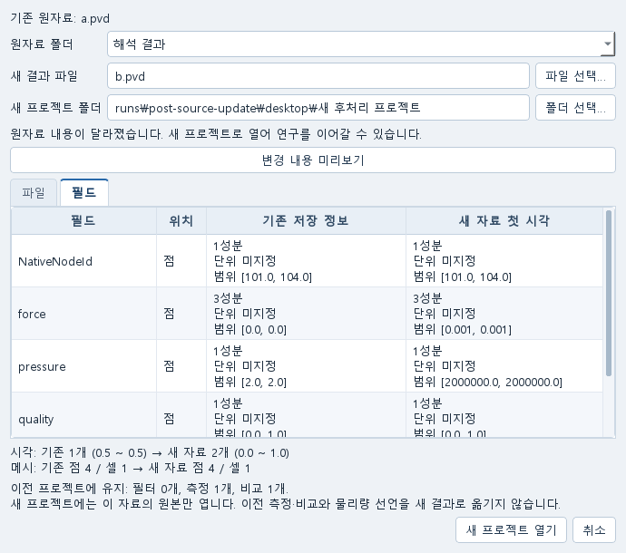

취소하거나 파일 읽기에 실패하면 기존 프로젝트를 계속 사용할 수 있습니다.
새 프로젝트 저장 후 창 열기만 실패한 경우 **저장한 새 프로젝트 열기**로 다시 엽니다.
자세한 동작과 지원 범위는 [원자료 변경 안내](POST_COMPARISON.md#변경된-원자료로-연구-이어가기)에 있습니다.

## 시험 채널을 교정하고 보고서로 저장하기

기본 설치 후 시작 메뉴에서 **데이터**와 **보고서**를 따로 열 수 있습니다.
보고서에는 저장한 시험 자료, 계산 결과, 연구 기록을 골라 넣습니다.

먼저 공개 예제로 전체 연결을 보려면 저장소 폴더에서 PowerShell을 열고 실행하세요.
합성 전압 파일을 가져오고 FELUPE 재료점 계산을 한 번 수행합니다. 실제 장비는 사용하지 않습니다.

```powershell
$caePython = Join-Path $env:LOCALAPPDATA 'AutonomousCAELab\windows-runtime\venv\Scripts\python.exe'
$example = & $caePython -m examples.experiment_report --store runs/experiment-example --run | ConvertFrom-Json
.\Start-CAE-Lab.cmd -Tool report -Store runs/experiment-example -Port 18766 -DocumentId $example.report
```

**공개 시험 비교 보고서**가 열립니다. 왼쪽에서 센서 교정 또는 관측과 계산을 선택해
표와 곡선을 읽으세요. **선택 섹션 편집…**에서 설명과 표·곡선 포함 여부를 바꾸고
**설명 적용**을 누릅니다. **파일** 메뉴에서 저장하거나 PDF·Markdown으로 내보냅니다.
다시 열 때는 같은 작업 폴더와 문서를 사용합니다. 예제의 별도 작업 폴더는 기본 시작
메뉴가 여는 작업 폴더와 다르므로 위 명령을 그대로 사용하세요.

자기 파일로 작업할 때는 Data에서 열과 단위를 지정한 뒤 **편집 → 채널 교정…**을
엽니다. 교정서의 계수·영점·단위·범위를 입력하고 **교정 전후 보기**에서 확인한 후
**초안에 적용**합니다. Data에서 가져오기를 실행하고 저장하면 원값과 교정값이 함께
남습니다. 결과 표의 필요한 행을 선택하고 **선택 결과로 보고서…**를 누르면 해당
자료로 보고서를 이어 씁니다. 범위 밖·센서 포화 표본도 원값은 남으며 계산에서는 제외됩니다.

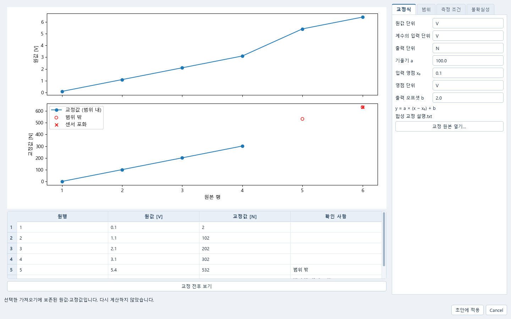

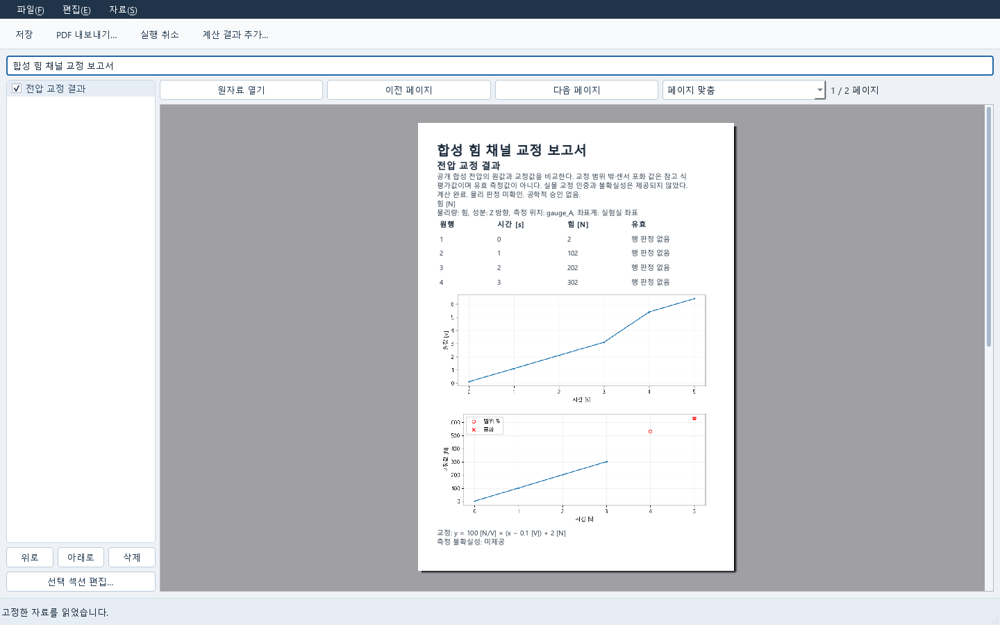

위 화면은 실제 Qt 제품 창에 공개 합성 자료를 연 것입니다. 센서 교정의 정확성이나
제품의 공학적 승인을 뜻하지 않습니다. 제공된 불확실성을 전파하려면
[시험 자료의 불확실성 안내](experiment_expert/WORKFLOW_KO.md)를 따르세요.
저장한 관측·예측 비교에서는 [차이의 불확실성](experiment_expert/COMPARISON_UNCERTAINTY_KO.md)을
별도 계획으로 계산할 수 있습니다. 상관을 모르면 미확인으로 남으며 계산을 자동 실행하지 않습니다.
실장비 수집·중지는 남은 개발 범위입니다. 계수 식별 진단, 수집 설정 재사용과 오류 복구는
[시험 자료와 보고서 상세 안내](EXPERIMENT_REPORT.md)를 참고하세요.

## 내 모델과 결과로 이어가기

소성 재료를 먼저 살펴보려면 [고체 소성 해석 예제](../examples/material-tests/ns1/README.md)를
사용하세요. 형상·메시·하중과 소성 표가 들어 있는 편집 가능한 FreeCAD 파일입니다.
소성 해석 기능과 이 예제는 현재 `main`에 포함되어 있습니다. 기존 설치를 사용한다면
저장소를 갱신한 뒤 예제 안내의 지원 범위와 실행 순서를 따르세요.

기존 결과는 ParaView Post에서 직접 열 수 있습니다. FreeCAD 모델이나 AI 연결을
먼저 만들 필요는 없습니다. [설치 안내의 Post 실행 명령](INSTALL_KO.md#cad와-후처리-열기)에
사용할 결과 파일을 넣으세요.

MCP는 별도 클라이언트 설정 후 같은 로컬 문서와 명령을 호출하는 선택적 연결입니다.
“모델링부터 해석·전문가 토론까지 전부 자동 완료”하는 설치본을 제공하지는 않습니다.
문헌 검색도 연결된 도구의 지원 범위 안에서 공개 자료를 조회하며, 유료 원문을 구매하지 않습니다.

현재 가능한 작업과 개발 중인 연결은 [현재 개발 상태](../CURRENT_STATE.md), Python·CLI
상세 예시는 [영문 기술 참고](REFERENCE_EN.md)에서 확인할 수 있습니다.
