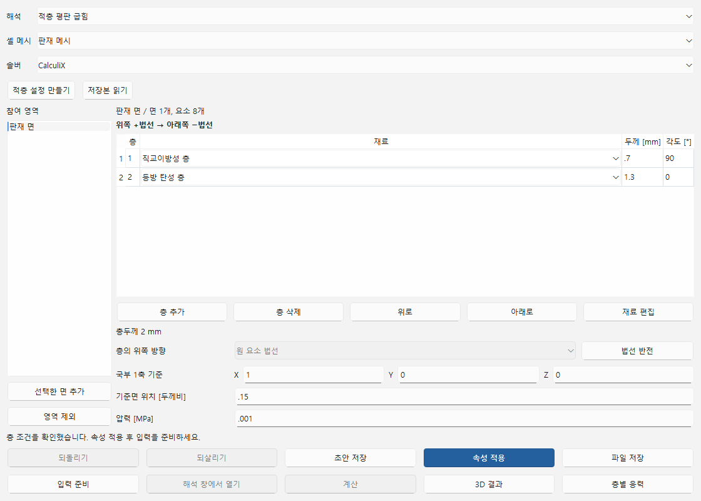
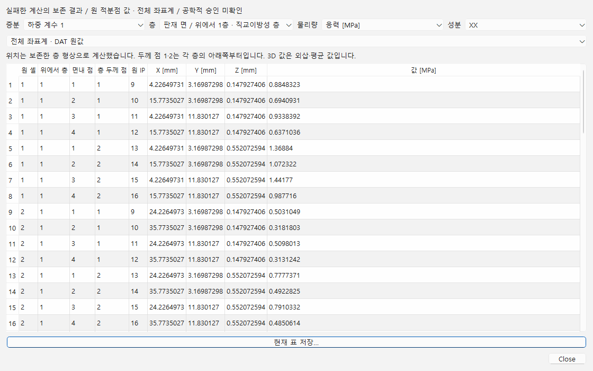

# 적층 셸 편집과 층별 결과

FreeCAD의 FEM 해석에서 실제 8절점 셸 메시, CalculiX 솔버, 고체 재료와 고정 조건을 준비합니다. **적층 → 적층 셸…**에서 그 해석·메시·솔버를 선택하고 **적층 설정 만들기**를 누릅니다. 기존 S8 판재 해석과는 별도 해석을 사용합니다.

1. 3D 화면에서 참여할 면 또는 메시를 선택하고 **선택한 면 추가**를 누릅니다. 영역끼리 같은 요소를 중복 선택할 수 없습니다.
2. **층 추가**로 2–16층을 구성합니다. 각 층의 원 FEM 재료, 두께 **mm**, 각도 **°**를 지정합니다. 표의 첫 층은 **+법선 쪽 위층**입니다. 위로·아래로 옮긴 편집은 되돌리기·되살리기로 복구합니다.
3. **재료 편집**에서 등방 선형 탄성 또는 직교이방성 선형 탄성을 명시합니다. 직교이방성은 E1·E2·E3, ν12·ν13·ν23, G12·G13·G23가 모두 필요하며 탄성 계수는 MPa입니다. 빠진 상수는 추정하지 않습니다.
4. 원 요소 법선 또는 반대 법선을 확인하고, 전역 좌표로 국부 1축의 기준 방향을 입력합니다. 각도는 +법선에 대한 오른손 방향입니다. **법선 반전**은 층 순서·각도·기준면 위치·압력 부호도 함께 바꾸어 현재 물리 배치를 보존합니다.
5. 기준면 위치는 총두께에 대한 비율이며, 양의 압력 **MPa**는 선택한 +법선 방향의 하중입니다. **속성 적용 → 입력 준비** 후 **해석 창에서 열기**로 같은 입력의 계산 문서를 엽니다. 이 버튼은 계산하지 않습니다. 계산 문서에서 입력을 검토하고 실행합니다. 연결된 **계산** 버튼도 같은 준비 입력을 사용합니다.
6. 완료된 계산의 **3D 결과**에서는 층별 형상과 변위·응력·변형률을 봅니다. **층별 응력**에서는 저장한 적층 결과 기록을 선택하고 층·증분·물리량·성분을 고릅니다. 표는 원 DAT 적분점 값이며 **현재 표 저장…**으로 선택한 값을 CSV에 저장합니다.
7. 원 FreeCAD 문서의 적층 표로 돌아와 층 조건을 수정합니다. **초안 저장**과 **파일 저장**은 불완전한 입력도 보존합니다. 두께가 `1e`처럼 미완성이거나 재료가 빠졌으면 입력 준비·계산은 차단됩니다. 기존 결과는 바뀌지 않으며, 적용 후 새 입력으로 계산해야 새 조건의 결과가 생깁니다. `.caepre`를 새 FreeCAD에서 열어 층 조건을 계속 편집할 수 있습니다.

## 출력의 의미와 지원 범위

이 경로는 CalculiX 2.22의 **S8R COMPOSITE**, 고정 조건과 정적 압력, 등방·직교이방성 선형 탄성을 지원합니다. S6, 파손·박리 법칙, 비선형 적층, 일반 혼합 요소는 이 경로의 지원 대상이 아닙니다. 기존 S8 27적분점 결과는 그대로 별도 경로에서 읽습니다.

화면의 위→아래 층과 native 입력의 아래→위 층을 명시적으로 대응시킵니다. 각 층에는 **면내 4점 × 두께 방향 2점**이 있습니다. 2층이면 원 셸 하나당 16개 적분점입니다. 표의 원 IP 번호는 계산 원문 그대로 보존합니다.

**DAT 전체 좌표계**는 원 S/E 여섯 성분입니다. **선언 층축** 선택은 그 원값의 좌표 변환이며 native LOCAL 출력으로 표시하지 않습니다. 위치는 보존한 FRD 층 형상으로 계산한 위치이며 native DAT COORD가 아닙니다. 곡면에서 선언한 요소 기준축과 점별 물질축을 동일하다고 가정하지 않습니다.

**FRD 3D 응력·변형률**은 native 외삽·절점 평균 값입니다. DAT 원 적분점과 혼합하지 않습니다. 이 출력 경로에서는 COORD와 RF를 요청하지 않으며, 반력·평형 또는 강도·내구 승인으로 해석할 수 없습니다. 계산 성공과 공학적 승인은 별개입니다.

공개 예제는 `examples/composite/generate_laminate.py`의 `create(새_FCStd_경로)`로 준비합니다. 두 재료, 서로 다른 0.7/1.3 mm 두께와 90/0°를 가진 평판입니다. 실제 Windows 확인은 이 2층 모델에 한정하며 16층 전체 조합이나 일반 곡면 적층의 공학적 정확도를 검증한 것은 아닙니다.
