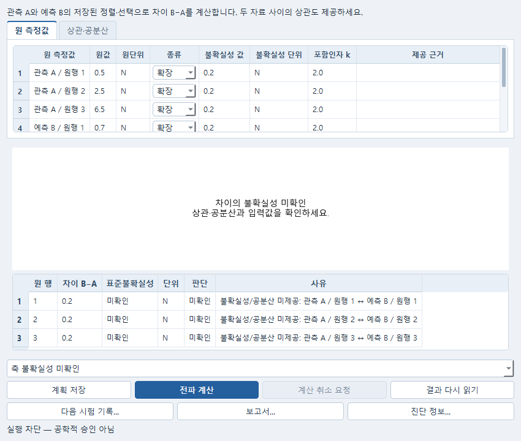

# 비교한 두 값의 차이와 불확실성

Data에서 보존한 관측 A와 예측 B의 비교를 선택하면 **차이 B−A의 불확실성**을 별도 계획으로 계산할 수 있습니다. 원자료와 원 비교를 바꾸지 않습니다. 비교를 열거나 분석창을 여는 것만으로 계산하지 않습니다.

1. Data에서 가져온 채널을 고르고 기존 비교를 수행한 뒤 문서를 저장합니다.
2. 비교 목록에서 저장된 비교와 사용할 표본 구간을 선택합니다.
3. **편집 → 제공 불확실성 전파…**를 엽니다. 창 제목이 **차이의 불확실성**인지 확인합니다.
4. **원 측정값**에서 A와 B의 원행 또는 표본 순서, 값과 단위를 확인합니다. 각 입력의 표준불확실성 또는 확장불확실성과 포함인자 k를 입력합니다. 제공된 불확실성의 단위가 원단위와 달라도 지원되는 단위이면 환산합니다.
5. **상관·공분산**에서 제공된 전체 행렬을 입력합니다. 행과 열은 표시된 A/B 원표본 순서이며 공분산의 단위는 두 축 단위의 곱입니다. A 내부, B 내부뿐 아니라 **A와 B 사이의 관계**도 필요합니다. 독립성이 실제로 제공된 경우에만 **독립이라고 명시 제공**을 고르고 근거를 적습니다.
6. **계획 저장**으로 입력을 보관하거나 **전파 계산**으로 명시 실행합니다. 상관이나 불확실성이 부족하면 차이값은 유지하고 해당 불확실성을 **미확인**으로 표시합니다. 빈칸을 독립이나 0으로 채우지 않습니다.
7. 저장한 Numerical 계획을 다시 열면 같은 원자료·비교와 입력을 계속 편집할 수 있습니다. **다음 시험 기록…**에서 질문을 적어 Study에 전파 결과를 보존합니다. 결과 안에 원 A/B의 정확한 개정과 저장된 비교가 함께 남습니다. **보고서…**에서도 같은 결과를 읽습니다.

공개 합성 자료를 실제 Qt 창에서 연 화면입니다. 차이 0.2 N은 계산됐지만 A와 B 사이의
공분산이 없어 불확실성은 미확인입니다. 숫자축에 0처럼 표시하지 않으며, 필요한 상관을
제공한 뒤 **전파 계산**으로 새 결과를 계산합니다. 실측 정확성을 검증한 사례는 아닙니다.

## 계산 범위

- 같은 물리량·성분·위치·기준계·응답단위와 같은 축 이름·단위를 갖는 스칼라 또는 한 축 곡선 비교를 지원합니다. 평균값 단위가 다른 두 응답을 새로 환산하거나 공간 대응을 만들지 않습니다.
- 기존 비교가 B를 A의 시각으로 선형 보간했다면 **B 원표본의 값과 전체 공분산**에 같은 선형 연산을 적용합니다. 표준불확실성을 보간하지 않습니다. 외삽이나 계산 누락 구간을 가로지르는 보간은 지원하지 않습니다.
- 원 비교의 제외 표본은 제외로 남습니다. 원값 대신 0이나 0 분산으로 바꾸지 않습니다. 최대 512개 입력 변수와 512개 출력 표본 안에서 구간을 명시 선택해야 합니다. A/B 원표본을 함께 세므로 실제 허용 출력 수는 보간에 필요한 B 표본 수에 따라 달라집니다.
- 결과는 원 응답단위의 **물리 차이 B−A**입니다. 기존 최적화의 가중·정규화 잔차에 대한 불확실성은 아닙니다.
- 축 불확실성이 미확인이어도 고정된 축 좌표에 조건부인 값 전파는 계산할 수 있습니다. 전체 측정 불확실성, 불확실한 시각 정렬과 신뢰구간을 계산했다는 뜻은 아닙니다.
- 같은 원응답의 자기 비교를 서로 독립인 두 입력으로 계산하지 않습니다. 이 경우 불확실성 전파만 제한하고 원 비교의 읽기와 저장은 유지합니다.
- 기존 교정식에 이미 제공된 출력 불확실성을 자동 복사하거나 다시 합산하지 않습니다. 이번에는 비교에 보존된 값의 입력 불확실성을 명시 제공합니다. 일반 비선형 함수나 Monte Carlo 전파는 추가하지 않았습니다.

잘못된 단위·행렬 순서·음수 분산·양의 준정부호가 아닌 결합 공분산은 수정해야 합니다. 원 입력과 실패 결과를 보존하며 수치 기준을 완화하지 않습니다. 계산 성공은 공학적 승인을 뜻하지 않습니다.
