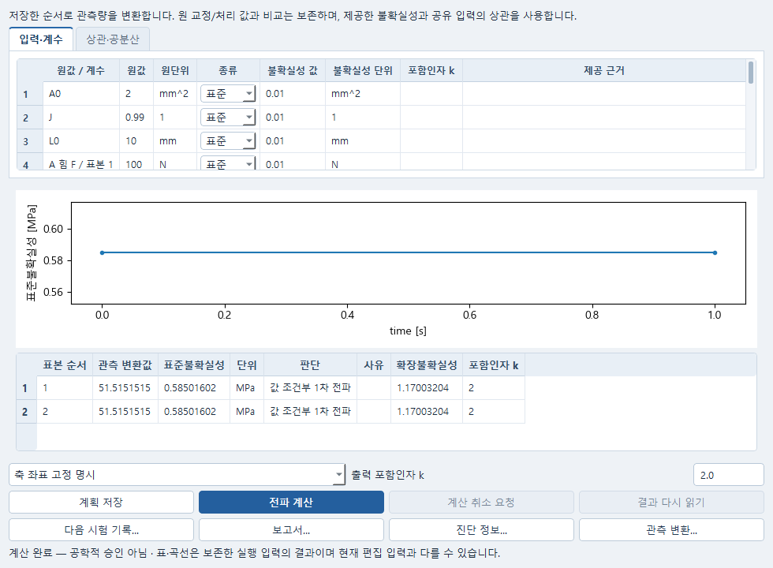

# 교정·게이지·시간 offset의 불확실성

Data에서 원 시험 응답이나 **저장한 비교**를 선택하고 편집 메뉴의 **관측 변환의 불확실성…**을 엽니다. 기존 시험 분석창의 **관측 변환…**도 같은 설정을 엽니다. 원 자료와 기존 비교는 유지되고, 선택한 변환은 새 분석 계획에서 계산됩니다.

사진은 단축 시험의 합성 자료를 사용한 예제입니다. 실제 시험의 공학적 승인 결과가 아닙니다.

**원 채널**에서 사용할 관측량과 실제 보존 채널을 선택합니다. 게이지에는 두 점의 변위 X/Y/Z, 응력에는 실제 힘 채널이 필요합니다. 같은 원자료/보존 결과의 scalar 성분 또는 한 시간축 곡선을 사용하며, 이미 적용한 교정을 다시 적용하지 않습니다. 기존 `y=a(x−x0)+b`의 원값·a·x0·b와 원단위를 그대로 전파합니다. 같은 import/처리 원본의 원값은 하나의 입력으로 연결합니다. 다른 자료의 교정계수가 실제로 같은 입력이면 **시간과 공유 입력**에서 같은 공유 이름을 지정합니다. 값·원단위·교정 원본이 충돌하면 차단합니다.

**기준과 치수**에서 고정 방향 n, 공통 기저와 두 기준점의 원좌표를 명시합니다. n은 단위벡터입니다. `g=n·(uB−uA)`는 고정 방향 투영 게이지 신장이며 일반 회전/전단의 실제 두 점 거리 변화가 아닙니다. 실제 양의 L0를 제공하면 `e=g/L0`, `lambda=1+e`, `ln(lambda)`를 선택할 수 있습니다. 이 profile의 lambda는 양수여야 합니다.

공칭 응력은 `P=F/A0`입니다. F를 N, A0를 mm²로 변환하면 P는 MPa입니다. 동축 Cauchy 응력 `sigma=P*lambda/J`는 힘·게이지·면적 축이 일치하는 단축/동축 시험을 명시한 경우만 사용합니다. L0/A0/J는 실제 값과 원단위·공유 입력 이름·제공 근거가 필요합니다. J=1을 자동 입력하지 않습니다. 비압축 가정이라면 그 가정과 J=1을 사용자가 명시하며, J 불확실성이 미제공이라는 사실을 0으로 바꾸지 않습니다. 면적 단위는 mm² 또는 m²입니다.

**시간과 공유 입력**에서 operand별 하나의 공통 offset `δt`를 선택하면 `y(t+δt)`를 평가합니다. 단위는 s이며 미분 부호는 해당 구간 slope의 양의 부호입니다. 실제 허용할 최대 원 시각 간격도 입력합니다. **원 시각에서 변환 → 시간 정렬**과 **성분별 시간 정렬 → 변환**은 다른 관측 정의이며 저장한 순서 그대로 미분합니다. 예를 들어 로그 변형률을 먼저 만든 뒤 선형 보간한 값과, 먼저 변위를 보간한 뒤 로그를 취한 값은 다릅니다.

원/target 시각 격자는 확정되어 있습니다. offset 평가점이 원 시각 knot, segment gap, 품질 제외 또는 범위 밖이면 해당 불확실성은 **미확인**이고 사유가 표시됩니다. knot의 원값은 유지합니다. 외삽하거나 제외 구간을 연결하거나 누락값을 0으로 채우지 않습니다. 일반 불확실 방향, 전체 3D F tensor, 표본별 확률적 timestamp는 이 profile에 포함되지 않습니다.

**변환 설정 사용**을 누르면 기존 입력·계수 표에 원값·교정계수·치수·offset이 표시됩니다. 각 표준/확장 입력 불확실성과 단위를 지정하고 상관·공분산 탭에서 제공 관계를 입력합니다. 공유 입력은 한 열로 합쳐지며, 같은 offset의 B−A 상쇄도 이 열에서 처리합니다. 미제공 교차공분산을 독립/0으로 추정하지 않습니다. 독립인 경우에만 근거와 함께 독립을 명시하세요. 기존 부분 공분산·PSD 검사를 그대로 사용합니다.

출력 **포함인자 k**를 명시하면 표준불확실성에 k를 곱한 확장불확실성도 표시합니다. k가 없으면 확장값은 미확인입니다. 이는 관측점 주변의 국소 1차 선형화이며 분포·정규성·신뢰구간·공학적 승인을 자동으로 뜻하지 않습니다. 원 비교의 가중/정규화 잔차를 전파하는 기능이 아닙니다.

**계획 저장**, **전파 계산**, **다음 시험 기록…**, **보고서…**는 기존 Numerical/JobManager/Study/Report 명령을 사용합니다. 읽기·저장·재열기는 계산을 시작하지 않습니다. 이전 Plan·결과·공유 자료는 덮지 않으며, 다시 계산하려면 새로 명시 실행합니다.

수치 근거: [JCGM 100:2008 §5](https://www.bipm.org/documents/20126/2071204/JCGM_100_2008_E.pdf/cb0ef43f-baa5-11cf-3f85-4dcd86f77bd6?download=true&version=1.10)의 관측점 민감도와 공분산을 쓰는 1차 전파를 소비합니다. 새 공분산/MC 엔진은 만들지 않습니다. 화면은 [Qt QFormLayout](https://doc.qt.io/qtforpython-6.8/PySide6/QtWidgets/QFormLayout.html)의 긴 행 줄바꿈과 기존 Research appearance를 사용하며, 한 긴 폼 대신 작업별 설정 탭으로 좁은 창의 접근을 유지합니다.
