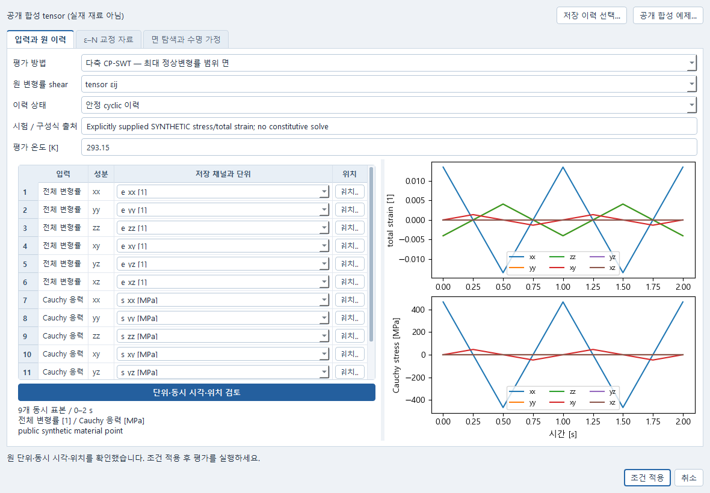
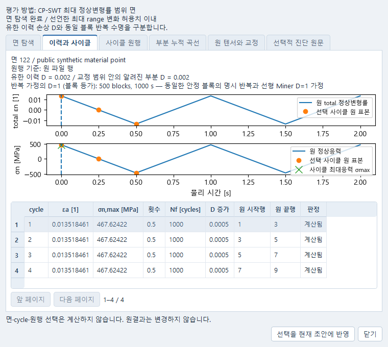

# 변형률 피로 평가 사용법

Data·Material·해석에 저장한 전체 변형률(total strain) 이력과 교정 계수로 피로 손상과 수명을
평가한다. 계산한 면에서 사이클과 원 측정 행을 찾아보고, 그 선택을 문서에 저장해 다시 열 수 있다.
기존 연구 도구의 계산·저장을 사용한다. 공개 합성 예제의 계수는 실재 재료의 시험값이 아니다.

## GUI 작업 순서

이미 설치된 기존 실행기로 Simulation을 연다. 설치/준비 단계가 이미 끝난 환경을 사용하며 이 인도 때문에
새 다운로드를 실행할 필요는 없다. 기존 실행기 예: `Start-CAE-Lab.cmd -Tool simulation`.

1. 해석 창에서 **반복하중 피로 평가**를 고르고 **피로 조건 → 반복하중 조건…**을 연다.
   S–N 응력 수명, 단축 CMB(평균응력 보정 없음), 단축 SWT, 다축 CP-SWT 중 필요한 방법을 선택한다.
2. **저장 이력 선택…**에서 저장된 Data/Simulation/Material의 보존 계산을 고른다. 실제 total strain과
   stress 채널을 선택하고, native 공간 채널은 기존 정확한 위치 picker로 요소/적분점/층 등을 지정한다.
   한 위치의 같은 물리 시각이어야 한다. 없는 성분은 선택 안 함으로 남고 실행이 차단된다.
3. **입력과 원 이력**에서 단위, 텐서/공학 전단, 안정된 반복 이력인지 여부, 실제 이력 출처와
   온도를 검토한다. **단위·동시 시각·위치 검토**를 누르면 선택한 성분의 곡선을 읽는다.
   성분별 단위 변환과 기준계의 상세 내역은 검토 상태에 마우스를 올려 확인한다.
   원 measure와 다른 shear 변환은 차단된다. CMB/NONE에는 응력·shear가 필수가 아니다.
4. **ε–N 교정 자료** 탭의 E, σf′, εf′, b,c, 단위, 온도/진폭/수명 범위, 시험 출처와 실패 정의를 입력한다.
   SWT에는 σmax 범위도 필요하다. 계수는 완전 양진 축방향 안정 cyclic 자료여야 한다. **면 탐색과 수명 가정**에서
   검색 분할·고정 기저·root 허용치·반복 블록 가정을 명시한다. 반복 체크만으로 적합성을 승인하지 않는다.
5. **조건 적용 → 모델 평가**를 눌러 계산한다. 조건 편집과 원자료 읽기, 결과 선택은 새 계산을 시작하지 않는다.
6. 계산 결과를 고르고 **연구 → 사이클과 누적값…**을 연다. **면 탐색** 표에서 최대 정상변형률 범위로
   선정한 면과 최대 SWT·알려진 최대 손상의 진단 면을 구별한다. **이력과 사이클**에서 행을 고르면
   **사이클 원행**에 실제 포함 표본과 닫힘 구간, 동시 최대응력, 수명과 역산 잔차가 나온다.
   원행을 고르면 **원 텐서와 교정**에서 공급된 성분값·원 단위·변환값과 해당 계산의 교정자료를 읽는다.
7. **선택을 현재 초안에 반영 → 저장**을 누른다. 다시 열면 같은 계산 결과의 면·사이클·원행을 복원한다.
   계산 당시의 자료는 저장 결과에 보존된다. 과거 결과를 읽을 때 원 CSV나 솔버를 다시 실행하지 않는다.

면·cycle·원행 표는 256행씩 읽는다. 부분 누적 곡선의 x축은 cycle **기록 번호**이며 물리 시간이 아니다.
원 history 곡선의 x축만 실제 초 단위다. 원 파일 행이 없는 native 이력은 보존 표본 index라는 원행 기준을 구별한다. 반복 수명은 blocks와 초의 블록 등가 노출량이며 유한 이력 D와 다르다.
원 hash/내부 참조는 선택적 진단 원문에 있다. 사용자에게 JSON 입력이나 ID 복사를 요구하지 않는다.

## 공개 합성 예제

전용 편집기의 **공개 합성 예제…**를 명시적으로 승인하면 제공한 12성분 CSV를 실제 기존 Data owner에
가져와 저장한다. 이는 Data import 1개이며 FE 또는 피로 solver 실행이 아니다. 조건 적용 뒤 Simulation에서
피로 실행을 별도로 요청한다. 예제 Data 생성 후 편집기를 취소하면 Simulation은 바뀌지 않지만, 명시 생성한
Data 문서는 보존된다. 늦게 돌아온 Data/미리보기 응답은 새 편집이나 다른 owner를 덮지 않는다.

기본 예제 `examples/impact/synthetic-total-strain-tensor.csv`는 supplied axial/90도 위상차 shear,
동시 stress·total strain 모두를 가진 0..2 s의 합성 두 cycle다. strain은 1, stress는 MPa,
공학 전단이 아닌 tensor shear다. 모든 0 성분도 CSV에 명시적으로 제공한다.
`synthetic-fatigue-calibration.json`과 `synthetic-tensor-data-mapping.json`은 이 예제의 명시 자료다.
계수 E=200000 MPa, σf′=1000 MPa, εf′=.5, b=−.1, c=−.5는 실측값이 아니다.
Nf=1000 cycles에서 독립 forward 생성했으므로 세 방법 모두 D=.002, 반복 블록 등가 수명 500 blocks를 기대한다.
CP-SWT 예제는 최종 133면을 실제 계산하며 4개의 rainflow half 기록을 보존한다.

`synthetic-nested-return-peak.csv`는 복귀 가지에만 σmax=900 MPa가 있는 중첩 반례다.
`synthetic-plane-selection-counterexample.csv`는 최대 strain 면 x와 최대 SWT/damage 면 y를 구별한다.
두 파일은 같은 13열/단위 형식의 독립 합성 검토 자료다. 기본 예제의 두-cycle 수치 기대값을 이 반례에 적용하지 않는다.
Data에서 다른 CSV를 열 때 시험 제목/프로토콜도 해당 자료에 맞게 명시한다.

## GUI 없이 재현하는 실제 작은 경로

저장소 루트, 이미 설치된 기존 Python에서 다음을 실행한다. `--output`은 존재하지 않는 새 폴더여야 한다.
새 라이브러리 설치·solver/provider·HTTP 서버가 없는 기존 in-process owner 경로다.

    python examples/impact/strain_fatigue_example.py --output /absolute/new/fatigue-check

Windows에서는 기존 설치의 **절대 Python exe**와 새 절대 출력 폴더를 사용한다.
2026-10-16 통합 확인에서 같은 예제를 Windows Python3.13으로 계산하고 별도 프로세스로 다시 읽었다.
실제 QWindows 창에서도 저장된 합성 자료를 로컬 HTTP로 읽고 정상·좁은 창과 한글 표시,
숫자 편집 취소 및 면·사이클·원행 선택 복원을 확인했다. 테스트 프로세스는 기존
`scripts/native_check.py`로 실행하고 종료했다. 원 Pro 인도의 Linux 실행 기록과 별도로 보존한다.

이 runnable은 Data import/save → exact ref → NONE/SWT/CP-SWT Simulation 계산 → 원행 선택/저장 →
원 CSV·원 작업 폴더·live inputs/jobs 제거 → 별도 Python process에서 retained bytes 읽기를 수행한다.
`RUN_RESULT.json`, `expected.json`, `cold.stdout.txt`, `cold.stderr.txt`, `retained-copy/`가 남는다.
원 결과 hash·선택 동일, cold job 생성 0, `1e` 초안 저장·실행차단, stale CAS 거절과 명시 수정·재저장을 확인한다.

## 오류와 복구

`1e`, 빈 숫자, 교정 누락은 취소하거나 **조건 적용**하여 미완성 초안으로 저장할 수 있다. 저장은 검증 승인이
아니다. 실행은 차단되며 필수값을 고친 뒤 다시 명시 실행한다. Cancel은 기존 Simulation 초안을 바꾸지 않는다.

σmax≤0, 교정 범위 밖, root 무근/비수렴은 해당 cycle 수명을 미정으로 남긴다. 알려진 부분 D를 전체 D 또는
안전/무한 수명으로 읽지 않는다. tensor 경계/half peak 대응 불일치로 반복 수명만 미정일 수도 있다.

취소 요청과 실제 취소 완료는 기존 Job 상태로 구별한다. 완료된 면은 CANCELLED 결과로 저장·읽을 수 있으며
진행 중이던 면까지 완성됐다고 표시하지 않는다. 면 처리 실패도 FAILED와 완료 면/실패 이유를 보존한다.
저장 실패는 이전 saved pointer·원결과를 유지한다. 현재 초안을 다시 읽고 명시 재저장한다. 선택 반영 직전에
현재 document/session/generation/job/초안이 바뀌면 반영하지 않는다. 과거 결과 선택으로 재실행하지 않는다.

## 사용 범위

미소변형 정상 손상형 SWT의 구현 검사는 실재 재료 engineering qualification이 아니다. 전단 지배 재료,
비비례 추가경화, FS, 반복 소성·cohesive fatigue 연계, Impact A/B는 별도다. 상세 식·표본 정책·한계는
`MATHEMATICS.md`, 실제 실행/미실행과 통합 경계는 `DELIVERY_KO.md`를 따른다.
