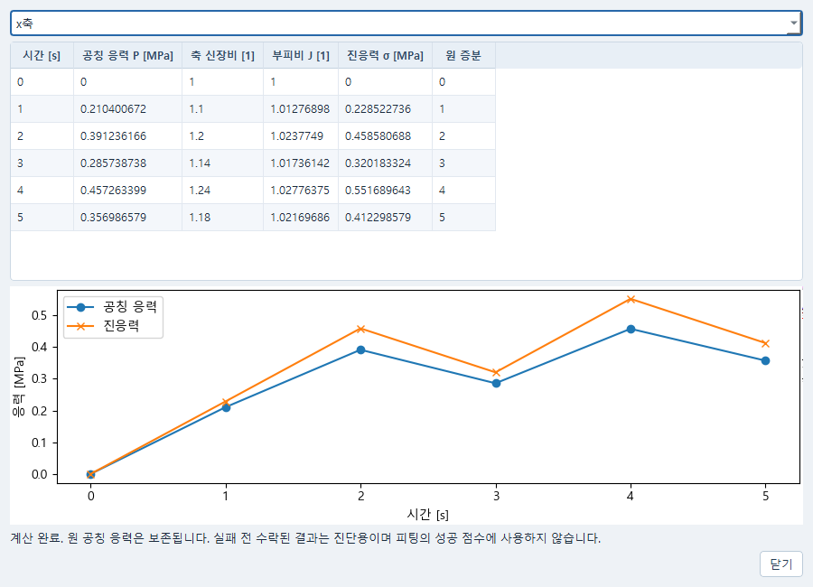

# 유한변형 시험 자료로 피팅하기

독립 Data와 Material, 수치 연구 창에서 진행한다. CAD나 AI 연결은 필요하지 않다.
Windows에서는 기존 바로가기를 사용하거나 저장소에서 다음과 같이 Data를 연다.

```powershell
.\scripts\start_cae_research.ps1 -Tool data
```

다른 창도 같은 실행기의 `-Tool material`, `-Tool numerical`로 열 수 있다.

## 시험 자료 열기와 변환

1. Data에서 **CSV 열기…**로 시험 파일을 연다. 공개 예제는
   `examples/finite-measure/train.csv`다.
2. **편집 → 유한변형 시험 설정…**에서 시간, 하중, 변형 열과 실제 단위를 고른다.
   축방향과 회전·전단 없는 단축·동축 시험인지 확인한다. 표점 변위인지,
   크로스헤드 변위인지 구분한다.
3. **치수와 가정**에서 초기 단면적 A0와 표점 거리 L0, 측정 근거를 입력한다.
   공개 예제는 A0=20 mm2, L0=50 mm다. 진응력이 필요하면 현재 면적 A(t),
   관측한 부피비 J, 전체 변형구배 F 또는 명시한 등체적 가정 중 근거를 고른다.
   J=1이나 크로스헤드 변위와 표점 변위가 같다는 가정은 근거 없이 선택하지 않는다.
4. **변환값**에서 필요한 응력과 변형률을 고르고 **변환 미리보기**를 누른다.
   표에서 공칭 응력 P, 진응력 σ, 공학 변형률 e, 신장비 λ, 로그 변형률을 확인한다.
   그래프 선택은 표시할 물리량만 바꾼다. 입력을 바꾸면 다시 미리보기해야 한다.
   정확한 원값과 긴 무효 이유는 표의 도움말에서도 볼 수 있다.
5. **초안에 반영 → 설정 적용 → 가져오기**를 누른다. 이어서
   **편집 → 응력과 변형률 변환 추가… → 설정 적용 → 처리 미리보기…**로 간다.
   미리보기의 **변환값과 원행 확인…**에서 변환값, 단위, 원행, 무효 이유를 살핀 뒤
   **처리 결과 보존**을 누른다. 마지막으로 Data를 **저장**한다.

설정 창의 미리보기는 저장된 관측값이 아니다. **취소**하면 입력 자료에 반영하지 않는다.
`1e` 같은 미완성 숫자는 초안으로 남겨 수정할 수 있지만 유효한 변환값으로 계산되지는 않는다.
무효행을 성공값으로 바꾸거나 조용히 삭제하지 않는다. 계산 제외와 화면 숨김은 별개이며,
피팅용·검증용 표본과 가중치는 기존 수치 연구의 표본 선택에서 지정한다.

**Data의 유한변형 시험 설정 창.** 왼쪽에서 열과 단위를 고르고 오른쪽 표·곡선에서
변환값을 확인한다. **초안에 반영**하기 전에는 원래 입력이 바뀌지 않는다.


## Material과 피팅으로 이어가기

Material에서 **Neo-Hooke**와 사용할 응력·시간 단위를 지정하고 재료를 저장한다.
Data의 **편집 → 보존한 처리 결과…**를 열어 응력 채널 `finite_sigma` 또는 `finite_P`를
선택하고 **피팅 계획으로…**를 누른다. 기존 계획을 고르거나 새 계획과 저장한 재료를
선택한다. Material의 **재료 피팅…**에서도 같은 재료의 계획을 열 수 있다.
시험 편집창에서 **유한변형 측정 이력 / 횡방향 제어**를 선택하고,
변환한 신장비 채널 `finite_lambda`와 축방향, 횡방향의 자유 수축·고정·지정 조건을 명시한다.

진응력 관측 `finite_sigma`를 비교할 때는 같은 축의 모델 응답(예: `stress_xx`)과
**후보의 실제 수락 F/J로 P → 진응력 변환**을 선택한다. 모델이 실제 계산한 변형구배와
부피비로 비교하며, 원래 공칭 응력은 보존된다. 관측 파일의 J나 지정한 횡방향 변형을
계산된 실제 수축으로 대신하지 않는다.

`train.csv`는 피팅용, 독립 시험인 `holdout.csv`는 검증용으로 같은 계획에 연결할 수 있다.
`train-unit-twin.csv`는 단위와 열 순서만 바꾼 같은 시험이므로 독립 검증용으로 쓰지 않는다.
공개 작은 예제의 피팅 조건은 μ만 변경, 초기 0.8 MPa, 범위 0.5–2 MPa,
Lamé 계수 5 MPa 고정, 평가 예산 40, 난수 시드 17이다.

피팅을 실행한 뒤 보존된 후보와 물리 잔차를 읽고 비교한다. 상세 결과가 없는 후보는
명시적으로 상세 평가를 실행해야 한다. 사용할 계수를 채택한 뒤 Material과 피팅 계획을
각각 저장한다. 저장한 문서는 각 창의 **열기…**에서 다시 연다. 원행 변환을 확인하려면
Data의 **보존한 처리 결과…**, 보존 계산의 응력을 확인하려면 Material의
**도구 → 공칭응력을 진응력으로 보기…**를 사용한다. 이 응력 비교 창은 새 해석을 시작하지 않는다.

**수치 연구의 피팅 결과 창.** 오른쪽 위에서 피팅용·검증용 시험을 전환한다.
**측정 변형**을 고르면 하중이 줄어드는 구간도 원래 취득 순서대로 본다.
아래 잔차는 응력 단위의 예측값−관측값이며, 계수 채택은 **계수를 재료에 적용…**에서 한다.


**Material의 응력 비교 창.** 같은 계산에서 공칭응력과 진응력이 얼마나 다른지 확인한다.
이 창을 여는 것만으로 계산하거나 계수를 바꾸지는 않는다.



## 적용 범위와 주의할 점

- 현재 관측 변환은 회전·전단 없는 단축·동축 시험을 대상으로 한다.
  전체 F를 사용하면 9성분을 모두 지정해야 한다. 비대각 성분을 자동으로 0으로 채우지 않는다.
- 열의 단위 선언과 수치 환산을 구분한다. 단위 이름만 바꿔서 변환을 대신하지 않는다.
  힘/초기 면적의 공칭 응력을 진응력으로 이름만 바꾸지 않는다.
- 자유 횡수축은 지원하는 Neo-Hooke 시험 제어에서 계산한다. 알 수 없는 치수·측정 근거나
  누락된 계산 상태를 추정해 채우지 않는다.
- 실패한 계산에서 이미 수락된 구간은 진단용으로 볼 수 있지만 피팅 성공 점수에는 쓰지 않는다.
  원래 실패 이유와 증분은 응력 비교 창에 남는다.

개발 API와 실행 확인 범위는 [API](API_KO.md),
[구현 설명](IMPLEMENTATION_KO.md), [수용 기록](ACCEPTANCE_KO.md)을 참고한다.
