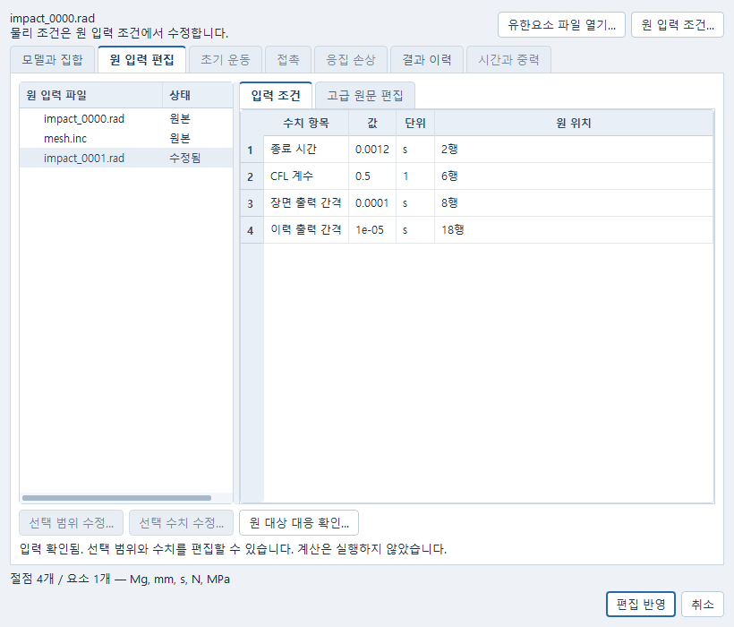
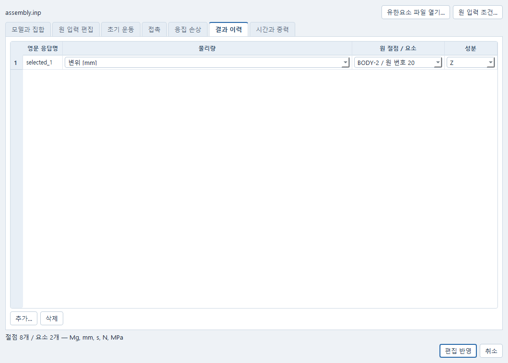

# 충격 입력을 열고 계산하기

**해석** 앱의 **충격 조건…**에서 INP 또는 native Starter/Engine 입력을 열고 편집할 수 있다.
아래 Python 예제와 기존 Simulation API도 같은 입력과 문서를 사용한다. 입력 편집·저장·결과
읽기에는 CAD·AI·MCP·WSL이나 유료 API가 필요하지 않다. 저장한 계산 결과는 해석 앱의
**연구 → 보존 결과 다시 읽기…**에서 다시 읽을 수 있다. 실제 계산에는 등록한 솔버가 필요하다.

## 실행 준비

현재 저장소를 하위 모듈과 함께 내려받고 [Windows 설치 안내](../INSTALL_KO.md)를
따른다. 기존 설치는 저장소를 갱신한다. 아래 명령의 `python`은 설치 안내에서 확인한
제품용 Python 실행 파일을 사용하며 저장소 루트에서 실행한다.

실제 계산에는 기존에 등록한 무료 Windows OpenCourant가 필요하다. 예제 실행기가
솔버를 새로 설치하거나 구매하지는 않는다. 런타임이 없어도 계산을 요청하지 않는 입력
편집·저장 예제는 사용할 수 있다.

## 해석 앱에서 입력 편집과 저장

1. **해석 → 충격 조건… → 유한요소 파일 열기…**에서 주 INP 또는 Starter `.rad`와 입력 제출
   작업 폴더를 고른다. native 입력이면 함께 사용할 **Engine 파일**도 명시적으로 고른다.
   원 단위 **Mg, mm, s, N, MPa**를 확인하고 **입력 확인 → 가져오기**를 누른다.
   포함 파일은 모두 지정한 작업 폴더에서 찾는다. 다른 단위를 자동 환산하지 않는다.
   읽는 도중 취소하면 해당 읽기가 끝난 뒤 창이 닫히며 이전 입력은 유지된다.
2. **모델과 집합**에서 기존 집합과 메시를 확인한다. **원 입력 조건…**을 누르면
   **원 입력 편집** 탭의 파일 목록과 **입력 조건** 표가 열린다. native RAD에서는 원문이 물리 조건의
   기준이므로 기존 초기 운동·접촉·손상·시간 탭의 별도 편집을 잠근다. 현재 투영값은 유지되며,
   INP의 기존 운동·접촉 편집은 계속 사용할 수 있다.
   계층 INP의 **결과 이력**에서는 부품 instance와 원 local 절점·요소 번호를 고른다.
   같은 local 번호가 다른 instance에 있어도 구분하며, 내부 재번호를 직접 입력하지 않는다.
3. 원파일을 고르고 수치 항목을 선택한 뒤 **선택 수치 수정… → 미리보기 → 선택 편집 반영**을 누른다.
   직접 원문을 바꾸려면 **고급 원문 편집**에서 범위를 선택하고 **선택 범위 수정…**을 누른다.
   수정할 원문과 기존 선택을 비교한 뒤 명시적으로 반영한다. **취소**하면 그 편집은 반영하지 않는다.
   원문은 INP/RAD의 ASCII 제약을 따르며, 선택하지 않은 범위와 원파일의 줄바꿈은 보존한다.
4. 미지원 카드가 있으면 진단의 파일·행을 두 번 눌러 정확한 원 위치로 이동한다.
   미완성 초안을 반영하고 저장할 수 있지만 계산은 기존 입력 검사에서 차단된다.
   진단을 없애기 위해 미지원 카드를 자동 무시하거나 허용값을 바꾸지 않는다.
5. 충격 조건 창의 **편집 반영**으로 돌아가 해석 앱의 **변경 적용 → 저장**을 누른다.
   같은 해석 문서를 다시 열고 **충격 조건… → 원 입력 조건…**에서 이어서 편집한다.
   원문 미리보기·수치 수정·저장으로 솔버가 실행되지는 않는다.

원문 편집으로 번호나 집합 구성원이 달라지면 **원 대상 대응 확인…**에서 기존 원 대상과 현재
선택할 대상을 비교한다. 바뀐 항목은 선택을 비워 두므로 원 instance/local 번호 또는 집합을
직접 다시 고르고 **대응 미리보기 → 현재 대상 명시 수락**을 누른다. 상세에서 이전·현재 전체
구성원을 읽을 수 있다. **거절**하면 이전 참조와 실행 차단을 유지한다. 이전 정수 번호가 남아
있다는 이유만으로 다른 대상에 붙이지 않는다. 원문 변경으로 생성 집합이 끊겼다면
**모델과 집합**에 보존된 이름을 선택하고 **집합 수정…**에서 현재 원 집합과 면을 하나씩 다시
지정한다. 다른 집합의 미확인 정의는 그대로 남는다. 사용 중인 집합은 조건을 먼저 정리하지
않으면 삭제할 수 없다. 내부 해시·바이트 위치는 입력하지 않으며 원 instance/local 번호와
실제 구성원으로 확인한다.



사진은 공개 native 입력을 읽은 실제 Windows Qt 창이다. 원파일 목록에서 Engine 파일을
고르면 종료 시간과 출력 간격을 표에서 선택할 수 있다. 계산 결과 화면은 아니다.



계층 INP의 결과 위치는 **BODY-2 / 원 번호 20**처럼 부품과 원 번호로 고른다.
다른 부품의 같은 번호와 구별하며, 사진의 공개 입력은 실제 충돌 해석 검증 사례가 아니다.

## 저장한 결과 다시 읽기

1. 해석 앱 왼쪽 **계산 결과**에서 다시 읽을 원 계산을 선택한다.
2. **연구 → 보존 결과 다시 읽기…**를 누른다. 편집 중인 입력이 있으면 먼저 **변경 적용**한다.
   현재 입력을 고쳐도 원 계산에 제출했던 입력은 유지된다.
3. **저장된 결과 파일 읽기**는 보존된 VTK와 CSV를 읽는다. 솔버나 변환기를 실행하지 않는다.
   **원 ANIM/TH를 다시 변환해 읽기**는 등록된 변환기로 원출력을 변환한다. 새 솔버 계산은 하지 않는다.
4. 왼쪽에 추가된 읽기 결과를 선택해 이력과 공간 결과를 확인한다. 읽은 표본 수와 공간 결과의
   전체 시각 수, 누락·손상 시각 수를 함께 표시한다. CSV는 처음 손상된 행 앞까지만 읽고,
   그 뒤의 행을 건너뛰어 연결하지 않는다. 손상된 공간 결과와 별개로 정상 프레임은 볼 수 있다.
5. **저장** 후 같은 해석 문서를 다시 열어 이어간다. 원 계산이 실패·취소였다면 그 상태는 유지된다.
   일부 결과를 읽었다는 이유로 계산 성공이나 공학적 적합성으로 바뀌지 않는다.

선택 창에서 **취소**하면 읽기를 요청하지 않는다. 제출 응답을 받지 못한 경우 메뉴가
**결과 읽기 상태 확인…**으로 바뀐다. 이 메뉴로 같은 요청을 확인하면 읽기 작업을 중복 생성하지 않는다.
기다리는 동안 다른 계산을 선택하거나 입력을 편집해도 늦게 도착한 응답이 그 선택과 편집을 덮어쓰지 않는다.

## CAD 없이 지금 실행할 수 있는 공개 입력 검사

각 명령은 **없는 새 작업 폴더**를 지정한다. 이전 결과를 덮어쓰지 않는다. 기본 동작은 가져오기→명시 편집→기존 Simulation 저장→별도 Python 프로세스에서 같은 입력 재열기이며 native/runtime 조회를 하지 않는다.

```powershell
python examples/impact/input_a/run_public.py --workspace C:/CAE/A-native-edit --route native
python examples/impact/input_a/run_public.py --workspace C:/CAE/A-assembly-edit --route assembly
```

native 예제는 원 Starter/Engine/includes를 보존하고 종료 시간만 0.001→0.0012 s로 원문 hunk 편집한다. assembly 예제는 회전·이동한 두 instance 중 BODY-2 집합에 Vz=-100 mm/s를 명시하고 원 local 절점20의 Z 변위/속도를 선택한다. 내부 effective 번호나 hash를 사용자가 입력할 필요는 없다. 예제 코드는 선택 대응을 명시 수락한 뒤 같은 문서에 적용한다.

실제 Windows에 기존 pinned runtime이 등록돼 있을 때만 다음 **하나의 작은 경로**를 실행한다. 신규 binary 설치/다운로드나 다른 runtime 대체는 하지 않는다.

```powershell
python examples/impact/input_a/run_public.py --workspace C:/CAE/A-native-run --route native --run-native
```

이 명령은 기존 simulation.evaluate로 단일 Job을 제출한다. Starter→Engine→TH/ANIM reader→Post 등록→원 시각/ID의 응답 선택→저장→별도 프로세스 재열기를 실행한다. 별도 프로세스에서는 solver를 실행하지 않는다. Linux에서 `--run-native`를 지정하면 NOT_RUN과 exit 2를 반환하고 입력만 저장한다. native 계산을 성공시킨 것으로 해석하지 않는다. 계층 변환 경로를 따로 확인할 때만 별도 새 폴더와 `--route assembly --run-native`를 사용한다. 큰 campaign은 필요 없다.

Ctrl+C는 현재 Job에 취소를 요청한다. 실제 종료 여부는 기존 owned 프로세스 finally 및 cleanup 기록이 결정한다. 종료 미확인은 FAILED로 남기며 다음 검사를 성공처럼 이어 가지 않는다. 런타임 부재/Starter 오류/Engine 실패/후처리 실패의 원 자료는 해당 workspace에 남는다. 같은 작업의 timeout을 임의로 늘리거나 강제 종료를 정상 종료로 바꾸지 않는다.

## Windows 입력 개정과 시간적분 설정

Pro 원 작성 환경은 Linux였고 Windows solver는 미실행이었다. Sol의 실제 Windows 검사에서
원 공개 native 레시피의 자동 Ismstr/Itetra4=3 조합과 CFL 0.9 문제가 드러났다. 원 실패
계산·입력은 별도 작업 폴더에 보존하며 사용자 파일을 자동으로 바꾸지 않는다.
현재 공개 native 입력은 탄성 C3D4의 표준 Itetra4=1000을 명시하고 `/DT` scale=0.5,
minimum step=0을 사용한다. mass scaling, 재료·단위·연결·출력 시간과 아래 물리 공차는 바꾸지 않았다.

이 작은 tetra의 독립 선형 tangent/lumped-mass 고유치 상한은 약 7.8467e-7 s다.
CFL 0.9의 실제 초기 간격 8.2108e-7 s는 이를 초과했다. 이 계산은 실제 total-strain solver의
전체 구현 재현이나 일반 모델의 안정성 보증이 아니다. [공식 시간 간격 설명](https://help.altair.com/hwsolvers/rad/topics/solvers/rad/element_time_step_r.htm)과
[`/DT` 카드](https://help.altair.com/hwsolvers/rad/topics/solvers/rad/dt_engine_r.htm)의 scale 적용을 사용한다.
기존 INP 변환 경로의 레시피는 별도 검토 대상이며 native 사례의 결과로 계층 INP까지 수용하지 않는다.

## 사전 선언 예상량

길이축 10 mm의 균질 C3D4: 체적 1000/6 mm³, ρ=7.8e-9 Mg/mm³, 질량 1.3e-6 Mg = .0013 kg. Vz=-100 mm/s, g=0이므로 전체 KE=.0065 N·mm=6.5e-6 J, 실제 기록된 t에서 Uz=-100t mm다. native는 한 tetra이며, assembly는 동일 두 tetra 중 하나만 이동하므로 전역 질량은 .0026 kg이고 KE는 동일하다.

공개 검사 허용량은 변위 absolute 5e-5 mm, 속도 absolute .05 mm/s, 질량 relative 5e-6+absolute 1e-12 kg, KE relative 5e-4+absolute 1e-12 J다. 이는 파일/단위/시간/선택과 균일 병진의 작은 smoke 검사에 대한 사전 선언이며 공학 강도·수명·실험적 승인 기준이 아니다. 텍스트 converter 반올림과 명시적 선형 균일 병진을 고려한 수치 여유다. 원 Pro 작성 환경에서는 Windows 미실행이었다. 아래 Windows 국소 확인은 개정한 공개 native 입력 한 사례에만 해당한다. 기존 Starter/Engine/time coverage 관문은 이 허용량과 별개이며 낮추지 않았다.

입력으로 적분한 연속체 COM은 (2.5,2.5,2.5) mm, COM 관성은 대각 9.75e-6 / 비대각 1.625e-6 Mg·mm²다. **이 행렬은 solver 강체의 lumped inertia가 아니다.** `/RBODY` native readback 미구현을 이 값으로 대체하지 않는다. 코드의 initial_mass_properties.json은 native_body_mass_inertia=UNKNOWN을 유지한다.

## 검증과 잔여

원 인도의 RESULTS.md/RESULTS.json은 Pro 작성 당시 Linux 실행·synthetic 경계 대역·Windows 미실행을 구별한 기록이다. 후속 Sol Windows 통합 결과는 아래와 구별한다. A 전체 인수는 미완료다. `/RBODY`, native TRANSFORM/INIVEL AXIS 등 rigid readback과 native 실행·재후처리 전체 GUI 확인이 남는다. B/C는 별도 배정 범위를 유지한다.

원 입력 편집 GUI는 Windows Qt에서 공개 native 입력의 파일 선택·수치 미리보기·취소·반영과
같은 Simulation 저장을 확인했다. 별도 Python 프로세스로 저장 문서를 다시 읽은 뒤 같은 수치를
재편집할 수 있었다. 보통·좁은 창의 입력 조건/원문·미지원 위치와 원 대상 재선택도 확인했다.
원 CRLF 보존, 기존 ID 소멸 후 재선택, 생성 집합의 명시 복구, 전체 구성원 확인은 해당 GUI
경계 검사다. 이 확인에서 솔버·재메시·런타임 조회는 실행하지 않았다. 프로그램에서 조작한 Qt
창과 물리 키보드·마우스 조작은 구분하며, 이 기록은 Windows 잠금 상태의 OS 조작 수용이 아니다.


## Windows 국소 확인 — 2026-10-15

기존 Windows runtime latest-20261011/cb760c2의 binary/CFG hash를 확인하고 새 설치 없이
기존 Simulation/JobManager/owned process로 공개 native 입력을 실행했다. 작성·통합 교정은
Sol이며 원 Pro 구현과 원 실패 입력·로그는 그대로 보존했다.

| 범위 | 실제 결과 |
|---|---|
| 원 레시피와 CFL 0.9 | 첫 실행은 Engine 정상 종료에도 요소 삭제·에너지 폭주로 물리 검사 FAILED. 명시 Ismstr=2 시도는 Starter 경고2037로 Engine 전 차단. Itetra4=1000만 명시한 CFL 0.9도 물리 검사 FAILED |
| 개정 native 입력 | Itetra4=1000, `/DT` scale=0.5를 명시. Starter warning0/error0, Engine 정상 종료2632cycles, 실제 ANIM13프레임과 TH120표본 변환 |
| 사전 물리 공차 | 변위 최대 오차1.39e-17mm, Vz·전체 질량·KE 최대 오차0. 원 단위/접속/밀도/재료/질량 스케일링과 수용 공차 불변 |
| 실제 시각 | ANIM 0→0.00120015s, TH 0→0.001190115s. 요청 종료0.0012s 값으로 보간하지 않고 기록된 각 시각에서 비교 |
| 저장·새 프로세스 | 원 입력과 정확한 선택 결과 hash가 새 Python owner에서 같음. 새 Job0, solver0 |
| 프로세스 종료 | 360s 고정 상한 안에40.90s, exit0. outer Windows Job은 job_empty, owner shutdown joined |
| 기존 ParaView | 정확한 PVD/등록 참조를 기존 Post 담당에게 전달. 이 기록 시점의 실제 창 열기·저장·새 프로세스 재열기는 별도 미완료 |
| 계층 INP/강체/전체 A | 이번 native 사례로 수용하지 않음. 계층 변환의 기존 recipe 검토, `/RBODY`·TRANSFORM·AXIS와 전체 GUI 작업 잔여 유지 |

로컬 근거는 `_workspace/a-native-01`~`a-native-04`,
`_workspace/delivery-structure-impact/impact-input-windows-native-01`~`04`이다.
최종 정상 계산은 `a-native-04/input-a-check.json`, 선택은 `input-a-selected-result.json`,
별도 프로세스 읽기는 `input-a-cold-read.json`에 있다. 앞선 실패 결과는 덮어쓰지 않았다.
이 작은 탄성 병진 확인은 일반 충격·강도·수명 또는 실험적 적합성의 승인이 아니다.


재후처리는 현재 편집 초안의 계산이 아니다. 원 입력 D0를 계산한 뒤 문서를 D1로 편집했어도,
새 읽기 Job의 snapshot/hash/revision/generation은 원 D0로 함께 기록한다. 현재 D1 초안은
유지하고 제출 응답 유실 뒤 복구에서도 같은 D0 식별 정보를 쓴다. 이 후속 연결은 원 계산이
정상·실패·취소인 세 대역 경계 사례에서 저장/새 owner/result reference까지 확인했으며,
새 native 계산은 하지 않았다. TH/TITLES가 없거나 CSV가 중간에 잘려도 검증된 이력 구간과 정상 VTK를 나누어 읽는다.
손상된 프레임과 누락 시각은 그대로 남기며, 그 틈을 연결해 곡선이나 충격량을 계산하지 않는다.
기존 실제 출력의 별도 시험 사본에서 중간 프레임 손상과 CSV 잘림을 만들어 부분 읽기와
새 프로세스 재열기를 확인했다. 원 실제 계산은 정상이었으며 실패로 바꾸지 않았다.
재변환 converter의 실제 실행과 OS 직접 조작을 포함한 전체 화면 수용은 별도 미확인이다.

## Python에서 결과 위치 선택

결과는 **원 Job의 고정 입력**에 붙인다. 현재 편집 중인 다른 revision을 사용해 옛 결과를 대응시키지 않는다. `document_result(document_id, job_id, selection={"responses":["impact.velocity.Z@2"]})` 등의 domain 호출에서 내부 숫자는 source 선택으로 해석한 값이다. 단일 frame API는 `impact_retained.select_frame`; metadata 목록은 `inventory`이며 payload 검증 상태가 다르다. 없는 프레임/성분/active 값은 UNKNOWN 또는 명시 오류다.

## Python에서 보존 결과 다시 읽기

Python에서도 같은 해석 문서의 원 계산을 지정해 읽을 수 있다. 다음 호출은 GUI와 같은 명령이다.

```python
reply = workbench.document_command(
    document["id"], "simulation.reprocess",
    {"source_job_id": original_job_id, "convert_raw": False},
    session_id=document["session_id"],
    expected_generation=document["generation"], command_id=unique_command_id,
)
```

False는 이미 보존된 VTK/CSV만 읽으며 runtime 조회도 하지 않는다. True는 원 native ANIM/TH를 동일 pinned converter로 다시 변환한다. 2026-10-16 공개 INP 접촉쌍의 보존 결과에서 True의 TH/ANIM 재변환과 저장·새 owner 읽기를 확인했다. native RAD 전체 재변환·GUI 수용을 이 한 건으로 확대하지 않는다. 새 Job 결과의 READBACK_ONLY/solver_execution=NOT_PERFORMED와 source_execution_status를 함께 보여야 한다. 새 읽기가 성공해도 원 FAILED/CANCELLED를 SUCCEEDED로 바꾸지 않는다. 원 Job·현재 선택·입력과 결과를 저장한 뒤 새 owner에서 다시 읽는다.


## 탄성 사면체의 정확한 시간증분 — 2026-10-16

INP의 **모든 요소가 선형 탄성 LAW1의 C3D4**이고 실제 effective property가 Itetra4=1000이며 질량 스케일링이 없을 때, 생성 Engine은 기존 `/DT`와 함께 `/DT1/BRICK/STOP`을 명시한다. 두 카드 모두 사용자가 선택한 CFL 계수를 쓰고 minimum은 0이다. 예를 들어 CFL=.9이면 두 카드의 수치 행은 각각 `.9 0`이다. 계수를 .5로 낮추거나 기존 물리 공차·모델·원 결과를 바꾸는 기능이 아니다.

DT1은 같은 solid의 더 정확한 native 시간증분 계산을 선택한다. `/DT`의 전역 기본 계수와 DT1의 고체 계수는 native에서 서로 다른 변수다. 이번 유한 지원에서는 같은 사용자 계수를 유지하도록 **두 값이 같은 경우만** 지원한다. C3D8/C3D10, 소성 LAW36, cohesive, 혼합 모델, mass scaling에는 이 보조 카드를 자동 추가하지 않는다. 실제 검증된 formulation과 생성 조건이 다르면 실행 전에 거절한다. 적용 요소·계수·최소 증분·적용 이유는 기존 physical admission에 함께 보존한다.

Python의 `engine_deck(settings)` 미리보기·내보내기도 동일한 원 모델/시간 설정에서 같은 DT1 카드를 생성한다. adapter는 이미 검증한 모델과 effective physics를 재사용한다. 과거 결과를 다시 읽을 때는 지금의 생성기로 옛 Engine을 재생성하지 않고 그 원 실행에 보존된 정확한 Engine bytes를 읽는다.

기존 지원 native 탄성 C3D4/Itetra4=1000에는 명시 `/DT1/BRICK/STOP`을 읽고 편집·저장·내보낼 수 있다. `/DT`가 함께 있어야 하고, 두 scale은 유한한 0 초과 1 이하의 같은 값이어야 하며 두 minimum은 0이어야 한다. 중복 카드·비어 있거나 여분인 필드·다른 minimum·mass scaling 혼합·서로 다른 scale은 원 위치를 붙여 거절한다. 사용자 원문을 자동 동일화하지 않는다. 해당 초안과 원 bytes는 보존할 수 있다.

정상 DT1 문서의 수치 항목은 **전체·고체 시간증분 계수 함께 변경**으로 표시한다. 이 항목을 명시 편집하면 `/DT`와 DT1의 정확한 두 scale 범위를 한 작업으로 바꾸고 마지막에 전체 입력을 다시 검사한다. 다른 bytes와 원 CRLF는 그대로다. Undo/Redo, 저장 후 새 owner 재열기·재편집, 정확한 native 내보내기와 원문 복원을 확인했다. 기존 `/DT` 단독 문서와 허용된 mass scaling 문서는 종전대로다. 기존 source editor의 명칭 연결이며 새 GUI 개편이나 OS 조작 수용을 주장하지 않는다.

이 native 지원은 기존 탄성 C3D4 원문 범위다. generated INP의 B 응답용 `/TH/INTER` 등 전체 카드를 native로 재가져와 편집하는 기능은 여전히 미지원이다. DT1 카드 하나의 지원을 B 전체 native 편집 지원으로 해석하면 안 된다.

Python converter·controlled Starter 경계, 원문·문서 저장·cold와 기존 영향 검사를 마친 뒤 같은 공개 입력·CFL .9로 실제 계산 한 번을 확인했다. Starter·Engine과 결과 읽기가 성공했고 정확한 고체 시간증분 계산, 4733증분, 저장·새 프로세스의 동일 결과와 확인용 프로세스 종료를 확인했다. 접촉 전 에너지 폭주는 이번 출력에서 사라졌지만 접촉 후 에너지 오차는 남아 물리 수용은 미완료다. 새 원실행의 접촉쌍 응답은 단위 근거 전달을 추가 연결하기 전 UNKNOWN이며 빈 응답을 실제 0으로 해석하지 않는다. 과거 실패와 원 결과는 그대로 보존한다.
