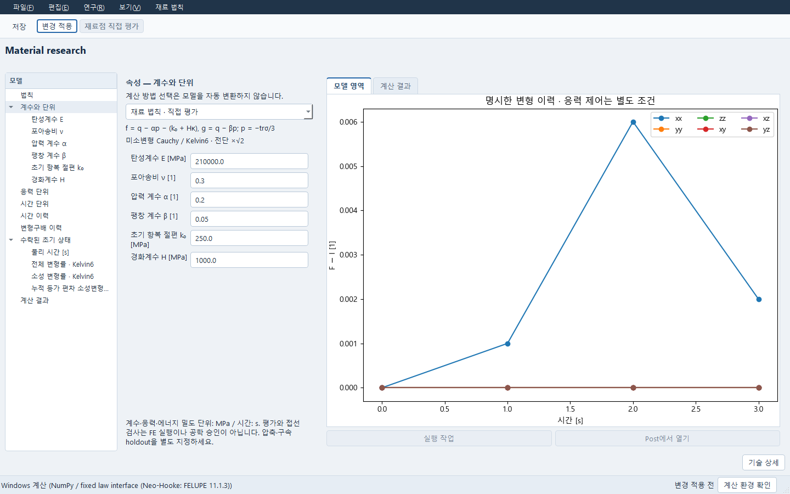

# Material 법칙·native FE 전송 — 실제 소스 인도

요청: PRO-LAW-NATIVE-20261015-01 / B4.5 FN09, B6.1 FN08-02.
기준: 공개 3ba7c97cb7c5de496a1b2ac7fdf8d83c0dc7dfad + upstream 3e48bf6138f495299f45b1af254bfb4aaff307b8.

Windows에서 세 법칙의 실제 FELUPE 계산과 저장 결과 재열기를 확인했다. 저장한 FreeCAD의
DP 시편도 새 프로세스로 열어 같은 할당을 계산하고, 저장 결과를 또 다른 프로세스에서 읽었다.
지원 범위와 실제 확인은 [Windows 확인 기록](ACCEPTANCE_KO.md#2026-10-15-windows-통합-확인)을 따른다.
아래 Linux/NOT_RUN은 Pro 작성 당시 기록이며 이후 Windows 확인과 구분한다.

## 인도 상태

DP 구성 적분·독립 접선·기존 fit 연결, 저장 Material 개정 전송, 동일 법칙의 FELUPE FE adapter/worker와 기존 Qt 연결 소스를 작성했다. 구현 파일이 있다는 뜻과 실제 native 실행에 통과했다는 뜻을 구분한다. Linux 좁은 검사는 **54 passed / 8 skipped**이다. 기존 Data→Numerical 다시험 fit→holdout→후보 증거→명시 CAS 채택→저장→새 Workbench owner 재열기를 실제로 실행했다. 실제 공간 FE, FELUPE Neo-Hooke 실행, FreeCAD native 적용·저장·새 프로세스, Qt 표시, Windows 실행은 이 환경에서 **NOT_RUN**이다. 설치 DNS 실패 원로그와 실행 가능한 입력·검사기를 함께 인도한다.

FELUPE는 원 pyproject의 고정 의존성 11.1.3을 재사용한다. 새 solver/optimizer/store/framework를 추가하지 않는다. 새 전역 조립기·Newton 해석기를 구현하지 않고 기존 FELUPE의 Mesh/RegionHexahedron/SolidBody/newtonraphson을 호출한다. CalculiX 카드 지원이나 MFront Windows 이식으로 표시하지 않는다. 기존 Linux sealed MFront와 exact-source 로컬 build 승인 경계는 유지한다.

## 읽는 순서

`API_KO.md`: 함수·typed 명령·값·오류·저장 경계.
`EQUATIONS_KO.md`: 정확한 DP/Neo/SLS 식, 측도, 초기 상태, 독립 기준.
`WINDOWS_KO.md`: 무료 기존 의존성 설치, 실제 FE·native·Qt 검사 명령과 종료 정책.
`ACCEPTANCE_KO.md`: 실제 수행/controlled fixture/NOT_RUN 및 남은 인수 관문.
`FILE_OWNERSHIP.md`: 전용 파일과 최소 공통 hunk의 소유·통합 경계.

## 사용자 경로

시작 메뉴의 **재료**를 열고 **새 구성식**에서 원하는 법칙을 선택한다.
기존 전처리·후처리나 AI를 실행하지 않아도 재료점 계산을 따로 사용할 수 있다.

기존 Material 창의 새 법칙 메뉴에서 DP/명시 Neo-Hooke/단일 branch SLS를 선택한다. 계수·단위·시간·F 이력·초기 상태를 입력하고 저장한다. 직접 평가와 특정 증분의 독립 접선 검사, Numerical Plan으로 연결하는 동작을 분리한다. 후보 선택만으로 Material을 바꾸지 않으며 기존 후보 증거 및 CAS 채택을 사용한다.

공개 합성 시편의 입력 편집 화면이다. 오른쪽 그래프는 계산 전 지정한 변형 이력이며 계산 결과가 아니다.

새 법칙 창은 계수와 단위부터 보여준다. 연구 메뉴의 ‘다시험 피팅 계획…’은 기존 재료 피팅 창을 열어 계수·피팅 시험·holdout을 편집하며, 여는 것만으로 계산하지 않는다. FE 할당창에서는 원값/원단위와 적용값/적용단위를 표에서 비교한다. 미완성 전달 메모는 그대로 저장할 수 있고 ID·해시·전체 JSON은 ‘기술 상세’에서 읽는다.

깨끗하게 저장된 개정에서 ‘FE 할당 검토’를 연다. 현재 FreeCAD 문서의 정확한 해석·재료·전체 solid 영역·Hex8 메시·native solver 문맥을 선택한다. 전달 초안 저장, 변환/interface 미리보기, 명시 적용, FE 입력 고정, 기존 Simulation 열기, 명시 계산은 각각 다른 동작이다. 계산 결과에는 실제 적분점 응력·변위·반력·증분별 상태와 실패가 남는다. 저장 후 원 owner를 닫고 새 owner에서 보존 결과를 읽는다. FreeCAD solver 문맥을 선택하더라도 이 경로의 실행 backend는 FELUPE이며 그 native CalculiX solver를 실행하지 않는다.

저장한 FreeCAD 시편을 다시 열 때 재료를 다시 적용할 필요는 없다. 형상·메시·조건이 같으면
기존 할당에서 **FE 입력 고정 → 해석에서 열기**로 이어 간다. 입력을 바꿨다면 할당 상태를
확인하고 다시 검토한다. 일반 형상과 다른 요소의 지원은 아래 제한을 따른다.

## 제한을 숨기지 않는다

현재 FE admission은 작은 준정적 단일 whole-solid Hex8 시편이다. 기존 loads/contacts/section/orientation/J2/dynamic 경로를 몰래 바꾸지 않는다. 추가 법칙을 전체 사용자 형상·모든 요소·모든 solver로 확대하지 않는다. MFront SVK의 새 Windows/FE pair, 다중 branch, 손상·파괴·피로·Impact는 이번에 구현하지 않았다. 저장된 원 SVK/J2/Maxwell 결과와 기존 backend는 유지한다. 강도·failure·실측 식별·공학승인은 UNKNOWN이다.

전체 인도4, 전체 제품 및 공학 승인 완료를 선언하지 않는다.
