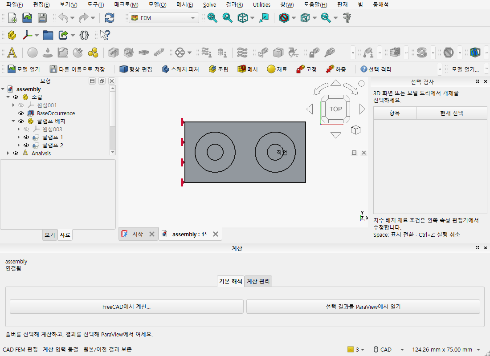

# FreeCAD 모델을 옮겨 이어 쓰기

FreeCAD의 모델 트리, 속성 편집기와 작업 패널에서 원래 부품을 편집합니다.
작업 사본은 편집 가능한 모델과 필수 외부 부품을 함께 옮깁니다. 메시 생성과
솔버 계산은 이 과정에서 실행하지 않습니다.

## 저장하고 옮기기

1. 모델을 연 뒤 **파일 → 프로젝트 저장**으로 `.caepre`를 저장합니다.
   외부 Link 부품은 함께 열려 있어야 합니다. 아직 작업 패널에서 편집 중이면
   먼저 완료하거나 취소합니다. 사본 명령이 입력을 자동으로 적용하지 않습니다.
2. **파일 → 작업 사본 만들기…**에서 포함할 모델과 부품을 확인합니다.
   저장 후 변경한 내용이 있으면 현재 내용을 저장해 포함할지, 마지막 저장본만
   포함할지 선택합니다. 취소하면 현재 편집과 이전 저장본은 유지됩니다.
3. 새 폴더 또는 비어 있는 폴더를 선택합니다. 필수 부품이 없거나 내용이 바뀌었다면
   오류가 있는 부품을 먼저 확인합니다. 파일 이름이 같다는 이유로 다른 부품을
   자동으로 사용하지 않습니다.
4. 완료 창의 **사본에서 모델 열기** 또는 **파일 → 작업 사본 열기…**로 새 작업 모델을 엽니다. 원 저장본과 현재 작업 사본은
   별개입니다. 이미 같은 이름의 문서가 열려 있으면 새 FreeCAD 창에서 여세요.

저장한 외부 부품 조립을 별도 FreeCAD에서 열고 문서 연결이 끝난 화면입니다.
모델 트리와 기본 속성 편집기를 사용하며, 사진에서는 메시 생성이나 계산을 실행하지 않았습니다.

## 편집하고 다시 옮기기

모델 트리에서 원부품이나 해당 위치의 Link를 선택합니다. 속성 편집기의 **Data**에서
치수 또는 조건을 변경하고, 기존 **실행 취소 / 다시 실행**으로 확인합니다.
다른 위치에 반복 배치된 부품을 선택할 때는 원부품 이름만 보고 고르지 말고
해당 배치와 면을 확인하세요.

사본에서도 **파일 → 프로젝트 저장** 또는 **Ctrl+S**로 모델과 참조 부품을 함께 저장합니다.
저장 확인에서 취소하면 새 저장 위치와 개정은 만들지 않습니다. 처음 연 저장본을
편집해 저장할 때도 원 저장본에 덮어쓰지 않고 현재 작업 사본에 보존합니다.
FreeCAD의 **Save As…**는 별도의 네이티브 파일 내보내기이며, 작업 사본의 프로젝트
저장과 구분하세요.

프로젝트를 저장한 다음 같은 사본 명령으로 다시 옮길 수 있습니다. 새 저장은
현지 작업 모델의 개정입니다. 과거 연구에서 참조한 원 저장본은 바뀌지 않습니다.
저장은 끝났지만 사본 연결 기록의 갱신이 끊겼다면 창을 유지하고
**파일 → 저장 연결 다시 확인**을 선택합니다. 이 명령은 원 저장 요청을 확인하며
같은 모델을 다시 저장하지 않습니다.
응답이 없다는 이유로 저장이나 사본 만들기를 반복 실행하지 않습니다.

## 외부 부품을 찾지 못할 때

동일한 파일의 위치 복구에는 원 부품의 크기와 내용 기록이 필요합니다. 현재
FreeCAD의 외부 Link 경로와 누락 선언에는 그 내용 기록이 없으므로, 파일 이름이나
사용자가 입력한 해시만으로 동일 부품이라고 승인하지 않습니다.
그때는 새 작업 모델에서 실제 Link를 다시 연결하고 검토한 뒤 새 개정으로 저장합니다.
기존 누락 기록은 원 저장본에 남습니다.

원본이 `.FCStd`이고 서로 다른 외부 문서의 파일 이름이 같거나 문서 간 수식의
대상이 모호하면, 부품들을 FreeCAD에서 함께 연 뒤 `.caepre`로 저장하세요.
자동 파일 이름 변경으로 수식의 의미를 추측하지 않습니다.

사용자 매크로나 추가 기능이 자체적으로 읽는 외부 파일은 자동 수집을 보장하지
않습니다. 지원하지 않는 파일 참조는 포함 목록에서 확인하며, 기존 native
열기·저장 기능은 계속 사용할 수 있습니다. 사본 열기가 형상·강도·접촉 조건의
공학적 적합성을 승인하는 것은 아닙니다.

공개 예제는 [외부 부품 조립 생성](../../examples/native-project-pre/create_public.py)을
사용합니다. 저장된 원자료의 검사와 실제 실행 범위는 이 인도의 별도 기록에서
구분하며, 개발 설명은 native-project 설계와 공통 API 문서를 참조하세요.
