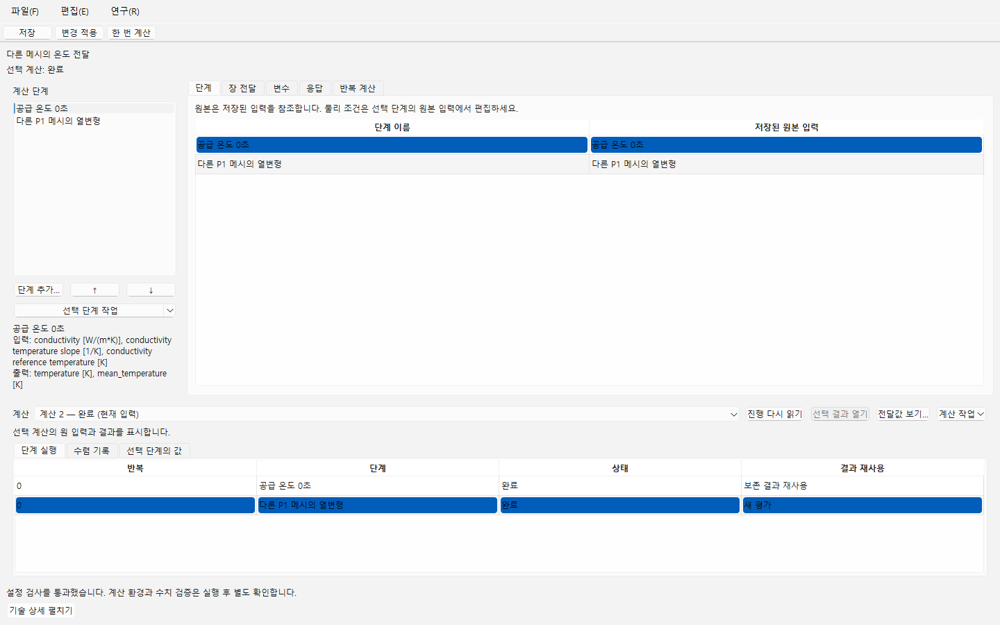
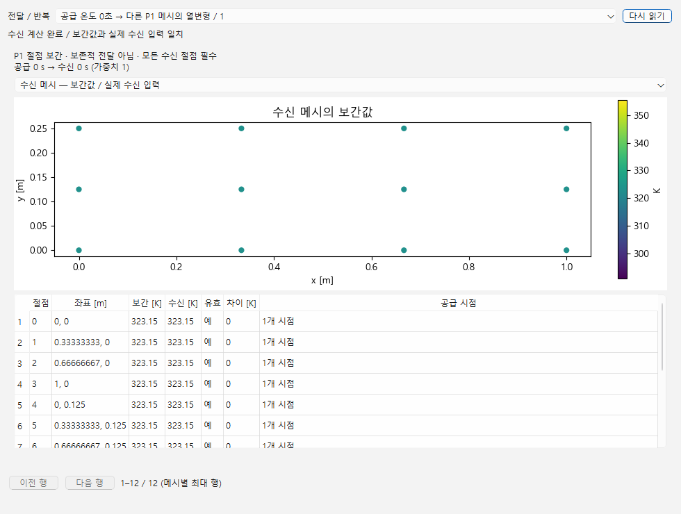

# 계산 절차를 다른 폴더에서 이어가기

계산 절차 창의 **파일 → 작업 사본 만들기…**에서 저장 후 계속하거나 저장된 내용만 선택합니다. 연결 창에서 계산 절차와 그 단계가 참조하는 재료·PDE·해석 문서를 함께 포함하세요. 성공 단계를 재사용하는 절차라면 원 계산을 가진 문서도 포함해야 합니다. 포함 목록을 확인한 뒤 새 폴더에 사본을 만듭니다. 복사할 때 계산하지 않습니다.

사본 폴더를 기존 작업 사본 열기로 열면 원 폴더 없이 문서를 읽고 편집할 수 있습니다. 계산 절차의 아래쪽에서 이전 계산을 선택한 뒤 **단계 실행**의 행을 선택하세요. **선택 단계의 값**과 **전달값 보기…**에서 원 공급값·수신값·단위·시간·필수 영역을 확인합니다. 실패한 전체 계산에서도 완료된 단계의 결과는 남습니다. 최종 종합 결과가 없이 종료된 실패도 실제 남아 있는 진행 기록과 완료 단계는 읽을 수 있습니다. 실행 전에 실패해 결과가 전혀 없었던 계산은 실패 기록만 보여 줍니다.

Windows의 기존 실행기로 새 폴더를 지정할 수도 있습니다. 열린 다른 작업과 함께 사용할 때는 사용하지 않는 포트를 고르세요.

```powershell
.\scripts\start_cae_research.ps1 -Tool evaluation -Store "D:\연구 사본" -Port 8776
```

창에서 **파일 → 계산 절차 열기…**로 보존한 계산 절차를 선택합니다. 빈 새 계산 절차를 열었다고 이전 결과가 사라지지는 않습니다.



[좁은 창에서 같은 계산 보기](images/evaluation-narrow.png). 사진은 공개 온도 전달 예제의 실제 Windows 창입니다.



단계·전달·응답을 편집하고 **변경 적용**, **되돌리기**, **다시 실행**, **저장**을 사용할 수 있습니다. 미완성 숫자나 연결 오류가 있는 초안도 보존할 수 있지만 계산은 입력 검사를 통과해야 합니다. 이전 계산은 편집한 입력의 새 결과로 바뀌지 않습니다.

새 계산이 필요할 때만 **한 번 계산**을 누르세요. 사본을 연 컴퓨터의 기존 실행 환경을 사용합니다. 원 컴퓨터의 프로그램 경로·실행 승인·자격 증명을 자동으로 가져오지 않습니다. 성공 단계 재사용을 준비한 경우에도 단계 순서, 원 모델의 저장 개정, 전달 조건·단위와 계산 입력이 같아야 합니다. 변경된 입력은 원 계산의 성공 단계로 대신하지 않습니다.

저장한 사본을 다시 복사할 수 있습니다. 새 사본에서도 원 계산과 사본에서 명시적으로 실행한 계산을 각각 선택해 읽습니다. 원 단계 입력과 실제 출력, 실패·재사용 기록은 보관하고 편집용 문서 연결만 새 폴더의 문서로 이어집니다.

이 기능은 기존 계산 절차의 Material·PDE·Simulation 단계와 그 도구가 지원하는 계산 종류를 보존합니다. 같은 메시 전달, P1 온도 전달, 반복 계산·공유 변수·미분 결과가 있는 원 기록도 다시 계산하지 않고 보관합니다. 새 실행의 지원 범위와 수치 조건은 기존 계산 절차와 해당 실행기의 조건을 따릅니다. Windows에서 사용할 수 없는 FEniCSx, 외부 CAD/솔버·파일 권한이 필요한 작업은 사본을 만들었다는 이유로 실행 가능해지지 않습니다. 재사용할 수 없는 반복 계산의 일부 단계는 기존 제한대로 전체 반복을 다시 시작해야 합니다. 사본과 계산 성공은 공학적 승인이나 미확인 조건의 검증을 뜻하지 않습니다.

개발·검사 범위는 [설계와 검증](DESIGN_KO.md)을 참고하세요.
