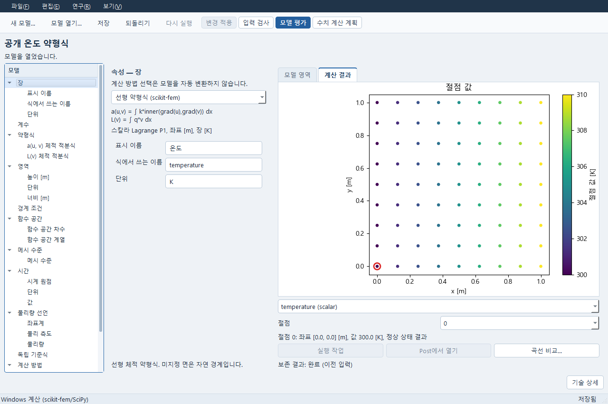
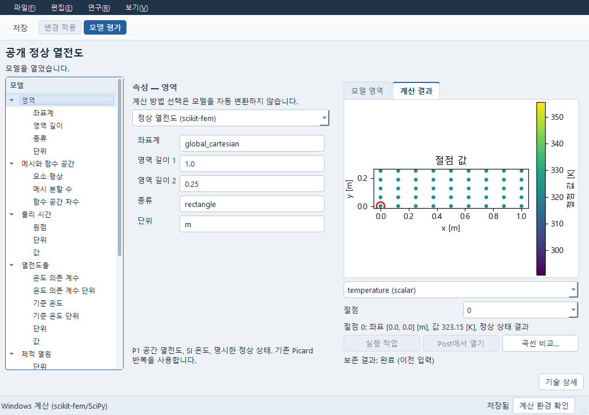

# PDE와 Simulation 작업 사본

PDE/해석 모델의 현재 입력과 저장 결과를 새 폴더에서 이어 쓸 수 있습니다. 기존 문서·계산 관리·평가기와 파일 메뉴를 사용합니다. CAD, Expert, OpenScience나 원 계산 환경은 저장 결과를 읽는 데 필요하지 않습니다.

1. 모델을 열어 입력을 편집합니다. **파일 → 작업 사본 만들기…**에서 **저장 후 계속** 또는 **저장된 내용만**을 선택합니다. 취소와 저장본 선택은 화면의 미적용 입력을 저장하지 않습니다.
2. 연결창에서 함께 옮길 문서를 명시 선택합니다. 포함 목록을 확인하고 새 폴더에 만듭니다. 기존 폴더는 덮어쓰지 않습니다. 실행 중인 계산은 종료와 저장을 확인한 뒤 복사합니다.
3. 새 위치를 기존 프로젝트/모델 열기 경로로 엽니다. 저장 결과는 원 입력에 속한 값·장·단위·시각으로 읽습니다. 현재 입력을 바꾸면 원 결과는 **이전 입력**으로 표시됩니다. 모델 열기·편집·되돌리기·저장은 새 계산을 시작하지 않습니다.
4. 현지 입력의 계산은 **모델 평가**로 명시 실행합니다. 현재 PC의 기존 지원 평가기와 운영자 환경을 사용하고 새 작업을 만듭니다. 원 작업을 자동 재시도하거나 원 결과를 새 입력의 계산으로 바꾸지 않습니다.
5. 새 결과까지 저장한 뒤 같은 작업 사본 메뉴로 다시 복사합니다. 두 번째 사본에서도 원 계산과 현지 계산은 각자 원 입력에 연결됩니다. 원 보관소가 없어도 보존 결과를 읽고 계속 편집할 수 있습니다.

아래는 새 위치에서 읽은 실제 Windows 계산의 온도장입니다. 입력을 바꾼 뒤에도
기존 계산은 **이전 입력**으로 표시되며, 절점을 선택하면 같은 위치의 값과 단위를 봅니다.
이 사진은 약형식 PDE와 정상 열전도의 작은 공개 예제이며 다른 해석의 검증 결과가 아닙니다.





현재 Windows에서 작은 scikit-fem 차원 약형식 PDE와 정상 열전도를 실제 계산해 이 흐름을 확인했습니다. 같은 구현이 다른 솔버의 설치나 공학적 적합성을 대신하지는 않습니다. 모델에 필요한 runtime이 없으면 새 실행은 실패 이유를 남깁니다. 원 입력·기존 결과·현재 편집을 그대로 두고 현재 연결 설정을 확인하세요. 미완성/지원하지 않는 입력도 저장하고 되돌릴 수 있지만 평가 관문은 유지합니다.

## 원 자료와 현재 실행

보관한 solver 입력, 결과 파일과 장 배열은 원 bytes를 보존합니다. 입력 hash와 원 실행 기록은 선택한 계산에 연결되며 현재 모델의 입력과 별도로 읽힙니다. 원 실패/취소·부분 출력의 상태, 오류, 누락은 성공으로 바꾸지 않습니다. 보존 자료가 바뀌거나 빠지면 다른 파일/최신 결과로 대체하지 않고 복사·열기를 거절합니다.

원 runtime의 실행 파일 경로, 환경 설정, 인증이나 입력 등록 목록을 현지 실행 설정으로 설치하지 않습니다. 원 command/log의 경로 문자열은 과거 기록으로 보존되며 새 실행의 경로로 사용하지 않습니다. 파일을 복사했다고 컴파일 허가가 생기지 않습니다. 사용자 MFront 원문, 저장 재료 법칙, INP/RAD bundle 등 모델에 명시 보관된 원문은 기존 입력 계약 그대로 보존하며 실행 시 현재 adapter의 원 허가·고정 source·단위 검사를 다시 사용합니다.

`structure.calculix.design`처럼 등록된 `.caepre`/native Analysis를 다시 열어 메시를 만드는 경로는 CB07의 editable native dependency 이동이 추가로 필요합니다. 원 결과는 읽을 수 있지만, 이 사본이 원 CAD 등록을 복원했다고 주장하지 않습니다. CAD가 필요 없는 지원 PDE/Simulation의 명시 실행은 이 제한과 별개로 사용할 수 있습니다. Post의 원 PVSM/등록 자료 이동은 CB08이며 필드 배열 읽기와 구별합니다.

## 공개 재현

기존 전용 Python, 저장소 루트에서 새 폴더를 지정합니다.

```text
python -m examples.portable_physics_public --output "연구 사본 확인/새 폴더"
```

이 공개 예제는 실제 기존 scikit-fem PDE/열전도 평가기를 각 한 번 실행해 원 결과를 만들고, 첫 사본의 명시 실행으로 각각 한 번만 새 계산합니다. 총 네 번의 작은 평가입니다. 원 store와 첫 사본은 shutdown 뒤 `.preserved`로 이름을 옮겨 보존합니다. 두 별도 Python 프로세스에서 원 위치 없이 읽기·편집·Undo/Redo·저장·재복사를 확인합니다. 읽기/저장/재복사 중 평가와 live 원작업 조회는 금지한 상태로 검사합니다. provider·CAD/외부 솔버 캠페인·새 설치는 없습니다.

PDE/Simulation 창은 실제 Windows Qt/HTTP에서 한글, 정상/좁은 크기, 원 온도장 [K]·좌표 [m], 이전 입력 표시, 저장/저장본/취소와 입력 선택을 확인했습니다. QTest 입력 검사이며 OS 마우스/포커스와 별도 GUI launcher 왕복은 미확인입니다.
