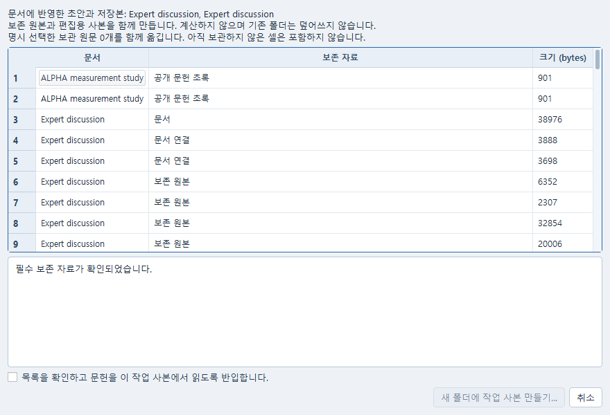
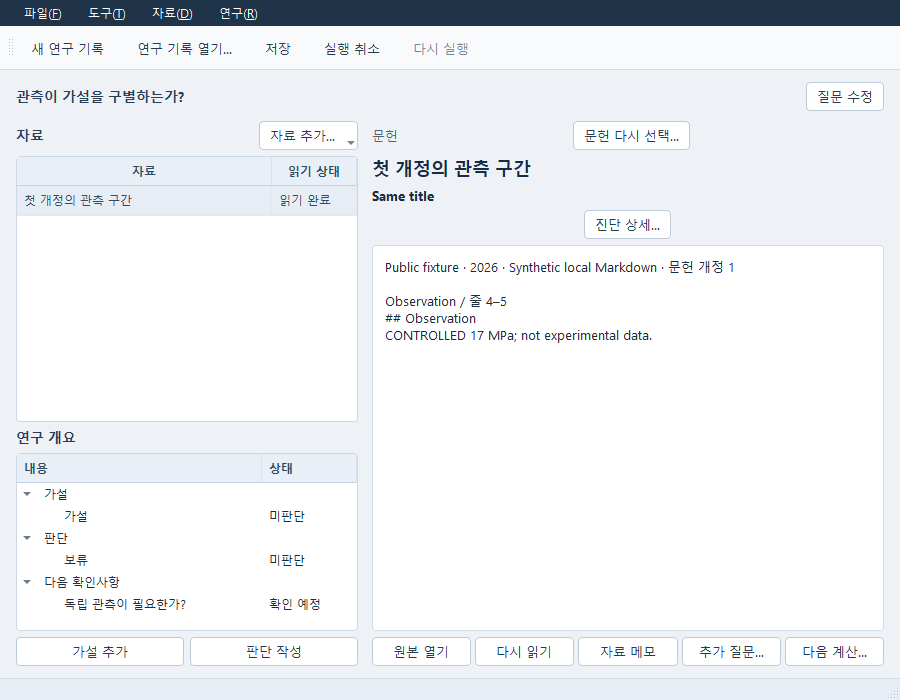

# 연구 기록과 토론을 다른 폴더에서 이어 쓰기

연구 기록(Study), 전문가 토론(Expert), 문헌을 담은 보고서를 자료와 함께 옮겨
새 폴더에서 계속 편집할 수 있습니다. 원래 폴더에 접근할 수 없어도 사본에 포함한
문헌과 저장 결과를 읽습니다. 사본을 여는 것만으로 AI 요청이나 계산이 시작되지는 않습니다.



사진은 공개 합성 자료를 사용한 실제 Qt 포함 목록입니다. 문헌의 제목과 읽은 범위를
확인한 뒤 아래 확인란을 선택하고 **새 폴더에 작업 사본 만들기…**를 누릅니다.
초록만 읽은 논문은 **공개 문헌 초록**으로 표시됩니다.



이 사진도 공개 합성 자료입니다. 옮긴 Study에서 문헌 구간을 읽고 가설·판단을 편집하는
모습이며 실제 시험값이나 AI 답변을 보여 주는 화면은 아닙니다.

사용 중인 모델 연결과 로그인은 새 위치에서 확인해야 합니다. 이전 토론은 그대로
읽을 수 있지만, 새 답변이 필요하면 현재 자료와 참여 역할을 선택해 **질문 보내기**를
누르세요. 원래 위치에서 진행하던 요청을 사본이 자동으로 이어 실행하지 않습니다.

## 일반 사용

1. 원 Study에서 질문·가설·판단·반증·다음 관측을 편집하고, 기존 문헌 선택기로 정확한 개정과 인용 구간을 보관한다. Expert는 현재 질문·근거와 원 토론을, Report는 문헌이 고정된 섹션과 본문을 기존 방법으로 보관한다.
2. Study/Expert의 파일 메뉴 **작업 사본 만들기…**를 연다. **저장 후 계속**는 기존 저장을 명시 실행한다. **저장된 내용만**와 취소는 화면의 미적용 문자열을 읽어 저장하지 않는다. Report는 기존 작업 사본 메뉴의 Save/Cancel·설명 적용 절차를 유지한다.
3. 기존 연결창에서 함께 옮길 Study·Expert·Report와 다른 정확한 원문서를 직접 포함한다. 문헌의 제목·개정·전체/인용 구간·크기를 확인한다. 검토한 문헌을 **새 사본의 현지 작업 범위에 반입**한다는 확인을 하고 새 폴더에 발행한다. 기존 폴더를 덮어쓰지 않는다. 미선택 문헌·폴더·검색 index·provider/operator 설정·session 파일은 옮기지 않는다.
4. 완성된 사본을 기존 프로젝트 열기 경로로 열고 독립 Study/Expert/Report 창을 사용한다. 원 store가 없어도 허용된 exact 문헌을 읽고 제목/질문/판단/본문을 편집·Undo/Redo·저장한다. 원 문헌이 없거나 철회되어도 작성한 UNKNOWN/NOT_RELEASED 판단을 자동 변경하지 않는다.
5. Expert에서 현재 역할과 정확한 문헌·질문·전송 허용 범위를 다시 선택하여 **새 Ask**를 명시 실행한다. 원 copied READY/RUNNING/dispatch_pending은 원 시도의 보존 상태이며 현지 실행 대상이 아니다. 현재 요청의 여러 역할은 **현재 요청의 다음 역할 응답 받기**로 명시 진행한다. portable 창의 poll은 다음 역할을 자동 dispatch하지 않는다. Co-STORM의 다음 진행/보고서/허용된 retry도 새 현지 작업에만 연결된다.
6. 저장 후 기존 사본 만들기로 재복사하고 두 번째 사본을 연다. 원 토론/원 제출 hash/원 A bytes와 현재 편집이 함께 보존된다. Report 문헌 원자료 열기는 매번 현재 사본의 resolver로 확인하며, 실패하면 원 store로 자동 돌아가지 않는다.

## 권한과 보존 상태

발행의 기존 명시 승인에는 검토된 문헌을 새 사본의 기존 KnowledgeStore에 반입하는 동작이 포함된다. `portable:<새 project ID>`라는 destination-bound workspace에만 현지 읽기 범위를 부여한다. 원 collection/access_scope/revoked는 provenance로 보존하고 권한으로 복사하지 않는다. 원·현지의 문자열 `local` 일치는 권한이 아니다. 현지 설정으로 workspace_id를 임의로 `local`로 강제하면 보존 문헌 읽기를 거부한다. 이 거부를 해결하려고 원 scope나 manifest를 수작업 변경하지 않는다.

문헌의 raw original bytes는 그대로 보존한다. 원 개정의 선택 segment, locator, text, 서지 metadata, 추출 실패/한계도 보존하며 원 citation/source/content SHA와 frozen A를 다시 쓰지 않는다. Study/Report 인용 구간만 선택한 사본에서는 그 위치로 읽는다. 전체 개정이 반입되지 않은 경우 locator 없는 원문 읽기/새 Ask의 전체 개정 사용은 `KNOWLEDGE_PARTIAL_REVISION`으로 거부한다. Expert에서 명시 선택한 exact revision은 전체 해당 개정이 반입되므로 정상적인 새 Ask 경로가 있다. latest fallback이나 새 검색/재추출로 원 근거를 대체하지 않는다.

현재 권한 부족/철회/동일 ID 다른 내용 충돌은 원문, frozen Report, Expert 결과·영수증, 새 전송 경로에서 검사한다. Report의 권한 거부는 이미지 누락과 달라 과거 원문 캐시를 다시 표시/출력하지 않는다. 이미지 손상에 대한 기존 R1 마지막 검증 미리보기 정책은 유지한다. 내보내기는 기존 PDF/Markdown renderer와 atomic export를 사용하되 파일/확인 대화 뒤 현재 선택과 권한을 재검사하며 늦은 편집·다른 창 변경·거부 시 기존 출력 파일을 건드리지 않는다.

권한 검사 범위는 기존 로컬 owner/resolver/API이다. 보존 bytes 암호화, 파일시스템 관리자에 대한 새 ACL, 이전에 적법하게 읽거나 외부로 내보낸 파일의 소급 회수는 추가하지 않는다.

## 새 Ask 실패 시

미설정 응답은 NOT_CONFIGURED이며 실제 답변이 아니다. 현재 전송 불허·철회·역할 불일치·예산 중단·취소에도 원 질문과 현재 편집, 이전 완료/실패/부분 기록을 보존한다. 자동 provider 전환·새 command 생성·재시도는 하지 않는다. 같은 **현지** command의 유실응답 확인은 기존 영수증/owner 검증을 사용한다. 원 사본의 command/session/job는 이 확인의 권한으로 사용할 수 없다.

현지 승인된 기존 runtime은 기존 연결 설정·dispatcher를 통해 사용한다. 이 인도 검사에는 유료/실제 provider 호출, 새 설치·API·계정·크레딧 사용이 없다. 공개 runnable의 CONTROLLED RUNTIME TEST RECORD는 실제 AI 답변이 아니다.

## 공개 재현

저장소 루트와 기존 Python에서 다음을 실행한다. output은 반드시 새 폴더여야 한다.

```text
python -m examples.portable_study_expert_public --output "검사 결과/새 연구 사본 검사"
```

이 명령은 생성한 공개 합성 원 store → S/X/B 사본 → 자기 controller shutdown/join → 자기 원 store 이름이동 보존 → 별도 Python cold1 → 현재 편집/저장·미설정 및 controlled Ask → 재복사 → 자기 첫 사본 이름이동 보존 → 별도 Python cold2를 실행한다. 각 자식은 현재 절대 Python과 timeout 150초를 사용한다. 결과 JSON, 두 process 로그, 원문/원 A/현재 제출 증거가 output에 남는다. 기존 사용자 폴더를 삭제하거나 기존 창·service를 종료하지 않는다.

pytest는 추가 플러그인 자동 로딩 없이 실행한 결과를 기준으로 한다. 제품의 검증 관문이나 테스트 assertion을 끄는 옵션이 아니다.

```text
# Linux
PYTEST_DISABLE_PLUGIN_AUTOLOAD=1 PYTHONPATH=.:tests python -m pytest -q tests/test_portable_study_expert.py tests/test_portable_study_costorm.py tests/test_portable_study_ui_contract.py tests/test_portable_study_report_export.py
```

Windows PowerShell에서는 `$env:PYTEST_DISABLE_PLUGIN_AUTOLOAD='1'; $env:PYTHONPATH='.;tests'`를 설정하고 같은 `python -m pytest ...`를 기존 절대 Python으로 호출한다. 실제 Windows 검사 범위와 원기록은 VERIFICATION_KO.md에 별도로 기록했다.

## 인도 적용

기존 실제 Pro 인도 PRO-PORTABLE-STUDY-EXPERT-20261015-01의 기준은 공개 main
eaa33cf6fd3f9356711102b820f26d155b056f16, native upstream
3e48bf6138f495299f45b1af254bfb4aaff307b8이다. 현재 통합은 기존 독립 연구 앱·서비스·문서
소유자를 사용하며 새 웹 화면·서버·소유자·검색 목록·접근권한 체계를 추가하지 않는다.

원 eaa33cf6 baseline에서 product.patch와 integration.patch를 모두 적용해야 한다. product.patch는 신규 전용 파일만, integration.patch는 root 소유 shared 최소 hunk만 포함한다. 중간 portable-study-intermediate-01.zip에 더하는 패치가 아니라 **같은 원 baseline 대비 최종 전체 이번 변경분**이다. 중간본과 중복 적용하지 않는다. 병렬 WIP에서는 root가 hunk와 SOURCE_CHANGES.json의 before/after를 대조하여 통합한다. shared 전체 덮어쓰기는 하지 않는다.

CB04–08, Report candidate/current 비교 탐색·부분 opener·managed native 및 제품 전체 수용은 원잔여다. Windows Qt 창과 QTest 입력·선택·취소·좁은 창 및 별도 Python 프로세스의 재개는 확인했다. OS 마우스/포커스·별도 GUI 프로세스의 자동 런처 왕복·실제 PDF 출력은 이 묶음의 완료 주장에 포함하지 않는다.


## 공개 문헌을 함께 옮기기

Co-STORM에서 이미 읽어 보관한 공개 문헌은 선택한 토론/보고서 및 중단 기록의 정확한 DOI·URL·제목·저자·인용 위치와 함께 옮긴다. 포함 목록 맨 위에서 문헌의 제목과 **공개 문헌 초록 / 서지정보 / 추출 원문** 구분을 확인한다. 초록만 읽은 문헌을 본문을 읽은 것으로 바꾸지 않는다. 같은 DOI라도 다른 보관 시점의 인용이면 각각 원 보관본을 유지한다. 원문이 없거나 내용/인용 범위가 다르면 새 검색으로 대체하지 않는다.

미선택 문헌 캐시와 전체 검색 목록, 인증·provider 설정은 포함하지 않는다. 새 위치에서 저장 인용을 읽는 것은 로컬 보관본 읽기이며 외부 조회가 없다. 공개 검색으로 새 질문을 시작하려면 현재 연결 설정과 이번 질문의 공개검색 허용을 둘 다 다시 선택한다. 복사한 허용 설정이나 원 중단 기록은 새 검색·재시도 권한이 아니다. 기존 모델/역할 구성은 현지 연결 설정을 사용하며 역할별 새 전문 모델이나 전문 코퍼스를 만드는 기능은 아니다.
