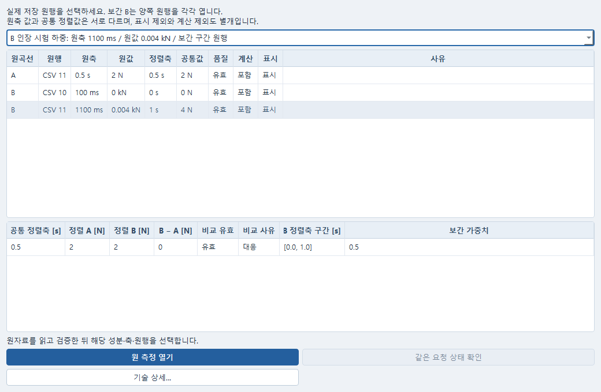

# 저장 곡선의 원자료 확인·복귀

저장한 비교 곡선에서 한 점을 고르고 그 값의 원 시험 행이나 원 측정으로 돌아간다.
보간된 값이면 계산에 쓰인 두 원행을 각각 확인한다. 비교나 해석을 다시 실행하지 않는다.

이 화면은 작은 공개 자료로 실제 Windows Qt 창을 연 것이다. 현재 확인 범위와 남은
실제 앱 왕복은 [Windows 확인 기록](WINDOWS_ACCEPTANCE_KO.md)을 따른다.

## 사용할 수 있는 자료

저장·적용된 v3 시간/시험 곡선 비교에서 사용한다. 현재 native 곡선 원본은 `time`과 `contact_force` 측정뿐이다. 일반 point/path를 새 v3 곡선으로 바꾸거나 새 reader를 만들지 않는다. 측정을 기존 Data로 전달한 실제 계보가 있으면 full measurement 선택을 별도로 검증한다. Report 그림, 3D 비교와 곡선은 서로 다른 계약이다.

먼저 기존 Post의 원자료 선택, 실제 block/위치, 응답 열·성분, 가로축·단위·기준계 지정과 미리보기/적용을 끝내고 프로젝트를 저장한다. 입력 변경이나 미적용 초안을 보존해야 한다면 먼저 기존 저장/초안 기능을 사용한다. 이 기능은 미저장 편집을 알아서 적용하거나 버리지 않는다.

## 원 A/B 확인

기존 곡선 창의 원 A, 원 B 또는 대응 표에서 행을 선택한 뒤 **원자료 열기…**를 누른다. 원행 표는 저장 원축·원값, 공통 정렬축·값, 품질, 계산 포함/제외, 표시/숨김을 분리한다. 대응 행을 선택했다면 저장된 정렬 A/B, B−A, 비교 유효/사유, B 구간과 보간 가중치도 별도 표에서 확인한다. 새 정렬·보간은 실행하지 않는다.

B가 보간된 값이면 선택 상자에 실제 B 원행 두 개가 나온다. 각각을 골라 **원 측정 열기** 또는 **원 시험 자료 열기**를 누른다. 예를 들어 B의 원축이 100/1100 ms, 원값이 0/0.004 kN이고 A 공통축에서 0.5 s로 대응하더라도, 저장 원행은 여전히 그 두 행이다. 정렬 B=2 N은 원행으로 만들지 않는다. 정확 대응 B는 하나만 나온다. 원행을 하나로 결정하지 못하면 임의의 행을 선택하지 않는다.

표의 native 행·point index는 VTK의 0 기준 위치이다. Data `physical_line`은 원래 importer가 보존한 행 번호이며 머리행이 0이다. 예제의 1/2는 파일의 두 데이터 행이다. 비교 표시 순번, CSV 행, VTK index, solver의 절점·요소 ID는 서로 바꾸어 쓰지 않는다. 더 자세한 block/선택·해시는 **기술 상세…**에 있다.

원축·원값은 각 원자료의 단위로, 공통값과 대응 표는 저장 비교의 공통 단위로 표시한다.
취득 원값의 단위는 보존된 교정 입력 단위가 있을 때만 표시하며, 선언이 없는 취득 단위는
**단위 미상**으로 남긴다. 변환 후 단위를 취득 원값에 붙이지 않는다.

## 원 측정 열기

실제 저장 project/workspace와 정확 measurement record, 결과 파일 목록·해시, 기존 원결과/의존 파일을 검증한다. 현재 owner의 저장 경로·문서·현재 적용 개정·초안도 대조한다. 현재 preview나 같은 이름의 최신 record로 바꾸지 않는다.

검증, 원행 선택, 창 활성화는 각각 별도 명령/영수증이다. 원행 선택은 기존 native source와 view를 재사용하며, 실제 block leaf의 flat index, 응답 성분, 가로축과 원행을 지정한다. 차트 속성을 다시 읽어 선택 적용을 확인한다. 같은 행 번호가 다른 block에 있다고 대신 선택하지 않는다. 분산 프로세스의 로컬 index를 process 0으로 추정하지 않는다.

시간 이력에서 원시각은 선택한 실제 행의 축 값이다. 원행 복귀를 위해 전역 animation clock을 임의 이동하지 않는다. 정적 하중 매개변수, UNKNOWN, 혼합 clock을 물리시간으로 이름만 바꾸지 않는다. chart domain이 선택 성분/축을 제공하지 않으면 실패를 표시하고 원자료를 유지한다.

Windows가 창 전면화를 허용하지 않으면 원행 선택 확인과 활성화 미확인을 구분한다. 내부 handle·경로 문자열을 입력 명령으로 실행하거나 키 입력을 조작하지 않는다. 실제 활성화 경로가 없는 owner에서는 사용자가 해당 창을 직접 선택한다.

## 원 시험 자료 열기

저장된 Data document/job/input revision/input SHA/result SHA/response SHA와 원행을 기존 resolver로 읽는다. 현재 Data 초안이나 최신 import 작업은 쓰지 않는다. 기존 읽기 전용 ReferenceContent에 정확한 저장 응답의 표·그래프를 열고 원곡선 표에서 해당 행을 선택한다. 품질 미달·계산 제외·숨김 원행도 원래 상태로 남는다.

보정된 자료에서 곡선의 `raw_x/raw_y`는 v3가 사용한 저장 응답의 변환 후 값일 수 있다. 취득 원값이 `raw_samples`에 보존되어 있으면 별도 취득 원축/원값 표에 표시한다. 원문의 `nan` 문자열을 0 또는 정상 측정으로 바꾸지 않는다.

기존 retained input receipt에 진짜 `post_measurement` 계보가 있으면 **시험의 원 측정 열기**가 나타난다. 기존 `post_observation`과 `project_samples`가 보존한 CSV 원행→native 원행, 성분, 축, summary를 대조한다. 일반 시험 Data에는 이 버튼을 억지로 만들지 않는다. Post 원결과가 없어도 정상인 보존 Data 읽기와 실패한 Post 복귀를 별도로 표시한다.

## 저장·닫기·다시 열기

원행 선택 후 기존 프로젝트 저장을 사용하면 owner-local `selection_context`와 exact 원행/선택 해시가 기존 analysis object에 보존된다. 새 저장소나 별도 프로젝트 schema는 만들지 않는다. token, session, PID를 선택 권한으로 저장하지 않는다. 다음 앱/서비스 세션에서 새 owner를 등록하고 실제 저장본으로 full origin을 다시 얻어 같은 원행을 재검증한다.

원창이 확실히 닫혔을 때만 **정확한 저장본 선택…**으로 해당 저장 project를 명시적으로 연다. 파일 선택 취소는 무동작이다. 다른 경로의 복제본이 같은 IDs를 가져도 자동 대체하지 않는다. 실행은 기존 desktop launcher와 launch claim을 사용한다. 열기 요청 이후 응답이 없어도 두 번째 창을 만들지 않고 기존 등록/명령 상태만 확인한다.

## 복구

누락 파일은 오류의 경로와 기술 상세의 핀으로 식별한다. 동일 bytes의 원파일을 원래 위치에 복원하거나 기존 복구 UI/명시적 저장본 선택으로 처리한다. 이동/변경 파일의 해시를 이 기능이 재계산해서 옛 참조를 성공시키지 않는다. 변경본은 새로운 분기이다. 확정 실패 후 같은 원파일을 복원했다면 이 확인 창을 닫고 저장 비교의 원행부터 다시 읽는다.

busy, disconnected, 복수 owner, PID 생존 불명, 명령 적용 미확정은 성공이 아니다. **같은 요청 상태 확인**은 기존 command ID만 조회한다. 대기 요청 취소는 기존 명령 취소 UI의 허용 범위에서 한다. 이미 적용에 들어간 명령을 취소됐다고 주장하지 않는다. 원행 선택·문서·session·개정·preview·편집·창 생존이 바뀌면 늦은 callback은 후속 선택/활성화/새 창 실행으로 진행하지 않는다. 이미 보내진 명령은 별도로 완료될 수 있으며, UI를 닫았다는 이유만으로 취소 또는 rollback을 주장하지 않는다.

## 이 인도에서 검증하지 못한 범위

Windows Qt6.9.1의 실제 표시 창에서 정상/좁은 크기와 A/B·B 양끝 원행 선택, 파일 선택 취소,
선택 변경 뒤 늦은 응답 차단을 작은 공개 시험 자료 대역으로 확인했다. Qt 이벤트를 사용한
확인이며 OS 입력이나 실제 ParaView owner/차트 선택 수용은 아니다.

native 표·그래프의 실제 pick 강조, Windows foreground/포커스, 실제 ParaView 저장·닫기·재개방과 공학적 수용은 NOT_RUN이다. chart의 좌표 성분 축을 직접 지원하지 않는 full path lineage는 명시적으로 거절하고 Data 원행을 유지한다. 분산 native 데이터셋의 로컬 행 복귀도 거절한다. 새로운 지원인 것처럼 분류하지 않는다.
