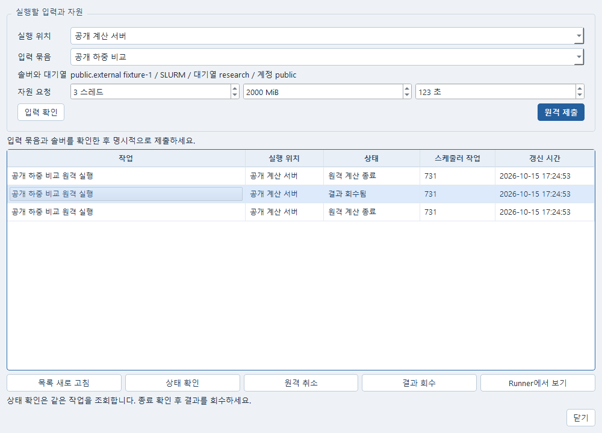

# Runner에서 원격 실행

기존 SSH 연결과 계산 환경이 등록되어 있을 때 사용한다. 로컬 작업과 문서 편집은
원격 등록 없이 계속 쓸 수 있다. 현재 인도에서는 실제 사용자 원격 호스트와 접속
권한이 제공되지 않아 실제 SSH·Slurm·PBS 실행은 미확인이다.

사진은 원격 서버에 접속하지 않은 로컬 시험 화면이다. 실행 위치와 작업은 공개 시험용
설정이며 실제 서버의 계산 완료를 보여 주는 사진이 아니다.

1. 기존 외부 실행의 **입력 묶음**을 준비한다. 묶음에는 원 후보값, 변수 단위와 종류,
   case와 exchange 관계가 보존된다. 이 단계는 계산하지 않는다.
2. Runner의 **도구 → 원격 실행…**을 연다. 등록한 실행 위치와 입력 묶음을 고르고,
   솔버 버전·대기열·스레드·메모리·시간을 확인한다. **입력 확인**은 접속하지 않는다.
3. **원격 제출**을 누른다. 선택한 환경에 입력을 보존한 후 한 번 제출한다.
   제출 응답이 유실되면 **요청 응답 다시 확인**을 사용한다. 창을 닫았거나 서비스를
   다시 열어도 같은 작업공간에서는 원 요청과 자원이 복원된다. 재확인은 같은 요청
   번호를 사용하며, 이미 접수된 작업을 찾으면 새로 제출하지 않는다.
4. 목록의 작업을 고르고 **상태 확인**으로 같은 scheduler 작업을 조회한다.
   목록 새로 고침과 창 열기는 보존 기록만 읽는다. 추적 시간이 끝나거나 연결이 끊겨도
   원격 작업이 끝난 뜻은 아니다. 종료를 모르면 **종료 미확인**으로 남긴다.
5. 계산을 멈출 때는 **원격 취소**를 누른다. 취소 명령 접수와 실제 종료는 구별된다.
   Runner에서 원격 제출 작업을 취소해도 같은 종료 확인을 수행한다. 반면 상태 확인이나
   회수 요청만 로컬에서 취소하면 원격 계산은 취소하지 않는다.
6. 원격 종료를 확인한 뒤 **결과 회수**를 누른다. 상태 확인과 재접속은 파일을
   자동으로 가져오지 않는다. 회수는 입력·runtime·파일 checksum과 원 후보의
   값/종류/단위를 대조한다. 누락 후보는 미평가, 실패 후보는 실패로 유지한다.
7. **Runner에서 보기**로 같은 회수 작업의 단일 값·곡선과 후보 표를 연다.
   등록한 VTU/PVD 공간 출력은 기존 **후처리에서 열기**를 사용한다. 배열·단위·위치·
   시간 선언은 기존 Post reader가 원 파일과 다시 대조한다. 원격 실행 성공은 수치
   검증이나 공학적 승인이 아니다.

조건이 잘못되어 첫 제출이 접수 전에 명확히 거절되면 원 입력을 수정할 수 있다.
접수 여부가 불명확하면 새 요청을 만들지 않고 같은 요청을 확인한다. 원격 환경
등록이 바뀐 경우 보존 작업을 다른 호스트나 다른 솔버로 옮겨 재연결하지 않는다.

메모리 값은 Slurm/PBS에 자원 요청으로 전달된다. SSH 직접 실행에서는 메모리의
강제 제한이 아닌 요청 정보이며, 스레드는 기존 runtime의 OMP 설정으로 전달한다.
SSH runtime은 협력 취소와 실제 정리 기록을 제공해야 한다. 이 기록이 없거나 원
입력과 다르면 프로세스 부재만으로 종료를 인정하지 않는다.

창에는 사용자 작업명과 자원을 표시한다. 내부 식별값과 원 기록은 기존 Runner
기술 상세에서 확인한다. 복구용 데스크톱 설정에는 operation, 연결 ID, 입력 작업 ID,
자원과 요청 번호만 저장하며 SSH 대상·키·암호·환경 값은 저장하지 않는다.

운영자 등록과 기존 CLI/Python 호출은 [실행 계약](CONTRACT.md), 이번 확인 범위는
[인도 기록](DELIVERY.md)에 있다.
