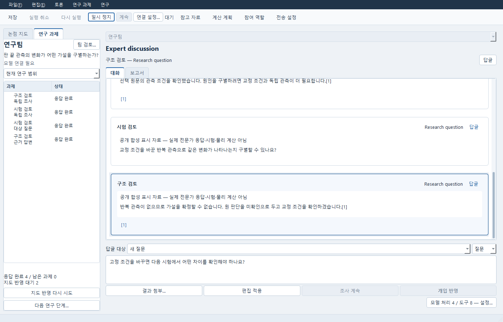
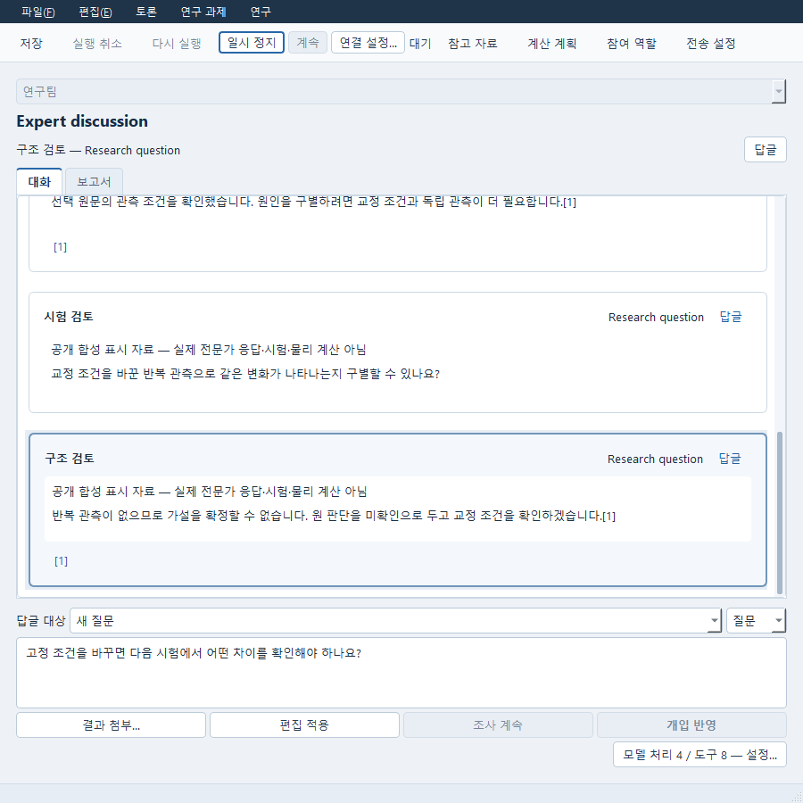

# 연구팀과 함께 관측 검토하기

Expert는 자료와 계산 결과를 읽고 검토 내용을 저장하는 연구 도구입니다. 모델을 연결하지 않아도 저장한 대화와 원 자료를 열고 편집할 수 있습니다. 새 응답을 요청할 때만 현재 연결 설정을 사용합니다.

## 팀과 검토 자료 선택

1. Expert에서 대화를 열고 대화 방식으로 **연구팀**을 선택합니다.
2. **팀 검토…**에서 연구 질문과 필요한 산출물을 적습니다. 담당자를 고르고 담당자별 질문, 확인할 항목, 허용 도구를 편집합니다.
3. **자료와 결과**에서 문헌과 저장한 계산 결과를 고릅니다. 결과는 원 문서의 저장 계산에서 물리량·단위·위치·표본 구간을 확인해 선택합니다. 계산 실패나 미확인 단위도 원 상태로 표시됩니다. 지원하지 않는 표본 선택은 적용할 수 없습니다.
4. **편집에 반영**으로 검토를 마치고 기존 **편집 적용** 또는 **저장**을 사용합니다. 선택창을 취소하면 이전 질문과 자료가 유지됩니다. **연구 시작**을 눌러야 새 연구를 요청합니다.



문헌의 검색 순위, 읽은 범위, 적용 조건은 서로 다릅니다. 원문에서 읽을 수 있는 구간과 조건을 확인하세요. 원 결과의 단위나 좌표를 자동으로 바꾸지 않습니다.

## 조사와 질문 이어가기

**연구 과제**에서 담당자의 응답 완료와 남은 과제를 따로 확인합니다. 남은 조사는 **조사 계속**으로 요청합니다. 답변이 끝난 뒤에도 지도를 반영하는 작업이 남을 수 있습니다. **지도 반영 다시 시도**는 현재 요청의 남은 지도 작업을 이어가며 완료한 담당자의 응답을 다시 만들지 않습니다.

발언을 선택한 뒤 마우스 오른쪽 메뉴의 **이 주장에 질문…**, **반례 추가…**, **관측 추가…**를 사용할 수 있습니다. 대상 주장과 답할 담당자를 고르고 작성부에서 내용을 입력합니다. **개입 반영**은 사용자 발언을 남기는 동작입니다. 조사를 이어가려면 별도로 **조사 계속**을 요청합니다.

**논점 지도** 탭은 읽을 수 있는 현재 지도만 보여 줍니다. 논점을 선택한 뒤 오른쪽 메뉴의 **논점의 근거 읽기…**로 원 자료를 읽습니다. 조사를 멈추려는 과제는 오른쪽 메뉴의 **미해결로 남기기…**에서 사유를 입력합니다. 실행 중이거나 결과·정리가 미확인인 과제와 이전 사본의 과제는 변경할 수 없습니다. 이전 단계는 단계 선택 목록에서 열람합니다. **다음 연구 단계…**는 새 질문과 담당 범위를 편집하는 동작이며 자동으로 응답을 요청하지 않습니다.



## 계획, 결과, 판단, 보고서

계산 제안은 기존 **계산 계획**에서 열어 입력과 예산을 검토하고 명시적으로 실행합니다. 계산 결과를 저장한 뒤 **연구 → 결과로 후속 검토…**에서 이 대화의 계획과 실제 저장 결과, 검토할 담당자를 선택합니다. 후속 초안의 입력을 검토하고 적용한 뒤 **연구 시작**으로 요청합니다.

발언을 선택하고 **연구 → 선택 내용을 Study에 반영…**에서 원 주장을 고르면 편집 가능한 판단 문서를 엽니다. 판단 상태는 사용자가 작성하며 계산이 성공해도 적합 판정이 생기지 않습니다.

작성된 연구 보고서는 **연구 → 보고서 문서로 열기…**에서 기존 Report 편집기로 엽니다. 아직 보고서가 없으면 대화의 **보고서** 탭에서 먼저 작성을 요청합니다. 현재 공유할 수 없는 자료에 의존한 보고서는 다른 역할이나 공유 보고서에 전달할 수 없습니다.

전달 결과를 확인하지 못했다면 **연구 → 전달 확인 다시 시도**를 사용합니다. 같은 요청으로 만든 문서를 다시 확인하며 그 문서에 나중에 작성한 내용을 덮어쓰지 않습니다.

## 저장과 다른 컴퓨터에서 계속하기

**파일 → 저장**으로 대화를 보존합니다. 다른 문서와 함께 이동하려면 **파일 → 작업 사본 만들기…**에서 포함 목록을 검토합니다. 원 자료와 결과가 빠져 있으면 위치와 복구 안내를 확인하세요.

사본에서는 이전 응답, 시도, 미완료 지도 작업을 기록으로 읽습니다. 원 작업을 자동 수집하거나 이어 실행하지 않습니다. 원 모델 설정이나 전송 허가는 새 실행 권한이 되지 않습니다. 현지에서 새 연구를 요청하려면 현재 연결, 담당자와 자료 범위를 다시 검토해야 합니다. 현재 자료 접근이 철회되면 그 자료에 의존한 발언·지도는 표시되지 않으며 원 보존 기록은 유지됩니다.

## 공개 조작 예제

```powershell
python -m examples.research_team_desktop_public --output <새 폴더>
```

이 예제는 합성 관측과 명시된 표시 응답으로 기존 저장·열람·편집·실행 취소와 두 번의 이동 사본 열기를 확인합니다. 원 저장소와 모델 설정이 없어도 현지에 보존된 자료를 읽으며 새 계산은 실행하지 않습니다.

`--controlled-local`을 추가하면 텍스트 생성만 대역으로 두고 기존 연구팀 owner·예산·자료 범위·지도 경로에서 현지 새 요청과 명시적인 조사 계속을 확인합니다. 실제 AI 조사나 공학 검증 결과를 뜻하지 않습니다. 실제 모델·검색·해석의 지원 범위는 [설계](DESIGN_KO.md)와 [자료 읽기 안내](EVIDENCE_KO.md)를 함께 확인하세요.
