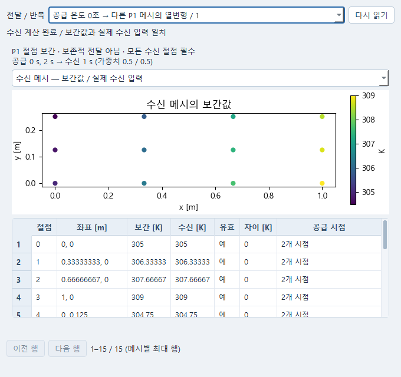

# S1 Windows 공간 PDE → 다른 P1 메시 온도 → 열구조

## 먼저 사용해 보기

저장소의 `Install-CAE-Lab.cmd`로 설치한 뒤 시작 메뉴에서 **방정식** 또는
**해석 모델**을 엽니다. 기존 설치도 설치 파일을 다시 실행하면 필요한 무료
scikit-fem 패키지를 추가합니다. WSL·FreeCAD·AI 연결은 필요하지 않습니다.

- 방정식: **새 모델… → Windows 공간 약형식**을 선택하고 장·영역·경계 조건을
  편집합니다. **입력 검사 → 변경 적용 → 모델 평가**로 계산하고 오른쪽에서 결과를 봅니다.
- 해석 모델: **새 해석 모델… → 정상 열전도 (scikit-fem)** 또는
  **평면응력 열탄성 (scikit-fem)**으로 시작합니다. 열전도는 온도와 열전도율,
  열탄성은 탄성계수·열팽창계수·무응력 온도와 온도 입력을 설정합니다.
- 여러 계산 연결: **계산 절차**에서 저장한 공급·수신 모델을 선택하고 연결 방식을
  **P1 온도 보간**으로 정합니다. 공급 시각·수신 시각과 절대온도/온도차를 확인한 뒤
  실행합니다. 완료 후 **전달값 보기**에서 공급과 수신 절점을 바꾸어 값을 비교합니다.
  결과의 **Post에서 열기**에는 별도로 연결한 ParaView가 필요합니다.




위 화면은 실제 Windows Qt 창입니다. 전달 화면의 표와 그래프는 아래 공개 Affine
계산의 저장 결과를 읽은 것이며, 화면을 여는 동작으로 계산을 다시 실행하지 않습니다.
계산 방법이나 물리량을 바꿔도 입력을 자동 변환하지 않습니다. 오류가 있으면 입력을
고쳐 다시 검사하고, 새 계산을 명시적으로 시작합니다. 이전 계산은 보존됩니다.

직접 연결을 만들기 전에 공개 예제부터 실행하려면 저장소 폴더의 PowerShell에서
다음을 실행합니다. `열전달 예제`는 기존 자료와 겹치지 않는 새 폴더여야 합니다.

```powershell
$caePython = Join-Path $env:LOCALAPPDATA 'AutonomousCAELab\windows-runtime\venv\Scripts\python.exe'
& $caePython -m examples.s1_windows_transfer --workspace '열전달 예제' --case affine
.\Start-CAE-Lab.cmd -Tool evaluation -Store '.\열전달 예제' -Port 8777
```

**계산 절차 열기…**에서 예제의 저장 계산 절차를 선택하고 기존 계산 결과와 전달값을 확인합니다.
위 명령은 기본 연구 폴더와 다른 예제 폴더를 열므로 별도 포트를 사용합니다.
예제 명령은 공급 열 계산 두 번과 수신 구조 계산 한 번을 실제로 실행한 뒤,
별도 프로세스에서 다시 읽습니다. 두 정상 온도장의 보간 예제이며 과도 열해석은 아닙니다.

통합 후 별도로 수행한 실제 계산·저장 재열기·Windows Qt 확인은 [Windows 수용 기록](WINDOWS_ACCEPTANCE_KO.md)을 참고한다. 아래 Pro 작성 당시의 미실행·제한 기록은 보존한다.

요청 `PRO-PDE-P1-WINDOWS-TRANSFER-S1-20261015-01`. 작성 기준은 공개 Git
`67a861e17415f19cc42838f82685f4f48c041ef5`, fixture pin은
`3e48bf6138f495299f45b1af254bfb4aaff307b8`이다.

## 인도 판정

**구현 소스 인도이며, S1 전체 수용 완료가 아니다.** 이 작성 환경은 Linux/Python 3.13.5다.
scikit-fem 및 PySide6 설치본이 없고, pip DNS와 공식 wheel 다운로드가 실패했다.
실제 worker와 공개 예제는 실행했지만 의존성 오류로 실패했다. 해당 실패와 cleanup,
실패한 saved owner를 새 프로세스에서 계산 0회로 읽은 관측을 보존했다.
실제 FE 조립·열/열구조 정답 검증, Windows, Qt 렌더, ParaView, MCP SDK/stdio는 NOT_RUN이다.
수치 시험 대역을 실제 FE 실행 증거로 바꾸지 않는다. 판정은 ACCEPTANCE_RESULTS.md를 따른다.

## 사용자 경로

기존 독립 Qt PDE와 Simulation에서 모델을 만들고, 기존 Evaluation에 저장된 모델을
선택한다. 전송 연결을 `P1 온도 보간`으로 바꾸고 공급 snapshot/시각 대응/수신 시각/온도
의미를 지정한다. Check는 solver import·실행 없이 입력을 검사한다. 명시 Run만 새 job을
만든다. `전달값 보기`에서 원 snapshot과 수신값을 별도로 선택한다. 구조 결과의 실제
변위/응력을 기존 결과 선택기와 Post로 보낸다. 저장 이후 동일 owner를 다시 열어 읽는다.
새 웹 제품 화면, CAD, AI, WSL, 유료 서비스는 필요하지 않다. 기존 localhost HTTP는
독립 Qt와 같은 owner를 연결하는 전송 계층이며 새 UI/solver/server 구현이 아니다.

새 capability는 다음과 같이 기존 backend registry에 별도로 등록한다.

| ID | 실제 코드 경로의 물리 |
|---|---|
| `pde.scikit_fem.dimensioned` | 기존 dimensioned scalar P1 체적 약형식 AST → scikit-fem 조립 |
| `thermal.scikit_fem.rectangle` | SI 정상 열전도, 상수 또는 기존 lagged Picard 열전도율 |
| `structural.scikit_fem.thermoelastic_rectangle` | SI 미소변형 등방 평면응력 열탄성 |

기존 `pde.fenicsx.*`, `thermal.fenicsx.*` 경로 및 Windows guard는 유지한다.
새 backend identity와 버전은 입력·실행·원결과에 남는다. 라이브러리를 찾지 못하면 FAILED이며
FEniCSx, ODE, lookup 또는 fixture 계산으로 대체하지 않는다.

## Windows 설치와 작은 실행

아래는 **Windows 실행 명령이며 여기서 실행한 기록이 아니다**. root가 제품 패치를
병합한 저장소 루트에서 실행한다. Python 3.12 x64를 명시한다. 기존 다른 팀 환경을
업그레이드하지 말고 별도 가상환경을 사용한다. 설치 비용은 없으며 인터넷 접속은 필요하다.

```powershell
py -3.12 -m venv .venv-s1
.\.venv-s1\Scripts\python -m pip install -e ".[spatial,research-ui]"
.\.venv-s1\Scripts\python -m pip install pytest==8.4.2
.\.venv-s1\Scripts\python -c "import skfem,numpy,scipy; print(skfem.__version__,numpy.__version__,scipy.__version__)"
.\.venv-s1\Scripts\python -m examples.s1_windows_transfer --workspace "S1 결과\uniform" --case uniform
.\.venv-s1\Scripts\python -m examples.s1_windows_transfer --workspace "S1 결과\affine" --case affine
.\.venv-s1\Scripts\python -m pytest -q tests/test_s1_installed_spatial.py -rs --tb=short
```

`uniform`은 공급 2×2 셀/9절점/8삼각형과 수신 3×2 셀/12절점/12삼각형이다.
공급에 내부 자유도 1개를 남겨 경계값만 채우는 예제가 아닌 실제 sparse solve를 요구한다.
323.15 K, Tref=293.15 K, α=23e-6/K에서 기대 변위는 `α·30·(x,y)`이고
x=1m에서 0.00069m이다. 이는 독립 검사식이지 코드가 반환하는 대체 정답이 아니다.

`affine`은 공급 0초 2×2 셀과 2초 4×2 셀의 **서로 다른** 메시, 수신 1초 3×2 셀이다.
각 공급의 실제 정상 계산 후 `T=300+4x−2y+5t K`의 두 snapshot을 0.5/0.5로 전달한다.
수신 독립 검사식은 `305+4x−2y K`다. 이는 두 정상 상태의 명시적 대응이지 새 과도 열 solver가
아니다. 비균일 온도에는 기존 uniform free-expansion benchmark를 명시적으로 미적용한다.
잔차 검사는 그대로 적용하며, 미적용을 그 benchmark PASS로 표시하지 않는다.

예제 종료 코드는 성공 0, 보존된 실행 실패 2다. 설치 실패에도 job 및 원 stderr를 남긴다.
성공/실패 경로 모두 원 service/owner를 닫은 뒤 별도 Python 프로세스로 재열기를 수행한다.
재열기 프로세스에서 backend/evaluator/mapping 호출과 FE 라이브러리 import를 금지한다.
사용자가 지정하는 `--deadline-seconds`를 넘으면 소유 job에 취소를 요청하고 finally로 정리한다.
원 예제 기록 경로로 `--reopen <s1-...json>`을 실행하면 재계산 없이 동일 검사만 한다.

## 기존 Qt 작업 화면

```powershell
.\.venv-s1\Scripts\caelab serve --store "S1 결과\편집" --port 8766
# 다른 터미널에서 선택한 도구 하나를 연다.
.\.venv-s1\Scripts\python -m apps.research.pde_window --service http://127.0.0.1:8766
.\.venv-s1\Scripts\python -m apps.research.simulation_window --service http://127.0.0.1:8766
.\.venv-s1\Scripts\python -m apps.research.evaluation_window --service http://127.0.0.1:8766
```

기존 새 모델 선택기에서 Windows capability를 고른다. PDE의 식/계수/영역/공간/경계 조건은
기존 선언 편집기를 사용한다. 지원 공간은 P1뿐이며 다른 차수 입력은 Check 오류다.
Simulation에서는 경계 절대 온도, K/m 기울기, 열원, k, 메시, 구조 E/ν/α/Tref를 편집한다.
Evaluation은 저장된 각 원문서 revision을 참조한다. 원문서를 바꾼 뒤에는 기존 source refresh
동작으로 새 revision을 명시 선택해야 한다. 이전 frozen run의 입력은 변경하지 않는다.

전달 설정에서 exact/linear/steady_relabel 중 하나를 선택한다. 마지막 정책은 동일 물리적
정상 상태라는 사용자의 서술 선언이 없으면 실패한다. 수신 clock은 수신 모델 원 clock과
일치해야 하며, 정책만 바꿔 수신 모델 시간을 숨겨 수정하지 않는다. 이 첫 구조 capability는
전체 수신 절점의 온도가 필요하므로 필수 영역을 선택적으로 해제할 수 없다.

전달값 창은 수신 행과 각 공급 snapshot을 별도로 표시한다. 절점 수, 순서, ID가 서로
다르므로 같은 행 번호를 같은 물리점으로 표시하지 않는다. 원값·mapped·received·좌표·mask·
단위·clock·source refs·실제 삼각형 가중치를 확인한다. 구조 응력은 DG0 cell-average Pa,
변위는 nodal m이며 응력을 nodal 값으로 바꿔 표시하지 않는다.

## 지원 경계와 후속

첫 공간은 metre/global-Cartesian 직사각형의 완전한 P1 삼각형 메시다. 원 node labels 및
cell/node 순서 변경은 허용하지만 source hole, 중복/퇴화/잘못된 연결은 차단한다.
임의 CAD/곡면/3D/벡터 전달/보존적 전달/외삽은 이번 첫 capability의 범위가 아니다.
이를 더 넓은 원 B6 개발 범위의 종결로 표시하지 않는다.

구조는 일정 E/ν/α, traction-free 외곽과 기존 origin ux/uy·lower-right uy anchors다.
초기응력, 임의 구조 BC, plane strain, finite strain, 두께 방향 온도 구배는 구현했다고
주장하지 않는다. 기존 일반 차원식 AST의 허용식과 경계는 weak capability에서 수정할 수 있다.

S2의 공유 설계변수 MDO와 첫 실제 adjoint는 이번에 구현하지 않았다. 확정 경계는
API_CONTRACT.md에 남기며 기존 DefinitionFactory/optimizer/Picard/lag를 사용해야 한다.
미래용 framework/optimizer/adjoint placeholder를 선제 추가하지 않았다. S1 인도도 전체 B6,
MDO, engineering qualification 완료가 아니다. 모든 물리 qualification은 UNKNOWN이다.
