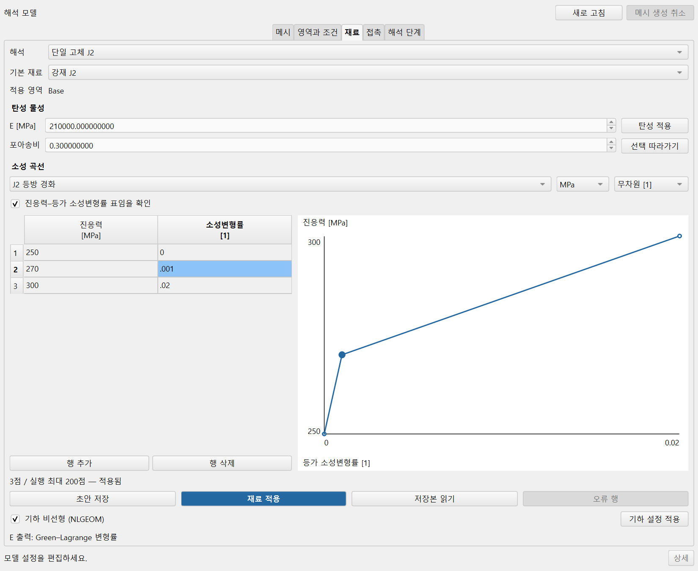
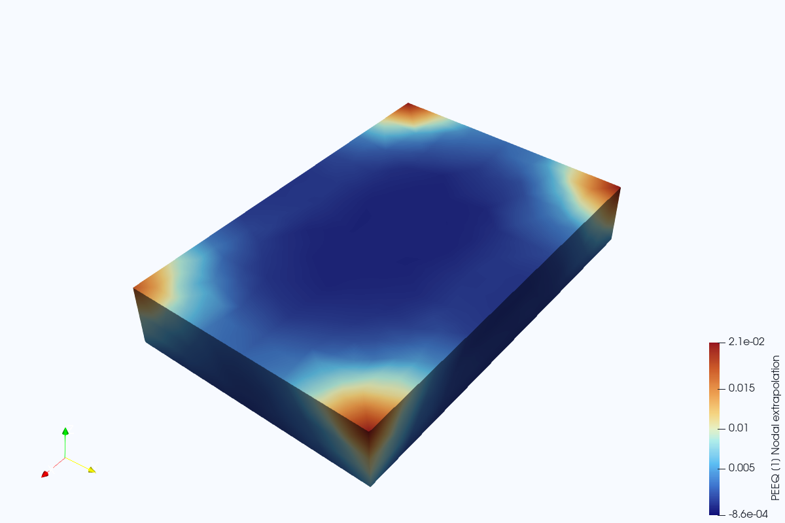

# 고체 소성 해석 예제

`block-j2.FCStd`는 바로 열어 편집할 수 있는 FreeCAD 모델입니다. 30×20×5 mm
직육면체와 메시, 고정면, 하중면, 탄성·소성 재료가 들어 있습니다.
모델링이나 메시 생성부터 시작하지 않고 재료 표와 해석 설정을 살펴볼 수 있습니다.

이 예제와 소성 해석 기능은 저장소 `main`에 포함되어 있습니다. 기존 설치를 사용한다면
저장소를 갱신한 뒤 실행하세요. 재료 변경 감지와 실패한 계산의 부분 결과 복구도
반영했습니다. 전체 지원 범위는 [현재 상태](../../../CURRENT_STATE.md)를 따릅니다.

## 열고 편집하기

Windows 설치를 마친 뒤 이 폴더의 **Open-Example.cmd**를 더블클릭합니다.
처음 실행할 때 FreeCAD 위치를 물으면 설치된 `FreeCAD.exe`를 선택하세요.
매번 새 작업 폴더를 만들므로 이전에 저장한 작업은 유지됩니다. 이전 작업을 이어가려면
그때 저장한 전처리 문서를 여세요. 이 실행 파일은 공개 예제를 새로 여는 용도입니다.

저장소 폴더의 PowerShell에서도 같은 예제를 열 수 있습니다.
실행 파일 선택 대신 경로를 지정하려면 `-FreeCADExe`를 사용하세요.

```powershell
.\scripts\start_cae_pre.ps1 -Source .\examples\material-tests\ns1\block-j2.FCStd
```

1. 해석 모델 창의 **재료** 탭을 열고 기본 재료를 선택합니다.
2. **저장본 읽기**로 저장한 표를 확인합니다. 응력은 MPa, 소성변형률은 무차원입니다.
3. 값을 바꾸고 **재료 적용**을 누릅니다. 계산에는 적용한 값이 사용됩니다.
4. 문서를 다른 이름으로 저장합니다. 다시 열어 같은 표와 조건으로 이어갈 수 있습니다.



FreeCAD에서 예제 모델을 읽어 표시한 재료 편집 패널입니다. 표의 행을 선택하면
곡선의 같은 점이 강조됩니다. 작은 창에서는 필요한 탭을 스크롤해 조작할 수 있습니다.

잘못 입력한 표도 **초안 저장**으로 남겨 둘 수 있습니다. 오류 행을 고치기 전에는
계산할 수 없습니다. 고정·하중의 면 확인을 요구하면 **영역과 조건**에서 해당 조건을
선택하고 면을 다시 지정하세요. 형상을 바꾸면 메시도 다시 만들어야 합니다.

입력 준비와 실행, 결과 열기는 [소성 해석 사용법](../../../docs/NS1_USER_MODEL_KO.md)을
따릅니다. 입력 준비만으로 계산이 시작되지는 않습니다.

## 들어 있는 값과 확인한 결과

| 설정 | 값 |
|---|---|
| 요소 | C3D10, 532개 |
| 탄성 | 탄성계수 210,000 MPa, 포아송비 0.3 |
| 소성 표 | (250 MPa, 0), (270 MPa, 0.001), (300 MPa, 0.02) |
| 경계 조건 | Face5 고정, Face6에 180,000 N의 native 하중 |
| 해석 | 정적 J2 등방 경화, 기하 비선형 켜짐 |

2026-10-14 Windows의 FreeCAD 1.1.4에서 이 모델의 입력을 만들고 CalculiX 2.22로
계산했습니다. 10개 수렴 증분의 변위·응력·변형률·등가 소성변형률을 읽었으며,
ParaView 6.2에서 소성변형률을 선택하고 저장한 후처리 프로젝트를 다시 열었습니다.
솔버는 기존 어댑터로 실행했고 후처리는 pvpython으로 확인했습니다. Runner 화면의
버튼부터 끝까지 조작한 인수 시험이나 이 하중에 대한 공학적 적합성 판정은 아닙니다.



그림은 실제 계산값을 ParaView로 그린 것입니다. 가짜 계산이나 제품 창 전체의 캡처가
아닙니다. PEEQ는 절점으로 외삽·평균된 무차원 값입니다. 이 결과에는 음수 절점값도
있으며 원출력을 보존했습니다. 적분점의 값이나 음수가 없는 값으로 바꾸어 표시하지 않습니다.

후처리 문서에서 **필드 정보 읽기**를 누르면 물리량과 단위, 출력 위치를 확인할 수
있습니다. `PEEQ_1` 행을 선택하면 등가 소성변형률이라는 뜻과 절점 외삽·평균 여부가
아래에 표시됩니다. 위·아래 방향키로 다른 행을 선택할 수 있고, 자동 새로고침에도
선택은 유지됩니다. 실제 색상 분포와 시각은 **ParaView에서 보기**로 열어 선택합니다.

예제는 저장소의 공개 직육면체와 기존 메시에서 만들었습니다. 회사 자료나 유료 솔버,
WSL, AI 연결이 필요하지 않습니다. 실제 사용 재료를 대표하는 인증된 물성표는 아닙니다.

## 함께 있는 입력 자료

`j2_example.tsv`는 표에 붙여넣을 합성 물성 입력입니다. 첫 열은 진응력 MPa,
둘째 열은 등가 소성변형률이며 머리글 없이 복사합니다. 공칭응력이나 전체변형률을
변환하는 자료로 사용하지 마세요.

`create_single_solid.py`는 별도의 10×10×20 mm Box만 만드는 스크립트입니다.
FreeCADCmd.exe로 실행하거나 FreeCAD Python 콘솔에서 `create(output_path)`를
호출합니다. 기존 파일을 덮어쓰지 않으며 메시·재료·하중을 만들지는 않습니다.
Pro의 원격 작성 환경에서는 실행하지 않았고, 위에 확인한 계산은 `block-j2.FCStd`의 결과입니다.

두 물체 접촉 예제는 `examples/contact/two-feet.FCStd`에 있습니다. 형상을 바꾸면
예전 Face 번호를 그대로 사용하지 말고 현재 면을 다시 선택하세요. 제품의 실행 경로는
예제 파일명이나 치수에 따라 달라지지 않습니다.
